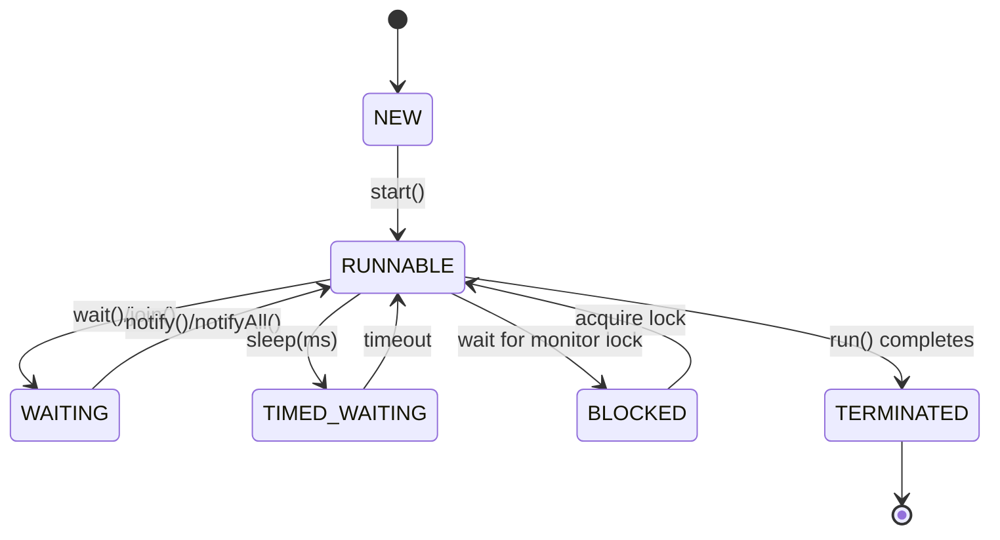

# MODULE 1 — SUPPLEMENTARY REFERENCE

This document provides detailed explanations for all topics referenced in Module 1 practice exercises and assessments that need deeper coverage.

---

## 1. PROGRAM EXECUTION: COMPLETE STEP-BY-STEP WALKTHROUGH

When a user types `java HelloWorld` and presses Enter, the following deeply complex execution process unfolds:

1. **OS Level**: The OS locates the `java` binary (from PATH), and creates a new process to run the Java launcher.
2. **Native Launcher (`java.c`)**: The C-level launcher parses command-line arguments (e.g., `-Xmx`, `-cp`, and the main class name).
3. **JVM Creation**: `JNI_CreateJavaVM()` is called via the Java Native Interface. This allocates memory areas (Heap, Metaspace, Stacks), initializes Garbage Collection (GC), and creates the main thread.
4. **Bootstrap Class Loading**: The Bootstrap ClassLoader (implemented in native code) loads core classes like `java.lang.Object`, `java.lang.String`, `java.lang.System`, and `java.lang.Class` from core modules (`rt.jar` in pre-Java 9, or `java.base` module).
5. **Main Class Loading**: The Application ClassLoader loads `HelloWorld.class` using the parent-first delegation model (checking if platform or bootstrap loaders already loaded it).
6. **Bytecode Verification**: The Class Verifier checks for type safety, stack consistency, and valid branch targets to ensure the bytecode won't compromise the JVM.
7. **Class Preparation**: Static fields are allocated in memory and initialized with default values (e.g., `0` for ints, `null` for references). Method tables (vtable/itable) are constructed.
8. **Class Resolution**: Symbolic references in the class's constant pool (like `"java/lang/System"`) are resolved to direct memory references.
9. **Class Initialization**: The `<clinit>` (static initializer) block runs if present, assigning actual initial values to static fields.
10. **Main Method Lookup**: The JVM searches the resolved class for the exact method signature: `public static void main(String[])`.
11. **Stack Frame Creation**: A new stack frame is created for `main` on the main thread's JVM stack. This frame includes a local variable array (slot 0 = `args`), an empty operand stack, and frame data.
12. **Bytecode Interpretation**: The JVM's template interpreter begins executing the bytecode instructions of `main` sequentially.
13. **Method Invocation**: When `System.out.println("Hello")` is executed:
    - `getstatic` loads the `System.out` reference (a `PrintStream` object) onto the operand stack.
    - `ldc` loads the String constant `"Hello"` from the constant pool onto the operand stack.
    - `invokevirtual` dispatches the `println` method. A new stack frame is created for `println`.
14. **I/O Operation**: The `PrintStream` eventually calls native methods to write the character data to the OS's stdout stream.
15. **Return**: The `println` frame is popped from the JVM stack. Control returns to `main`. The `return` instruction pops the main frame.
16. **JVM Shutdown**: With no non-daemon threads left, `DestroyJavaVM()` is called. GC finalizers are run, native OS resources are released, and the OS process exits cleanly.

### Execution Timeline Diagram

```text
OS Process Start -> JVM Init -> Class Loading -> Execution -> Output -> Shutdown
+---------------+  +--------------+  +------------------+  +-------------+
| OS Context    |  | Heap/Metaspace| | JVM Stack (Main) |  | Native OS   |
| $ java Hello  |->| [System]     |  |                  |  | stdout      |
+---------------+  | [String]     |  +------------------+  +-------------+
                   | [HelloWorld] |  | Frame: main()    |
                   +--------------+  | - LocalVars: args|
                                     | - OpStack:       |
                                     | [System.out]     |
                                     | ["Hello"]        |
                                     |                  |
                                     | Frame: println() |-> Hello\n
                                     | - LocalVars: ... |
                                     +------------------+
```

---

## 2. STACK FRAMES — COMPLETE DEEP DIVE

> [!IMPORTANT]
> A stack frame is the fundamental unit of method execution in the JVM. It holds all the state necessary for a single method invocation.

### What is a Stack Frame?
- Created for every method invocation and destroyed upon method return (normal or exceptional).
- Lives on the thread's JVM stack. Every thread has its own private stack.
- The size of a frame is FIXED at compile time. `javac` calculates the maximum local variables and maximum stack depth required and bakes this into the `.class` file.

### Stack Frame Components

#### a) Local Variable Array
- An indexed array of 32-bit (4-byte) slots.
- **Slot 0**: Holds the `this` reference for instance methods, or the first parameter for static methods.
- Parameters occupy the initial slots, followed by method local variables.
- `long` and `double` values occupy TWO consecutive slots due to being 64-bit.

**Slot Mapping Example**:
```java
public static void main(String[] args) { 
    int x = 42; 
    double y = 3.14; 
    String s = "hello"; 
}
```
| Slot Index | Content | Type |
| :--- | :--- | :--- |
| 0 | `args` | Reference |
| 1 | `x` | int |
| 2 | `y` (part 1) | double |
| 3 | `y` (part 2) | double |
| 4 | `s` | Reference |

#### b) Operand Stack
- A Last-In-First-Out (LIFO) stack used as a workspace for bytecode instructions.
- All arithmetic and method invocations occur by pushing operands onto this stack, executing the instruction, and pushing the result back.
- Maximum depth is computed at compile time by `javac`.

**Operand Stack Step-by-Step (`int result = 3 + 4 * 5;`)**:
```text
Instruction     Operand Stack State
-----------------------------------
iconst_3        [3]
iconst_4        [3, 4]
iconst_5        [3, 4, 5]
imul            [3, 20]     // pops 4, 5; pushes 20
iadd            [23]        // pops 3, 20; pushes 23
istore_1        []          // pops 23 and stores in local slot 1
```

#### c) Frame Data
- **Return Address**: Where to resume execution in the calling method's bytecode.
- **Constant Pool Reference**: A pointer to the constant pool of the class for resolving symbols.
- **Exception Table Reference**: Mapping of program counters to catch blocks.

### Thread Stack Configuration
- Default stack size typically ranges from 512KB to 1MB, depending on the OS and architecture.
- Configurable via the `-Xss` flag: `java -Xss2m HelloWorld`
- Exhausting the stack (e.g., via infinite recursion) results in a `StackOverflowError`.
- **Calculation**: If default size is 512KB and an average frame is 100 bytes, max depth is ~5000 frames.

---

## 3. BYTECODE INSTRUCTIONS — COMPREHENSIVE REFERENCE

### a) Constant Loading Instructions
- `iconst_0` through `iconst_5`: Push int constants 0 to 5.
- `iconst_m1`: Push -1.
- `lconst_0`, `lconst_1`: Push long 0, 1.
- `fconst_0`, `fconst_1`, `fconst_2`: Push float constants.
- `dconst_0`, `dconst_1`: Push double constants.
- `bipush <byte>`: Push byte value (-128 to 127).
- `sipush <short>`: Push short value (-32768 to 32767).
- `ldc <index>`: Push item from constant pool (int, float, String, Class).
- `ldc2_w <index>`: Push long or double from constant pool.
- `aconst_null`: Push null reference.

### b) Local Variable Instructions
- `iload`, `iload_0` to `iload_3`: Load int from local variable to operand stack.
- `lload`, `fload`, `dload`, `aload`: Load long/float/double/reference.
- `istore`, `istore_0` to `istore_3`: Pop int from operand stack and store in local variable.
- `lstore`, `fstore`, `dstore`, `astore`: Store long/float/double/reference.

### c) Arithmetic Instructions
- `iadd`, `isub`, `imul`, `idiv`, `irem`: Int arithmetic.
- `ladd`, `lsub`, `lmul`, `ldiv`, `lrem`: Long arithmetic.
- `fadd`, `fsub`, `fmul`, `fdiv`, `frem`: Float arithmetic.
- `dadd`, `dsub`, `dmul`, `ddiv`, `drem`: Double arithmetic.
- `ineg`, `lneg`, `fneg`, `dneg`: Negation.

### d) Type Conversion Instructions
- **Widening**: `i2l`, `i2f`, `i2d`, `l2f`, `l2d`, `f2d`
- **Narrowing**: `i2b`, `i2c`, `i2s`, `l2i`, `f2i`, `d2i`, `d2f`, `f2l`, `d2l`

### e) Branching / Control Flow Instructions
- `ifeq`, `ifne`, `iflt`, `ifge`, `ifgt`, `ifle`: Compare int on stack with zero and branch.
- `if_icmpeq`, `if_icmpne`, `if_icmplt`, etc.: Compare top two ints and branch.
- `goto`: Unconditional jump.
- `tableswitch`, `lookupswitch`: Switch statement implementations.

### f) Object and Method Instructions
- `new`: Allocate new object on heap.
- `invokespecial`: Call constructor, superclass method, or private method (static binding).
- `invokevirtual`: Call instance methods (dynamic binding / virtual dispatch).
- `invokestatic`: Call static methods.
- `invokeinterface`: Call interface methods.
- `invokedynamic`: Call dynamically resolved methods (lambdas, string concatenations).
- `getfield`, `putfield`: Read/write instance fields.
- `getstatic`, `putstatic`: Read/write static fields.

### g) Array Instructions
- `newarray`: Create primitive array.
- `anewarray`: Create reference array.
- `iaload`, `iastore`: Load/store int array element.
- `aaload`, `aastore`: Load/store reference array element.
- `arraylength`: Get array length.

### h) Stack Manipulation
- `dup`: Duplicate top of stack.
- `pop`: Discard top of stack.
- `swap`: Swap top two values.

---
### BYTECODE SCENARIOS

**Scenario: For Loop**
```java
int sum = 0;
for (int i = 0; i < 10; i++) {
    sum += i;
}
```
**Bytecode & State Trace**:
```text
Opcode          Operand Stack   Local Vars       Notes
0: iconst_0     [0]             []               push 0
1: istore_1     []              [-, 0]           sum = 0 (slot 1)
2: iconst_0     [0]             [-, 0]           push 0
3: istore_2     []              [-, 0, 0]        i = 0 (slot 2)
4: iload_2      [0]             [-, 0, 0]        load i
5: bipush 10    [0, 10]         [-, 0, 0]        push 10
7: if_icmpge 20 []              [-, 0, 0]        if i >= 10, jump to exit (offset 20)
10: iload_1     [0]             [-, 0, 0]        load sum
11: iload_2     [0, 0]          [-, 0, 0]        load i
12: iadd        [0]             [-, 0, 0]        sum + i
13: istore_1    []              [-, 0, 0]        sum = result (slot 1)
14: iinc 2, 1   []              [-, 0, 1]        increment slot 2 (i) by 1
17: goto 4      []              [-, 0, 1]        loop back to condition
20: return      []              ...              loop exit
```

**Scenario: If-Else**
```java
if (x > 5) { y = 1; } else { y = 2; }
```
```text
Opcode          Operand Stack
0: iload_1      [x]
1: iconst_5     [x, 5]
2: if_icmple 11 []          // if x <= 5, jump to else
5: iconst_1     [1]
6: istore_2     []          // y = 1
7: goto 13      []          // jump over else
11: iconst_2    [2]
12: istore_2    []          // y = 2
13: ...
```

**Scenario: Method Call**
```java
int res = Math.max(a, b);
```
```text
Opcode                   Operand Stack
0: iload_1               [a]
1: iload_2               [a, b]
2: invokestatic Math.max [result]
5: istore_3              []
```

---

## 4. JVM EXECUTION ENGINE — DETAILED

### Template Interpreter
- Reads one bytecode instruction at a time.
- Maps opcodes to hand-coded assembly language templates tailored to the CPU.
- Uses a Program Counter (PC) register to point to the current instruction.
- **Advantage**: Fast startup (no compilation delay).
- **Disadvantage**: Slower execution overall.

### JIT Compilation — Tiered Compilation
The JVM profiles code as it runs and selectively compiles hot spots into native machine code.
- **Tier 0**: Interpreter (no compilation, just basic profiling).
- **Tier 1**: C1 compiler with full optimization (client compiler).
- **Tier 2**: C1 with limited optimization (invocation counters only).
- **Tier 3**: C1 with full profiling (collects branch probabilities and type profiles).
- **Tier 4**: C2 compiler (server compiler) — aggressive, profile-guided optimization.

### Invocation Counter & Back-Edge Counter
- **Invocation Counter**: Tracks method calls.
- **Back-Edge Counter**: Tracks loop iterations (jumping backwards in bytecode).
- When combined thresholds reach a limit (e.g., ~10,000 for server VMs), the method is queued for JIT compilation.
- Configurable via `-XX:CompileThreshold`.

### On-Stack Replacement (OSR)
- Solves the problem of a long-running loop getting "stuck" in the interpreter.
- OSR allows the JVM to replace the interpreter frame with a newly JIT-compiled frame *while the loop is still executing*.
- Indicated by a `%` symbol in `-XX:+PrintCompilation` logs.

### JIT Optimizations
- **Inlining**: Replacing a method call with the body of the called method (reduces call overhead).
- **Dead Code Elimination**: Removing code that has no effect.
- **Constant Folding**: Computing constants at compile time.
- **Loop Unrolling**: Expanding loop bodies to reduce condition checking overhead.
- **Escape Analysis**: Determining if an object's reference escapes a method. If not, optimizations apply:
  - **Scalar Replacement**: Allocating object fields directly on the stack/registers instead of the heap.
  - **Lock Elision**: Removing unnecessary synchronized blocks on local objects.
- **Null / Range Check Elimination**: Skipping redundant bounds/null checks in loops.

### `-XX:+PrintCompilation` Output Format
```text
timestamp compile_id attributes tier method_name size deopt_type
     54       23       %        3   java.lang.String::hashCode (55 bytes)
```
- `timestamp`: Milliseconds since JVM start.
- `compile_id`: Unique ID for the compilation task.
- `attributes`: `%` (OSR), `s` (synchronized), `!` (has exception handlers).
- `tier`: Which compiler tier (1-4).
- `method_name`: Class::method.
- `size`: Bytecode size.

---

## 5. CLASS LOADING — COMPLETE DEEP DIVE

> [!NOTE]
> Class loading is dynamic; classes are loaded only when first referenced.

### Class Loader Hierarchy
```text
Bootstrap ClassLoader (C++ Native, loads java.base)
         ^
         | delegates to
Platform ClassLoader (Java, loads java.sql, etc.)
         ^
         | delegates to
Application ClassLoader (Java, loads classpath classes)
         ^
         | delegates to
Custom ClassLoaders (Java, loads dynamic/network classes)
```

### Parent-First Delegation Model
1. Application ClassLoader receives a request.
2. It delegates to the Platform ClassLoader.
3. Platform delegates to Bootstrap ClassLoader.
4. Bootstrap tries to find the class. If found, returns it.
5. If not, Platform tries. If found, returns it.
6. If not, Application tries to load it from the classpath.

### Class Loading Phases
1. **Loading**: Read `.class` bytes, create a `java.lang.Class` object representing it in Metaspace.
2. **Linking**:
   - **Verification**: Bytecode safety checks (structure, type safety).
   - **Preparation**: Allocate memory for static fields; assign default values (e.g., `0`, `null`).
   - **Resolution**: Convert symbolic references in the constant pool to direct memory references.
3. **Initialization**: Execute the `<clinit>` method, which contains static initializers and static field assignments in their textual order.

### Custom ClassLoader Example
```java
public class MyClassLoader extends ClassLoader {
    @Override
    protected Class<?> findClass(String name) throws ClassNotFoundException {
        // 1. loadClassBytes reads the binary .class file from a source (network/disk)
        byte[] classBytes = loadClassBytes(name); 
        
        // 2. defineClass parses the byte array and registers it with the JVM
        return defineClass(name, classBytes, 0, classBytes.length);
    }
    
    private byte[] loadClassBytes(String name) {
        // Implementation omitted: read bytes from custom source
        return new byte[0];
    }
}
```

---

## 6. ProcessBuilder — COMPLETE GUIDE

### What is ProcessBuilder?
- A utility class in `java.lang` to create and interact with OS-level processes.
- Useful for executing shell commands, interacting with git, or invoking `javac`/`javap`.

### API Reference
```java
// 1. Configure the process
ProcessBuilder pb = new ProcessBuilder("javap", "-c", "HelloWorld");
pb.directory(new File("/path/to/classes")); // Set working directory
pb.redirectErrorStream(true);               // Merge stderr into stdout

// 2. Start the process
Process process = pb.start();

// 3. Read output asynchronously (prevent blocking)
BufferedReader reader = new BufferedReader(new InputStreamReader(process.getInputStream()));
String line;
while ((line = reader.readLine()) != null) {
    System.out.println(line);
}

// 4. Wait for completion and get exit code
int exitCode = process.waitFor();
System.out.println("Exited with: " + exitCode);
```

### Key Methods
- `command(List<String>)`: Sets the executable and arguments.
- `directory(File)`: Sets the current working directory.
- `environment()`: Returns a modifiable Map of environment variables.
- `redirectErrorStream(true)`: Pipes stderr directly into stdout.
- `start()`: Spawns the OS process.
- `waitFor()`: Blocks the current thread until the child process terminates.
- `exitValue()`: Returns exit code (throws exception if process is still running).
- `destroyForcibly()`: Force kills the process.

---

## 7. REFLECTION API — BASICS

> [!WARNING]
> Reflection breaks encapsulation and bypasses compile-time safety. It is also significantly slower than direct execution. Use sparingly.

### What is Reflection?
- The ability to inspect and manipulate classes, methods, fields, and constructors dynamically at **runtime**.
- Lives in `java.lang.reflect`.

### Core Operations

**Getting a Class Object (3 ways)**:
```java
Class<?> c1 = String.class;                    // Compile-time literal
Class<?> c2 = "hello".getClass();              // Runtime instance
Class<?> c3 = Class.forName("java.lang.String"); // Dynamic loading by FQCN
```

**Inspecting Methods**:
```java
Method[] methods = c1.getDeclaredMethods();
for (Method m : methods) {
    System.out.println(m.getName() + " returns " + m.getReturnType());
}
```

**Invoking Methods Dynamically**:
```java
Method mainMethod = clazz.getMethod("main", String[].class);
// Invoke static method (null instance object)
mainMethod.invoke(null, (Object) new String[]{"arg1", "arg2"}); 
```

**Inspecting and Modifying Fields**:
```java
Field field = clazz.getDeclaredField("privateSecretField");
field.setAccessible(true); // Bypass Java access control!
String secret = (String) field.get(obj); // Read
field.set(obj, "newSecret");             // Write
```

### Performance & Security
- 10-100x slower due to boxing, access checks, and preventing JIT optimizations (like inlining).
- Module system (JPMS) restricts deep reflection by default unless the module explicitly `opens` the package.

---

## 8. JAVA THREADS — INTRODUCTION

### What is a Thread?
- A lightweight unit of execution within an OS process.
- Each thread possesses its own PC Register, JVM Stack (frames), and Native Method Stack.
- All threads share the Heap and Metaspace.

### Creating Threads

**Way 1: Extend `Thread`**
```java
class MyThread extends Thread {
    @Override
    public void run() {
        System.out.println("Running in: " + Thread.currentThread().getName());
    }
}
new MyThread().start();
```

**Way 2: Implement `Runnable` (Preferred)**
```java
Runnable task = () -> System.out.println("Running in: " + Thread.currentThread().getName());
Thread t = new Thread(task);
t.start();
```

### `start()` vs `run()`
> [!CAUTION]
> Never call `run()` directly to start a thread!
- `start()`: Requests the OS to create a new native thread, which then invokes the `run()` method.
- `run()`: A normal method call executed synchronously on the *current* thread.

### Thread Lifecycle States



### Thread Safety Preview
- Local variables are inherently thread-safe because each thread has its own stack.
- Instance variables (on the heap) and static variables are shared. Concurrent mutation without synchronization leads to race conditions.

---

## 9. SYSTEM.NANOTIME() AND TIMING

### Measuring Elapsed Time
```java
long startTime = System.nanoTime();
// ... code under test ...
long endTime = System.nanoTime();

long elapsedNanos = endTime - startTime;
double elapsedMillis = elapsedNanos / 1_000_000.0;
System.out.printf("Elapsed: %.3f ms%n", elapsedMillis);
```

### Comparison
| Feature | `System.nanoTime()` | `System.currentTimeMillis()` |
| :--- | :--- | :--- |
| **Resolution** | Nanoseconds | Milliseconds |
| **Use case** | Measuring exact duration | Current wall clock time |
| **Monotonic** | Yes (never goes backward) | No (can jump if OS time syncs via NTP) |
| **Epoch** | Arbitrary starting point | Jan 1, 1970 UTC |

---

## 10. JAR FILES — CREATION AND EXECUTION

### What is a JAR?
- Java ARchive. A standard ZIP format containing `.class` files, metadata (`MANIFEST.MF`), and resources.

### Command Line Tools
```bash
# 1. Compile source files into an 'out' directory
javac -d out src/com/example/*.java

# 2. Create JAR and designate the Main Class
jar --create --file app.jar --main-class=com.example.Main -C out .

# 3. Execute the JAR
java -jar app.jar
```

### Alternative: Custom Manifest
```bash
echo "Main-Class: com.example.Main" > MANIFEST.MF
jar cfm app.jar MANIFEST.MF -C out .
```
- `c`: Create archive
- `f`: Specify file name
- `m`: Include custom manifest
- `v`: Verbose output

---

## 11. EXCEPTION HANDLING BASICS (Preview)

```java
try {
    int result = 10 / 0; 
} catch (ArithmeticException e) {
    System.out.println("Math Error: " + e.getMessage());
}
```

### Common Module 1 Exceptions:
- `ArithmeticException`: Integer division by zero.
- `ArrayIndexOutOfBoundsException`: Invalid array index access.
- `NullPointerException`: Dereferencing a `null` object reference.
- `ClassNotFoundException`: Thrown by dynamic class loading (`Class.forName`).
- `StackOverflowError`: Infinite recursion exhausting the JVM thread stack.

---

## 12. STRING EQUALITY — == vs .equals()

> [!IMPORTANT]
> Always use `.equals()` to compare String content in Java!

### Reference Equality (`==`)
- Checks if two variables point to the **exact same memory address**.
- `new String("hello") == new String("hello")` evaluates to `false`.

### Value Equality (`.equals()`)
- Checks if the character content is identical.
- `"hello".equals(new String("hello"))` evaluates to `true`.

### The String Pool
- String literals (e.g., `"hello"`) are interned automatically in a special JVM pool.
- `"hello" == "hello"` evaluates to `true` because the compiler reuses the same pool reference.
- Explicit `new String()` bypasses the pool and allocates a new object on the heap.

---

## 13. FOR LOOP SYNTAX AND BYTECODE

### Syntax & Flow
```java
for (initialization; condition; update) {
    body;
}
```
1. `initialization` (runs once)
2. `condition` (if false, loop terminates)
3. `body` executes
4. `update` executes, return to step 2.

*See Section 3 for the complete Bytecode trace of a for loop.*

---

## 14. JPMS / MODULES — QUICK REFERENCE

### module-info.java
Modules explicitly declare what they require and what packages they expose.
```java
module com.app.core {
    exports com.app.core.api;     // Make api package accessible to other modules
    requires java.logging;        // Dependency on standard logging module
}

module com.app.ui {
    requires com.app.core;        // Dependency on core module
}
```

### Compilation & Execution
```bash
# Compile multiple modules
javac -d out --module-source-path src $(find src -name '*.java')

# Run modular application
java --module-path out --module com.app.ui/com.app.ui.Main
```

---

## 15. RUNTIME MEMORY APIS

Querying the JVM's memory state dynamically:
```java
Runtime rt = Runtime.getRuntime();
long MB = 1024 * 1024;

System.out.println("Max Memory:   " + (rt.maxMemory() / MB) + " MB");
System.out.println("Total Memory: " + (rt.totalMemory() / MB) + " MB");
System.out.println("Free Memory:  " + (rt.freeMemory() / MB) + " MB");
System.out.println("Used Memory:  " + ((rt.totalMemory() - rt.freeMemory()) / MB) + " MB");
```

### Definitions:
- `maxMemory()`: The maximum amount of memory the JVM will attempt to use (set via `-Xmx`).
- `totalMemory()`: The current total memory the JVM has allocated from the OS.
- `freeMemory()`: The amount of free space within `totalMemory`.
- `System.gc()`: Sends a **hint** to the JVM to perform garbage collection; execution is never guaranteed.
