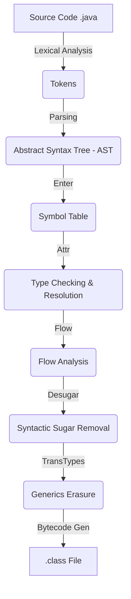
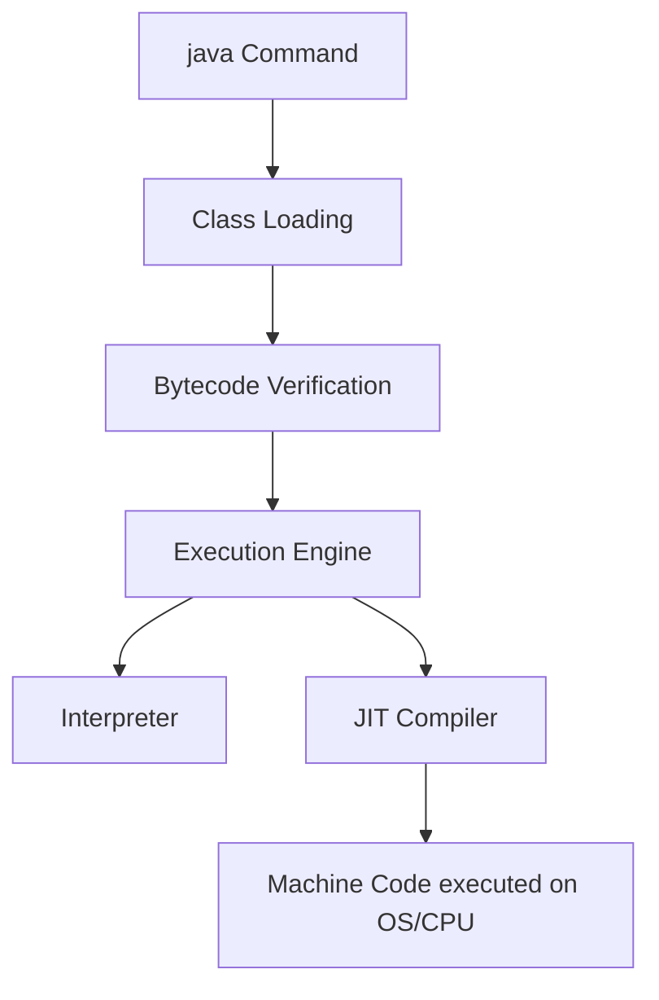

# Module 1: Introduction & JVM Internals - Volume 1 (Theory)

Welcome to the first volume of the Java Mastery Curriculum. This document is a foundational masterclass into what Java is, how it processes your source code, and how the Java Virtual Machine (JVM) operates under the hood. 

---

## PART 1: DEFINITION

### What is Java?
When someone asks "What is Java?", the common, shallow answer is "a programming language." However, this is fundamentally incomplete. Java is an entire ecosystem and platform. It consists of three primary components:
1. **The Java Programming Language:** The human-readable syntax used to express logic.
2. **The Java Virtual Machine (JVM):** The abstract computing machine that executes bytecode. It is the engine that actually runs the code.
3. **The Java API / Standard Library:** A massive, built-in collection of pre-written software components (classes and interfaces) providing core functionality, ranging from basic data structures to advanced networking and concurrency APIs.

### Why does Java exist? (History)
In 1991, James Gosling and his team at Sun Microsystems initiated the **"Green Project."** Their goal was to develop software for consumer electronic devices (like set-top boxes and televisions). They needed a language that was platform-independent (since different TVs used different CPUs) and highly reliable.

Gosling created **Oak** (named after an oak tree outside his window). However, the digital cable television industry wasn't ready. The team pivoted when they realized Oak was perfect for a massive new network: the **World Wide Web**.

Oak was renamed to **Java** (inspired by Peet's Coffee Java) and officially released in 1996 as **Java 1.0**. Sun Microsystems open-sourced much of it over the years, and in 2010, **Oracle Corporation** acquired Sun, taking stewardship of the platform.

### What Problems Does Java Solve?
Before Java, C and C++ dominated the landscape. They were powerful but fraught with problems that Java aimed to solve:
1. **Platform Dependence:** C/C++ compiled directly to machine code specific to the OS and CPU. Java solved this via compilation to bytecode, evaluated by the JVM. 
2. **Memory Safety:** C/C++ required manual memory management (malloc, free), leading to memory leaks and catastrophic pointer errors. Java introduced automatic Garbage Collection.
3. **Network Readiness:** Java was built from the ground up to operate securely over a network via its Applet security model and standard networking libraries.

**Real-World Analogy:** Java is like a universal translator. Instead of writing a manual in English, French, and Japanese (C/C++), you write it in a universal symbolic language (bytecode) and hand it to native speakers (JVMs) who translate it on the fly into their native tongue (machine code). *"Write Once, Run Anywhere" (WORA).*

### Java Editions
| Edition | Description |
|---|---|
| **Java SE (Standard Edition)** | The core platform. Contains all core libraries, JVM, and tools. This is what we learn. |
| **Jakarta EE (formerly Java EE)** | Built on top of SE, providing APIs for massive enterprise applications (Servlets, JPA, EJB). |
| **Java ME (Micro Edition)** | A stripped-down version for resource-constrained embedded devices. Largely obsolete today. |

### Java Version History
| Version | Year | Key Features Introduced |
|---|---|---|
| Java 1.0 | 1996 | Original release, Applets, AWT. |
| Java 1.2 | 1998 | Collections Framework, Swing, JIT compiler. |
| Java 5 | 2004 | **Generics**, Annotations, Enums, Autoboxing, Enhanced For-Loop. |
| Java 8 | 2014 | **Lambdas**, Streams API, Optional, New Date/Time API, Metaspace. |
| Java 9 | 2017 | **Project Jigsaw** (Module System), JShell, Factory methods for collections. |
| Java 11 (LTS) | 2018 | Local-Variable Syntax for Lambda Parameters (`var`), New HTTP Client. |
| Java 17 (LTS) | 2021 | **Sealed Classes**, **Records**, Pattern Matching for `instanceof`, Text Blocks. |
| Java 21 (LTS) | 2023 | **Virtual Threads (Project Loom)**, Record Patterns, Sequenced Collections. |

> [!TIP]
> **LTS (Long Term Support)** versions (8, 11, 17, 21) are the industry standard for enterprise production environments.

### JDK Distributions
Since Java is open-source (OpenJDK), multiple vendors build and distribute the JDK:
- **OpenJDK:** The reference implementation (free, open-source).
- **Oracle JDK:** Oracle's commercial build (free for dev, requires license for prod depending on version).
- **Eclipse Adoptium (Temurin):** Highly popular, free, community-driven build.
- **Amazon Corretto:** AWS's production-ready distribution with long-term support.
- **GraalVM:** An advanced JDK with a high-performance JIT compiler and Ahead-of-Time (AOT) compilation capabilities.

---

## PART 2: SYNTAX (Program Structure)

### Anatomy of a Java Program
A standard Java file follows a strict top-to-bottom order:
1. `package` declaration
2. `import` statements
3. `class` declaration
4. Fields & Methods

```java
package com.mastery.intro; // 1. Package

import java.util.List;     // 2. Import

public class HelloWorld {  // 3. Class Declaration

    // 4. Main Method (Entry Point)
    public static void main(String[] args) {
        System.out.println("Hello, JVM!");
    }
}
```

### The `main` Method Decoded
Every single keyword in `public static void main(String[] args)` exists for a critical JVM-level reason.

- **`public`**: Access modifier. The JVM, acting as an external entity (written in C++), needs permission to locate and invoke this method from outside the class. If it were `private`, the JVM couldn't call it.
- **`static`**: The JVM must invoke the entry point *without instantiating the class first*. If it wasn't static, the JVM would have to guess how to construct `new HelloWorld()` (what if it lacked a no-args constructor?). `static` allows the method to exist at the class-level.
- **`void`**: The method does not return a value to the JVM. Once the main thread completes, the program terminates. Returning an int (like in C) isn't used; exit codes are set via `System.exit(int)`.
- **`main`**: The standard identifier the JVM explicitly searches for.
- **`String[] args`**: The parameter accepting command-line arguments passed to the JVM. It is a one-dimensional array of `String` objects.

### File Naming Rules
1. A `.java` file can contain multiple classes, but **at most ONE `public` class**.
2. If there is a `public` class, the **filename MUST match the class name exactly**, including case (e.g., `HelloWorld.java`).
3. If there is no `public` class, the file can be named anything (though it is terrible practice).

### Package Naming Conventions
Packages provide a namespace to prevent naming collisions. They use a **reverse internet domain name** convention.
- If you own `mastery.com`, your root package is `com.mastery`.
- For the `intro` module, the package is `com.mastery.intro`.

### Comments
- **Single-line:** `// comment`
- **Multi-line:** `/* comment */`
- **Javadoc:** `/** documentation */` (Read by the `javadoc` tool to generate HTML API documentation).

---

## PART 3: INTERNAL WORKING

### 1. The JDK Architecture

The Java ecosystem is nested. 

```text
+-------------------------------------------------------------+
|                     JDK (Java Development Kit)              |
|                                                             |
|  +-------------------------------------------------------+  |
|  |                  JRE (Java Runtime Environment)       |  |
|  |                                                       |  |
|  |  +-------------------------------------------------+  |  |
|  |  |               JVM (Java Virtual Machine)        |  |  |
|  |  |                                                 |  |  |
|  |  |  +---------------+ +---------------+ +-------+  |  |  |
|  |  |  | Class Loader  | | Memory Areas  | |Engine |  |  |  |
|  |  |  +---------------+ +---------------+ +-------+  |  |  |
|  |  +-------------------------------------------------+  |  |
|  |                                                       |  |
|  |  +-------------------------------------------------+  |  |
|  |  |           Java Standard Library (API)           |  |  |
|  |  |     (java.lang, java.util, java.io, etc.)       |  |  |
|  |  +-------------------------------------------------+  |  |
|  +-------------------------------------------------------+  |
|                                                             |
|  +-------------------------------------------------------+  |
|  |           Development Tools (javac, javap, jdb)       |  |
|  +-------------------------------------------------------+  |
+-------------------------------------------------------------+
```
- **JDK:** Everything needed to *develop* Java (Compiler + JRE).
- **JRE:** Everything needed to *run* Java (JVM + Libraries).
- **JVM:** The actual execution engine.

### 2. The Compilation Pipeline (javac deep dive)

When you run `javac HelloWorld.java`, the compiler executes a complex pipeline:



1. **Scanner (Lexical Analysis):** Converts raw characters into a stream of tokens (keywords, identifiers, literals).
2. **Parser:** Builds the **Abstract Syntax Tree (AST)**, ensuring the code follows grammatical rules.
3. **Enter:** Traverses the AST to populate the symbol table (recording class names, methods, fields).
4. **Attr (Attribute/Type Checking):** Verifies type safety (e.g., you aren't adding a String to a boolean). Resolves names to their actual symbols.
5. **Flow Analysis:** Checks for definite assignment of variables, unreachable code, and ensures all code paths return.
6. **Desugar/Lower:** Removes syntactic sugar. For example, enhanced `for-each` loops are converted to standard `Iterator` while loops. `enum` declarations are converted into regular classes extending `java.lang.Enum`.
7. **TransTypes:** Erases generics (Generics Type Erasure). `List<String>` becomes just `List`, with necessary casts inserted.
8. **Generate:** Emits the actual bytecode into a `.class` file.

### 3. The .class File Format

The `.class` file is a highly structured binary file. 

```text
+------------------------+
| Magic Number (CAFEBABE)| <-- Identifies file as Java class
+------------------------+
| Minor/Major Version    | <-- e.g., 65.0 for Java 21
+------------------------+
| Constant Pool          | <-- Strings, Class names, Method refs
+------------------------+
| Access Flags           | <-- public, final, super
+------------------------+
| This Class             | <-- Reference to constant pool
+------------------------+
| Super Class            | <-- Reference to java.lang.Object
+------------------------+
| Interfaces             |
+------------------------+
| Fields                 | <-- Variables
+------------------------+
| Methods                | <-- Code (Bytecode attributes)
+------------------------+
| Attributes             | <-- Source file name, Line numbers
+------------------------+
```
> [!IMPORTANT]
> The **Magic Number** `0xCAFEBABE` is a hexadecimal signature at the first 4 bytes of every `.class` file. The JVM checks this before doing anything else.

### 4. Bytecode

The JVM is a **stack-based virtual machine**, meaning it uses an operand stack for computations rather than CPU registers.

If we run `javap -c HelloWorld.class`:
```bytecode
  public static void main(java.lang.String[]);
    Code:
       0: getstatic     #7  // Field java/lang/System.out:Ljava/io/PrintStream;
       3: ldc           #13 // String Hello, JVM!
       5: invokevirtual #15 // Method java/io/PrintStream.println:(Ljava/lang/String;)V
       8: return
```
- **`getstatic`**: Pushes the static field `System.out` onto the operand stack.
- **`ldc`**: Loads a constant (the String "Hello, JVM!") from the constant pool onto the operand stack.
- **`invokevirtual`**: Pops the target object and arguments off the stack, and invokes the instance method `println`.
- **`return`**: Ends the method returning void.

### 5. The JVM Execution Pipeline

When you run `java HelloWorld`:



#### Class Loading (The Delegation Model)
The JVM loads classes dynamically, on-demand, using a parent-first delegation model.
1. **Bootstrap ClassLoader:** Loads core Java API classes (`java.lang.*`, `java.util.*`) written in native code.
2. **Platform ClassLoader:** Loads platform-specific extensions.
3. **Application ClassLoader:** Loads user-defined classes from the classpath.

**Phases of Class Loading:**
1. **Loading:** Reads `.class` file into memory.
2. **Linking:**
   - *Verify:* Ensures bytecode is safe and structurally correct (prevents malicious code from crashing JVM).
   - *Prepare:* Allocates memory for static variables and initializes them to default values (0, null).
   - *Resolve:* Replaces symbolic references in the constant pool with direct memory references.
3. **Initialization:** Executes static initializers (`static { }` blocks) and assigns actual values to static fields.

#### Interpretation vs JIT Compilation
| Approach | Description | Speed |
|---|---|---|
| **Interpreter** | Reads and executes bytecode instruction by instruction sequentially. | Fast startup, slow peak performance. |
| **JIT Compiler** | Translates hot (frequently executed) bytecode into optimized native machine code. | Slower startup, ultra-fast peak performance. |
| **HotSpot JVM** | Uses both. Interprets first, monitors execution (profiling), and JIT compiles the "hot spots". | Best of both worlds. |

### 6. JVM Memory Areas

The JVM manages memory in 5 distinct data areas:

```text
  Shared Among All Threads                   Per Thread (Isolated)
+-------------------------+      +-----------------------------------------+
|                         |      |  +----------+ +----------+ +----------+ |
|    METHOD AREA          |      |  | Thread 1 | | Thread 2 | | Thread 3 | |
|    (Metaspace)          |      |  |          | |          | |          | |
| - Class Metadata        |      |  | [Stack]  | | [Stack]  | | [Stack]  | |
| - Constant Pool         |      |  | [PC Reg] | | [PC Reg] | | [PC Reg] | |
| - Method Bytecode       |      |  | [Native] | | [Native] | | [Native] | |
| - Static Variables      |      |  +----------+ +----------+ +----------+ |
|                         |      +-----------------------------------------+
+-------------------------+
|                         |
|        HEAP             |
| - Object Instances      |
| - Arrays                |
| - Garbage Collected     |
|                         |
+-------------------------+
```

#### The Stack Frame (Deep Dive)
Every time a method is called, a new **Stack Frame** is pushed onto the thread's JVM Stack. When the method returns, the frame is popped.

```text
+-----------------------------------+
|            STACK FRAME            |
|                                   |
| +-------------------------------+ |
| |       Local Variable Array    | |
| | [0] args (String[])           | |
| | [1] int x                     | |
| +-------------------------------+ |
|                                   |
| +-------------------------------+ |
| |       Operand Stack           | |
| | (Temporary workspace for      | |
| |  bytecode instructions)       | |
| | -> "Hello JVM"                | |
| | -> System.out ref             | |
| +-------------------------------+ |
|                                   |
| +-------------------------------+ |
| |       Frame Data              | |
| | (Reference to constant pool,  | |
| |  return address, exceptions)  | |
| +-------------------------------+ |
+-----------------------------------+
```

### 7. Step-by-step: `java HelloWorld`
1. OS launches a JVM process.
2. Bootstrap ClassLoader loads `java.lang.Object`, `System`, `String`, etc.
3. Application ClassLoader locates `HelloWorld.class` on the classpath.
4. Bytecode Verifier checks `HelloWorld.class`.
5. Memory is allocated in Metaspace for `HelloWorld` metadata.
6. The JVM's Execution Engine searches for `public static void main(String[])`.
7. A new Thread (the main thread) is created.
8. A Stack Frame for `main` is pushed onto the thread's stack.
9. `getstatic` pushes the `System.out` reference to the Operand Stack.
10. `ldc` pushes the String `"Hello, JVM!"` reference to the Operand Stack.
11. `invokevirtual` executes the print logic.
12. `return` pops the frame.
13. The main thread terminates, JVM shuts down.

---

> [!NOTE]
> Proceed to **Volume 2: Code** to write, compile, and execute this manually using the command line (avoiding IDE magic for your first attempt).
