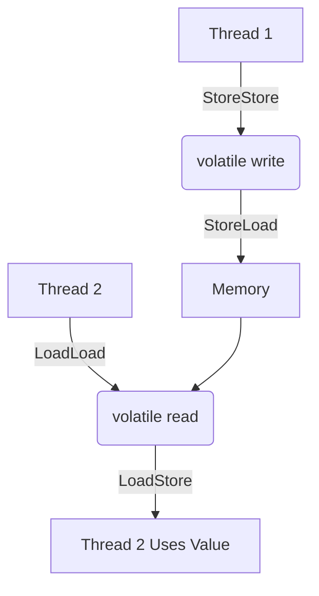
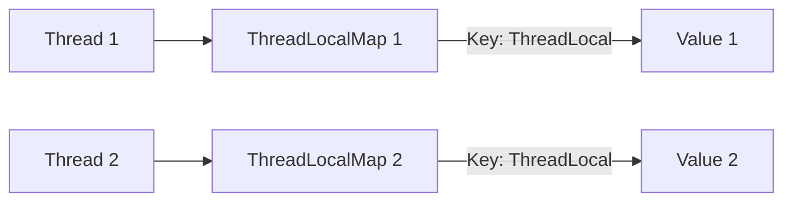
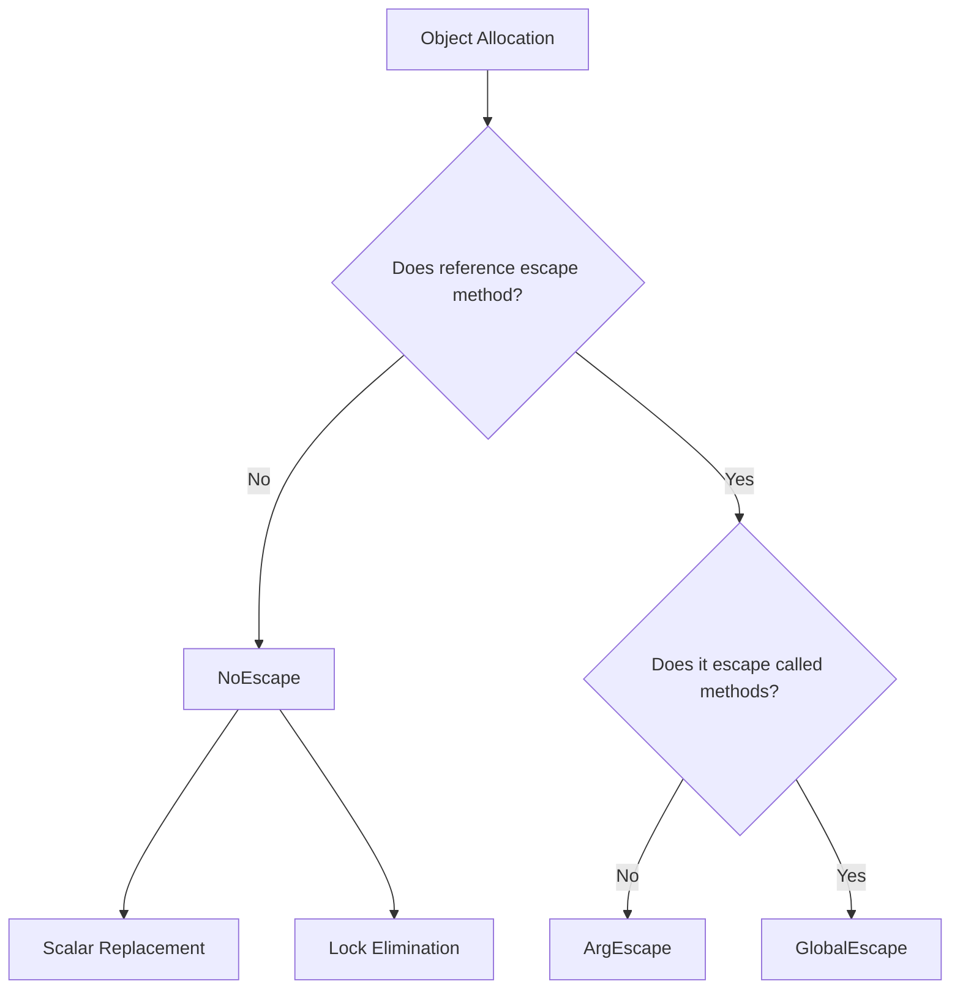
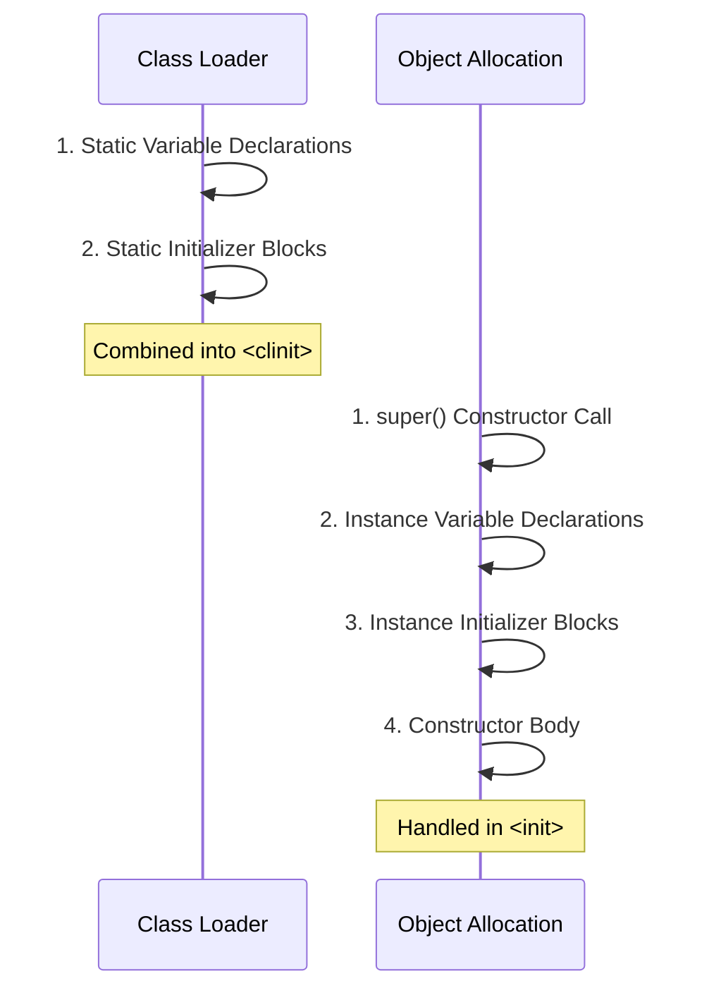

# MODULE 2 — SUPPLEMENTARY REFERENCE

---

## 1. VOLATILE KEYWORD — COMPLETE DEEP DIVE

### What is volatile?
- Guarantees VISIBILITY of changes across threads
- Every write to a volatile variable is immediately flushed to main memory
- Every read of a volatile variable reads from main memory (not CPU cache)
- Prevents instruction reordering around volatile accesses

### Memory Barriers



- **StoreStore barrier**: Before volatile write — ensures all prior stores are visible
- **StoreLoad barrier**: After volatile write — ensures the write is visible before any subsequent load
- **LoadLoad barrier**: After volatile read — ensures the read completes before subsequent loads
- **LoadStore barrier**: After volatile read — ensures the read completes before subsequent stores

### x86 Assembly Implementation
- Volatile write compiles to: `mov [address], value` + `lock addl $0, (%rsp)` (or `mfence`)
- The `lock` prefix forces cache line flush and memory ordering

### What volatile does NOT guarantee

> [!WARNING]
> NOT atomic for compound operations: `count++` is NOT thread-safe even with volatile
> `count++` = read + increment + write = 3 separate operations
> For atomicity, use `AtomicInteger.incrementAndGet()` or `synchronized`

### volatile and 64-bit Operations (JLS 17.7)
- Without volatile, reads/writes of `long` and `double` on 32-bit JVMs may NOT be atomic
- JVM may split into two 32-bit operations → word tearing
- volatile guarantees atomic read/write for long and double

### Code Examples
```java
// Common pattern: flag to stop a thread
private volatile boolean running = true;

public void run() {
    while (running) {  // Guaranteed to see latest value
        doWork();
    }
}

public void stop() {
    running = false;  // Visible to the run() thread immediately
}
```

### JIT Loop Hoisting Without volatile

> [!CAUTION]
> If JIT loop hoisting occurs without `volatile`, your application might enter an infinite loop!

```java
// WITHOUT volatile — JIT may transform to:
// if (!flag) while(true) { ... }  // INFINITE LOOP!
private boolean flag = false;
void loop() {
    while (!flag) { /* ... */ } // JIT hoists flag read outside loop
}
```

### When to Use volatile vs synchronized vs Atomic
| Feature | volatile | synchronized | AtomicInteger |
|---|---|---|---|
| Visibility | ✅ | ✅ | ✅ |
| Atomicity | ❌ (single read/write only) | ✅ | ✅ |
| Mutual exclusion | ❌ | ✅ | ❌ |
| Performance | Fast | Slower (monitor) | Fast (CAS) |
| Use case | Flags, status | Critical sections | Counters |

---

## 2. THREADLOCAL — COMPLETE GUIDE

### What is ThreadLocal?
- A variable that has a SEPARATE copy for each thread
- Each thread accesses its own independent instance
- No synchronization needed — inherently thread-safe

### API
```java
// Create with initial value
ThreadLocal<SimpleDateFormat> dateFormat = 
    ThreadLocal.withInitial(() -> new SimpleDateFormat("yyyy-MM-dd"));

// Access — each thread gets its own SimpleDateFormat
String formatted = dateFormat.get().format(new Date());

// Set value for current thread
dateFormat.set(new SimpleDateFormat("dd/MM/yyyy"));

// CRITICAL: Remove when done (especially in thread pools!)
dateFormat.remove();
```

### How It Works Internally



- Each Thread object has a `ThreadLocal.ThreadLocalMap`
- `ThreadLocalMap` uses the `ThreadLocal` instance as key (weak reference) and the value as value (strong reference)
- `get()` → `Thread.currentThread().threadLocals.get(this)`
- `set(value)` → `Thread.currentThread().threadLocals.set(this, value)`

### Memory Leak Danger in Thread Pools!

> [!CAUTION]
> In thread pools, threads are REUSED — they don't die.
> ThreadLocal values persist as long as the thread lives.
> If you don't call `remove()`, values accumulate.
> The key (ThreadLocal) is a weak reference, so it can be GC'd.
> But the VALUE is a strong reference → can't be GC'd → MEMORY LEAK.
> ALWAYS call `remove()` in a `finally` block.

```java
try {
    threadLocal.set(expensiveObject);
    // ... use it
} finally {
    threadLocal.remove(); // MANDATORY in thread pools!
}
```

### Use Cases
- Per-thread database connections
- Per-thread SimpleDateFormat (not thread-safe!)
- Per-thread transaction context
- Per-thread random number generators

---

## 3. REFLECTION API FOR VARIABLE INSPECTION

### Inspecting Fields of a Class
```java
import java.lang.reflect.Field;
import java.lang.reflect.Modifier;

Class<?> clazz = MyClass.class;
Field[] fields = clazz.getDeclaredFields();

for (Field field : fields) {
    field.setAccessible(true); // bypass private
    System.out.printf("Name: %-15s Type: %-15s Modifiers: %-20s Value: %s%n",
        field.getName(),
        field.getType().getSimpleName(),
        Modifier.toString(field.getModifiers()),
        field.get(instance) // null for static fields context
    );
}
```

### Key Methods
- `Class.getDeclaredFields()` — all fields (including private), this class only
- `Class.getFields()` — public fields only, including inherited
- `Field.getName()` — field name
- `Field.getType()` — field type as Class
- `Field.getModifiers()` — int bitmask (use Modifier.isStatic(), Modifier.isFinal(), etc.)
- `Field.get(instance)` — get field value
- `Field.set(instance, value)` — set field value
- `Field.setAccessible(true)` — bypass access checks

### Modifying final Fields via Reflection
```java
Field field = clazz.getDeclaredField("CONSTANT");
field.setAccessible(true);
// In Java 12+, this may throw InaccessibleObjectException for module-restricted fields
field.set(instance, newValue); // CAN modify final fields (with caveats)
```

> [!WARNING]
> Modifying final fields via reflection can cause undefined behavior. JIT may have inlined the original value. The JVM makes no guarantees about visibility of reflected final field changes.

---

## 4. OBJECT HEADER — DETAILED BREAKDOWN

### Object Header Structure (64-bit JVM, Compressed Oops)
```text
+------------------------------------------+
| Object Header (12 bytes with comp. oops) |
+------------------------------------------+
| Mark Word        (8 bytes / 64 bits)     |
| Klass Pointer    (4 bytes compressed)    |
+------------------------------------------+
| Instance Fields   (varies)               |
+------------------------------------------+
| Padding          (to 8-byte alignment)   |
+------------------------------------------+
```

### Mark Word Bit Layout (64-bit, unlocked state)
```text
|------------------------------------------------------------------------|
| unused:25 | identity_hashcode:31 | unused:1 | age:4 | biased:1 | lock:2 |
|------------------------------------------------------------------------|
                                                                    00 = unlocked
                                                                    01 = biased
                                                                    10 = lightweight locked
                                                                    11 = heavyweight locked (monitor)
```

- **identity_hashcode** (31 bits): Stored after first call to `identityHashCode()` or `hashCode()` (if not overridden)
- **age** (4 bits): GC generation age (0-15), object promoted to old gen when age reaches threshold
- **biased** (1 bit): biased locking flag
- **lock** (2 bits): lock state

### Klass Pointer
- Points to class metadata in Metaspace
- 4 bytes with compressed oops (default for heaps < 32GB)
- 8 bytes without compression

### Array Header Extension
```text
+------------------------------------------+
| Mark Word        (8 bytes)               |
| Klass Pointer    (4 bytes compressed)    |
| Array Length     (4 bytes)               | ← extra field!
+------------------------------------------+
| Array Elements   (varies)                |
+------------------------------------------+
```

---

## 5. COMPRESSED OOPS — DETAILED MATH

### What are Compressed Oops?
- On 64-bit JVMs, object references are normally 8 bytes
- Compressed Oops uses 32-bit references to save memory
- Enabled by default for heaps ≤ 32GB

### How It Works (Bit Shifting)
- All objects are aligned to 8-byte boundaries
- This means the last 3 bits of any object address are always 000
- Compressed oop = real_address >> 3 (right-shift by 3)
- To dereference: real_address = compressed_oop << 3 (left-shift by 3)
- 32-bit compressed oop can address: 2^32 × 8 = 32GB of heap

### Example
```text
Real address:      0x00000007FFF00000 (34,355,019,776 in decimal)
Compressed oop:    0x00000007FFF00000 >> 3 = 0x0FFFE0000
                   Fits in 32 bits!

Dereference:
0x0FFFE0000 << 3 = 0x00000007FFF00000
```

### JVM Flags
- `-XX:+UseCompressedOops` (default ON for heaps ≤ 32GB)
- `-XX:+UseCompressedClassPointers` (compresses klass pointers)
- `-XX:ObjectAlignmentInBytes=16` — doubles max addressable heap to 64GB

### Zero-Based vs Non-Zero-Based
- Zero-based: heap starts at address 0 (fastest, no base needed)
- Non-zero-based: heap starts at offset, requires base addition
- JVM tries zero-based first

---

## 6. ESCAPE ANALYSIS — DETAILED

### What is Escape Analysis?
- JIT compiler analysis that determines if an object's reference "escapes" the method or thread
- If it DOESN'T escape, the JVM can apply powerful optimizations

### Escape States



- **NoEscape**: Object is only used within the method that creates it. No reference is stored to heap or passed to other methods.
- **ArgEscape**: Object is passed as an argument to another method but doesn't escape that method either (the called method is inlined).
- **GlobalEscape**: Object reference is stored in a heap field or returned from the method — fully escapes.

### Optimizations Based on Escape Analysis

#### 1. Scalar Replacement
- Object's fields are replaced with local variables (scalars)
- Object is never actually allocated on the heap!

```java
// Before optimization:
Point p = new Point(3, 4); // Heap allocation
int d = p.x + p.y;

// After Scalar Replacement:
int p_x = 3; // Stack variable
int p_y = 4; // Stack variable
int d = p_x + p_y; // No heap allocation!
```

#### 2. Stack Allocation
- Object allocated on stack instead of heap
- Automatically freed when method returns — no GC needed
- (Note: HotSpot primarily uses scalar replacement rather than true stack allocation)

#### 3. Lock Elimination
- If object doesn't escape, synchronization on it is useless
- JIT removes the lock entirely

```java
// Before:
synchronized(new Object()) { // lock on non-escaping object
    doWork();
}
// After: lock eliminated, just doWork()
```

### What Defeats Escape Analysis
- Storing reference in a field: `this.myField = newObject;`
- Returning the object from the method
- Passing to a non-inlined method
- Using reflection on the object
- Object is too large for scalar replacement

### JVM Flags
- `-XX:+DoEscapeAnalysis` (default ON since Java 6u23)
- `-XX:+EliminateAllocations` (default ON)
- `-XX:+EliminateLocks` (default ON)
- `-XX:+PrintEscapeAnalysis` (diagnostic)

---

## 7. JOL (JAVA OBJECT LAYOUT) TOOL

### What is JOL?
- Open-source tool by Aleksey Shipilëv (Oracle JVM engineer)
- Analyzes and prints the memory layout of Java objects
- Shows: object header, field offsets, padding, total size

### Maven Dependency
```xml
<dependency>
    <groupId>org.openjdk.jol</groupId>
    <artifactId>jol-core</artifactId>
    <version>0.17</version>
</dependency>
```

### Usage
```java
import org.openjdk.jol.info.ClassLayout;

public class JOLDemo {
    int x;
    long y;
    boolean z;
    String name;

    public static void main(String[] args) {
        System.out.println(ClassLayout.parseInstance(new JOLDemo()).toPrintable());
    }
}
```

### Output Example (annotated)
```text
jolDemo object internals:
OFF  SZ     TYPE  DESCRIPTION
  0   8     (object header: mark word)
  8   4     (object header: klass pointer)
 12   4     int   JOLDemo.x
 16   8     long  JOLDemo.y
 24   1     boolean JOLDemo.z
 25   3     (alignment padding)
 28   4     String JOLDemo.name (reference)
Instance size: 32 bytes
```

### Key Observations
- JVM reorders fields by size to minimize padding
- `long`/`double` aligned to 8-byte boundaries
- References are 4 bytes (compressed oops)
- Total object size is always multiple of 8 bytes

---

## 8. RUNTIME MEMORY APIs

```java
Runtime rt = Runtime.getRuntime();
long totalMemory = rt.totalMemory();  // Current heap size
long freeMemory = rt.freeMemory();    // Free within current heap
long maxMemory = rt.maxMemory();      // Maximum heap (-Xmx)
long usedMemory = totalMemory - freeMemory;

System.out.printf("Used: %d MB | Free: %d MB | Total: %d MB | Max: %d MB%n",
    usedMemory / (1024*1024),
    freeMemory / (1024*1024),
    totalMemory / (1024*1024),
    maxMemory / (1024*1024));
```

### Memory Measurement Pattern

> [!TIP]
> Calling `System.gc()` is just a hint to the JVM and might be ignored, but it is often useful when doing basic memory benchmarking or debugging.

```java
System.gc(); // Hint to run GC before measurement
long before = Runtime.getRuntime().totalMemory() - Runtime.getRuntime().freeMemory();

// Allocate objects to measure
int[] array = new int[1_000_000];

long after = Runtime.getRuntime().totalMemory() - Runtime.getRuntime().freeMemory();
System.out.println("Memory used: " + (after - before) + " bytes");
```

---

## 9. INITIALIZATION ORDER — COMPLETE SEQUENCE

When a class is loaded and an object is created:



### Class Initialization (`<clinit>`)
1. Static variable declarations (in textual order)
2. Static initializer blocks (in textual order)
3. These are combined into single `<clinit>` method

### Instance Initialization (`<init>`)
1. `super()` constructor call (implicit or explicit)
2. Instance variable declarations (in textual order)
3. Instance initializer blocks (in textual order)
4. Constructor body

```java
public class InitOrder {
    static int s1 = print("static field 1");    // Step 1
    static { print("static block"); }            // Step 2
    static int s2 = print("static field 2");    // Step 3
    
    int i1 = print("instance field 1");          // Step 4 (per new)
    { print("instance block"); }                 // Step 5 (per new)
    int i2 = print("instance field 2");          // Step 6 (per new)
    
    InitOrder() {
        print("constructor");                    // Step 7 (per new)
    }
}
```

---

## 10. LAMBDA vs INNER CLASS — VARIABLE CAPTURE

### Inner Class Capture
- Captured variables stored as synthetic fields (`val$varName`)
- `this` refers to the inner class instance
- `Outer.this` refers to the enclosing class
- Can shadow enclosing scope variables

### Lambda Capture
- Uses `invokedynamic` + `LambdaMetafactory`
- Captured variables passed as parameters (no synthetic fields)
- `this` refers to the ENCLOSING class (lexical scoping)
- CANNOT shadow enclosing scope local variables (compiler error)
- Variables must be effectively final

### Bytecode Difference
```java
// Inner class generates: MyClass$1.class with val$x field
// Lambda generates: invokedynamic call, no extra class file
```

---

## 11. FALSE SHARING & @Contended

### CPU Cache Lines
- CPUs read memory in 64-byte cache lines
- When two threads modify different variables on the SAME cache line
- Each modification invalidates the entire cache line for the other CPU core
- Massive performance degradation (up to 100x slower)

```text
Cache Line (64 Bytes):
[ var1 | var2 | ... | ... ]
  ^      ^
  |      |
 T1     T2
 (T1 writes var1 -> invalidates T2's cache for var2!)
```

### @Contended Annotation
```java
import jdk.internal.vm.annotation.Contended;

public class PaddedCounters {
    @Contended
    volatile long counter1; // Padded to its own cache line
    
    @Contended
    volatile long counter2; // Padded to its own cache line
}
```
- Requires JVM flag: `-XX:-RestrictContended`
- Adds ~128 bytes of padding around the field

---

## 12. VarHandle API (Preview)

### What is VarHandle?
- Modern replacement for `sun.misc.Unsafe` for low-level memory operations
- Provides atomic and ordered access to variables
- Part of `java.lang.invoke` package (Java 9+)

### Usage

> [!NOTE]
> `VarHandle` operations are inherently atomic and memory-safe when used with methods like `compareAndSet`.

```java
import java.lang.invoke.MethodHandles;
import java.lang.invoke.VarHandle;

public class AtomicCounter {
    private volatile int count = 0;
    private static final VarHandle COUNT_HANDLE;
    
    static {
        try {
            COUNT_HANDLE = MethodHandles.lookup()
                .findVarHandle(AtomicCounter.class, "count", int.class);
        } catch (ReflectiveOperationException e) {
            throw new ExceptionInInitializerError(e);
        }
    }
    
    public int incrementAndGet() {
        return (int) COUNT_HANDLE.getAndAdd(this, 1) + 1;
    }
    
    public boolean compareAndSet(int expected, int newValue) {
        return COUNT_HANDLE.compareAndSet(this, expected, newValue);
    }
}
```
