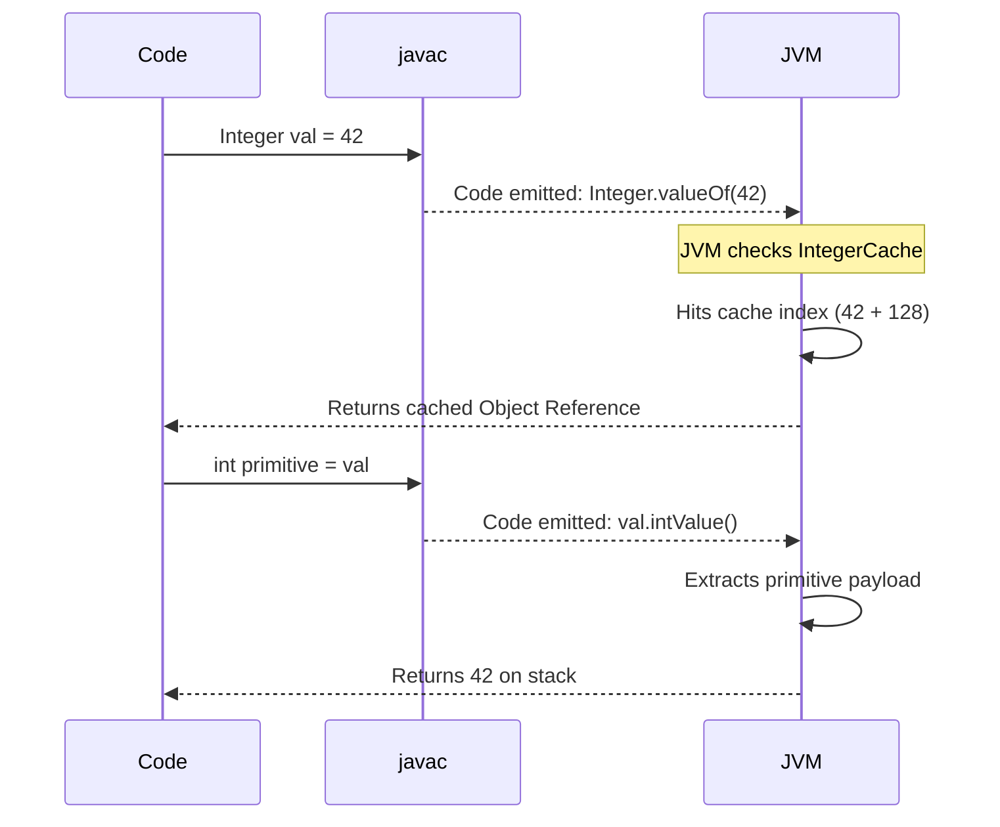

# MODULE 3: DATA TYPES — Volume 1: Theory & Internals

> [!IMPORTANT]
> **Prerequisites:** Familiarity with basic Java syntax and a foundational understanding of computer architecture (stack vs. heap, binary representation).
> **Target Environment:** Java 21 LTS, JVM (HotSpot), IntelliJ IDEA.

## PART 1: DEFINITION

### What is a Data Type?
In computer science, a **data type** is a classification or a strict specification that defines:
1. **The domain of values** a variable or expression can assume.
2. **The operations** that can be legally performed on those values.
3. **The semantic meaning** of the raw bits stored in memory.
4. **The memory representation** (size, layout, and structural constraints) required to store the values.

Without data types, a computer's memory is just a continuous, undifferentiated sequence of 1s and 0s. A data type imposes a schema onto those bits. When the JVM reads a 32-bit sequence `01000001 01001000 00000000 00000000`, the data type tells it whether to interpret it as the integer `1,095,237,632`, the floating-point number `12.5`, or as a reference pointer to an object on the heap.

### Why do Programming Languages have Data Types?
Data types are foundational to language design. They serve four primary architectural purposes:

1. **Type Safety and Correctness:** By enforcing types, the compiler acts as a mathematical proof engine. It guarantees that nonsensical operations (like multiplying a `String` by a `Thread`) are structurally impossible. This eliminates an entire class of runtime memory corruption errors common in untyped assembly or poorly typed C.
2. **Memory Efficiency:** Types allow the compiler to allocate exactly the required amount of memory. An 8-bit `byte` consumes less space than a 64-bit `long`. Without types, the runtime would have to use a maximal universal container for everything, wasting immense amounts of RAM.
3. **Compiler Optimization:** When a compiler knows a type is strictly an integer, it can safely use single-cycle CPU instructions (like `ADD` or `IMUL`). When dealing with polymorphic or dynamic types, the runtime must incur the overhead of method dispatch and type-checking on every operation.
4. **Programmer Intent and Contract:** Types serve as enforced, machine-verifiable documentation. When an API demands a `java.time.LocalDate`, it communicates intent far better than requiring an `int` array.

### Java as a Statically-Typed Language
Java is **statically-typed**. This means type enforcement happens at *compile time* during the semantic analysis phase of `javac`, long before the program ever reaches the JVM. 
* A variable must be declared with its type before it can be used.
* Once a variable is declared as a specific type, it can never change its type (strong typing).
* The compiler verifies that all assignments, method arguments, and return values strictly adhere to the type contract.

> [!NOTE]
> Even with the introduction of `var` in Java 10 (Local Variable Type Inference), Java remains strictly statically typed. `var` is merely syntactic sugar; the compiler deduces the exact, immutable static type at compile time. It is **not** dynamic typing like JavaScript's `let` or `var`.

### Real-World Analogy: Data Types as Container Specifications
Think of a computer's memory as a massive warehouse. If you want to store goods, you don't just dump them on the floor; you need containers.
* A **data type** is the specification of the container.
* A **variable** is the container itself, stamped with a label.
* The **value** is the good placed inside.

You cannot put a grand piano (an `Object`) into a tiny pill bottle (a `byte`), nor would you use a shipping container (a `long`) to hold a single grain of rice (a boolean). The compiler is the warehouse manager, ensuring container limits are respected.

### The Two Paradigms: Primitive vs. Reference Types
Java's type system is famously divided into two distinct categories, a design decision driven by performance needs in the mid-1990s:

1. **Primitive Types:** The "raw" materials. There are exactly 8 primitive types (`byte`, `short`, `int`, `long`, `float`, `double`, `char`, `boolean`). They are not objects. They have no methods. They are stored directly on the execution stack (for local variables) or directly embedded within an object's memory layout on the heap (for fields). They are passed by value.
2. **Reference Types:** Everything else. Classes, interfaces, arrays, enums, records, and annotations. When you declare a reference type, the variable does not hold the object; it holds a pointer (a memory address or handle) to an object allocated on the heap. They are passed by value of the reference.

### Type System Design Philosophy
Why did Java's creators (James Gosling et al.) choose these specific 8 primitives?
In a pure object-oriented language like Smalltalk, *everything* is an object, including the number `1`. While mathematically elegant, representing every integer as a full-fledged heap object in 1995 was catastrophically slow and memory-intensive. Java compromised. By baking in 8 primitive types mapping directly to hardware CPU registers and ALUs (Arithmetic Logic Units), Java achieved C-like execution speed for math and logic, while reserving the object-oriented paradigm for complex data structures.

---

## PART 2: SYNTAX — EVERY DETAIL

### Primitive Types (Deep dive into ALL 8)

Java guarantees the size and behavior of primitive types across all platforms. A Java `int` is exactly 32 bits on a toaster, a smartwatch, and a supercomputer. This was a revolutionary departure from C/C++, where `int` size depends on the OS and architecture.

#### Integer Types

##### `byte`
- **Size:** 8-bit signed two's complement integer.
- **Range:** -128 to 127 (-2^7 to 2^7 - 1).
- **Default Value:** `0`
- **Why it exists:** Memory-efficient storage for massive arrays, processing raw binary I/O streams (`InputStream`/`OutputStream`), and network protocols.
- **Internal Representation:** Two's complement representation means the highest bit is the sign bit (0 for positive, 1 for negative). To negate a number, flip all bits and add 1.
- **Byte Ordering:** Java strictly enforces **Big-Endian** byte order (network byte order) when writing bytes to streams or interpreting them, unlike x86 processors which are Little-Endian.

> [!TIP]
> Use `byte` when you are dealing with raw binary data, like reading an image file or manipulating network packets. Do not use `byte` for general counting just to "save memory"—local variables on the JVM stack consume 32 bits regardless of whether they are `byte` or `int`. The memory savings only manifest in large arrays.

##### `short`
- **Size:** 16-bit signed two's complement integer.
- **Range:** -32,768 to 32,767.
- **Default Value:** `0`
- **Why it exists:** Historically used for 16-bit audio processing (like WAV files) and mapping to 16-bit legacy C structs.
- **Modern Usage:** Extremely rare. In modern Java, `short` is almost entirely superseded by `int`. Since local variables pad to 32 bits anyway, and most CPUs process 32/64-bit words optimally, `short` provides negligible benefits outside of specific hardware-level interoperability or massive `short[]` arrays.

##### `int`
- **Size:** 32-bit signed two's complement integer.
- **Range:** -2,147,483,648 to 2,147,483,647.
- **Default Value:** `0`
- **The Workhorse:** `int` is the default, most optimized integer type in Java. The JVM's bytecode instruction set is heavily biased towards `int` operations (e.g., `iadd`, `imul`, `iload`). Any arithmetic operation involving `byte` or `short` implicitly promotes them to `int` before execution.
- **Literals:** Any integer literal in source code (e.g., `42`) is typed as `int` by default. You can use underscores for readability (`1_000_000`) and different radices (`0x` for hex, `0b` for binary, `0` for octal).

##### `long`
- **Size:** 64-bit signed two's complement integer.
- **Range:** -9,223,372,036,854,775,808 to 9,223,372,036,854,775,807.
- **Default Value:** `0L`
- **When to use:** Timestamps (milliseconds since Unix Epoch), extremely large counts, database primary keys, cryptographic hashes.
- **Syntax:** You must append an `L` (or `l`) to a literal if it exceeds the `int` range, otherwise the compiler throws an error.
- **Historical JVM quirk:** On 32-bit JVMs, a `long` consumes two 32-bit stack slots. Writing to a `long` is technically not atomic on 32-bit architectures unless declared `volatile`. On modern 64-bit JVMs, a `long` fits in a single 64-bit register and slot.

> [!WARNING]
> Always use a capital `L` for long literals (e.g., `42L`). A lowercase `l` looks nearly identical to the number `1` in many fonts (`42l`), which is a notorious source of bugs.

#### Floating-Point Types

##### `float`
- **Size:** 32-bit IEEE 754 single precision.
- **Precision:** ~6-7 decimal digits.
- **Default Value:** `0.0f`
- **Format:** 1 sign bit + 8 exponent bits + 23 mantissa (fraction) bits.
- **Syntax:** Requires an `f` or `F` suffix (e.g., `3.14f`). Without it, the literal defaults to `double`.
- **Usage:** Mostly used for memory-constrained scenarios requiring fractional numbers, such as massive arrays in 3D graphics (OpenGL/Vulkan vertex buffers) or machine learning tensors.

> [!CAUTION]
> **NEVER use `float` (or `double`) for money or exact financial calculations.**
> Due to binary fraction representation, floating-point math is imprecise. For example, `0.1f + 0.2f` does not exactly equal `0.3f`. Always use `java.math.BigDecimal` or `long` (representing cents) for currency.

##### `double`
- **Size:** 64-bit IEEE 754 double precision.
- **Precision:** ~15-16 decimal digits.
- **Default Value:** `0.0d`
- **Format:** 1 sign bit + 11 exponent bits + 52 mantissa bits.
- **The Standard:** `double` is the default type for floating-point literals (e.g., `3.14` is a `double`).
- **Performance:** On modern 64-bit CPUs with dedicated FPU (Floating Point Unit) and SIMD instructions, `double` arithmetic is just as fast as `float`, rendering `float` unnecessary except for memory conservation in arrays.

##### Deep Dive: IEEE 754 Quirks
The floating-point specification includes several bizarre but strictly defined behaviors:
- **Special Values:** `Float.POSITIVE_INFINITY`, `Float.NEGATIVE_INFINITY`, and `Float.NaN` (Not a Number).
- **Division by zero:** Integer `1 / 0` throws `ArithmeticException`. Floating-point `1.0 / 0.0` results in `Infinity`. `0.0 / 0.0` results in `NaN`.
- **NaN behavior:** `NaN` is infectious; any operation with `NaN` yields `NaN`. Astonishingly, `Double.NaN == Double.NaN` evaluates to `false`! You must use `Double.isNaN(val)` to check for NaN.
- **Signed Zero:** Floating-point numbers have both `+0.0` and `-0.0`. They are considered equal by `==`, but behave differently in operations like `1.0 / -0.0` (yields `-Infinity`).
- **Denormalized numbers:** Very small numbers close to zero are represented uniquely to allow gradual underflow rather than a sudden flush to zero, at the cost of severe CPU performance penalties.

#### Character Type

##### `char`
- **Size:** 16-bit unsigned integer.
- **Range:** 0 to 65,535 (`\u0000` to `\uFFFF`).
- **Default Value:** `\u0000` (the null character, NOT a space).
- **Internal Encoding:** Java uses **UTF-16** internally for character representation.
- **The BMP and Surrogates:** A single 16-bit `char` can perfectly represent any character in the Unicode Basic Multilingual Plane (BMP) — encompassing almost all modern world languages. However, 16 bits is not enough for the full Unicode standard (which goes up to 1,114,111).
- **Supplementary Characters:** Characters outside the BMP, such as Emojis (e.g., 🚀 `U+1F680`) or ancient scripts, require **two** `char` values, known as a **Surrogate Pair**. Thus, a `String` of one Emoji has a length of 2!
- **Numeric Nature:** Because `char` is fundamentally an unsigned 16-bit integer, you can perform math on it. `char c = 'A' + 1;` results in `c` being `'B'`.
- **Conversions:** `char` implicitly widens to `int`, `long`, `float`, and `double`. However, you cannot implicitly narrow an `int` to a `char` (even if the `int` is `65`) because `char` is unsigned and `int` is signed; it requires an explicit cast `(char)`.

#### Boolean Type

##### `boolean`
- **Size:** JVM implementation dependent (conceptually 1 bit of information).
- **Domain:** Strictly `true` or `false`.
- **Default Value:** `false`
- **The JVM Reality:** At the bytecode level, the JVM has **no boolean instructions**. It uses `int` instructions for boolean logic. Internally, `0` represents `false`, and `1` represents `true`.
- **Memory Footprint:** 
  - As a local variable on the stack, a `boolean` takes up 1 slot (32 bits, behaving like an `int`).
  - As a field in an object, HotSpot JVM packs them, typically consuming 1 byte.
  - In a `boolean[]` array, the JVM internally treats it as a `byte[]` array, allocating 1 byte per element and manipulating it using `baload` and `bastore` instructions.
- **Strict Isolation:** Unlike C/C++ where `0` is false and `1` is true natively, Java absolutely forbids casting a `boolean` to an `int` or any other primitive type.

### Comprehensive Table

| Type | Kind | Size (bits) | Stack Slots | Min Value | Max Value | Default | Wrapper Class | JVM Descriptor |
|---|---|---|---|---|---|---|---|---|
| `byte` | Integer | 8 | 1 (32-bit padded) | -128 | 127 | 0 | `Byte` | `B` |
| `short` | Integer | 16 | 1 (32-bit padded) | -32,768 | 32,767 | 0 | `Short` | `S` |
| `int` | Integer | 32 | 1 | -2^31 | 2^31 - 1 | 0 | `Integer` | `I` |
| `long` | Integer | 64 | 2 (on 32-bit JVM) | -2^63 | 2^63 - 1 | 0L | `Long` | `J` |
| `float` | Float | 32 | 1 | 1.4E-45 | 3.4028235E38 | 0.0f | `Float` | `F` |
| `double` | Float | 64 | 2 (on 32-bit JVM) | 4.9E-324 | 1.7976931348623157E308 | 0.0d | `Double` | `D` |
| `char` | Character | 16 | 1 (32-bit padded) | `\u0000` (0) | `\uffff` (65535) | `\u0000` | `Character` | `C` |
| `boolean` | Boolean | JVM-defined | 1 | false | true | false | `Boolean` | `Z` |

---

### Reference Types

While there are only 8 primitives, there is a limitless number of reference types. A reference type variable contains a pointer (memory address/handle) to an object allocated on the Garbage Collected Heap.

- **Class Types:** `String`, `Object`, `java.util.ArrayList`, and any class you define.
- **Interface Types:** `List`, `Runnable`, `Comparable`. A variable can be declared as an interface, and it can point to any object implementing that interface.
- **Array Types:** `int[]`, `String[]`, `Object[][]`. In Java, arrays are full-fledged objects.
- **Enum Types:** Specialized classes representing a fixed set of constants.
- **Annotation Types:** Specialized interfaces used for metadata (e.g., `@Override`).
- **Record Types (Java 16+):** Transparent data carriers defined with `record Point(int x, int y) {}`.
- **The `null` Type:** There is a special type without a name that represents the null reference. The literal `null` is the only value of this type. It can be implicitly cast to any reference type, but NEVER to a primitive type.
- **Hierarchy:** Every single reference type (except the null type) implicitly or explicitly inherits from `java.lang.Object`.

**Reference Size Overhead:**
On a 64-bit JVM, a reference pointer is technically 64 bits (8 bytes). However, by default, the HotSpot JVM employs an optimization called **Compressed OOPs (Ordinary Object Pointers)**, which compresses heap references to 32 bits (4 bytes) as long as the heap size is under ~32 GB.

---

### Wrapper Classes (CRITICAL section)

For every primitive type, `java.lang` provides a corresponding Reference Type wrapper:
`Byte`, `Short`, `Integer`, `Long`, `Float`, `Double`, `Character`, `Boolean`.

#### Why do Wrapper Classes exist?
If primitives are faster and use less memory, why wrap them in objects?
1. **Generics Erasure:** Java Generics (`<T>`) are implemented via Type Erasure and require objects. The compiler erases `<T>` to `Object`. You cannot write `List<int>` because `int` does not extend `Object`. You must use `List<Integer>`.
2. **Collections Framework:** Data structures like `HashMap` and `ArrayList` only store Object references.
3. **Utility Methods:** Classes like `Integer` provide static utility methods for parsing (`Integer.parseInt()`), converting radixes, and bit manipulation.
4. **Nullability:** Primitives always have a value (e.g., `0`). Sometimes, in business logic or databases, you need to represent the *absence* of a value. An `Integer` can be `null`; an `int` cannot.

#### Immutability
**ALL** wrapper classes are strictly immutable. Once you create an `Integer` object holding `5`, that object can never be changed to hold `6`. Doing `integerVariable++` actually creates a brand new `Integer` object and discards the old one.

#### Object Caching (`IntegerCache`)
To mitigate the severe memory and GC overhead of constantly allocating wrapper objects, the JVM employs aggressive caching for frequently used values.
- `Integer`: Caches values from `-128` to `127`.
- `Byte`, `Short`, `Long`: Cache values from `-128` to `127`.
- `Character`: Caches values from `\u0000` to `\u007F` (0 to 127).
- `Boolean`: Caches `Boolean.TRUE` and `Boolean.FALSE`.

This leads to a classic Java interview question constraint:
```java
Integer a = Integer.valueOf(100);
Integer b = Integer.valueOf(100);
System.out.println(a == b); // TRUE! Points to the same cached object.

Integer x = Integer.valueOf(500);
Integer y = Integer.valueOf(500);
System.out.println(x == y); // FALSE! 500 is outside the cache, creates distinct objects.
```

> [!TIP]
> You can increase the upper bound of the Integer cache by passing the JVM argument: `-XX:AutoBoxCacheMax=<size>`. This is highly beneficial for applications processing massive amounts of small boxed integers.

#### Instance Creation
Since Java 9, the constructors for wrapper classes (e.g., `new Integer(5)`) are **deprecated for removal**. You should always use the static factory method `Integer.valueOf(5)`, as it leverages the caching mechanism, whereas `new` always bypasses the cache and forces a heap allocation.

---

### Autoboxing and Unboxing

Introduced in Java 5, **Autoboxing** is the syntactic sugar where the compiler automatically converts a primitive type into its corresponding wrapper object. **Unboxing** is the reverse.

- **Autoboxing:** `Integer val = 42;` (Compiler transforms to `Integer val = Integer.valueOf(42);`)
- **Unboxing:** `int primitive = val;` (Compiler transforms to `int primitive = val.intValue();`)

#### Performance & Danger Profile
Autoboxing makes code incredibly clean, but hides massive performance pitfalls.

**The Loop Allocation Trap:**
```java
Long sum = 0L; // Boxed Long
for (long i = 0; i < Integer.MAX_VALUE; i++) {
    sum += i; 
}
```
In the above code, because `sum` is a `Long` object, the operation `sum += i` translates to unboxing `sum`, adding `i`, and autoboxing the result back into a *new* `Long` object. This loop will silently instantiate **over 2 billion** `Long` objects on the heap, triggering continuous Garbage Collection pauses. Changing `Long sum` to `long sum` makes the loop execute hundreds of times faster.

**The NPE Danger:**
```java
Integer boxed = null;
int primitive = boxed; // throws NullPointerException!
```
Unboxing a `null` reference calls `.intValue()` on a null pointer, immediately throwing an NPE. Autoboxing masks this danger by making objects look like primitives.

---

### Type Ranges and Overflow/Underflow

#### Integer Overflow
When an integer exceeds its maximum capacity, Java does not throw an error, crash, or dynamically allocate more memory. It simply wraps around mathematically using two's complement arithmetic.
```java
int max = Integer.MAX_VALUE; // 2147483647
int overflow = max + 1;      // -2147483648 (Integer.MIN_VALUE)
```

#### Integer Underflow
Similarly, subtracting below the minimum value wraps to the maximum positive value.
```java
int min = Integer.MIN_VALUE; // -2147483648
int underflow = min - 1;     // 2147483647 (Integer.MAX_VALUE)
```

> [!IMPORTANT]
> Because standard arithmetic operators (`+`, `-`, `*`) silently wrap, financial or cryptographic code can suffer catastrophic logic errors. To protect against this, Java 8 introduced `Math.addExact()`, `Math.multiplyExact()`, etc. These methods throw an `ArithmeticException` if an overflow occurs, providing safety at the cost of slight performance overhead.

#### Floating-Point Overflow/Underflow
Unlike integers, floating-point numbers do not wrap around:
- **Overflow:** Exceeding `Double.MAX_VALUE` results in `Infinity`.
- **Underflow:** Nearing zero past the precision limit results in **Gradual Underflow**. The IEEE 754 standard uses Denormalized (subnormal) numbers to represent values extremely close to zero, losing precision gracefully before finally bottoming out to `0.0`.

---

## PART 3: INTERNAL WORKING

### How `javac` Handles Data Types

The Java Compiler (`javac`) enforces types during the semantic analysis phase. 
1. **Type Checking:** It traverses the Abstract Syntax Tree (AST), checking that every assignment and method invocation satisfies the static type bounds.
2. **Type Inference:** For the `var` keyword, `javac` looks at the initializer expression and permanently binds the variable to that evaluated type.
3. **Numeric Promotion:** In binary operations (like `+`), `javac` applies promotion rules. If one operand is `double`, the other is widened to `double`. If operands are `byte` or `short`, they are both promoted to `int`.
4. **Implicit vs Explicit Casting:** `javac` implicitly allows **widening conversions** (e.g., `int` to `long`), because no magnitude information is lost. It strictly forbids implicit **narrowing conversions** (e.g., `long` to `int`); the programmer must explicitly declare `(int)` to acknowledge potential data loss (truncation).
5. **Constant Folding:** `javac` evaluates constant primitives at compile time. `int x = 24 * 60 * 60;` compiles directly to pushing the integer `86400` into bytecode, eliminating runtime math.

### Bytecode for Data Types

The JVM instruction set is strongly typed, but skewed towards 32-bit ints and objects.
- **Prefixes determine type:** `i` for int, `l` for long, `f` for float, `d` for double, `a` for object reference.
- **Addition:** `iadd`, `ladd`, `fadd`, `dadd`.
- **Arrays:** `iaload` (load int from array), `aaload` (load reference from array), `baload` (load byte/boolean).

Notice there are no `badd`, `sadd`, or `cadd` instructions for byte, short, or char arithmetic. The JVM relies entirely on `int` instructions for these.

**Conversion Bytecode:**
- Widening uses specific opcodes: `i2l` (int to long), `i2f`, `i2d`, `f2d`.
- Narrowing uses truncating opcodes: `i2b` (int to byte - keeps lowest 8 bits), `i2c` (int to char), `l2i`.

### Memory Layout

#### Primitive Storage
Primitives have zero overhead. An `int` local variable takes exactly 4 bytes in a stack frame slot.

#### Wrapper Object Storage
Objects on the HotSpot JVM are expensive. A wrapper object like `Integer` requires:
1. **Mark Word (Header):** 8 bytes (used for hashcode, GC locks, biased locking).
2. **Klass Pointer (Header):** 4 bytes (with compressed oops) pointing to the class metadata.
3. **Payload (Data):** 4 bytes for the `int` value.
4. **Alignment Padding:** The JVM aligns objects to 8-byte boundaries. 8 + 4 + 4 = 16 bytes. No padding needed here.
**Total:** 16 bytes to store a 4-byte integer. A 400% memory bloat!

#### Arrays Layout
- **Primitive Array (`int[1000]`):** 
  Header (16 bytes) + (1000 * 4 bytes) = **4,016 bytes**. Highly contiguous, extremely cache-friendly for the CPU L1/L2 caches.
- **Reference Array (`Integer[1000]`):**
  Header (16 bytes) + Reference pointers (1000 * 4 bytes) + Actual Integer Objects (1000 * 16 bytes) = **20,016 bytes**. 
  This is highly fragmented memory. Traversing an `Integer[]` causes cache misses because the CPU must follow 1000 different pointers scattered across the heap.

### Garbage Collection Implications

- **Primitives:** Because they live on the thread stack, they are trivially created and destroyed as methods are called and return. **Zero Garbage Collection overhead.**
- **Wrapper Objects:** Every un-cached `Integer` allocation is placed on the Eden Space of the Heap. Hot loops doing autoboxing generate massive amounts of short-lived garbage. This forces the GC to run Minor Collections frequently to sweep Eden space, causing CPU spikes and latency jitter in your application.

> [!TIP]
> In highly performance-sensitive applications (HFT, low-latency trading, game engines), autoboxing is strictly banned. Engineers use primitives, and for collections, they use primitive-backed libraries like Eclipse Collections, Fastutil, or HPPC which provide structures like `IntArrayList` to avoid wrapper objects entirely.

---

## PART 4: VISUAL DIAGRAMS

### 1. IEEE 754 Float Bit Layout (32-bit)
```text
Bit 31       Bits 30 - 23                 Bits 22 - 0
+---+------------------------+---------------------------------------+
| S |        Exponent        |               Mantissa                |
+---+------------------------+---------------------------------------+
| 1 |        8 bits          |                23 bits                |
+---+------------------------+---------------------------------------+
 S = Sign Bit (0 = Positive, 1 = Negative)
```

### 2. Two's Complement (8-bit Byte)
```text
0111 1111  =  127  (MAX)
0000 0001  =    1
0000 0000  =    0
1111 1111  =   -1
1000 0000  = -128  (MIN)
```

### 3. Memory Layout Comparison: `int` vs `Integer`
```text
Stack Frame (Local Vars)                  JVM Heap Space
+----------------------+                  +--------------------------+
| int count = 42;      | --- directly --> | [ 0x00 0x00 0x00 0x2A ]  | (4 bytes total)
+----------------------+                  +--------------------------+

+----------------------+                  +--------------------------+
| Integer obj = 42;    | --- pointer ---> | Mark Word    (8 bytes)   | \
+----------------------+                  | Klass Ptr    (4 bytes)   | | -> 16 bytes total
                                          | int payload  (4 bytes)   | /
                                          +--------------------------+
```

### 4. Array Layout: `int[]` vs `Integer[]`
```text
int[] primitives = {1, 2, 3};
Heap: [Header 16b] [1] [2] [3] (Contiguous Memory, Cache Friendly)

Integer[] objects = {1, 2, 3};
Heap: [Header 16b] [Ref1] [Ref2] [Ref3] (Fragmented Memory)
                       |      |      |
                       v      v      v
                    [Obj1] [Obj2] [Obj3] (Cache Misses)
```

### 5. Java Type Hierarchy
```mermaid
graph TD
    Type[Java Data Types] --> Prim[Primitive Types]
    Type --> Ref[Reference Types]
    
    Prim --> Num[Numeric]
    Prim --> Bool[boolean]
    
    Num --> IntG[Integer]
    Num --> FloatG[Floating-Point]
    Num --> CharG[char]
    
    IntG --> byte
    IntG --> short
    IntG --> int
    IntG --> long
    
    FloatG --> float
    FloatG --> double
    
    Ref --> Obj[java.lang.Object]
    Obj --> Arrays[Arrays e.g. int[]]
    Obj --> Classes[Classes]
    Obj --> Interfaces[Interfaces]
    
    Classes --> Wrapper[Wrappers e.g. Integer]
    Classes --> String[String]
    Classes --> Custom[User Defined]
```

### 6. Autoboxing Flow


### 7. Widening and Narrowing Conversions
```mermaid
graph LR
    byte -->|Implicit| short
    short -->|Implicit| int
    char -->|Implicit| int
    int -->|Implicit| long
    int -->|Implicit/Precision Loss| float
    long -->|Implicit/Precision Loss| float
    long -->|Implicit/Precision Loss| double
    float -->|Implicit| double
    
    double -.->|Explicit Cast (narrow)| float
    float -.->|Explicit Cast (narrow)| long
    long -.->|Explicit Cast (narrow)| int
    int -.->|Explicit Cast (narrow)| short
    short -.->|Explicit Cast (narrow)| byte
    int -.->|Explicit Cast (narrow)| char
```

> [!NOTE]
> Converting from `int` to `float`, or `long` to `double`/`float`, is an implicit widening conversion, but it can result in a loss of precision because floating-point types cannot accurately represent all large integers.

---
**End of Volume 1.**
