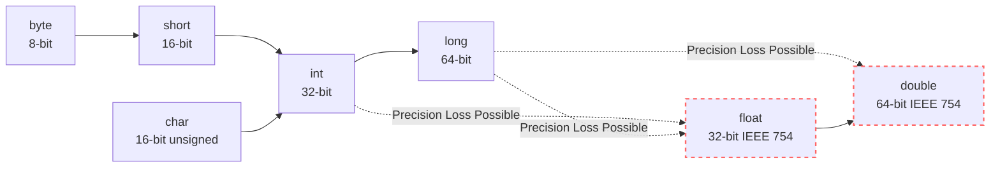
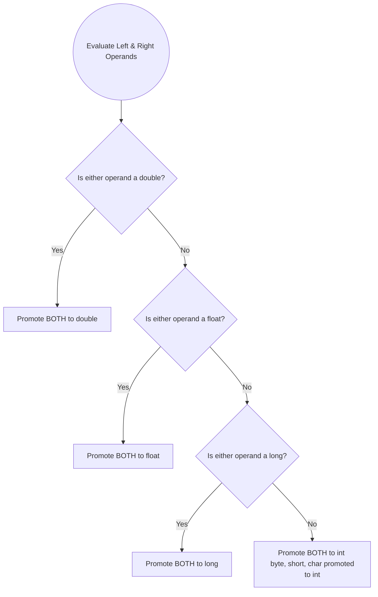
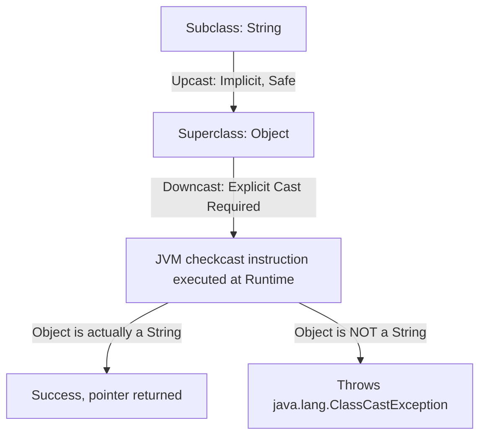
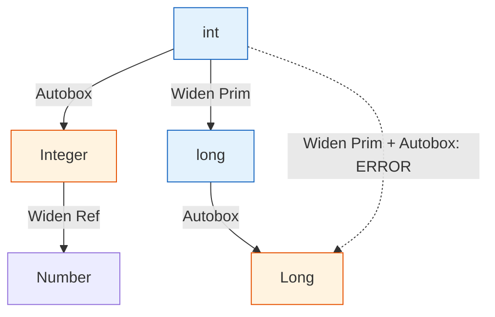

# MODULE 5: TYPE CONVERSION & CASTING — Volume 1: Theory & Internals

Welcome to Volume 1 of Module 5 in the Java Mastery Curriculum. In this extremely comprehensive guide, we will dive deep into the mechanics, semantics, and JVM internals of **Type Conversion and Casting** in Java. Designed for the Java 21 LTS release and focusing on the rigorous constraints of the Java Virtual Machine (JVM) and the OpenJDK compiler (`javac`), this module will take you far beyond the surface-level syntax. You will learn exactly how bits are manipulated, how the compiler enforces type safety during the `Attr` phase, and how the HotSpot JIT compiler optimizes type checks at runtime.

---

## PART 1: DEFINITION

### What is Type Conversion?

At its core, **type conversion** is the process of translating a value from one data type into another. In a strongly typed language like Java, every variable and every expression has a type that is known strictly at compile-time. When a value is assigned to a variable, passed as a method argument, or evaluated in an expression, its type must exactly match the expected type, or it must be convertible to the expected type according to the rigid rules defined in the Java Language Specification (JLS Chapter 5).

> [!NOTE]
> **Type Conversion vs. Type Casting**
> People often use these terms interchangeably, but they refer to different things.
> - **Type Conversion** is the conceptual and operational transformation of a value from type $A$ to type $B$. It is the mechanism.
> - **Type Casting** is the explicit syntax `(TargetType) expression` used by the programmer to instruct the compiler to perform a conversion that it would not perform automatically. Casting is the syntax; conversion is the action.

### Why is Type Conversion Needed?

In the Java ecosystem, type conversion is inescapable. You will encounter it constantly because:

1. **API Interoperability**: Different libraries and APIs expect different parameter types. A networking library might return a `byte[]` stream, but your domain logic requires an `int` or a `long`.
2. **Arithmetic on Mixed Types**: When evaluating an expression like `3.14 * 10`, the JVM must reconcile a `double` (3.14) and an `int` (10) to perform the computation accurately. 
3. **Storage and Memory Layout Requirements**: Reading a 64-bit `long` from a database but needing to store it in a 32-bit `int` field in an embedded system requires a defined mechanism to handle the structural mismatch.
4. **Polymorphism**: In object-oriented programming, treating a `String` as an `Object` or narrowing an `Object` back to a `String` is fundamental to generic collections, reflection, and dynamic dispatch.

### The Two Fundamental Categories

Type conversions in Java fall into two broad buckets:

1. **Widening Conversions (Implicit / Automatic)**: Transitioning from a smaller data type (fewer bits or narrower range) to a larger data type. Because the target type can accommodate all possible values of the source type (mostly), the compiler performs this automatically without any explicit cast syntax. There is generally no loss of magnitude.
2. **Narrowing Conversions (Explicit / Casting Required)**: Transitioning from a larger data type to a smaller data type. Because the target type cannot hold all the possible values of the source type, data loss (magnitude or precision loss) is possible. The `javac` compiler strictly forbids this unless the programmer explicitly assumes the risk using a cast `(type)`.

> [!IMPORTANT]
> Java is a rigorously **strongly typed** language. The compiler acts as an aggressive gatekeeper. If an implicit conversion isn't strictly defined by the JLS as a safe Widening Primitive Conversion, `javac` will throw a compilation error. It will not silently guess your intent.

---

## PART 2: SYNTAX — EVERY DETAIL

### Widening Primitive Conversions (Implicit)

Widening primitive conversions occur when a value of a smaller numeric type is assigned to a variable of a larger numeric type. 

#### The Full Conversion Path
The defined paths for widening in Java are:
- `byte` (8-bit) $\rightarrow$ `short` (16-bit) $\rightarrow$ `int` (32-bit) $\rightarrow$ `long` (64-bit) $\rightarrow$ `float` (32-bit IEEE 754) $\rightarrow$ `double` (64-bit IEEE 754)
- `char` (16-bit unsigned) $\rightarrow$ `int` $\rightarrow$ `long` $\rightarrow$ `float` $\rightarrow$ `double`

#### Widening Rules
- **Automatic**: No explicit cast is needed.
- **Compiler Permitted**: Always allowed by `javac` in assignment and method invocation contexts.
- **Data Loss**: While widening preserves the *magnitude* of the value (you won't turn a large positive number into a negative one), it does **not** always preserve *precision*.

> [!CAUTION]
> **The Precision Loss Trap**
> Do not assume that widening is entirely lossless. The JLS explicitly states that converting from an integer type to a floating-point type can result in a loss of precision, meaning the least significant bits of the integer might be discarded.
> 
> - `int` (32 bits) $\rightarrow$ `float` (32 bits, but only 24 bits for the mantissa)
> - `long` (64 bits) $\rightarrow$ `float` (24-bit mantissa)
> - `long` (64 bits) $\rightarrow$ `double` (53-bit mantissa)

#### Examples

```java
public class WideningDemo {
    public static void main(String[] args) {
        byte b = 42;
        int i = b;        // widening: byte → int (automatic, lossless)
        long l = i;       // widening: int → long (automatic, lossless)
        
        // --- PRECISION LOSS EXAMPLES ---
        
        // int to float
        int bigInt = 123_456_789; // Requires 27 bits to represent exactly
        float f = bigInt;         // widening: int → float (automatic, BUT precision loss!)
        
        System.out.println("Original int: " + bigInt); // Prints: 123456789
        System.out.println("As float:     " + f);      // Prints: 1.23456792E8 (Note the '92' at the end)
        System.out.printf("Float as int: %d\n", (int) f); // Prints: 123456792 (Lost exact value!)
        
        // long to double
        long bigLong = 9_000_000_000_000_000_001L; // Exceeds 53-bit mantissa capacity
        double d = bigLong;
        System.out.println("Original long: " + bigLong); // 9000000000000000001
        System.out.println("As double:     " + d);       // 9.0E18
        System.out.printf("Double to long: %d\n", (long) d); // 9000000000000000000 (Lost the 1)
    }
}
```

When an `int` or `long` is converted to a `float` or `double` and loses precision, it is rounded to the nearest representable floating-point value using the IEEE 754 round-to-nearest mode.

---

### Narrowing Primitive Conversions (Explicit Cast)

A narrowing primitive conversion happens when going against the widening flow. The target type has a smaller range or less precision than the source type.

#### The Conversion Path
- `double` $\rightarrow$ `float` $\rightarrow$ `long` $\rightarrow$ `int` $\rightarrow$ `short` $\rightarrow$ `byte`
- `int` $\rightarrow$ `char`, `short` $\rightarrow$ `char`, `byte` $\rightarrow$ `char`

Because of the potential for severe magnitude data loss (e.g., trying to fit 1,000,000 into an 8-bit `byte` that maxes out at 127), the compiler demands an explicit cast.

#### Syntax
```java
targetType variable = (targetType) expression;
```

#### What Happens During Narrowing (The Internal Mechanics)

1. **Integer Narrowing (e.g., `int` $\rightarrow$ `byte`)**
   The JVM simply truncates all the higher-order bits and keeps only the lower-order bits that fit into the target type. It does not perform bounds checking or throw exceptions.
   - Example 1: `(byte) 256`
     `256` in 32-bit int: `00000000 00000000 00000001 00000000`
     Truncate to 8-bit byte: `00000000` $\rightarrow$ Value is `0`.
   - Example 2: `(byte) 130`
     `130` in 32-bit int: `00000000 00000000 00000000 10000010`
     Truncate to 8-bit byte: `10000010`. In Java, a byte is signed (two's complement). The leftmost bit is `1`, indicating a negative number. The value evaluates to `-126`.

2. **Floating-to-Integer Narrowing (e.g., `double` $\rightarrow$ `int`)**
   This is a multi-step process defined strictly by JLS §5.1.3.
   - **Step 1**: It truncates toward zero. It discards the fractional part entirely. **It does NOT round.** `(int) 3.99` is `3`, and `(int) -3.99` is `-3`.
   - **Step 2**: Handle special values:
     - If the float/double is `NaN` (Not a Number), the result is `0`.
     - If the float/double is `POSITIVE_INFINITY` or is too large to fit in the target integer type, the result is the `MAX_VALUE` of the target type (e.g., `Integer.MAX_VALUE` which is `2147483647`).
     - If the float/double is `NEGATIVE_INFINITY` or is too small (too negative), the result is the `MIN_VALUE` of the target type (e.g., `Integer.MIN_VALUE`).

3. **Double to Float Narrowing (`double` $\rightarrow$ `float`)**
   The 64-bit `double` is rounded to the nearest 32-bit `float` value using IEEE 754 round-to-nearest. If the absolute value is too large for a `float`, it converts to `Float.POSITIVE_INFINITY` or `Float.NEGATIVE_INFINITY`. If it's too small, it converts to positive or negative zero.

> [!WARNING]
> Integer narrowing acts purely as a bitwise truncation mask. It will quietly corrupt your data by wrapping around if the value exceeds the target type's boundaries. Never narrow without validating the range first if data integrity is critical.

---

### Numeric Promotion Rules

When you perform arithmetic operations or bitwise operations, the JVM often implicitly converts the operands to a common type before performing the operation. This is called **Numeric Promotion**.

#### Unary Numeric Promotion
When a single operand is subjected to a unary operator (`+`, `-`, `~` bitwise NOT), unary numeric promotion applies:
- If the operand is of type `byte`, `short`, or `char`, it is promoted to an `int`.
- Otherwise, it remains its original type (`int`, `long`, `float`, `double`).

```java
byte b = 10;
// byte result = -b; // COMPILE ERROR! Unary '-' promotes 'b' to int.
int result = -b;     // Correct.
byte casted = (byte) -b; // Explicit cast required to fit it back in a byte.
```

#### Binary Numeric Promotion (JLS §5.6.2)
When two operands are used in a binary operator (like `+`, `-`, `*`, `/`, `%`, `==`, `<`, `&`, `|`, `^`), the JVM applies Binary Numeric Promotion to ensure both operands are of the same type.

The rules are evaluated in this exact order:
1. If either operand is of type `double`, the other is converted to `double`.
2. Otherwise, if either operand is of type `float`, the other is converted to `float`.
3. Otherwise, if either operand is of type `long`, the other is converted to `long`.
4. **Otherwise, both operands are converted to `int`.**

> [!IMPORTANT]
> **The `byte + byte = int` Phenomenon**
> Rule #4 is why adding two `byte`s results in an `int`. The JVM does not have bytecode instructions to perform arithmetic directly on `byte` or `short` types. It promotes them to `int` first, performs the 32-bit addition, and yields a 32-bit `int` result.

```java
byte b1 = 10;
byte b2 = 20;

// byte b3 = b1 + b2; // COMPILE ERROR! The RHS evaluates to an 'int' (Rule 4).
byte b3 = (byte)(b1 + b2); // Correct: Must cast the resulting int back to byte.
```

**Compound Assignment Exemption**
Compound assignment operators (`+=`, `-=`, `*=`, etc.) have a built-in implicit cast.
```java
byte b1 = 10;
b1 += 20; // This works! 
```
According to JLS §15.26.2, `E1 op= E2` is exactly equivalent to `E1 = (T) ((E1) op (E2))`, where `T` is the type of `E1`. So, `b1 += 20` is silently compiled as `b1 = (byte)(b1 + 20)`.

---

### Constant Expression Special Rule (Narrowing of Constant Expressions)

There is a brilliant, highly specific exemption in the compiler (JLS §5.2) designed to make assigning literal values to smaller types less painful.

If you have an expression of type `int`, it can be implicitly narrowed to a `byte`, `short`, or `char` **IF AND ONLY IF**:
1. The expression is a **compile-time constant expression** (e.g., a literal or a `final` variable initialized with a literal).
2. The value of the constant expression is verified by `javac` to **fit exactly** within the range of the target type.

```java
byte b1 = 100;       // OK — 100 is an int constant, but it fits in byte (-128 to 127)
// byte b2 = 128;    // ERROR — 128 exceeds byte range. Requires cast: (byte) 128

final int X = 100;
byte b3 = X;         // OK — X is a final compile-time constant, fits in range.

int y = 100;
// byte b4 = y;      // ERROR — y is NOT final. It's a variable. Compiler won't trust it.

final int Z = 200;
// byte b5 = Z;      // ERROR — Z is final, but 200 is out of byte bounds.
```

---

### Reference Type Conversions

Converting between reference types (Objects, Interfaces, Arrays) is fundamentally different from primitive conversion. Primitive conversion actually alters the bit-level representation of the data. **Reference type conversion does absolutely nothing to the underlying object in memory.** It merely changes the *type of the reference* (the pointer) you use to interact with that object.

#### Upcasting (Widening Reference)
Going from a Subclass to a Superclass (or implementing Interface).
- Always implicit.
- Always safe.
- Evaluated entirely at compile-time.
- You lose access to subclass-specific methods through that reference, but the object itself remains unchanged (polymorphism).

```java
String s = "Hello JVM";
Object obj = s; // Upcasting: String → Object. Implicit and safe.
```

#### Downcasting (Narrowing Reference)
Going from a Superclass to a Subclass.
- **Requires explicit cast.**
- The compiler allows it as long as the two types are in the same inheritance hierarchy.
- **Can fail at runtime.**

```java
Object obj = "Hello JVM";
String s = (String) obj; // Downcasting: Object → String. Requires explicit cast.

Object num = Integer.valueOf(42);
// String str = (String) num; // Compiles fine! But throws ClassCastException at runtime.
```

When you write `(String) obj`, `javac` emits a `checkcast` bytecode instruction. At runtime, the JVM inspects the actual object on the heap that `obj` points to. If the object is not a `String` (or a subclass of `String`), the JVM throws a `java.lang.ClassCastException`.

To prevent this, always test the type first using `instanceof`:

```java
if (obj instanceof String) {
    String str = (String) obj; // Safe downcast
    System.out.println(str.length());
}
```

#### Interface Casting
- A class reference can be cast to an interface it implements (Upcasting).
- An interface reference can be cast back to the implementing class (Downcasting, requires runtime `checkcast`).
- Casting between two entirely unrelated interfaces is generally permitted by the compiler because a class implementing the first interface *might* also implement the second interface (e.g., a dynamic proxy or a concrete class you don't know about yet). The compiler defers the check to runtime.
- **Exception**: If a class is marked `final`, it cannot be subclassed. Therefore, if a `final` class does not implement Interface A, the compiler knows for a mathematical certainty that it can never be cast to Interface A, and it will emit a compile-time error.

---

### Autoboxing/Unboxing as Type Conversion

Since Java 5, the compiler automatically bridges the gap between primitive types and their corresponding wrapper classes (`int` $\leftrightarrow$ `Integer`).

- `int` $\rightarrow$ `Integer`: Autoboxing (acts like widening reference)
- `Integer` $\rightarrow$ `int`: Unboxing (acts like narrowing reference)

> [!TIP]
> **The Two-Step Rule for Boxing/Widening**
> The Java compiler is willing to do **one** implicit primitive conversion step, OR **one** autoboxing step, or a specific combination of them, but it has strict limits.

- **Autoboxing + Widening Reference (Allowed)**: `int` $\rightarrow$ `Integer` $\rightarrow$ `Number` $\rightarrow$ `Object`
  ```java
  Number n = 42; // Valid: int -> Integer -> Number
  ```
- **Unboxing + Widening Primitive (Allowed)**: `Integer` $\rightarrow$ `int` $\rightarrow$ `long`
  ```java
  Integer i = 100;
  long l = i; // Valid: Integer -> int -> long
  ```
- **Widening Primitive + Autoboxing (NOT ALLOWED)**: `int` $\rightarrow$ `long` $\rightarrow$ `Long`
  ```java
  int x = 10;
  // Long L = x; // ERROR! Compiler will not widen 'int' to 'long' and THEN autobox to 'Long'.
  Long L = (long) x; // OK: Explicitly widen to long, then compiler autoboxes to Long.
  Long L2 = 10L;     // OK: long literal directly autoboxed to Long.
  ```

---

### String Conversions

String conversion is a special case in Java. Any type can be converted to a `String` when used with the string concatenation operator (`+`).

- `"" + 42` evaluates to `"42"` (primitive `int` converted to String representation).
- `"" + true` evaluates to `"true"`.
- `"" + null` evaluates to `"null"`.
- `"" + myObject` calls `String.valueOf(myObject)`, which in turn calls `myObject.toString()`.

To explicitly parse Strings back to primitives, we use wrapper class methods:
- `Integer.parseInt("42")` (returns primitive `int`)
- `Integer.valueOf("42")` (returns object `Integer`)
- `Double.parseDouble("3.14")`

In modern Java (Java 15+), `String.formatted()` provides an elegant alternative to `String.format()` for conversions.

---

### Pattern Matching for `instanceof` (Java 16+)

Java 16 revolutionized reference narrowing by introducing **Pattern Matching for `instanceof`** (JEP 394). This eliminates the tedious "test-and-cast" boilerplate.

```java
Object obj = "Hello Java 21";

// OLD WAY:
if (obj instanceof String) {
    String s = (String) obj; // Manual downcast required
    System.out.println(s.toUpperCase());
}

// MODERN WAY (Java 16+):
if (obj instanceof String s) {
    // 's' is a pattern variable. It is already cast to String.
    // No explicit (String) cast needed!
    System.out.println(s.toUpperCase());
}
```

**Scope Rules (Flow Scoping)**
The pattern variable `s` is only in scope where the compiler can guarantee the pattern matched.
```java
if (obj instanceof String s && s.length() > 5) {
    // Valid: 's' is in scope on the right side of && because short-circuiting 
    // guarantees the left side was true.
}

// if (obj instanceof String s || s.length() > 5) {
//    ERROR! If the left side is false, the right side evaluates, but 's' isn't a String.
// }

if (!(obj instanceof String s)) {
    return; // Exit if not a String
}
// 's' IS IN SCOPE HERE! Because of flow typing, if we reach this line, 'obj' MUST be a String.
System.out.println(s.length()); 
```

### Pattern Matching for `switch` (Java 21)

Java 21 finalized Pattern Matching for `switch` (JEP 441), taking reference conversion and extraction to the next level. You can now switch on the type of an object directly.

```java
Object obj = getSomeObject();

String result = switch (obj) {
    case Integer i -> "It's an Integer: " + (i * 2); // i is auto-cast to Integer
    case String s when s.length() > 5 -> "Long String: " + s; // Guarded pattern
    case String s -> "Short String: " + s;
    case null -> "It is null!"; // Switch can now natively handle null, no more NPEs!
    default -> "Unknown type: " + obj.toString();
};
```
- **Dominance Ordering**: A `case String s` cannot precede a `case String s when ...` or a specific subtype, because it would "dominate" (shadow) the more specific cases. The compiler enforces correct ordering.

---

## PART 4: VISUAL DIAGRAMS

### 1. Complete Widening Conversion Graph


### 2. Widening Conversions Matrix

| Source Type | Target Type | Conversion Type | Data Loss Possible? | Note |
| :--- | :--- | :--- | :--- | :--- |
| `byte` | `short`, `int`, `long`, `float`, `double` | Implicit | No | Strict magnitude preservation |
| `short` | `int`, `long`, `float`, `double` | Implicit | No | Strict magnitude preservation |
| `char` | `int`, `long`, `float`, `double` | Implicit | No | Zero-extension (unsigned) |
| `int` | `long`, `double` | Implicit | No | Exact representation |
| `int` | `float` | Implicit | **YES (Precision)** | `int` has 32 bits, `float` mantissa has 24 |
| `long` | `float` | Implicit | **YES (Precision)** | `long` has 64 bits, `float` mantissa has 24 |
| `long` | `double` | Implicit | **YES (Precision)** | `long` has 64 bits, `double` mantissa has 53 |
| `float` | `double` | Implicit | No | Exact representation |

### 3. Binary Numeric Promotion Flowchart (JLS §5.6.2)


### 4. Bit Truncation Visualization (Narrowing: int to byte)

```ascii
Value: 130 (Integer)
Target: byte (8-bit)
Operation: Explicit Cast (byte) 130

Step 1: 32-bit representation of int 130
[00000000] [00000000] [00000000] [10000010]
   ^ High 24 bits (Discarded) ^    ^ Low 8 bits (Kept) ^

Step 2: Truncate to 8 bits
[10000010]

Step 3: Interpret as signed two's complement byte
Leftmost bit is 1 (Negative flag)
Invert bits: 01111101
Add 1:       01111110 -> 126
Apply sign:  -126

Result: (byte) 130 == -126
```

### 5. Float to Int Truncation Behavior

```ascii
Source Value (float/double)      Target Cast       Resulting Integer Value
---------------------------      -----------       -----------------------
 3.14159                         (int)             3 (Truncates toward zero)
-3.99999                         (int)            -3 (Truncates toward zero)
 Float.NaN                       (int)             0 (Standard rule for NaN)
 Float.POSITIVE_INFINITY         (int)             2147483647 (Integer.MAX_VALUE)
 Float.NEGATIVE_INFINITY         (int)            -2147483648 (Integer.MIN_VALUE)
 5_000_000_000f                  (int)             2147483647 (Clamped to MAX_VALUE)
```

### 6. Bytecode Conversion Instructions

| Source \ Target | `int` | `long` | `float` | `double` | `byte` | `char` | `short` |
| :--- | :--- | :--- | :--- | :--- | :--- | :--- | :--- |
| **`int`** | - | `i2l` | `i2f` | `i2d` | `i2b` | `i2c` | `i2s` |
| **`long`** | `l2i` | - | `l2f` | `l2d` | `l2i`, then `i2b` | `l2i`, `i2c` | `l2i`, `i2s` |
| **`float`** | `f2i` | `f2l` | - | `f2d` | `f2i`, then `i2b` | `f2i`, `i2c` | `f2i`, `i2s` |
| **`double`** | `d2i` | `d2l` | `d2f` | - | `d2i`, then `i2b` | `d2i`, `i2c` | `d2i`, `i2s` |

> *Note: There are no explicit JVM bytecodes to convert `byte`/`char`/`short` up to `int`. They are implicitly loaded onto the operand stack as 32-bit `int`s using instructions like `bipush`, `sipush`, or `iload`.*

### 7. Reference Type Casting Flow



### 8. Autoboxing and Widening Limitations



### 9. Stack Frame State During Conversion (`l2i`)

```ascii
Code:
long l = 100_000_000L;
int i = (int) l;

Operand Stack Timeline:
[1] lload_1      | Stack: [ <long high 32>, <long low 32> ]  (Consumes 2 slots)
[2] l2i          | Stack: [ <int> ]                          (Consumes 1 slot)
[3] istore_3     | Stack: [ empty ]                          (Stored in local var 3)
```

### 10. Compound Assignment Implicit Cast Behavior

| Expression | Equivalent Compilation | Note |
| :--- | :--- | :--- |
| `byte b = 1; b += 2;` | `b = (byte)(b + 2);` | Compiles fine. Silent narrowing cast. |
| `short s = 5; s *= 1.5;` | `s = (short)(s * 1.5);` | Compiles fine. `s` promoted to double, multiplied, then explicitly narrowed to `short` (truncating decimal). |
| `int i = 10; i /= 3L;` | `i = (int)(i / 3L);` | Promoted to long, divided, cast back to int. |

---

## PART 3: INTERNAL WORKING

### How `javac` Handles Type Conversions

The translation from source code to bytecode is governed strictly by the `javac` compiler pipeline. Type checking and conversion resolution occur predominantly during the **Attr (Attribution)** phase.

1. **Attribution (`Attr.java`)**: The compiler traverses the Abstract Syntax Tree (AST). When it encounters an assignment `T var = E;`, it resolves the type of `E`.
2. **Assignability Check (`Types.java`)**: It invokes `isAssignable(E.type, T)`. If `E` is a primitive and `T` is a larger primitive, it recognizes a Widening Primitive Conversion. 
3. **AST Rewriting (`Lower.java`)**: The compiler modifies the AST to explicitly insert a type conversion tree node (`JCTypeCast`).
4. **Bytecode Emission (`Gen.java`)**: When generating the class file, the compiler maps the conversion node directly to the appropriate JVM bytecode instruction (e.g., emitting an `i2l` instruction if converting an `int` to a `long`).

For Reference types:
- If upcasting, `javac` emits nothing special; it just treats the variable as the supertype.
- If downcasting `(Target) obj`, `javac` emits a `checkcast` instruction into the constant pool and references it.

### JIT Optimizations for Conversions

The HotSpot C2 (Server) JIT Compiler applies aggressive optimizations to type conversions at runtime to minimize performance overhead.

1. **Redundant Cast Elimination**: If the JIT proves through control flow analysis (or Class Hierarchy Analysis) that an object is *definitely* of the target type (perhaps via an earlier `instanceof` check that dominates the block), it will completely eliminate the `checkcast` instruction from the compiled machine code.
2. **Type Specialization**: In generic code where autoboxing/unboxing occurs frequently (e.g., `ArrayList<Integer>`), the JIT can use Escape Analysis to realize the `Integer` wrapper is never visible outside the method. It will "scalar replace" the object and just use the raw primitive `int` registers, effectively optimizing away the boxing conversion entirely.
3. **Devirtualization**: By profiling the application (using method data counters), the JIT tracks the actual runtime types flowing into a method. If a cast always succeeds for a specific subtype, it optimizes the machine code for that happy path, moving the slow type-check into an uncommon trap (deoptimization path).

---

> [!CAUTION]
> As a Senior Java Engineer, your awareness of type conversion goes beyond making the code compile. You must deeply understand how implicit widening affects floating-point precision, how silent integer narrowing in compound assignments can mask overflow bugs, and how to leverage modern Java pattern matching to write safer, cleaner polymorphic code. JVM performance tuning also relies heavily on understanding how to help the JIT optimize away boxing and `checkcast` overhead on hot paths.
