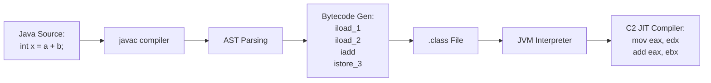
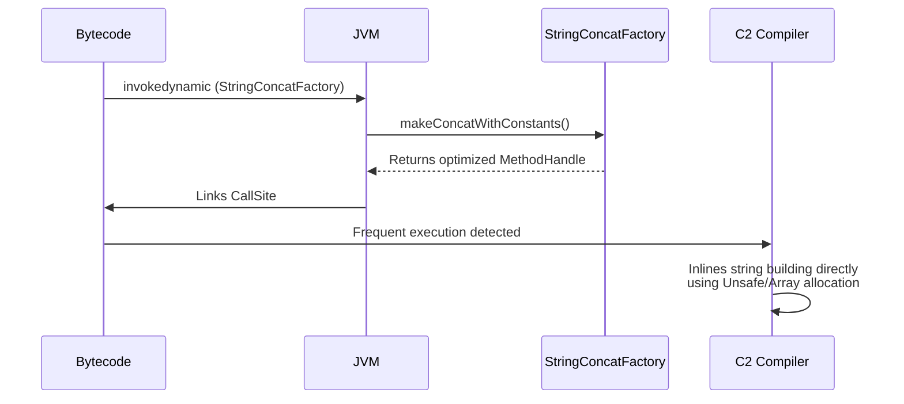
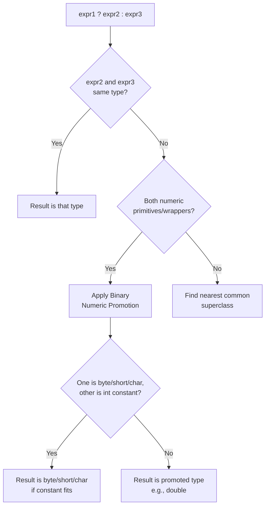

# MODULE 6: OPERATORS — Volume 1: Theory & Internals

Welcome to Module 6, Volume 1. As a Java developer, understanding operators beyond the surface level is what separates framework mechanics from true engineers. In this volume, we will dissect operators not just at the language specification level, but down to the bytecode and JIT compiler optimizations. We will examine edge cases, implicit casting rules, evaluation order, and JVM internals targeting Java 21 LTS.

## PART 1: DEFINITION

### What is an operator?
At its core, an operator is a syntactic symbol that performs an operation on one or more operands and produces a result. Operators are the functional "verbs" of programming—they act upon data (the "nouns") to compute new values, perform assignments, or evaluate conditions. 

In Java, there are approximately 40 operators grouped into 8 primary categories. When analyzing an expression, operators are governed by three fundamental properties defined by the Java Language Specification (JLS):

1. **Precedence (Order of Evaluation):** Determines which operator is evaluated first when an expression contains multiple operators with different precedences (e.g., `*` is evaluated before `+`).
2. **Associativity:** Determines the order of evaluation when operators of the same precedence appear sequentially. Most operators are left-to-right (e.g., `a - b - c` is `(a - b) - c`), but some, like assignment operators, are right-to-left.
3. **Arity:** The number of operands an operator takes:
   - **Unary:** 1 operand (e.g., `-x`, `++i`)
   - **Binary:** 2 operands (e.g., `a + b`, `x == y`)
   - **Ternary:** 3 operands (e.g., `condition ? a : b`)

> [!WARNING]
> **No User-Defined Operator Overloading**
> Unlike C++, Kotlin, or Python, Java strictly prohibits user-defined operator overloading. You cannot define what `+` means for your custom `Money` or `Matrix` classes. The *only* operator overloaded natively by the Java language itself is the `+` operator, which performs String concatenation when at least one operand is a `String`. This design choice was made by James Gosling to keep the language readable and prevent the obfuscation of code semantics.

---

## PART 2: SYNTAX — EVERY DETAIL

### 1. Arithmetic Operators

The arithmetic operators perform standard mathematical operations:
- `+` (addition), `-` (subtraction), `*` (multiplication), `/` (division), `%` (modulus/remainder)
- Unary: `+` (positive promotion), `-` (negation)

#### Division and Modulus Quirks
Integer division in Java truncates *toward zero*. This is distinctly different from Python, which performs floor division (truncation toward negative infinity).
- `7 / 2 = 3`
- `-7 / 2 = -3` (Python gives -4)

The integer modulus operator `%` produces a remainder whose sign matches the **dividend** (the left operand), completely ignoring the sign of the divisor.
- `7 % 2 = 1`
- `-7 % 2 = -1`
- `7 % -2 = 1`

Floating-point operations introduce IEEE 754 standard behaviors:
- `7.0 / 2 = 3.5` (No truncation)

> [!CAUTION]
> **Division by Zero Semantics**
> - **Integer:** `10 / 0` → Throws `java.lang.ArithmeticException: / by zero`
> - **Floating-Point:** `10.0 / 0` → Results in `Infinity` (No exception thrown!)
> - **Floating-Point 0/0:** `0.0 / 0.0` → Results in `NaN` (Not a Number)

Floating-point modulus works as well, computing the exact remainder:
- `5.5 % 2.0 = 1.5`
- `10.0 % 0.0 = NaN`

#### Numeric Promotion
Whenever a binary arithmetic operator is applied, **Binary Numeric Promotion** occurs:
1. If either operand is `double`, the other is promoted to `double`.
2. Otherwise, if either operand is `float`, the other is promoted to `float`.
3. Otherwise, if either operand is `long`, the other is promoted to `long`.
4. Otherwise, **both operands are promoted to `int`**, even if they are `byte`, `short`, or `char`.

Thus, `byte + byte` evaluates to `int`.

### 2. Increment/Decrement Operators

These unary operators modify the variable's value by 1.
- `++x` (Pre-increment): Increment the value, then use the new value in the expression.
- `x++` (Post-increment): Use the current value in the expression, then increment the variable.
- `--x` (Pre-decrement), `x--` (Post-decrement).

> [!TIP]
> **Implicit Casting in Increment**
> Increment and decrement operators include an implicit narrowing cast.
> `short s = 10; s++;` compiles perfectly and is functionally equivalent to `s = (short)(s + 1)`. 

**Operand Stack Evaluation (x++ + ++x):**
```java
int x = 5;
int y = x++ + ++x; // y becomes 12, x becomes 7
```
1. `x++` is evaluated. 5 is pushed to the operand stack. `x` becomes 6 in the local variable array.
2. `++x` is evaluated. `x` becomes 7 in the local variable array. 7 is pushed to the operand stack.
3. The `+` operator pops 5 and 7, adds them, pushing 12.
4. 12 is stored in `y`.

> [!IMPORTANT]
> These operators can ONLY be applied to variables (L-values). Applying them to literals or complex expressions results in a compile error: `5++` is illegal.

### 3. Assignment Operators

- **Simple:** `=`
- **Compound:** `+=`, `-=`, `*=`, `/=`, `%=`
- **Bitwise Compound:** `&=`, `|=`, `^=`, `<<=`, `>>=`, `>>>=`

> [!CAUTION]
> **The Implicit Narrowing Trap**
> Compound assignments automatically apply an implicit cast to the type of the left-hand variable (JLS §15.26.2).
> - `short s = 10; s = s + 5;` → **COMPILE ERROR** (RHS evaluates to `int`, requires explicit cast to `short`).
> - `short s = 10; s += 5;` → **OK!** Equivalent to `s = (short)(s + 5)`.

Assignment operators are **right-to-left associative**, meaning they cascade backward:
`a = b = c = 5;`
1. `c = 5` evaluates to 5.
2. `b = 5` evaluates to 5.
3. `a = 5` evaluates to 5.

Assignment is an expression that returns the assigned value:
`int x; if ((x = getValue()) > 0) { ... }`

### 4. Comparison/Relational Operators

- `==`, `!=`, `<`, `>`, `<=`, `>=` (Result is always `boolean`)

#### Reference vs. Primitive Comparison
For primitives, `==` compares values (with numeric promotion applied first).
For object references, `==` compares **memory addresses (identity)**, NOT content.

- `new String("hello") == new String("hello")` → `false` (different heap objects)
- `"hello" == "hello"` → `true` (String pool references identical object)

> [!WARNING]
> **The Integer Cache Trap**
> Java caches `Integer` instances for values between -128 and 127.
> - `Integer.valueOf(127) == Integer.valueOf(127)` → `true`
> - `Integer.valueOf(128) == Integer.valueOf(128)` → `false`
> Always use `.equals()` for object comparison!

If you mix a wrapper and a primitive, unboxing occurs before comparison:
`new Integer(5) == 5` → `true` (The object is unboxed to `int`, then values are compared).

- `null == null` → `true`. `obj == null` is perfectly valid.

#### Floating-Point Comparison Quirks
- `NaN != NaN` → `true` (`NaN` is inherently unequal to everything, including itself).
- `NaN == NaN` → `false`
- `0.0 == -0.0` → `true` (Despite having completely different bit patterns in IEEE 754).

Use `Double.compare(d1, d2)` or an epsilon comparison (`Math.abs(d1 - d2) < 1e-9`) for precise float checks.

### 5. Logical Operators

- `&&` (Short-circuit AND)
- `||` (Short-circuit OR)
- `!` (Logical NOT)
- `&`, `|` (Non-short-circuit logical AND/OR)

**Short-Circuit Behavior:**
- `&&` evaluates its right operand ONLY if the left operand evaluates to `true`.
- `||` evaluates its right operand ONLY if the left operand evaluates to `false`.

```java
// Safe: length() is never called if str is null
if (str != null && str.length() > 0) 

// DANGER (NPE): Both sides evaluate regardless
if (str != null & str.length() > 0) 
```

> [!NOTE]
> Side effects in short-circuited expressions can cause bugs:
> `if (checkA() || checkB())` -> `checkB()` may never execute if `checkA()` is true. Do not place critical state modifications inside condition checks.

### 6. Bitwise Operators

Operate directly on the bits of integer types (`byte`, `short`, `int`, `long`).

- `&` (Bitwise AND)
- `|` (Bitwise OR)
- `^` (Bitwise XOR)
- `~` (Bitwise Complement / NOT)

**Two's Complement Quirks:**
The `~` operator flips all bits. Because Java uses two's complement for signed integers:
`~x` equals `-(x + 1)`.
- `~0 = -1`
- `~1 = -2`

**Common Bitwise Patterns:**
- **Masking:** `value & 0xFF` (Extracts lowest byte, prevents sign extension during widening).
- **Setting a bit:** `flags | FLAG_READ`
- **Clearing a bit:** `flags & ~FLAG_READ`
- **Toggling a bit:** `flags ^ FLAG_READ`
- **Checking a bit:** `(flags & FLAG_READ) != 0`

**The XOR Swap Trick:**
```java
a ^= b;
b ^= a;
a ^= b;
```
Swaps `a` and `b` without a temporary variable (though modern JIT compilers optimize standard temp variable swaps better).

### 7. Shift Operators

- `<<` (Left Shift): Shifts bits left, fills with 0s. Effectively multiplies by 2^n. `1 << 3 = 8`.
- `>>` (Signed Right Shift): Shifts right, preserves the sign bit (1s for negative, 0s for positive). Effectively divides by 2^n (floor division). `-8 >> 1 = -4`.
- `>>>` (Unsigned Right Shift): Shifts right, filling with 0s regardless of sign.
  - `-1 >>> 1 = 2147483647` (Integer.MAX_VALUE)
  - `-1 >>> 0 = -1` (shift by 0 does nothing)

> [!IMPORTANT]
> **Modulo Shift Distance**
> The shift distance is bounded! For `int`, it's masked with `0x1F` (modulo 32). For `long`, it's masked with `0x3F` (modulo 64).
> `1 << 32` evaluates to `1 << (32 % 32)` = `1 << 0` = `1`.
> `1 << 33` evaluates to `1 << (33 % 32)` = `1 << 1` = `2`.

Note: `byte`, `short`, and `char` are promoted to `int` *before* shifting.

### 8. Ternary (Conditional) Operator

`condition ? valueIfTrue : valueIfFalse`
This is the only ternary operator in Java. It is an expression, returning a value. It is NOT a replacement for if-else in all cases because it can't contain statements.

- `true ? 1 : 1.0` → Returns a `double` (`1.0`). (Binary numeric promotion applies to the branches).
- `true ? (byte) 1 : (byte) 2` → Returns `int`! Numeric promotion occurs when evaluating the expression.
- `true ? 'a' : 0` → Returns `int`.

> [!CAUTION]
> **The Autoboxing Null Trap**
> ```java
> Integer a = null;
> int x = true ? a : 0; // Throws NPE!
> ```
> Because one branch is `int` (0) and the other is `Integer`, the compiler dictates the result type is `int`. It attempts to unbox `a` (which is `null`) by calling `a.intValue()`, causing a NullPointerException.

Can be nested (use parentheses for clarity):
`a > b ? a : (b > c ? b : c)`

### 9. instanceof Operator

`obj instanceof Type` evaluates if `obj` is an instance of `Type` or its subclasses.
- Returns `false` if `obj` is null (Safe from NPE).
- Pattern Matching (Java 16+): `if (obj instanceof String s)` binds variable `s`.
- Primitives (`5 instanceof Integer`) and unrelated types (`"hello" instanceof Integer`) cause compile errors.

### 10. new Operator

Allocates memory on the heap, invokes the constructor, and returns the reference.
- `new Object()`
- `new int[10]`
- `new int[5][5]`

### 11. Cast Operator

`(Type) expression` explicitly converts types. (Covered extensively in Module 5: Type Systems).

### 12. Arrow Operator (Lambda)

`->` separates parameters from the body in lambda expressions. Not technically an operator in JLS terminology, but heavily used as syntax. (Covered in Lambda module).

---

## OPERATOR PRECEDENCE TABLE

| Precedence | Operator Type | Operators | Associativity |
| :--- | :--- | :--- | :--- |
| **1** | Postfix | `expr++`, `expr--` | Left-to-Right |
| **2** | Unary | `++expr`, `--expr`, `+expr`, `-expr`, `~`, `!` | Right-to-Left |
| **3** | Multiplicative | `*`, `/`, `%` | Left-to-Right |
| **4** | Additive | `+`, `-` | Left-to-Right |
| **5** | Shift | `<<`, `>>`, `>>>` | Left-to-Right |
| **6** | Relational | `<`, `>`, `<=`, `>=`, `instanceof` | Left-to-Right |
| **7** | Equality | `==`, `!=` | Left-to-Right |
| **8** | Bitwise AND | `&` | Left-to-Right |
| **9** | Bitwise XOR | `^` | Left-to-Right |
| **10** | Bitwise OR | `\|` | Left-to-Right |
| **11** | Logical AND | `&&` | Left-to-Right |
| **12** | Logical OR | `\|\|` | Left-to-Right |
| **13** | Ternary | `? :` | Right-to-Left |
| **14** | Assignment | `=`, `+=`, `-=`, `*=`, `/=`, `%=`, `&=`, `^=`, `\|=`, `<<=`, `>>=`, `>>>=` | Right-to-Left |

---

## PART 3: INTERNAL WORKING

### How javac Compiles Operators

At the JVM level, there are no "variables" in expressions; there is only the Operand Stack and the Local Variable Array. Operators are compiled into specific bytecode instructions that pop operands off the stack, compute the result, and push it back.

JVM instructions are strictly typed. 
- For `int`: `iadd`, `isub`, `imul`, `idiv`, `irem`
- For `long`: `ladd`, `lsub`, `lmul`, `ldiv`, `lrem`
- For `float`/`double`: `fadd`, `dadd`, etc.
- Negation: `ineg`, `lneg`, `fneg`, `dneg`

Because `byte`, `short`, and `char` are promoted to `int` inside the JVM, there are no `badd` or `sadd` instructions. They all use `iadd`.

#### Increment/Decrement Bytecode
The `iinc <slot> <amount>` instruction is unique: it directly modifies a local variable without pushing it to the operand stack.

**`x++` vs `++x` in an assignment (`y = x++` vs `y = ++x`):**
```text
// y = x++
iload_1       // push x to stack (old value)
iinc 1, 1     // increment x in local array
istore_2      // store top of stack (old value) to y

// y = ++x
iinc 1, 1     // increment x in local array
iload_1       // push x to stack (new value)
istore_2      // store top of stack (new value) to y
```

#### Comparison Bytecode
Comparisons use branching instructions. For ints, it's the `if_icmpXX` family (`if_icmpeq`, `if_icmpne`, `if_icmplt`, `if_icmpgt`, `if_icmple`, `if_icmpge`).
For floats and doubles, it involves `fcmpg`/`fcmpl` or `dcmpg`/`dcmpl`, which push -1, 0, or 1 to the stack, followed by a standard `ifXX` jump.
- `fcmpg`: Pushes 1 if either operand is NaN.
- `fcmpl`: Pushes -1 if either operand is NaN.

#### Short-circuit Logic (`&&` and `||`)
Java does not have an `and` instruction for booleans. Short-circuit logic is compiled into control flow jumps (`goto`, `ifeq`, `ifne`).

For `if (a > 5 && b < 10)`:
```text
   iload_1         // load a
   iconst_5
   if_icmple FAIL  // if a <= 5, jump to FAIL (short circuit)
   iload_2         // load b
   bipush 10
   if_icmpge FAIL  // if b >= 10, jump to FAIL
   // ... body of if ...
FAIL:
   // ... next code ...
```

#### Bitwise & Shift Bytecode
- `iand`, `ior`, `ixor` (and long variants `land`, `lor`, `lxor`)
- `ishl`, `ishr`, `iushr` (and long variants `lshl`, `lshr`, `lushr`)

#### String Concatenation (`+`)
Before Java 9, `String a = "Hello " + name + "!";` compiled to:
`new StringBuilder().append("Hello ").append(name).append("!").toString();`

In Java 9+, JEP 280 introduced `invokedynamic` for concatenation. The compiler emits an `invokedynamic` instruction pointing to `StringConcatFactory.makeConcatWithConstants`. This allows the JVM to lazily generate the most optimized string builder strategy at runtime without bloating the bytecode.

### JIT Optimizations for Operators

The C2 JIT Compiler performs aggressive optimizations on operators at runtime:
- **Strength Reduction:** Replacing expensive operations with cheaper ones. e.g., `x * 2` becomes `x << 1`. `x / 2` (for unsigned) becomes `x >> 1`.
- **Constant Folding:** Expressions involving only constants (`3 + 4 * 2`) are evaluated during compilation and replaced with the result (`11`).
- **Dead Code Elimination:** `if (false && expensiveMethod())` is completely removed from the compiled machine code.
- **Loop-invariant code motion:** Operations that don't change inside a loop are moved outside.
- **Algebraic Simplification:** `x * 1` is reduced to `x`. `x + 0` is reduced to `x`.

---

## PART 4: VISUAL DIAGRAMS

### 1. Precedence Table
*(See Section 2 for complete table)*

### 2. Short-Circuit Evaluation (`&&` and `||`)
```mermaid
graph TD
    Start && --> EvalA1[Evaluate A]
    EvalA1 --> IsATrue{Is A True?}
    IsATrue -- Yes --> EvalB1[Evaluate B]
    EvalB1 --> ResB[Result = B]
    IsATrue -- No --> ResF[Result = false, Skip B]
    
    Start || --> EvalA2[Evaluate A]
    EvalA2 --> IsAFalse{Is A False?}
    IsAFalse -- Yes --> EvalB2[Evaluate B]
    EvalB2 --> ResB2[Result = B]
    IsAFalse -- No --> ResT[Result = true, Skip B]
```

### 3. Operand Stack Trace: `a + b * c - d`
Assuming `a=1`, `b=2`, `c=3`, `d=4`. Precedence forces `b * c` first.
```text
Stack State:
Instruction      Stack (Bottom->Top)   Comment
------------------------------------------------------
iload a          [1]                   Push a
iload b          [1, 2]                Push b
iload c          [1, 2, 3]             Push c
imul             [1, 6]                Pop 2 & 3, push 6
iadd             [7]                   Pop 1 & 6, push 7
iload d          [7, 4]                Push d
isub             [3]                   Pop 7 & 4, push 3
```

### 4. Bit-Level Visualization

```text
a = 12 (0000 1100), b = 10 (0000 1010)

AND (&):     0000 1100
             0000 1010
             ---------
Result (8):  0000 1000  (Only bits set in BOTH are 1)

OR (|):      0000 1100
             0000 1010
             ---------
Result (14): 0000 1110  (Bits set in EITHER are 1)

XOR (^):     0000 1100
             0000 1010
             ---------
Result (6):  0000 0110  (Bits that DIFFER are 1)

NOT (~):     0000 1100
             ---------
Result (-13):1111 0011  (All bits flipped)

LSHIFT (<<1):0000 1100 << 1
Result (24): 0001 1000

RSHIFT (>>1):1111 0100 >> 1 (-12)
Result (-6): 1111 1010
```

### 5. Bytecode Compilation Flow


### 6. Bytecode Instructions per Operator Type Matrix

| Operator | int | long | float | double |
| :--- | :--- | :--- | :--- | :--- |
| `+` | `iadd` | `ladd` | `fadd` | `dadd` |
| `-` | `isub` | `lsub` | `fsub` | `dsub` |
| `*` | `imul` | `lmul` | `fmul` | `dmul` |
| `/` | `idiv` | `ldiv` | `fdiv` | `ddiv` |
| `%` | `irem` | `lrem` | `frem` | `drem` |
| `- (unary)`| `ineg` | `lneg` | `fneg` | `dneg` |
| `&` | `iand` | `land` | N/A | N/A |
| `\|` | `ior` | `lor` | N/A | N/A |
| `^` | `ixor` | `lxor` | N/A | N/A |
| `<<` | `ishl` | `lshl` | N/A | N/A |
| `>>` | `ishr` | `lshr` | N/A | N/A |
| `>>>` | `iushr`| `lushr`| N/A | N/A |

### 7. Post-Increment vs Pre-Increment Operand Stack

```text
Operation: int y = x++;      Operation: int y = ++x;
Initial: x = 5 (slot 1)      Initial: x = 5 (slot 1)

1. iload_1 (Stack: [5])      1. iinc 1, 1 (x in slot 1 is now 6)
2. iinc 1, 1 (x is now 6)    2. iload_1 (Stack: [6])
3. istore_2 (y gets 5)       3. istore_2 (y gets 6)
```

### 8. String Concatenation (Java 9+ invokedynamic)


### 9. Integer Division and Modulus Behavior
| Dividend (`a`) | Divisor (`b`) | `a / b` (Division) | `a % b` (Modulus) |
| :--- | :--- | :--- | :--- |
| 7 | 2 | 3 | 1 |
| -7 | 2 | -3 | -1 |
| 7 | -2 | -3 | 1 |
| -7 | -2 | 3 | -1 |
| 7 | 0 | ArithmeticException | ArithmeticException |

### 10. Ternary Operator Type Promotion Rules

