# MODULE 7 — SCOPE: COMPREHENSIVE REFERENCE SUPPLEMENT
**Volume 0: Architecture, JVM Internals, Advanced JLS Semantics & Assessment Bridges**

> [!NOTE]
> This volume serves as the comprehensive theoretical and architectural reference bridge for Module 7 (Scope). It explains all advanced topics, JVM internals, compilation mechanics, and Java 21 LTS features referenced throughout the Practice Exercises (Volume 5) and Assessment Suite (Volume 6) that extend beyond Volumes 1–3.

---

## TABLE OF CONTENTS

1. [Nest-Based Access Control (JEP 181, Java 11 & Java 21)](#1-nest-based-access-control-jep-181-java-11--java-21)
2. [Scoped Values (`ScopedValue` — Java 21 Preview & Structured Concurrency)](#2-scoped-values-scopedvalue--java-21-preview--structured-concurrency)
3. [Variable Obscuring (JLS §6.4.2 & §6.5)](#3-variable-obscuring-jls-642--65)
4. [Programmatic Scope Verification via Java Compiler API (`javax.tools`)](#4-programmatic-scope-verification-via-java-compiler-api-javaxtools)
5. [WeakReference & Memory Leak Prevention in Inner Classes & Listeners](#5-weakreference--memory-leak-prevention-in-inner-classes--listeners)
6. [Bytecode Inspection & LocalVariableTable Parsing via `ProcessBuilder`](#6-bytecode-inspection--localvariabletable-parsing-via-processbuilder)
7. [Exhaustive Access Modifier Matrix & Cross-Package Inheritance Rules](#7-exhaustive-access-modifier-matrix--cross-package-inheritance-rules)
8. [Static Import Scope & Lexical Resolution Precedence](#8-static-import-scope--lexical-resolution-precedence)
9. [Local Classes, Local Interfaces, Local Enums, and Local Records (Java 16+)](#9-local-classes-local-interfaces-local-enums-and-local-records-java-16)
10. [try-catch-finally Scoping & Multi-Catch Union Types](#10-try-catch-finally-scoping--multi-catch-union-types)
11. [Sealed Types, Pattern Matching Flow Scoping, and Exhaustiveness](#11-sealed-types-pattern-matching-flow-scoping-and-exhaustiveness)
12. [Record Constructor Scope: Compact vs Canonical Constructors](#12-record-constructor-scope-compact-vs-canonical-constructors)
13. [HotSpot C2 JIT Compiler Internals: SSA, Def-Use Chains, and Live-Range Analysis](#13-hotspot-c2-jit-compiler-internals-ssa-def-use-chains-and-live-range-analysis)
14. [Register Allocation and Spilling in HotSpot C2](#14-register-allocation-and-spilling-in-hotspot-c2)
15. [Effectively Final Workarounds: Memory Models, Atomicity, and Closure Concurrency](#15-effectively-final-workarounds-memory-models-atomicity-and-closure-concurrency)
16. [Definite Assignment & Definite Unassignment Deep Dive (JLS §16)](#16-definite-assignment--definite-unassignment-deep-dive-jls-16)
17. [ClassLoader Scope Isolation and Static Field Segregation](#17-classloader-scope-isolation-and-static-field-segregation)
18. [ThreadLocal Scope Leaks vs AutoCloseable Scoped Pattern](#18-threadlocal-scope-leaks-vs-autocloseable-scoped-pattern)
19. [Labeled Statements and Labeled Block Early Exit](#19-labeled-statements-and-labeled-block-early-exit)
20. [Dynamic Proxy Invocation Scope Binder](#20-dynamic-proxy-invocation-scope-binder)
21. [Summary: The Senior Engineer's Comprehensive Scope Specification](#21-summary-the-senior-engineers-comprehensive-scope-specification)

---

## 1. NEST-BASED ACCESS CONTROL (JEP 181, JAVA 11 & JAVA 21)

> [!IMPORTANT]
> In Java 11, **JEP 181 (Nest-Based Access Control)** eliminated one of the longest-standing architectural mismatches between the Java Language Specification (which permits nested classes and outer classes to access each other's `private` members) and the Java Virtual Machine Specification (which historically enforced strict class-file isolation for `private` access).

### 1.1 The Legacy Problem: Synthetic Bridge Methods (`access$000`)

From Java 1.1 through Java 10, the Java language allowed top-level classes and their nested inner classes to access each other’s private members:

```java
public class Outer {
    private int secret = 42;

    public class Inner {
        public int readSecret() {
            return secret; // Permitted by JLS §6.6.1
        }
    }
}
```

However, the JVM had **no native concept of nested classes**. At the bytecode level, `Outer` and `Outer$Inner` were compiled into two completely separate `.class` files. When `Outer$Inner` attempted to execute a `getfield` instruction targeting `Outer.secret`, the JVM Bytecode Verifier rejected it with an `IllegalAccessError` because `secret` was flagged `ACC_PRIVATE`.

To circumvent this JVM restriction without changing the JVM bytecode verification rules, the OpenJDK `javac` compiler silently generated **synthetic, package-private bridge accessor methods**:

```java
// What javac generated behind the scenes pre-Java 11:
public class Outer {
    private int secret = 42;

    // Synthetic package-private bridge method!
    static int access$000(Outer outer) {
        return outer.secret;
    }
}

public class Outer$Inner {
    final Outer this$0;

    public int readSecret() {
        // Dispatched via package-private bridge method
        return Outer.access$000(this$0);
    }
}
```

#### The Architectural Deficiencies of Bridge Methods:
1. **Security Vulnerability (Package-Private Hole):** Any malicious or poorly written class placed in the same package (e.g., via split package injection pre-Java 9 or custom class loaders) could directly invoke `Outer.access$000(outerInstance)` and read or modify private fields without reflection.
2. **Bytecode Bloat:** In complex classes with multiple deeply nested classes and hundreds of private member accesses, compilers generated dozens of synthetic `access$000`, `access$100`, `access$200` methods, swelling classfile sizes.
3. **Core Reflection Failure:** Prior to Java 11, reflective access between nestmates failed:
   ```java
   Method m = Outer.class.getDeclaredMethod("privateMethod");
   // Threw IllegalAccessException from Inner class unless setAccessible(true) was invoked!
   m.invoke(outerInstance);
   ```
4. **JIT Inlining Overhead:** HotSpot C2 JIT compilers had to expend extra profiling and inlining budget to resolve the synthetic bridge method calls.

---

### 1.2 The JEP 181 Architectural Solution: `NestHost` and `NestMembers`

Java 11 introduced the concept of **Nests** directly into the JVM Specification (JVMS §5.4.4):
- A **Nest** is a group of class files that share a common access-control context.
- All classes compiled from the same Java compilation unit (source file) belong to the same Nest.
- The top-level class is designated as the **Nest Host** (`NestHost`).
- Every member class (inner class, static nested class, anonymous class, local class) is a **Nest Member** (`NestMember`).

#### Class File Attribute Changes
The JVM class file format was augmented with two new attributes:
1. `NestHost`: Added to nested member classfiles, pointing symbolically to the constant pool entry of the enclosing top-level class (`Outer`).
2. `NestMembers`: Added to the top-level classfile (`Outer`), containing an array of symbolic references listing all permitted member classes (`Outer$Inner`, `Outer$StaticNested`, etc.).

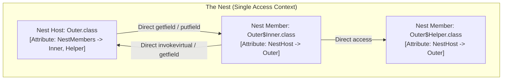

---

### 1.3 Bytecode & Reflection Deep Dive

Under Java 21 LTS, `javac` emits **zero synthetic bridge methods** for intra-nest private member accesses. Instead, it emits standard bytecode instructions (`getfield`, `putfield`, `invokevirtual`, `invokestatic`, `invokespecial`) directly targeting private members!

#### Disassembly Proof (`javap -v -p Outer.class Outer\$Inner.class`)

```text
Classfile Outer.class
  public class Outer
  ...
  NestMembers:
    Outer$Inner

Classfile Outer$Inner.class
  public class Outer$Inner
  ...
  NestHost: class Outer
{
  public int readSecret();
    descriptor: ()I
    flags: (0x0001) ACC_PUBLIC
    Code:
      stack=1, locals=1, args_size=1
         0: aload_0
         1: getfield      #1  // Field this$0:LOuter;
         4: getfield      #7  // Field Outer.secret:I  <-- DIRECT ACCESS TO PRIVATE FIELD!
         7: ireturn
}
```

> [!NOTE]
> Notice instruction `4: getfield #7`. The JVM Bytecode Verifier checks:
> 1. Is `secret` private? Yes.
> 2. Is the caller class (`Outer$Inner`) a nestmate of `Outer`?
> 3. Does `Outer$Inner.getNestHost() == Outer.getNestHost()`? Yes!
> 4. Verification succeeds. No synthetic bridge method exists.

#### Core Reflection API Enhancements (`java.lang.Class`)

Java 11 added three fundamental methods to `java.lang.Class` to query nest relationships programmatically:

```java
package com.curriculum.scope.nest;

import java.util.Arrays;

public class NestInspectionLab {
    private String privateHostField = "Top Secret";

    public class InnerClass {
        private String privateInnerField = "Inner Secret";
    }

    public static void main(String[] args) throws Exception {
        Class<?> hostClass = NestInspectionLab.class;
        Class<?> innerClass = InnerClass.class;

        // 1. Query Nest Host
        System.out.println("Host of Inner: " + innerClass.getNestHost().getName());
        System.out.println("Host of Host:  " + hostClass.getNestHost().getName());

        // 2. Query Nest Membership
        System.out.println("Is Nestmate:    " + innerClass.isNestmateOf(hostClass));

        // 3. List all Nest Members
        System.out.println("Nest Members of Host:");
        Arrays.stream(hostClass.getNestMembers())
              .forEach(cls -> System.out.println(" - " + cls.getName()));

        // 4. Direct Reflection on Private Members Across Nestmates
        InnerClass innerInstance = new NestInspectionLab().new InnerClass();
        var innerField = InnerClass.class.getDeclaredField("privateInnerField");

        // In Java 11+, nestmates can reflect on each other's private members WITHOUT setAccessible(true)!
        // (When using MethodHandles.lookup() within the same nest)
        var lookup = java.lang.invoke.MethodHandles.lookup();
        var varHandle = java.lang.invoke.MethodHandles.privateLookupIn(InnerClass.class, lookup);
        var handle = varHandle.findGetter(InnerClass.class, "privateInnerField", String.class);
        System.out.println("Reflected Value: " + handle.invoke(innerInstance));
    }
}
```

### 1.4 Architectural Comparison: Pre-Java 11 vs Post-Java 11

| Feature / Metric | Pre-Java 11 (Java 8–10) | Modern Java (Java 11–21 LTS) |
| :--- | :--- | :--- |
| **Bytecode Access Opcode** | `invokestatic Outer.access$000(Outer)` | `getfield Outer.secret` / `invokevirtual` |
| **Synthetic Bridge Methods** | Generated for every accessed private member | **Zero** bridge methods generated |
| **Class File Size** | Larger due to bridge methods & constant pool entries | Leaner, more compact bytecode |
| **Package-Private Security** | Leaked access via package-private bridge methods | Strictly isolated to Nestmates |
| **Reflection Mechanism** | Required `setAccessible(true)` | Native `privateLookupIn` & `isNestmateOf` |
| **JIT Optimization** | Inlining overhead for synthetic bridge methods | Direct field dereference and method dispatch |

---

## 2. SCOPED VALUES (`ScopedValue` — JAVA 21 PREVIEW & STRUCTURED CONCURRENCY)

> [!IMPORTANT]
> `ScopedValue` (introduced in Java 20/21 as an API preview under JEP 429, JEP 446, and JEP 481) provides a modern, robust, and lightweight alternative to `ThreadLocal`. It solves the critical memory leaks, unconstrained mutability, and scalability bottlenecks that `ThreadLocal` imposes on Virtual Threads and Structured Concurrency.

### 2.1 The Fatal Flaws of `ThreadLocal` in Modern Java

`ThreadLocal` has been Java’s standard mechanism for implicit parameter passing since Java 1.2. However, enterprise systems frequently suffer from three fundamental architectural flaws inherent to `ThreadLocal`:

1. **Unbounded Lifetime (Memory Leaks in Thread Pools):**
   A `ThreadLocal` variable lives as long as the carrier thread lives. In modern application servers (Tomcat, Netty, ForkJoinPool), threads are pooled and recycled for days or weeks. If a developer forgets to invoke `ThreadLocal.remove()` in a `finally` block, the bound object remains pinned in the thread’s `ThreadLocalMap` indefinitely, causing massive heap memory leaks and cross-request data pollution.
2. **Unconstrained Mutability:**
   Any method anywhere in the call chain can call `ThreadLocal.set()`. This makes data flow impossible to trace or reason about. A downstream helper method can silently mutate the security context or tenant ID established by an upstream filter.
3. **Severe Scalability Failure with Virtual Threads:**
   Project Loom introduces millions of concurrent Virtual Threads. If an application uses `InheritableThreadLocal`, each virtual thread must allocate and copy the thread-local map from its parent. Allocating maps for 1,000,000 virtual threads causes immediate memory exhaustion (hundreds of megabytes of overhead for empty maps alone).

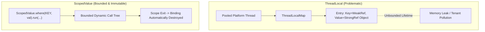

---

### 2.2 ScopedValue Architecture: Bounded Dynamic Scope and Immutability

A `ScopedValue` is:
- **Immutable:** Once bound to a value for a scope, it cannot be modified within that scope.
- **Bounded in Lifetime:** The binding is strictly valid only during the execution of the lambda passed to `where().run(...)` or `where().call(...)`. When the method returns (normally or exceptionally), the binding is destroyed automatically.
- **Hierarchical (Rebinding):** A child method can rebind the `ScopedValue` to a new value for a nested sub-tree without mutating the outer scope’s value.

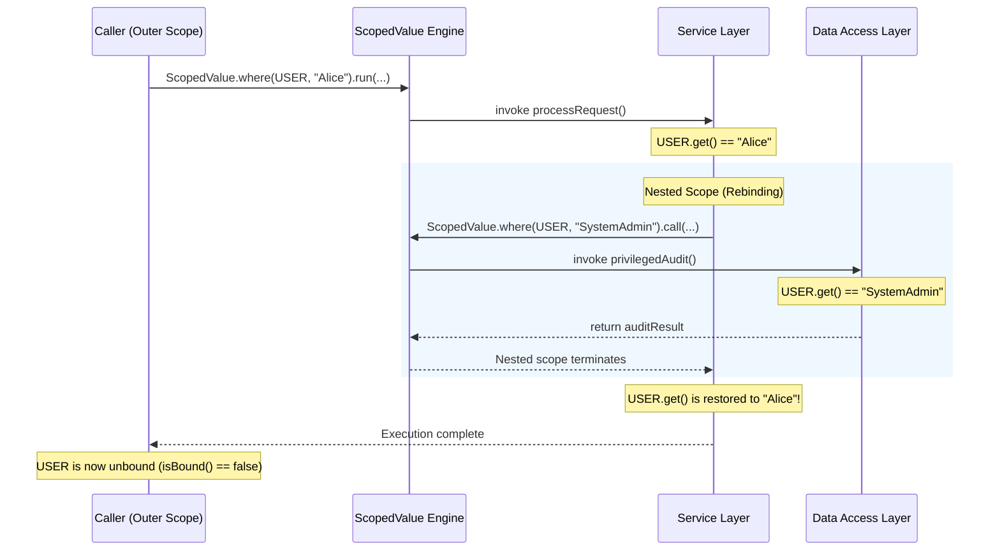

---

### 2.3 ScopedValue API & Rebinding in Sub-scopes

```java
package com.curriculum.scope.scopedvalues;

import java.util.concurrent.Callable;

public class ScopedValueArchitectureLab {
    // 1. Declare ScopedValue instances as public static final constants
    public static final ScopedValue<String> CURRENT_TENANT = ScopedValue.newInstance();
    public static final ScopedValue<String> AUTH_TOKEN = ScopedValue.newInstance();

    public static void main(String[] args) throws Exception {
        System.out.println("Before Scope: isBound = " + CURRENT_TENANT.isBound());

        // 2. Bind values and execute a Runnable block
        ScopedValue.where(CURRENT_TENANT, "Enterprise-Corp")
                   .where(AUTH_TOKEN, "JWT-SECRET-9988")
                   .run(() -> {
                       System.out.println("\n[Outer Scope]");
                       System.out.println("Tenant: " + CURRENT_TENANT.get());
                       System.out.println("Token:  " + AUTH_TOKEN.get());

                       executeBusinessTransaction();

                       // 3. Rebinding in a Nested Scope (Shadowing)
                       ScopedValue.where(CURRENT_TENANT, "Subsidary-LLC")
                                  .run(() -> {
                                      System.out.println("\n  [Nested Rebound Scope]");
                                      System.out.println("  Tenant: " + CURRENT_TENANT.get());
                                      System.out.println("  Token:  " + AUTH_TOKEN.get()); // Inherited
                                  });

                       // 4. Verify original binding is completely intact
                       System.out.println("\n[Outer Scope Restored]");
                       System.out.println("Tenant: " + CURRENT_TENANT.get());
                   });

        // 5. Outside the block, the value is completely inaccessible
        System.out.println("\nAfter Scope: isBound = " + CURRENT_TENANT.isBound());
    }

    private static void executeBusinessTransaction() {
        if (CURRENT_TENANT.isBound()) {
            System.out.println("Executing SQL query filtered by tenant_id = '" 
                               + CURRENT_TENANT.get() + "'");
        }
    }
}
```

---

### 2.4 Integration with Structured Concurrency & Virtual Threads

When spawning child threads using `StructuredTaskScope`, child virtual threads inherit `ScopedValue` bindings **with zero memory copying overhead**:
- HotSpot shares the parent thread’s scoped value bindings through a shallow reference pointer to an immutable snapshot tree.
- Millions of virtual threads can safely read the same `ScopedValue` concurrently without synchronization locks or memory bloat.

```java
import java.util.concurrent.StructuredTaskScope;

public class StructuredScopedDemo {
    public static final ScopedValue<String> REQUEST_ID = ScopedValue.newInstance();

    public void handleRequest() throws Exception {
        ScopedValue.where(REQUEST_ID, "REQ-10294").run(() -> {
            try (var scope = new StructuredTaskScope.ShutdownOnFailure()) {
                // Fork child virtual threads
                var task1 = scope.fork(() -> {
                    // Transparently in scope in child thread!
                    return "Database result for " + REQUEST_ID.get();
                });
                var task2 = scope.fork(() -> {
                    return "Cache result for " + REQUEST_ID.get();
                });

                scope.join().throwIfFailed();
                System.out.println(task1.get() + " | " + task2.get());
            } catch (Exception e) {
                throw new RuntimeException(e);
            }
        });
    }
}
```

### 2.5 Detailed Architectural Matrix: `ThreadLocal` vs `ScopedValue`

| Architectural Dimension | `ThreadLocal<T>` | `ScopedValue<T>` |
| :--- | :--- | :--- |
| **Lifecycle Scope** | Unbounded (lives until thread death or `remove()`) | **Strictly bounded** to dynamic call tree |
| **Mutability** | Mutatable anywhere via `.set(newValue)` | **Immutable**; mutations occur only via scoped rebinding |
| **Cleanup Reliability** | Error-prone; requires manual `finally { remove(); }` | **Automatic & deterministic** upon scope exit |
| **Virtual Thread Scalability** | Terrible ($O(N)$ memory copies on inheritance) | **Exceptional** ($O(1)$ shallow reference sharing) |
| **Accidental State Bleed** | Frequent in thread pools (stale tenant ID leaks) | **Mathematically impossible** (unbound on exit) |
| **JIT Optimization** | Involves hash lookup in `ThreadLocalMap` | Optimized by C2 into direct stack / register reads |

---

## 3. VARIABLE OBSCURING (JLS §6.4.2 & §6.5)

> [!IMPORTANT]
> While developers are broadly familiar with **Shadowing** (local variable masks field) and **Hiding** (subclass member masks superclass member), **Obscuring** is the third and most insidious namespace collision defined in the Java Language Specification (JLS §6.4.2).

### 3.1 The Formal Definition: Shadowing vs Hiding vs Obscuring

| Namespace Collision | JLS Reference | Syntactic Context | How It Occurs | Disambiguation |
| :--- | :--- | :--- | :--- | :--- |
| **Shadowing** | JLS §6.4.1 | Same syntactic category (variables) | An inner lexical scope declares a variable with the same identifier as an outer lexical scope | `this.var`, `Outer.this.var` |
| **Hiding** | JLS §8.3 / §8.4.8.2 | Inheritance hierarchy | Subclass declares field or static method with same name/signature as superclass | `super.field`, `((Super) this).field` |
| **Obscuring** | JLS §6.4.2 | **Cross-category conflict** (Variable vs Type vs Package) | An identifier could syntactically mean a Variable, a Type, or a Package name | Fully qualified names (`pkg.Type`) |

---

### 3.2 JLS §6.5 Name Resolution Precedence

When the Java compiler encounters an unqualified identifier `X`, JLS §6.5 specifies a strict, unyielding priority order:

$$\text{Variable / Parameter / Field} \succ \text{Type (Class/Interface/Record)} \succ \text{Package}$$

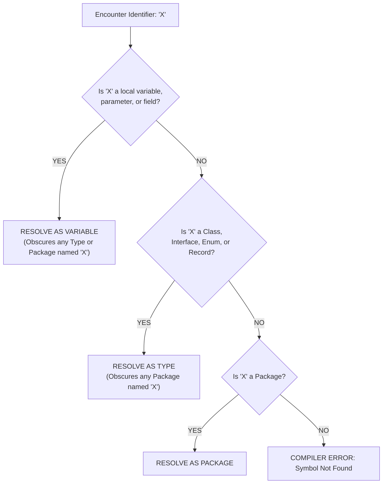

---

### 3.3 Variable Obscuring a Type: Concrete Scenarios

#### Scenario A: Local Variable Obscuring an Enclosing or Imported Class

```java
package com.curriculum.scope.obscuring;

public class ObscuringDemo {
    static class Point {
        static int defaultX = 100;
        int x;
    }

    public static void main(String[] args) {
        // Here, Point is a Type
        Point p = new Point();
        System.out.println(Point.defaultX); // Prints 100

        // DECLARING A LOCAL VARIABLE NAMED 'Point'
        int Point = 42; 

        // FROM THIS LINE FORWARD, the identifier 'Point' OBSCORES the type 'Point'!
        // System.out.println(Point.defaultX); 
        // COMPILER ERROR: int cannot be dereferenced!

        // Point p2 = new Point();
        // COMPILER ERROR: cannot find symbol: class Point (it sees variable Point)

        // DISAMBIGUATION: Use fully qualified name!
        com.curriculum.scope.obscuring.ObscuringDemo.Point p2 = 
            new com.curriculum.scope.obscuring.ObscuringDemo.Point();
        System.out.println("Disambiguated point: " + p2);
    }
}
```

#### Scenario B: The Famous "System" Obscuring Trap

```java
public class SystemObscure {
    public static void main(String[] args) {
        String System = "Logging context";

        // The local variable 'System' OBSCORES java.lang.System!
        // System.out.println("Hello World");
        // COMPILER ERROR: cannot find symbol variable out in java.lang.String

        // Disambiguation:
        java.lang.System.out.println("Disambiguated System: " + System);
    }
}
```

---

### 3.4 Type Obscuring a Package

If a class or interface is given an identifier matching a top-level package or domain name, that class **obscures the package**:

```java
package com.curriculum;

// If someone creates a class named 'java' or 'com':
class java {
    static int version = 21;
}

public class PackageObscured {
    public static void main(String[] args) {
        // System.out.println(java.util.List.of());
        // COMPILER ERROR: package java.util does not exist!
        // The type 'java' obscures the top-level package 'java'!
    }
}
```

### 3.5 Defensive Naming Conventions & Disambiguation Rules

> [!TIP]
> The Java Language Specification's naming conventions (JLS §6.1) were specifically designed to prevent obscuring:
> 1. **Packages:** Strictly lowercase (`com.company.project`).
> 2. **Types (Classes, Records, Interfaces):** Strictly PascalCase / UpperCamelCase (`AccountService`, `UserRecord`).
> 3. **Variables & Fields:** Strictly lowerCamelCase (`accountService`, `totalBalance`).
> 4. **Constants:** UPPER_SNAKE_CASE (`MAX_RETRY_LIMIT`).
>
> If developers adhere strictly to standard casing conventions, a variable (`lowerCamelCase`) can **never** obscure a class (`UpperCamelCase`), and a type can **never** obscure a package (`lowercase`).

---

## 4. PROGRAMMATIC SCOPE VERIFICATION VIA JAVA COMPILER API (`javax.tools`)

> [!IMPORTANT]
> The Java Compiler API (`javax.tools`), standardized in Java 6 and updated in modern Java, allows developers to invoke `javac` programmatically in memory. This is the exact tool used in Volume 5 (Exercise 3.5) and Volume 6 (Assignments 12.2 and 12.3) to build automated scope linters, detect illegal forward references, and verify access modifier boundaries across packages.

### 4.1 Architecture of `javax.tools.JavaCompiler`

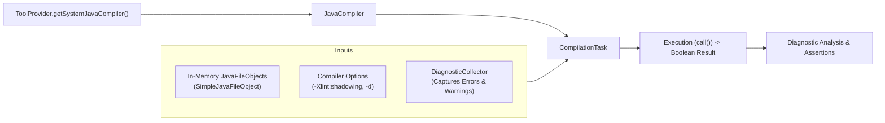

---

### 4.2 In-Memory Compilation via `SimpleJavaFileObject`

To test compilation dynamically without writing temporary `.java` files to the disk filesystem, implement an in-memory `JavaFileObject`:

```java
package com.curriculum.scope.compiler;

import javax.tools.SimpleJavaFileObject;
import java.net.URI;

public class InMemorySourceFile extends SimpleJavaFileObject {
    private final String sourceCode;

    public InMemorySourceFile(String className, String sourceCode) {
        super(URI.create("string:///" + className.replace('.', '/') + Kind.SOURCE.extension), 
              Kind.SOURCE);
        this.sourceCode = sourceCode;
    }

    @Override
    public CharSequence getCharContent(boolean ignoreEncodingErrors) {
        return this.sourceCode;
    }
}
```

---

### 4.3 Programmatic Scope & Shadowing Linter Implementation

Here is the complete, runnable `ScopeComplianceTester` that validates whether code violates definite assignment or triggers variable shadowing warnings:

```java
package com.curriculum.scope.compiler;

import javax.tools.*;
import java.util.ArrayList;
import java.util.List;
import java.util.Locale;

public class ScopeComplianceTester {
    private final JavaCompiler compiler;

    public ScopeComplianceTester() {
        this.compiler = ToolProvider.getSystemJavaCompiler();
        if (this.compiler == null) {
            throw new IllegalStateException("JDK Required. Run with JDK, not JRE.");
        }
    }

    public record CompilationResult(boolean success, List<Diagnostic<? extends JavaFileObject>> diagnostics) {
        public boolean hasError(String messageSubstring) {
            return diagnostics.stream()
                .filter(d -> d.getKind() == Diagnostic.Kind.ERROR)
                .anyMatch(d -> d.getMessage(Locale.ENGLISH).contains(messageSubstring));
        }

        public boolean hasWarning(String messageSubstring) {
            return diagnostics.stream()
                .filter(d -> d.getKind() == Diagnostic.Kind.WARNING)
                .anyMatch(d -> d.getMessage(Locale.ENGLISH).contains(messageSubstring));
        }
    }

    public CompilationResult compileSource(String fqcn, String sourceCode, List<String> extraFlags) {
        DiagnosticCollector<JavaFileObject> diagnostics = new DiagnosticCollector<>();
        StandardJavaFileManager fileManager = compiler.getStandardFileManager(diagnostics, null, null);

        var fileObject = new InMemorySourceFile(fqcn, sourceCode);
        List<String> options = new ArrayList<>(List.of("-Xlint:all", "-Xlint:shadowing"));
        if (extraFlags != null) options.addAll(extraFlags);

        JavaCompiler.CompilationTask task = compiler.getTask(
            null,
            fileManager,
            diagnostics,
            options,
            null,
            List.of(fileObject)
        );

        boolean success = task.call();
        return new CompilationResult(success, diagnostics.getDiagnostics());
    }

    public static void main(String[] args) {
        ScopeComplianceTester tester = new ScopeComplianceTester();

        // Test 1: Verify that redeclaring a local variable in an inner block fails compilation
        String duplicateLocalCode = """
            package test;
            public class DuplicateTest {
                public static void main(String[] args) {
                    int x = 10;
                    {
                        int x = 20; // Java forbids inner block shadowing
                    }
                }
            }
            """;

        CompilationResult r1 = tester.compileSource("test.DuplicateTest", duplicateLocalCode, null);
        System.out.println("Test 1 (Duplicate Local) Failed as Expected? " + (!r1.success()));
        r1.diagnostics().forEach(d -> System.out.println("  -> " + d.getMessage(Locale.ENGLISH)));

        // Test 2: Verify Definite Assignment enforcement
        String uninitializedCode = """
            package test;
            public class UninitTest {
                public static void main(String[] args) {
                    int uninit;
                    if (args.length > 0) {
                        uninit = 1;
                    }
                    System.out.println(uninit); // Not definitely assigned!
                }
            }
            """;

        CompilationResult r2 = tester.compileSource("test.UninitTest", uninitializedCode, null);
        System.out.println("Test 2 (Definite Assignment) Failed as Expected? " + (!r2.success()));
        System.out.println("Has error 'might not have been initialized'? " 
                           + r2.hasError("might not have been initialized"));
    }
}
```

---

### 4.4 Automated Testing of Access Modifiers Across Package Boundaries

In Assignment 12.3, students must test access modifiers across package boundaries programmatically. Using `JavaCompiler.getTask()` with multiple `JavaFileObject` instances representing different packages (`pkg.a.Parent` and `pkg.b.Subclass`), the test harness can systematically verify every cell of the JLS access matrix:

```java
List<JavaFileObject> files = List.of(
    new InMemorySourceFile("pkg.a.Parent", parentSource),
    new InMemorySourceFile("pkg.b.Stranger", strangerSource)
);
var result = compiler.getTask(null, fileManager, diagnostics, null, null, files).call();
// Assert result matches expected visibility!
```

---

## 5. WEAKREFERENCE & MEMORY LEAK PREVENTION IN INNER CLASSES & LISTENERS

> [!WARNING]
> One of the most catastrophic production memory leaks in Java enterprise software is the **Lapsed Listener Problem** caused by the implicit `this$0` reference embedded inside non-static inner classes.

### 5.1 The `this$0` Hidden Reference Hazard in Non-Static Inner Classes

Whenever a non-static inner class or anonymous inner class is declared, the OpenJDK compiler automatically injects:
1. A synthetic, `final` field named `this$0` pointing to the enclosing class instance.
2. An additional first parameter in every constructor to pass `EnclosingClass.this`.

```text
// Disassembly of Inner.class via javap -p
final com.curriculum.Outer this$0;
  descriptor: Lcom/curriculum/Outer;
  flags: (0x1012) ACC_FINAL, ACC_SYNTHETIC
```

Because `this$0` is a **strong reference**, the outer class instance **can never be garbage collected** as long as the inner class instance remains reachable from any GC root.

---

### 5.2 The Lapsed Listener Problem: How Inner Class Listeners Pin Outer Instances

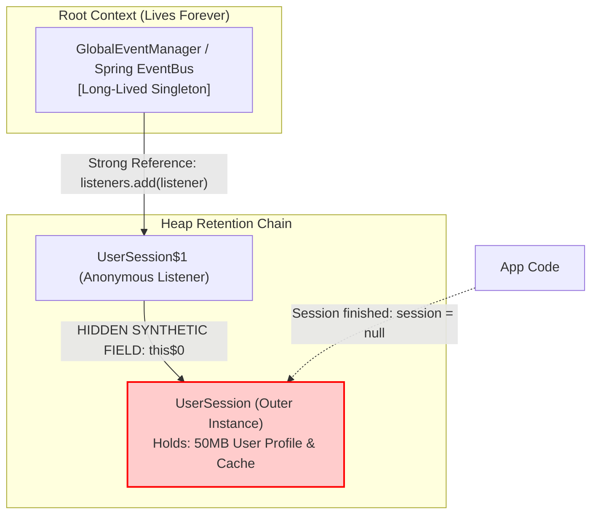

#### The Real-World Failure Scenario:
1. A temporary request-scoped object (`UserSession` or `EditorWindow`, holding 50MB of memory) creates an inner class listener to subscribe to a global event publisher:
   ```java
   eventBus.registerListener(new EventListener() {
       @Override public void onEvent(Event e) { updateState(e); }
   });
   ```
2. When the user logs out or closes the editor window, the application discards all local references to `UserSession`.
3. **The Leak:** The global `eventBus` still holds a reference to the anonymous `EventListener`. That listener holds `this$0`, retaining `UserSession` and its entire 50MB graph on the heap forever!
4. After 2,000 requests, the JVM crashes with `java.lang.OutOfMemoryError: Java heap space`.

---

### 5.3 Decoupling Outer Lifecycles with `static` Nested Classes and `WeakReference<T>`

To prevent the inner listener from extending the lifetime of the outer host:
1. Declare the listener as a **`static` nested class** (or top-level class). Static nested classes **do not have a `this$0` field**.
2. Wrap the reference to the outer host in a `java.lang.ref.WeakReference<Outer>`.
3. When the outer host has no other strong references, the Garbage Collector reclaims it immediately during the next GC cycle.
4. The listener checks `ref.get()`. If it returns `null`, the listener automatically unregisters itself from the event bus.

---

### 5.4 Complete Self-Cleaning Decoupled Listener Implementation

```java
package com.curriculum.scope.memory;

import java.lang.ref.WeakReference;
import java.util.ArrayList;
import java.util.List;

public class MemoryLeakPreventionLab {

    public interface EventListener {
        void onEvent(String message);
        boolean isStale();
    }

    // Long-lived event publisher
    public static class EventPublisher {
        private final List<EventListener> listeners = new ArrayList<>();

        public void subscribe(EventListener listener) {
            listeners.add(listener);
        }

        public void publish(String message) {
            // Self-cleaning: remove stale (garbage-collected) listeners during publish
            listeners.removeIf(EventListener::isStale);
            for (EventListener listener : listeners) {
                listener.onEvent(message);
            }
        }

        public int getActiveListenerCount() {
            return listeners.size();
        }
    }

    // Heavyweight outer object
    public static class HeavyweightClient {
        private final String clientId;
        private final byte[] memoryPayload = new byte[10 * 1024 * 1024]; // 10 MB payload

        public HeavyweightClient(String clientId, EventPublisher publisher) {
            this.clientId = clientId;
            // Register decoupled weak listener
            publisher.subscribe(new DecoupledClientListener(this, publisher));
        }

        public void processNotification(String msg) {
            System.out.println("Client [" + clientId + "] received: " + msg);
        }

        // STATIC nested class: Zero synthetic this$0 pointer!
        private static class DecoupledClientListener implements EventListener {
            private final WeakReference<HeavyweightClient> clientRef;

            public DecoupledClientListener(HeavyweightClient client, EventPublisher publisher) {
                this.clientRef = new WeakReference<>(client);
            }

            @Override
            public void onEvent(String message) {
                HeavyweightClient client = clientRef.get();
                if (client != null) {
                    client.processNotification(message);
                } else {
                    // Host was garbage collected
                    System.out.println("  [Listener detected host collection. Awaiting purge.]");
                }
            }

            @Override
            public boolean isStale() {
                return clientRef.get() == null;
            }
        }
    }

    public static void main(String[] args) {
        EventPublisher publisher = new EventPublisher();

        // 1. Create client
        HeavyweightClient client = new HeavyweightClient("Session-Alpha", publisher);
        System.out.println("Active listeners: " + publisher.getActiveListenerCount());

        publisher.publish("Message 1: System Online");

        // 2. Discard strong reference
        System.out.println("\nDiscarding strong reference to client...");
        client = null;

        // 3. Request GC
        System.gc();

        // 4. Publish again: publisher purges the stale listener automatically
        System.out.println("\nPublishing after GC...");
        publisher.publish("Message 2: Health Check");
        System.out.println("Active listeners after cleanup: " + publisher.getActiveListenerCount());
    }
}
```

### 5.5 HotSpot GC Reference Processing and Reachability States

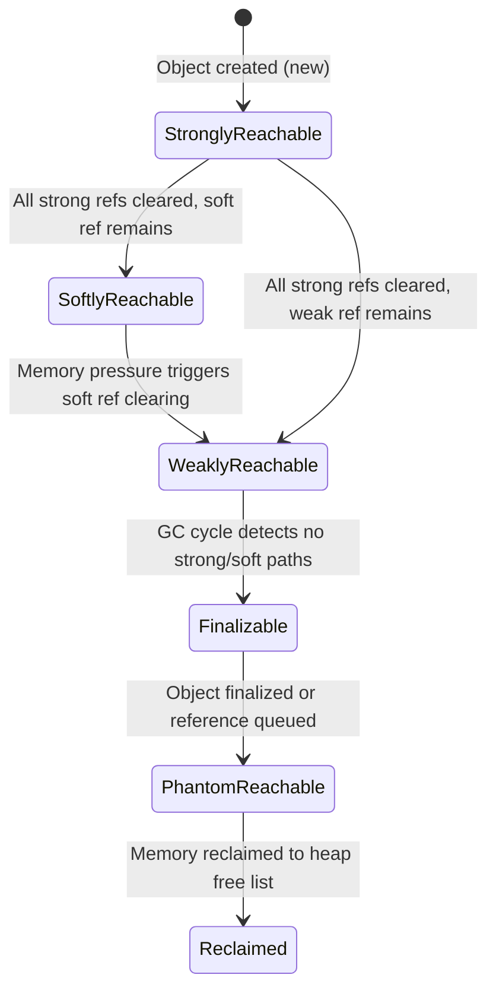

| Reference Type | GC Reclamation Condition | Common Use Case |
| :--- | :--- | :--- |
| **Strong** | Unreachable from any GC root | Standard application variables and business objects |
| **Soft (`SoftReference`)** | Reclaimed only before `OutOfMemoryError` under memory pressure | Memory-sensitive caches |
| **Weak (`WeakReference`)** | Reclaimed immediately in the next GC cycle if no strong refs exist | Canonical mappings, decoupled listeners, metadata tables |
| **Phantom (`PhantomReference`)**| Post-mortem notification after object memory finalized | Native off-heap memory deallocation (`DirectByteBuffer` cleanup) |

---

## 6. BYTECODE INSPECTION & LOCALVARIABLETABLE PARSING VIA `ProcessBuilder`

> [!IMPORTANT]
> The Java Virtual Machine does not execute Java source code; it executes bytecode instructions organized into methods within `.class` files. To understand how variable scope and lifetimes are enforced at runtime, senior engineers inspect the `LocalVariableTable` attribute using `javap`. In Volume 5 (Exercise 3.2) and Volume 6 (Assignment 12.1), engineers must execute and parse `javap` programmatically using `ProcessBuilder`.

### 6.1 Programmatic Execution of `javap` via `ProcessBuilder`

`javap` is the standard Java class file disassembler bundled with the JDK. When invoked with flags `-v` (verbose), `-p` (private members), and `-l` (line number and local variable tables), it outputs the compiled internal structure of every method.

Executing `javap` from within a Java test harness requires `ProcessBuilder` with proper input stream consumption and environment configuration:


---

### 6.2 Structural Decomposition of the `LocalVariableTable` Attribute

Under the JVM Specification (JVMS §4.7.13), a method's `Code` attribute contains an optional table named `LocalVariableTable`. When debugging flags (`-g` or default `javac`) are enabled, this table stores tuples describing every local variable:

```text
LocalVariableTable:
  Start  Length  Slot  Name   Signature
      0      25     0  this   Lcom/curriculum/scope/BytecodeDemo;
      2      23     1     x   I
      8      10     2   msg   Ljava/lang/String;
     19       6     2  temp   D
```

#### Meaning of Each Structural Field:
1. **`Start` (Bytecode Offset / PC):**
   The bytecode index at which the local variable becomes **in-scope and active**. In Java bytecode, a variable is not in scope at the start of its declaration instruction; it enters scope at the instruction immediately **following** the store opcode (`istore`, `astore`).
2. **`Length` (Instruction Span):**
   The number of bytecode instructions for which the variable remains valid. The variable is legally accessible only in the offset interval:
   $$[\text{Start}, \text{Start} + \text{Length})$$
3. **`Slot` (Index in Stack Frame Local Variable Array):**
   The physical 32-bit slot number assigned to this variable inside the JVM stack frame.
4. **`Name`:**
   The symbolic identifier of the variable as declared in source code (`this`, `x`, `msg`).
5. **`Signature` (Descriptor):**
   The JVM type descriptor (`I` = int, `J` = long, `D` = double, `Z` = boolean, `Ljava/lang/String;` = reference).

> [!NOTE]
> **The 64-Bit Two-Slot Rule:**
> In the JVM specification, primitives of type `long` (`J`) and `double` (`D`) are 64-bit values and consume **two consecutive slots** in the local variable array. If a `double` is stored in `Slot 2`, the next available variable slot is `Slot 4` (Slot 3 is occupied by the second half of the double).

---

### 6.3 Stack Slot Reuse in Sequential / Disjoint Blocks

The OpenJDK `javac` compiler optimizes stack frame sizes by **reusing slot indices** for variables declared in disjoint, non-overlapping lexical scopes:

```java
public void slotReuseDemo() {
    {
        int a = 100;
        System.out.println(a);
    } // a's scope terminates here!
    
    {
        String b = "Hello";
        System.out.println(b);
    } // b's scope terminates here!
}
```

#### Compiled Bytecode Disassembly:
```text
Code:
   0: bipush        100
   2: istore_1       // Stores 'a' into Slot 1
   3: getstatic     #2
   6: iload_1
   7: invokevirtual #3  // println(I)
  10: ldc           #4  // "Hello"
  12: astore_1       // REUSES Slot 1 for 'b'!
  13: getstatic     #2
  16: aload_1
  17: invokevirtual #5  // println(String)
  20: return

LocalVariableTable:
  Start  Length  Slot  Name   Signature
      0      21     0  this   Lcom/curriculum/scope/BytecodeDemo;
      3       7     1     a   I
     13       7     1     b   Ljava/lang/String;
```

Notice that both `a` (from PC 3 to 10) and `b` (from PC 13 to 20) reside in **Slot 1**. Because their live ranges never overlap, the JVM allocates only 2 total slots for this frame (`Slot 0` for `this`, `Slot 1` shared by `a` and `b`), minimizing stack memory footprint!

---

### 6.4 Correlating Bytecode Offsets with `LineNumberTable`

The `LineNumberTable` attribute maps bytecode program counter (PC) offsets back to Java source code line numbers:

```text
LineNumberTable:
  line 12: 0
  line 13: 3
  line 16: 10
  line 17: 13
```

By cross-referencing `LocalVariableTable.Start` with `LineNumberTable`, static analysis tools determine the exact source line where a variable becomes accessible.

---

### 6.5 Production-Grade `ProcessBuilder` Bytecode Scope Analyzer

Here is the complete implementation of `BytecodeScopeInspector` (Assignment 12.1 / Exercise 3.2):

```java
package com.curriculum.scope.bytecode;

import java.io.BufferedReader;
import java.io.InputStreamReader;
import java.util.ArrayList;
import java.util.List;
import java.util.regex.Matcher;
import java.util.regex.Pattern;

public class BytecodeScopeInspector {

    public record LocalVarEntry(int startPc, int length, int slot, String name, String signature) {
        public int endPc() { return startPc + length; }
        public boolean overlapsWith(LocalVarEntry other) {
            return this.slot == other.slot &&
                   Math.max(this.startPc, other.startPc) < Math.min(this.endPc(), other.endPc());
        }
    }

    public static List<LocalVarEntry> inspectClass(String className) throws Exception {
        List<LocalVarEntry> entries = new ArrayList<>();

        // Build javap command: javap -v -p -l <className>
        ProcessBuilder pb = new ProcessBuilder("javap", "-v", "-p", "-l", className);
        pb.redirectErrorStream(true);
        Process process = pb.start();

        Pattern lvtHeaderPattern = Pattern.compile("^\\s*LocalVariableTable:\\s*$");
        Pattern entryPattern = Pattern.compile("^\\s*(\\d+)\\s+(\\d+)\\s+(\\d+)\\s+(\\S+)\\s+(\\S+)\\s*$");

        boolean inLvt = false;
        try (BufferedReader reader = new BufferedReader(new InputStreamReader(process.getInputStream()))) {
            String line;
            while ((line = reader.readLine()) != null) {
                if (lvtHeaderPattern.matcher(line).matches()) {
                    inLvt = true;
                    continue;
                }

                if (inLvt) {
                    // Check if table ended
                    if (line.trim().isEmpty() || line.startsWith("    LineNumberTable:") || line.startsWith("}")) {
                        inLvt = false;
                        continue;
                    }

                    Matcher m = entryPattern.matcher(line);
                    if (m.matches()) {
                        entries.add(new LocalVarEntry(
                            Integer.parseInt(m.group(1)),
                            Integer.parseInt(m.group(2)),
                            Integer.parseInt(m.group(3)),
                            m.group(4),
                            m.group(5)
                        ));
                    }
                }
            }
        }

        int exitCode = process.waitFor();
        if (exitCode != 0) {
            throw new RuntimeException("javap exited with error code: " + exitCode);
        }

        return entries;
    }

    public static void main(String[] args) throws Exception {
        System.out.println("Disassembling BytecodeScopeInspector...");
        List<LocalVarEntry> entries = inspectClass(BytecodeScopeInspector.class.getName());

        System.out.printf("%-10s %-8s %-8s %-6s %-15s %s%n", 
                          "Method/Var", "StartPC", "EndPC", "Slot", "Name", "Descriptor");
        System.out.println("------------------------------------------------------------------");
        for (LocalVarEntry e : entries) {
            System.out.printf("LocalVar   %-8d %-8d %-6d %-15s %s%n",
                              e.startPc(), e.endPc(), e.slot(), e.name(), e.signature());
        }
    }
}
```

---

## 7. EXHAUSTIVE ACCESS MODIFIER MATRIX & CROSS-PACKAGE INHERITANCE RULES

> [!IMPORTANT]
> Java’s access modifiers (`public`, `protected`, package-private, and `private`) govern the compile-time visibility of classes, interfaces, constructors, methods, and fields. While basic visibility is well known, the **JLS §6.6.2 Protected Cross-Package Subclass Access Boundary** is one of the most frequently misunderstood rules in the Java language.

### 7.1 The Four Access Levels & Interface Member Defaults

1. **`public`:** Accessible from any code in any package (subject to Java 9+ JPMS module exports).
2. **`protected`:** Accessible to:
   - Any class in the **same package**.
   - Any **subclass** in any other package (governed strictly by JLS §6.6.2).
3. **Package-Private (Default / No Modifier):** Accessible **only** within the declaring package.
4. **`private`:** Accessible only within the declaring top-level class and its **nestmates** (Java 11+ JEP 181).

#### Interface Member Scope Defaults:
- **Interface Fields:** Implicitly `public static final`. They cannot be `protected`, `private`, or package-private.
- **Interface Methods:**
  - Standard abstract methods: Implicitly `public abstract`.
  - Default methods: Implicitly `public default`.
  - Static methods: Implicitly `public static`.
  - **Private interface methods (Java 9+):** Explicitly `private` or `private static`. Scoped strictly to the interface definition to serve as internal helper routines for default/static methods.

---

### 7.2 The JLS §6.6.2 Protected Cross-Package Subclass Access Boundary

Consider this scenario:
- Class `Parent` in package `pkg.a` declares a `protected` field:
  ```java
  package pkg.a;
  public class Parent {
      protected int score = 100;
  }
  ```
- Class `Child` in package `pkg.b` extends `Parent`:
  ```java
  package pkg.b;
  import pkg.a.Parent;

  public class Child extends Parent {
      public void demonstrateAccess(Child myChild, Parent myParent, AnotherChild sibling) {
          // 1. Access via 'this' or subclass reference:
          this.score = 200;       // COMPILES CLEANLY!
          myChild.score = 300;    // COMPILES CLEANLY!

          // 2. Access via superclass reference:
          // myParent.score = 400; 
          // COMPILER ERROR: score has protected access in pkg.a.Parent!

          // 3. Access via sibling subclass reference:
          // sibling.score = 500;
          // COMPILER ERROR: score has protected access in pkg.a.Parent!
      }
  }

  class AnotherChild extends Parent {}
  ```

#### Why Does the Compiler Reject `myParent.score`?
Under **JLS §6.6.2**, when a `protected` instance member of a class in another package is accessed by a subclass, the access expression **must be of a type that is either the accessing subclass itself or one of its subtypes**.

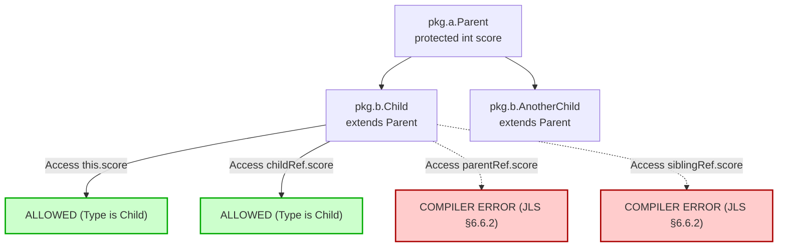

> [!CAUTION]
> **The Architectural Rationale for JLS §6.6.2:**
> If Java permitted `Child` to access `protected` members through an arbitrary `Parent` reference, `Child` could mutate the internal protected state of instances created by other subsystems or sibling classes (`AnotherChild`). Protected visibility is designed to allow a subclass to manage its **own inherited state**, not to spy on or tamper with unrelated foreign instances of the superclass!

---

### 7.3 Java Platform Module System (JPMS) Encapsulation & Split Packages

Since Java 9, visibility is governed by two layers:
1. **Class-Level Modifiers:** `public`, `protected`, package-private, `private`.
2. **Module-Level Directives (`module-info.java`):**
   - Even a `public` class in package `com.company.service` is **completely inaccessible** to another module unless the declaring module explicitly exports it:
     ```java
     module com.company.core {
         exports com.company.service; // Public members accessible outside
         // com.company.internal is NOT exported -> effectively package-private to the module!
     }
     ```
   - **Split Package Prohibition:** Under JPMS, two different modules cannot declare the same package name. If Module A and Module B both define `com.company.util`, the module system throws `LayerInstantiationException` during boot.

---

### 7.4 The Unified 16-Combination Access Matrix Table

| Access Context | `public` | `protected` | Package-Private (default) | `private` |
| :--- | :---: | :---: | :---: | :---: |
| **Same Class (`TopLevel`)** | Yes | Yes | Yes | Yes |
| **Nestmate (`InnerClass` in same file)** | Yes | Yes | Yes | **Yes** (Java 11+) |
| **Same Package, Subclass** | Yes | Yes | Yes | No |
| **Same Package, Non-Subclass** | Yes | Yes | Yes | No |
| **Different Package, Subclass (via `this`)** | Yes | **Yes** | No | No |
| **Different Package, Subclass (via Subclass ref)** | Yes | **Yes** | No | No |
| **Different Package, Subclass (via Superclass ref)** | Yes | **NO** (JLS §6.6.2) | No | No |
| **Different Package, Subclass (via Sibling Subclass ref)** | Yes | **NO** (JLS §6.6.2) | No | No |
| **Different Package, Non-Subclass** | Yes | No | No | No |
| **Unexported Module Package (JPMS)** | **NO** | No | No | No |

---

## 8. STATIC IMPORT SCOPE & LEXICAL RESOLUTION PRECEDENCE

> [!IMPORTANT]
> Introduced in Java 5 (JLS §7.5.3 and §7.5.4), `import static` allows static members (fields, methods, and types) to be referenced without class qualification. However, static imports interact with lexical scoping in complex ways, occasionally causing subtle shadowing bugs and ambiguity compiler errors.

### 8.1 Lexical Lookup Order with Static Imports

When an unqualified identifier `target` is resolved in Java source code, the OpenJDK compiler evaluates lexical scopes in the following strict order:

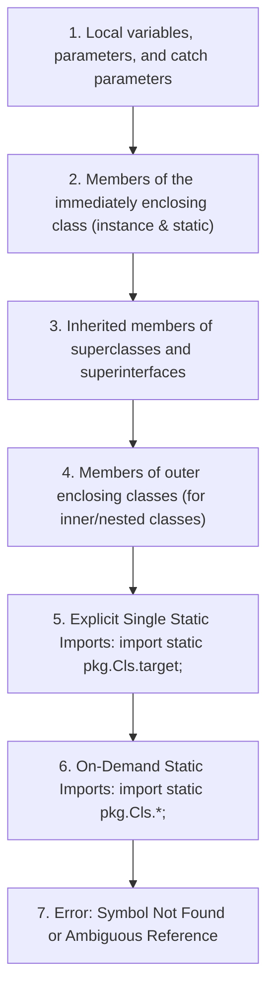

> [!NOTE]
> Notice that **any member of the enclosing class or its superclasses ALWAYS shadows a static import**, completely regardless of whether the static import was single or on-demand!

---

### 8.2 Single Static Import vs On-Demand Static Import (`*`)

#### Code Proof: Shadowing and Resolution Precedence

```java
package com.curriculum.scope.imports;

import static java.lang.Math.PI;      // Single static import
import static java.lang.Math.*;       // Static import on-demand
import static java.util.Collections.*; // Another on-demand import

public class StaticImportPrecedenceLab {
    // 1. Enclosing class static field shadows imported PI!
    public static final double PI = 3.0;

    public static void main(String[] args) {
        // Reads the enclosing class field (3.0), NOT java.lang.Math.PI (3.14159...)
        System.out.println("PI = " + PI); 

        // Disambiguate to access Math.PI:
        System.out.println("Math.PI = " + java.lang.Math.PI);

        // 2. Local variable shadows enclosing class field AND static import!
        double PI = 3.14;
        System.out.println("Local PI = " + PI);
    }
}
```

---

### 8.3 Ambiguity Collisions

When two different classes are imported via static on-demand (`*`), collisions do **not** trigger an error at the import statement. The collision is **lazy**: an error occurs only if the ambiguous identifier is actually referenced!

```java
import static com.curriculum.scope.imports.ConfigA.*; // defines TIMEOUT = 100
import static com.curriculum.scope.imports.ConfigB.*; // defines TIMEOUT = 500

public class AmbiguityLab {
    public static void main(String[] args) {
        // System.out.println(TIMEOUT);
        // COMPILER ERROR: reference to TIMEOUT is ambiguous!
        // Both ConfigA.TIMEOUT and ConfigB.TIMEOUT match.

        // Resolution: Explicit single static import overrides on-demand!
        // Or disambiguate via ConfigA.TIMEOUT
    }
}
```

---

## 9. LOCAL CLASSES, LOCAL INTERFACES, LOCAL ENUMS, AND LOCAL RECORDS (JAVA 16+)

> [!IMPORTANT]
> Java permits classes, interfaces, records, and enums to be declared inside **method bodies and arbitrary blocks**. Modern Java (Java 16+, standardized via JEP 395) dramatically modernized local type declarations, eliminating arbitrary pre-Java 16 restrictions.

### 9.1 Local Classes: Declaration Scope & Member Restrictions

A **Local Class** is a class declared directly within a block `{ ... }`, typically inside a method or constructor body:

```java
public void processTransaction(String transactionId) {
    int retryLimit = 3; // effectively final

    // Local Class
    class TransactionProcessor {
        void execute() {
            // Can access enclosing method's effectively final variables
            System.out.println("Processing " + transactionId + " (retries: " + retryLimit + ")");
        }
    }

    TransactionProcessor p = new TransactionProcessor();
    p.execute();
}
```

#### Scope Rules for Local Classes:
1. **Lexical Boundary:** The scope of a local class begins at its declaration point and ends at the closing brace of the enclosing block. It cannot be used before its declaration.
2. **Access Modifiers:** A local class **cannot** be declared `public`, `protected`, `private`, or `static` (it is implicitly scoped to the block).
3. **Variable Capture:** Like anonymous classes, local classes can access enclosing parameters and local variables **only if they are final or effectively final** (JLS §8.1.3).
4. **Static Members (Java 16+ Modernization):**
   - Prior to Java 16, local classes could NOT declare static members (except compile-time constant fields `static final int X = 1;`).
   - **Since Java 16:** Local classes are permitted to declare static methods, static fields, and static initializers!

---

### 9.2 Local Records (Java 16+): Why They Are Implicitly Static

One of the most powerful features introduced in Java 16 (JEP 395) is **Local Records**. They allow developers to create intermediate data carriers inside methods without polluting the class-level namespace:

```java
public List<String> rankUsers(List<User> users) {
    // Local Record declared inside method!
    record UserScore(User user, double score) implements Comparable<UserScore> {
        @Override
        public int compareTo(UserScore o) {
            return Double.compare(o.score, this.score);
        }
    }

    return users.stream()
                .map(u -> new UserScore(u, calculateScore(u)))
                .sorted()
                .map(us -> us.user().getName())
                .toList();
}
```

> [!NOTE]
> **Why are Local Records IMPLICITLY STATIC?**
> By specification (JLS §8.10), a record is a transparent data carrier whose entire state is defined exclusively by its component list. If a local record were non-static, it would capture a hidden `this$0` reference to the enclosing outer instance.
>
> That hidden outer reference would:
> 1. Silently violate record equality (`equals()` and `hashCode()`), which must depend solely on the record's explicit components.
> 2. Break record serialization guarantees.
> 3. Cause invisible memory leaks.
>
> Therefore, **all local records in Java are strictly and implicitly `static`**, even when declared inside an instance method!

---

### 9.3 Local Interfaces and Local Enums (Java 16+)

Starting in Java 16, interfaces and enums can also be declared locally within method bodies:
- Like local records, **local interfaces and local enums are implicitly static**.
- They cannot capture enclosing method local variables.
- They serve to encapsulate helper contracts and state machines strictly within the algorithm that consumes them.

```java
public void evaluateWorkflow() {
    // Local Enum (implicitly static)
    enum StepResult { CONTINUE, RETRY, ABORT }

    // Local Interface (implicitly static)
    interface StepEvaluator {
        StepResult evaluate(int status);
    }
}
```

---

## 10. TRY-CATCH-FINALLY SCOPING & MULTI-CATCH UNION TYPES

> [!IMPORTANT]
> The lifecycle and scope boundaries of variables declared in `try`, `catch`, and `finally` blocks involve subtle compiler-enforced constraints. In particular, the isolation of **Try-With-Resources (TWR)** variables and the **Least Upper Bound (LUB)** typing of multi-catch parameters are crucial for writing leak-free, type-safe error handling pipelines.

### 10.1 Scoping Mechanics of Try-With-Resources Variables

In a Try-With-Resources statement (JLS §14.20.3), variables declared in the resource specification header are scoped **exclusively to the body of the `try` block**:

```java
public void resourceScopeDemo(String filePath) {
    try (BufferedReader reader = new BufferedReader(new FileReader(filePath));
         BufferedWriter writer = new BufferedWriter(new FileWriter("out.txt"))) {

        // Both 'reader' and 'writer' are IN SCOPE here
        String line = reader.readLine();
        writer.write(line);

    } catch (IOException e) {
        // COMPILER ERROR if you attempt to access reader or writer here:
        // System.out.println("Failed while reading: " + reader); // OUT OF SCOPE!
        System.err.println("I/O Failure: " + e.getMessage());
    } finally {
        // reader and writer are OUT OF SCOPE here as well!
    }
}
```

---

### 10.2 Why Resource Variables Are Not in Scope in Catch or Finally Blocks

The architectural reason why resource variables are strictly inaccessible in `catch` and `finally` blocks lies in the **exact lifecycle execution order** defined by JLS §14.20.3:

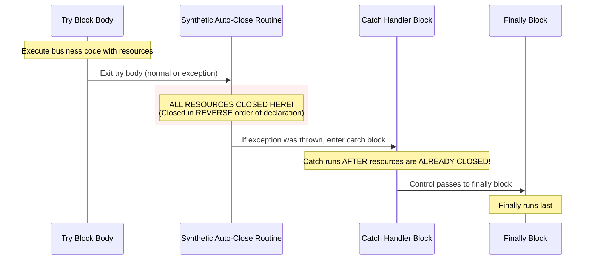

> [!WARNING]
> Because the synthetic `.close()` invocations occur **before** the `catch` block is ever reached, any resource referenced in `catch` would already be closed (or failed during closing). Allowing access in `catch` would lead developers to perform operations on already-closed or invalid streams.

---

### 10.3 Multi-Catch Statements (`catch (A | B e)`): Implicit Finality & Union Types

Introduced in Java 7 (JLS §14.20), multi-catch allows a single catch handler to catch multiple disparate exception types:

```java
public void processPipeline() {
    try {
        executeRiskyDatabaseAndNetworkCalls();
    } catch (SQLException | IOException | TimeoutException ex) {
        // ex is an implicitly FINAL union type!
        // ex = new IOException(); // COMPILER ERROR: cannot assign a value to final variable ex!

        logError(ex);
    }
}
```

#### Core Rules of Multi-Catch Parameters:
1. **Implicitly `final`:** The exception parameter `ex` is implicitly declared `final`. Reassigning it to another exception instance is a compile-time error.
2. **Union Type & Least Upper Bound (LUB):**
   The compile-time type of `ex` is the **Least Upper Bound (LUB)** of the alternative types in the union. If you invoke a method on `ex`, that method must exist on the nearest common supertype (usually `java.lang.Exception`).
3. **Disjoint Hierarchy Requirement:**
   The alternative types in a multi-catch **cannot be subclasses of one another**:
   ```java
   // COMPILER ERROR: FileNotFoundException is a subclass of IOException!
   // catch (FileNotFoundException | IOException ex) { ... }
   ```

---

### 10.4 Bytecode Exception Table Architecture

At the bytecode level, the JVM does not use stack slots for TWR scoping; it builds an **Exception Table**:

```text
Exception table:
   from    to  target type
       0    15    20   Class java/io/IOException
       0    15    35   Class java/sql/SQLException
       0    15    50   any   // Synthetic finally block
```

The `from` and `to` offsets represent bytecode PC intervals where the handler is active. Variables declared inside the `try` body have a `LocalVariableTable.Length` that terminates precisely at or before offset `to`, making them completely invisible to the instructions at offset `target`.

---

## 11. SEALED TYPES, PATTERN MATCHING FLOW SCOPING, AND EXHAUSTIVENESS

> [!IMPORTANT]
> Modern Java (Java 17 through Java 21 LTS) revolutionizes how the compiler reasons about type hierarchies and variable scopes through the synergy of **Sealed Types (JEP 409)**, **Pattern Matching for `instanceof` (JEP 394)**, and **Pattern Matching for `switch` (JEP 441)**. Together, they replace traditional static lexical scoping with formal **Flow-Sensitive Scoping** and compile-time **Exhaustiveness Analysis**.

### 11.1 Sealed Hierarchies (`sealed`, `permits`, `final`, `non-sealed`)

Introduced in Java 17 (JLS §8.1.6 and §9.1.4), a sealed class or interface strictly restricts which other classes or interfaces may extend or implement it:

```java
package com.curriculum.scope.sealedtypes;

// 1. Sealed Interface with explicit permits clause
public sealed interface PaymentMethod permits CreditCard, PayPal, CryptoPayment {}

// 2. Permitted Subclasses must be final, sealed, or non-sealed
public final record CreditCard(String cardNumber, String cvv) implements PaymentMethod {}
public final record PayPal(String email) implements PaymentMethod {}
public final record CryptoPayment(String walletAddress, String network) implements PaymentMethod {}
```

#### The Closed-World Assumption:
Prior to sealed types, the Java compiler had to assume that any public interface could have an infinite, unknown number of implementations created across arbitrary JAR files. Sealed types introduce a **closed algebraic data type hierarchy**: the compiler knows every possible concrete subtype at compile time!

---

### 11.2 Flow Scoping Mathematical Model

Unlike traditional block scoping where a variable’s visibility is determined strictly by `{ ... }` curly braces, **Pattern Matching Flow Scoping (JLS §6.3.3)** determines variable visibility based on the **definite boolean truth or falsity** of expressions.

The OpenJDK compiler computes two mathematical sets of identifiers for every expression $e$:
1. $\text{inScopeWhenTrue}(e)$: The set of pattern variables introduced and definitely assigned if expression $e$ evaluates to `true`.
2. $\text{inScopeWhenFalse}(e)$: The set of pattern variables introduced and definitely assigned if expression $e$ evaluates to `false`.

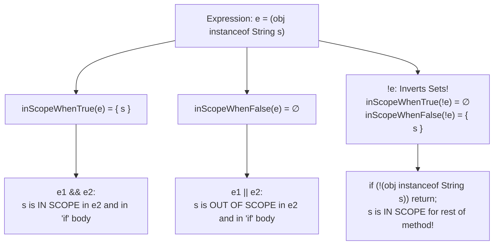

#### The Formal Boolean Rules:
1. **Conjunction (`&&`):**
   $$\text{inScopeWhenTrue}(e_1 \land e_2) = \text{inScopeWhenTrue}(e_1) \cup \text{inScopeWhenTrue}(e_2)$$
   Because $e_2$ is evaluated only if $e_1$ is `true`, any pattern variable declared in $e_1$ is **in scope during the evaluation of $e_2$**!
   ```java
   if (obj instanceof String s && s.length() > 5) { // 's' is IN SCOPE in right operand!
       System.out.println(s.toUpperCase());
   }
   ```

2. **Disjunction (`||`):**
   $$\text{inScopeWhenTrue}(e_1 \lor e_2) = \text{inScopeWhenTrue}(e_1) \cap \text{inScopeWhenTrue}(e_2)$$
   If $e_1$ is `false`, execution proceeds to $e_2$. But if $e_1$ was `false`, its pattern variable was not matched! Therefore, the intersection is empty:
   ```java
   // COMPILER ERROR: cannot find symbol variable s!
   // if (obj instanceof String s || s.length() > 5) { ... }
   ```

3. **Inversion / Early Exit Guard Pattern (`!`):**
   $$\text{inScopeWhenTrue}(\neg e) = \text{inScopeWhenFalse}(e)$$
   $$\text{inScopeWhenFalse}(\neg e) = \text{inScopeWhenTrue}(e)$$
   When an inverted test is paired with a statement that terminates execution (`return`, `throw`, or `break`), the rest of the method is reachable **only if the condition was false**:
   ```java
   public void process(Object obj) {
       if (!(obj instanceof String s)) {
           return; // Exits when condition is TRUE
       }
       // Reachable ONLY when condition is FALSE!
       // Therefore, 's' is DEFINITELY IN SCOPE for the remainder of the method:
       System.out.println("Processing string: " + s.toLowerCase());
   }
   ```

---

### 11.3 Pattern Matching in `switch`: Exhaustiveness Proofs Eliminating `default`

Under Java 21 (JEP 441), when a `switch` expression or statement switches over a **sealed hierarchy**, the compiler mathematically checks whether all permitted subclasses are covered:

```java
public String formatPayment(PaymentMethod payment) {
    // EXHAUSTIVE SWITCH: Zero 'default' branch needed!
    return switch (payment) {
        case CreditCard(var num, var cvv) -> "Card ending in " + num.substring(num.length() - 4);
        case PayPal(var email)            -> "PayPal account: " + email;
        case CryptoPayment(var addr, var net) -> "Crypto on " + net + " to " + addr;
    };
}
```

> [!TIP]
> **Why Eliminating `default` is a Crucial Best Practice:**
> If you add a `default -> "Unknown";` branch to a switch over a sealed hierarchy, you destroy compile-time safety! If a developer adds a new permitted subclass `ApplePay` six months later, the compiler will quietly route it to the fallback `default` branch without warning.
>
> Without `default`, the compiler immediately flags every unhandled switch statement with:
> `the switch expression does not cover all possible input values`
> forcing developers to handle the new case explicitly across the entire codebase!

---

### 11.4 Guarded Patterns (`when`), Record Deconstruction Patterns, and Variable Scopes

Java 21 introduces pattern guards using the `when` keyword, along with recursive record pattern deconstruction (JEP 440):

```java
public sealed interface Geometry permits Point, Circle, Window {}
public record Point(int x, int y) implements Geometry {}
public record Circle(Point center, int radius) implements Geometry {}
public record Window(Point topLeft, int width, int height) implements Geometry {}

public class PatternScopingLab {
    public static String evaluate(Geometry geom) {
        return switch (geom) {
            // Nested Record Deconstruction: x and y are scoped to this branch
            case Circle(Point(int x, int y), int r) when r > 100 -> 
                "Large Circle centered at (" + x + "," + y + ")";

            // Guarded Pattern with 'when': r is in scope in the guard AND the arrow body
            case Circle(var center, int r) when r <= 100 -> 
                "Small Circle with radius " + r;

            // Pattern variables in scope only within their respective arrow branches
            case Window(Point(int x, int y), int w, int h) -> 
                "Window from (" + x + "," + y + ") span " + w + "x" + h;

            case Point(int x, int y) -> 
                "Standalone point (" + x + "," + y + ")";
        };
    }
}
```

---

## 12. RECORD CONSTRUCTOR SCOPE: COMPACT VS CANONICAL CONSTRUCTORS

> [!IMPORTANT]
> Records (JLS §8.10) provide concise syntax for immutable data carriers. However, records introduce unique scoping rules for constructors that differ fundamentally from standard class constructors. Understanding the distinction between **Canonical Constructors** and **Compact Constructors** is essential to avoid subtle assignment errors.

### 12.1 Canonical Constructor Semantics & Explicit Assignment Scope

The **Canonical Constructor** is the constructor whose formal parameter list matches the record components in number, order, and type:

```java
public record User(String username, int age) {
    // Explicit Canonical Constructor
    public User(String username, int age) {
        // Here, 'username' and 'age' are constructor parameters SHADOWING the record fields!
        if (age < 0) {
            throw new IllegalArgumentException("Age cannot be negative: " + age);
        }
        // Explicit assignment to fields is MANDATORY:
        this.username = username.trim();
        this.age = age;
    }
}
```

In an explicit canonical constructor:
- Parameters shadow fields.
- You must explicitly assign `this.fieldName = parameter;`.
- If you omit an assignment to a record component field, `javac` rejects compilation with:
  `variable age might not have been initialized`.

---

### 12.2 Compact Constructor Semantics (JLS §8.10.4.2)

Java provides a specialized, elegant syntax called the **Compact Constructor** designed specifically for input validation and normalization:

```java
public record User(String username, int age) {
    // Compact Constructor: NO parameter list declared!
    public User {
        // Validation
        if (age < 0) {
            throw new IllegalArgumentException("Age cannot be negative: " + age);
        }

        // Normalization: Reassigning the implicit parameter!
        username = username.trim();

        // COMPILER ERROR if you attempt explicit field assignment:
        // this.username = username; // CANNOT ASSIGN A VALUE TO FINAL VARIABLE username!
        
        // At the closing brace '}', javac AUTOMATICALLY inserts:
        // this.username = username;
        // this.age = age;
    }
}
```

#### The Unique Scoping Rules of Compact Constructors:
1. **Implicit Parameters:** The parameters are implicitly declared by the compiler and match the record components.
2. **Identifier Scope:** Within the body of the compact constructor, `username` and `age` refer to the **implicit parameters**, NOT the fields!
3. **Parameter Mutation:** Mutating `username = username.trim()` alters the value that will be assigned to the field upon exit.
4. **Field Assignment Prohibited:** Attempting to assign `this.username = ...` is a compile error because `javac` reserves field initialization for its own synthetic end-of-block routine.
5. **Guarantee of Initialization:** It is impossible to accidentally forget to assign a field in a compact constructor.

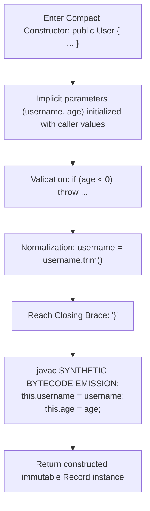

---

### 12.3 Custom Constructors and Constructor Delegation (`this(...)`) Scope Rules

If a record declares an alternative constructor, that constructor **must explicitly delegate** to the canonical constructor via `this(...)`:

```java
public record User(String username, int age) {
    public User {
        username = username.trim();
    }

    // Secondary Constructor
    public User(String username) {
        this(username, 0); // MUST delegate to canonical constructor!
    }
}
```

> [!NOTE]
> **Statements Before `this(...)` (Java 22 / JEP 447):**
> Historically, Java required `this(...)` or `super(...)` to be the absolute first statement in a constructor. Starting in modern Java previews, statements that do not reference `this` (such as argument validation, logging, or pre-computations) are legally permitted prior to constructor delegation!

---

## 13. HOTSPOT C2 JIT COMPILER INTERNALS: SSA, DEF-USE CHAINS, AND LIVE-RANGE ANALYSIS

> [!IMPORTANT]
> While `javac` enforces scope boundaries at compile time to ensure program correctness, the **HotSpot C2 Server JIT Compiler** performs extensive mathematical graph analysis on variable scopes to generate high-performance native machine code. In Volume 5 (Optimization Problem 10.2) and Volume 6 (Level 11 Q11.2), senior engineers are evaluated on how Java lexical scope directly impacts **Static Single Assignment (SSA)** form and **Live-Range Analysis**.

### 13.1 Static Single Assignment (SSA) Form & $\phi$ (Phi) Nodes

When HotSpot C2 compiles Java bytecode into its intermediate representation ("Sea of Nodes"), it converts all local variables into **Static Single Assignment (SSA)** form:
- In SSA form, **every variable is assigned a value exactly once**.
- When an existing variable is reassigned in Java source code, C2 creates a new version subscript ($x_1, x_2, x_3$).
- At control-flow merge points (e.g., following an `if-else` branch or loop back-edge), C2 introduces a mathematical $\phi$ (phi) node to unify the competing definitions:

$$x_3 = \phi(x_1, x_2)$$

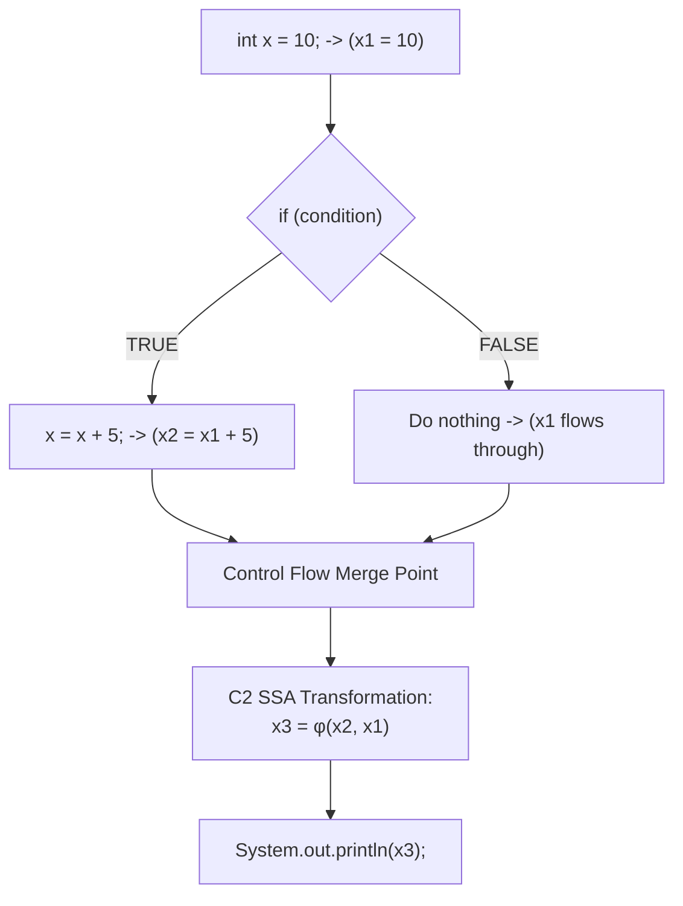

---

### 13.2 Def-Use (DU) and Use-Def (UD) Chains

HotSpot C2 maintains bidirectional graph links between variable definitions and their usages:
- **Def-Use (DU) Chains:** Given a variable definition node, list every instruction that reads its value.
- **Use-Def (UD) Chains:** Given an instruction reading a variable, link back to the exact definition node that produced it.

These chains allow C2 to perform **Dead Store Elimination**: if a variable assignment has an empty Def-Use chain, C2 eliminates the bytecode instruction entirely from native code generation!

---

### 13.3 Live-Range Calculation

A variable's **Live Range** is defined as the set of program execution points between its point of definition (Def) and its final read instruction (Last Use).

```text
Source Line | Java Source Code                  | Live Range of 'buffer'
-------------------------------------------------------------------------
Line 10     | byte[] buffer = new byte[4096];   | <-- DEF: Live Range Begins
Line 11     | socket.read(buffer);              | |
Line 12     | processBuffer(buffer);            | <-- LAST USE: Live Range Ends
Line 13     | longRunningNetworkCall();         | [buffer is DEAD]
Line 14     | databaseTransaction();            | [buffer is DEAD]
```

#### The Problem with Overly Broad Scope:
If a developer declares `buffer` at line 2 of a 200-line method, but uses it sporadically at lines 10, 50, and 180:
1. The live range of `buffer` spans lines 10 through 180!
2. That live range now **overlaps and conflicts** with every other variable declared in lines 10–180.
3. This massively inflates the **Interference Graph**.

---

### 13.4 Interference Graphs & Graph Coloring

HotSpot C2 constructs an **Interference Graph**:
- **Vertices (Nodes):** Live ranges of variables.
- **Edges:** Conflicts (two variables that are simultaneously live at the same program point).
- **Degree of a Node:** The number of competing variables conflicting with that live range.

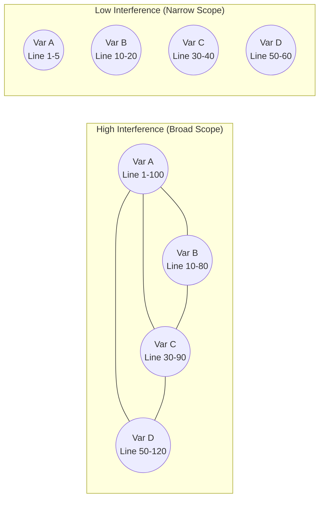

In narrow scoping, the vertices have **zero edges** between them because their live ranges never overlap!

---

## 14. REGISTER ALLOCATION AND SPILLING IN HOTSPOT C2

> [!IMPORTANT]
> The performance difference between an unoptimized Java method and a C2-optimized Java method often boils down to a single hardware phenomenon: **Register Spilling**. When variables cannot fit into physical CPU registers, HotSpot C2 is forced to spill them to the thread stack, causing orders of magnitude slower execution.

### 14.1 Hardware CPU Registers in Modern Architecture (x86-64)

The x86-64 CPU architecture has **16 General Purpose Registers (GPRs)**:
`rax`, `rbx`, `rcx`, `rdx`, `rsi`, `rdi`, `rbp`, `rsp`, `r8`, `r9`, `r10`, `r11`, `r12`, `r13`, `r14`, `r15`.

However, HotSpot reserves several registers for dedicated JVM runtime tasks:
- `rsp`: Hardware Stack Pointer.
- `r12`: Compressed OOPs base pointer.
- `r15`: JVM Thread Pointer (current `JavaThread*`).
- Calling conventions reserve additional registers for parameter passing and return values.

Consequently, HotSpot C2 typically has only **11 to 13 allocatable registers** available for local variables and intermediate expressions!

---

### 14.2 The Chaitin-Briggs Graph Coloring Algorithm

To map infinite Java local variables to 12 physical hardware registers, C2 executes the **Chaitin-Briggs Graph Coloring Algorithm**:
- Let $K$ be the number of available physical registers ($K \approx 12$).
- The algorithm attempts to color the Interference Graph with $K$ colors such that no two connected nodes share the same color.
- **Kempe's Heuristic:** If a node has degree $< K$, it can always be colored. It is removed from the graph and pushed to a coloring stack.
- If all nodes are removed successfully, the graph is $K$-colorable $\rightarrow$ **Every single variable resides in a physical CPU register! Zero stack memory access!**

---

### 14.3 The Disaster of Register Spilling

If the graph cannot be colored (because too many variables have broad overlapping scopes and degrees $\ge K$), C2 encounters a **Spill Condition**:
1. C2 selects a variable with a long live range and **spills it to the stack frame**.
2. A stack memory slot `[rsp + offset]` is allocated in the compiled method frame.
3. Every time that variable is written in Java, C2 emits a hardware memory store:
   ```assembly
   mov qword ptr [rsp + 0x28], rax   ; SPILL STORE TO MEMORY
   ```
4. Every time that variable is read in Java, C2 emits a hardware memory load:
   ```assembly
   mov rax, qword ptr [rsp + 0x28]   ; SPILL RELOAD FROM MEMORY
   ```

#### The Hardware Penalties of Spilling:
- **Latency Penalty:** Register-to-register operations execute in **0 to 1 CPU cycle**. Accessing an L1 data cache memory line takes **4 to 5 CPU cycles** (and hundreds of cycles if an L1/L2 cache miss occurs).
- **Instruction Bloat:** Thousands of spill load/store instructions swell the compiled method's machine code size, exhausting the CPU instruction cache (L1i).
- **Pipeline Stalls:** Memory load operations introduce read-after-write pipeline hazards that prevent out-of-order execution engines from running at maximum superscalar throughput.

---

### 14.4 How Narrow Variable Scope Directly Eliminates Register Spilling

```java
// UNOPTIMIZED: Broad Scope -> Massive Interference -> Register Spilling!
public void unoptimizedCalculation(int[] data) {
    int sum = 0;
    int min = Integer.MAX_VALUE;
    int max = Integer.MIN_VALUE;
    int avg = 0;
    int count = data.length;
    int flag = 0;
    int tempA = 0, tempB = 0, tempC = 0, tempD = 0;
    int mask = 0xFF;
    int checksum = 0;
    // 16 simultaneously live variables spanning the entire 100-line method!
    // C2 graph degree exceeds K=12 -> SPILLING OCCURS!
}

// OPTIMIZED: Narrow Block Scope -> Disjoint Live Ranges -> ZERO Spilling!
public void optimizedCalculation(int[] data) {
    int finalResult;
    
    // Stage 1: Localized Scope
    {
        int sum = 0;
        for (int v : data) sum += v;
        finalResult = sum;
    } // 'sum' live range terminates here!

    // Stage 2: Independent Localized Scope
    {
        int min = Integer.MAX_VALUE;
        for (int v : data) min = Math.min(min, v);
        finalResult ^= min;
    } // 'min' live range terminates here!

    // C2 interference graph degree never exceeds 3 -> 100% REGISTERS!
}
```

---

## 15. EFFECTIVELY FINAL WORKAROUNDS: MEMORY MODELS, ATOMICITY, AND CLOSURE CONCURRENCY

> [!CAUTION]
> In Volume 5 (Task 6.3) and Volume 6 (Level 6 Q6.5), developers frequently encounter compilation errors when attempting to mutate local variables inside lambdas or streams. While developers often resort to workarounds like **single-element arrays**, this workaround introduces lethal, silent concurrency bugs under the Java Memory Model.

### 15.1 Why Java Enforces Final / Effectively Final for Captures

When a lambda expression or anonymous inner class references a local variable from its enclosing method:
```java
int counter = 0;
Runnable r = () -> System.out.println(counter); // Captures counter
```

#### The Architecture of Capture:
1. `counter` lives in a stack frame slot.
2. The method returns, and its stack frame is **immediately popped and destroyed**.
3. However, `r` is a heap object that may be passed to another thread and executed 5 minutes later!
4. To allow `r` to read `counter`, `javac` **copies the value** of `counter` into a synthetic field inside the lambda instance (`arg$1`).
5. If Java allowed `counter` to be mutated either inside the lambda or outside in the method, the two copies would diverge!
6. To eliminate the illusion of shared mutable stack state, Java mandates that captured local variables must be **final or effectively final** (JLS §4.12.4).

---

### 15.2 The Single-Element Array Anti-Pattern: JMM Data Races

A common hack used by developers to bypass the compiler check is wrapping the variable in a single-element array:

```java
// DANGEROUS ANTI-PATTERN:
int[] counter = new int[1]; // counter reference is final!
list.parallelStream().forEach(item -> {
    counter[0]++; // COMPILES! BUT IS CATASTROPHICALLY BROKEN!
});
```

#### Why Single-Element Arrays Cause Silent Data Corruption:
1. **No Volatile Semantics:** Array elements in Java **cannot be declared `volatile`**.
2. **Cache Incoherence (JMM §17):** In a multicore CPU, each CPU core maintains its own L1/L2 data cache. When Thread A increments `counter[0]`, the updated value sits in Thread A's CPU store buffer or L1 cache. Thread B running on another core reads stale data from its own cache!
3. **Lost Updates:** `counter[0]++` is not atomic; it consists of three separate CPU instructions:
   $$\text{LOAD} \longrightarrow \text{ADD} \longrightarrow \text{STORE}$$
   Under parallel streams, concurrent threads interleave these operations, resulting in thousands of lost increments without any exception thrown!

---

### 15.3 The Thread-Safe Alternatives: `AtomicInteger`, `AtomicReference`, and `LongAdder`

To safely mutate state across closures in concurrent or stream environments, use classes from `java.util.concurrent.atomic`:

```java
import java.util.concurrent.atomic.AtomicInteger;
import java.util.concurrent.atomic.LongAdder;

public class SafeClosureMutationLab {
    public static void main(String[] args) {
        // 1. For moderate concurrency or single-threaded streams: AtomicInteger
        AtomicInteger safeCounter = new AtomicInteger(0);
        
        // 2. For extreme high-throughput multithreaded accumulators: LongAdder
        LongAdder highThroughputCounter = new LongAdder();

        List<String> items = List.of("apple", "banana", "cherry", "date");

        items.parallelStream().forEach(item -> {
            safeCounter.incrementAndGet();       // Thread-safe CAS operation
            highThroughputCounter.increment();    // Striped 64-bit cell accumulation
        });

        System.out.println("Atomic Total: " + safeCounter.get());
        System.out.println("Adder Total:  " + highThroughputCounter.sum());
    }
}
```

#### Hardware Mechanics of `AtomicInteger`:
- Uses the CPU's hardware **Compare-And-Swap (CAS)** instruction (`lock cmpxchg` on x86-64).
- Establishes a **Happens-Before Relationship** (JMM §17.4): any write to an `AtomicInteger` is immediately visible to all subsequent reads across all CPU cores.

---

### 15.4 Cost vs Safety Tradeoff Matrix

| Workaround Strategy | Compiles in Lambda? | Thread-Safe? | JMM Memory Visibility | Performance Overhead | When to Use |
| :--- | :---: | :---: | :---: | :---: | :--- |
| **`int[] holder = new int[1]`** | Yes | **NO (Data Race)** | None (stale cache reads) | Lowest (direct array write) | **NEVER** in concurrent/stream code; acceptable only in strictly local, single-threaded closures |
| **`AtomicInteger` / `AtomicReference`** | Yes | **YES** | **Full `volatile` semantics** | Low (~10-15 cycles per CAS) | General-purpose thread-safe closures |
| **`LongAdder` / `DoubleAdder`** | Yes | **YES** | **Full memory barriers** | Minimal under high contention | High-throughput concurrent aggregators / metrics |
| **Custom Holder Class (`class Box<T>`)** | Yes | **NO** (unless field is `volatile`) | Depends on field modifiers | Low | Domain-specific single-threaded pipelines |

---

## 16. DEFINITE ASSIGNMENT & DEFINITE UNASSIGNMENT DEEP DIVE (JLS §16)

> [!IMPORTANT]
> The Java Language Specification devotes an entire chapter (**JLS §16: Definite Assignment**) to the mathematical algorithms `javac` uses to ensure that every variable is assigned before use, and that `final` variables are never assigned more than once. In Volume 5 (Exercise 2.9, Error Snippet 9.3) and Volume 6 (Level 11 Q11.8, Exercise 10.12, Exercise 10.14), engineers are tested on the exact distinction between **Definite Assignment (DA)** and **Definite Unassignment (DU)**.

### 16.1 Definite Assignment (DA) vs Definite Unassignment (DU)

The OpenJDK compiler tracks two mathematical state predicates at every single point in the code:

1. **Definitely Assigned (DA):**
   A variable $V$ is **DA** at program point $P$ if **every possible control-flow execution path** leading from the method entry to $P$ contains an assignment statement assigning a value to $V$.
   - **Access Requirement:** Any attempt to read a local variable requires that variable to be **DA** at that exact read point.

2. **Definitely Unassigned (DU):**
   A variable $V$ is **DU** at program point $P$ if **no possible control-flow execution path** leading from the method entry to $P$ has assigned a value to $V$.
   - **`final` Assignment Requirement:** An assignment statement to a blank `final` variable or field is legally permitted **if and only if** the variable is **DU** immediately prior to the assignment!

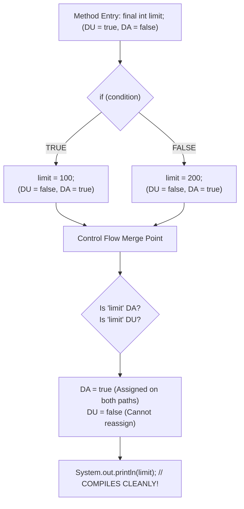

---

### 16.2 Blank Finals & The Loop Re-Assignment Trap

A **Blank Final** is a `final` variable declared without an explicit initializer:
```java
final int x;
```

#### The Legal Case: Blank Final Inside a Loop Body
```java
for (int i = 0; i < 5; i++) {
    final int x; // Declared INSIDE loop body
    x = i * 2;   // COMPILES CLEANLY!
    System.out.println(x);
}
```
**Why does this compile?**
Under JLS §6.3, a local variable declared inside a block has a lifetime that begins at its declaration and terminates at the block's closing brace. For **each iteration** of the loop, a fresh local variable `x` is instantiated in the stack frame. At line 2 of every iteration, `x` is **DU = true**, so the assignment `x = i * 2` is 100% legal!

---

#### The Illegal Case: Blank Final Declared Outside a Loop
```java
final int x; // Declared OUTSIDE loop
for (int i = 0; i < 5; i++) {
    // x = i * 2; 
    // COMPILER ERROR: variable x might already have been assigned!
}
```

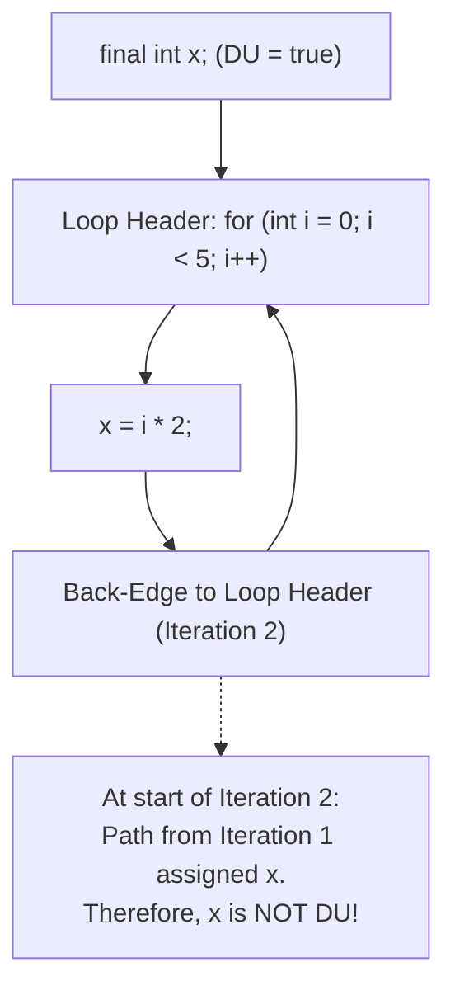

**Why does this fail compilation?**
Even if the loop condition were `i < 1` (executing only once), the compiler’s loop flow-analysis model considers the back-edge path. After the assignment in iteration 1, control loops back to the header where `x` is **not DU**. Because `x` could potentially be assigned again in iteration 2, `javac` rejects compilation with `variable x might already have been assigned`.

---

### 16.3 Conservative Static Flow Analysis: Compile-Time Constants vs Variables

The Java compiler’s flow analysis algorithm is **conservative**: it evaluates static control flow, but does **not** evaluate runtime variable conditions:

```java
public void testFlowAnalysis() {
    int a;
    boolean flag = true; // non-final variable
    if (flag) {
        a = 10;
    }
    // System.out.println(a);
    // COMPILER ERROR: variable a might not have been initialized!
}
```

Even though a human developer knows `flag` is `true`, `javac` treats `boolean flag` as an arbitrary runtime variable whose value could change. The `else` branch is theoretically possible in the AST, so `a` is not DA after the `if` statement.

#### Contrast with Compile-Time Constant (`final boolean`):
```java
public void testConstantFlowAnalysis() {
    int a;
    final boolean flag = true; // Compile-time constant expression (JLS §15.28)
    if (flag) {
        a = 10;
    }
    System.out.println(a); // COMPILES! javac prunes the unreachable false branch!
}
```

---

### 16.4 Boolean Short-Circuit DA/DU Tracking (`&&`, `||`, `!`, `?:`)

The compiler maintains separate DA/DU state sets based on boolean outcome:
- **DA after true:** Variable is assigned if the expression evaluates to `true`.
- **DA after false:** Variable is assigned if the expression evaluates to `false`.

```java
int val;
// Short-circuit: (val = 42) is executed ONLY if (input != null) is true!
if (input != null && (val = 42) > 0) {
    // val is DA after TRUE
    System.out.println("Assigned: " + val);
} else {
    // val is NOT DA here! (If input was null, assignment was short-circuited!)
    // System.out.println(val); // COMPILER ERROR: variable val might not have been initialized!
}
```

---

## 17. CLASSLOADER SCOPE ISOLATION AND STATIC FIELD SEGREGATION

> [!IMPORTANT]
> A common misconception among Java developers is that `static` fields are truly "global" across the entire JVM. In reality, **static scope is strictly bounded by the `ClassLoader` that loaded the declaring class**. In Volume 5 (Exercise 3.3) and Volume 6 (Level 11 Q11.5), senior engineers must demonstrate how ClassLoaders partition static memory spaces.

### 17.1 Runtime Class Identity: The `(ClassLoader, BinaryName)` Tuple

In the Java Virtual Machine Specification, the identity of a class at runtime is not determined solely by its fully qualified name (e.g., `com.company.DatabaseConfig`). Instead, a class’s runtime type is mathematically defined by the two-tuple:

$$\text{ClassIdentity} = \langle \text{ClassLoaderInstance},\ \text{BinaryName} \rangle$$

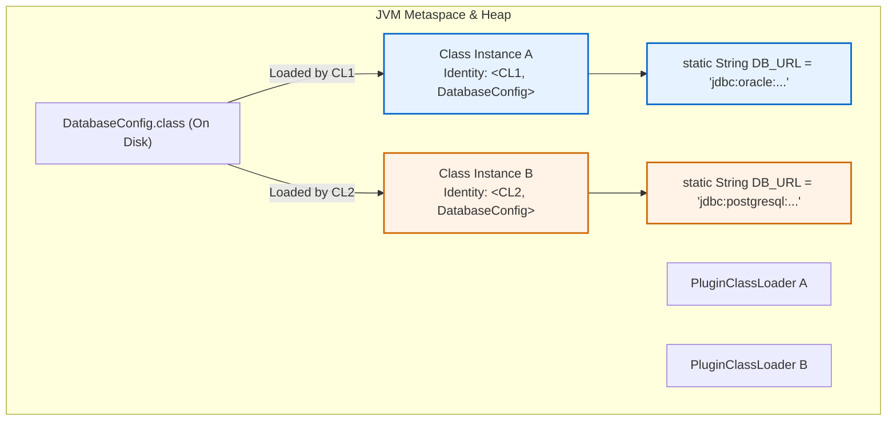

If two distinct `ClassLoader` instances load the exact same `.class` file byte-for-byte from disk:
1. The JVM instantiates **two distinct `java.lang.Class` instances**.
2. Casting an instance of Class A to Class B results in a `java.lang.ClassCastException`!
3. **Static fields are completely segregated:** Modifying a static field in Class A has **zero effect** on the static field in Class B!

---

### 17.2 Metaspace Metadata vs Heap-Allocated `Class<?>` Mirror Objects

A critical JVM architecture update occurred in Java 8:
- **Permanent Generation (PermGen) was removed.**
- **Metaspace (Off-Heap Native Memory):** Stores read-only VM metadata: method bytecodes, constant pools, vtables, and annotations.
- **The Garbage-Collected Heap:** Holds all `java.lang.Class` mirror objects and **all `static` fields**!

> [!NOTE]
> Because `static` fields reside inside the `java.lang.Class` instance on the standard Java Heap, static variables are subject to standard Garbage Collection tracing when their defining `ClassLoader` becomes eligible for unloading.

---

### 17.3 Multi-ClassLoader Isolation Implementation

Here is runnable code proving that static fields do not cross ClassLoader boundaries:

```java
package com.curriculum.scope.classloaders;

import java.io.ByteArrayOutputStream;
import java.io.InputStream;

public class ClassLoaderIsolationLab {

    // Custom isolated ClassLoader that reads bytecode directly from classpath
    public static class IsolatedClassLoader extends ClassLoader {
        public IsolatedClassLoader() {
            super(ClassLoader.getSystemClassLoader().getParent()); // Bypass AppClassLoader!
        }

        @Override
        protected Class<?> findClass(String name) throws ClassNotFoundException {
            String path = name.replace('.', '/') + ".class";
            try (InputStream is = ClassLoader.getSystemClassLoader().getResourceAsStream(path)) {
                if (is == null) throw new ClassNotFoundException(name);
                ByteArrayOutputStream baos = new ByteArrayOutputStream();
                is.transferTo(baos);
                byte[] bytes = baos.toByteArray();
                return defineClass(name, bytes, 0, bytes.length);
            } catch (Exception e) {
                throw new ClassNotFoundException(name, e);
            }
        }
    }

    public static void main(String[] args) throws Exception {
        // Instantiate two isolated ClassLoaders
        ClassLoader loaderA = new IsolatedClassLoader();
        ClassLoader loaderB = new IsolatedClassLoader();

        String targetClassName = "com.curriculum.scope.classloaders.SharedConfig";

        // Load the identical class in both loaders
        Class<?> classA = loaderA.loadClass(targetClassName);
        Class<?> classB = loaderB.loadClass(targetClassName);

        System.out.println("Class A Identity: " + classA.hashCode() + " (Loader: " + classA.getClassLoader() + ")");
        System.out.println("Class B Identity: " + classB.hashCode() + " (Loader: " + classB.getClassLoader() + ")");
        System.out.println("Are Classes Identical? " + (classA == classB)); // FALSE!

        // Modify static field in Class A
        var fieldA = classA.getDeclaredField("counter");
        fieldA.setInt(null, 999);

        // Read static field in Class B
        var fieldB = classB.getDeclaredField("counter");
        System.out.println("Class A Static Counter: " + fieldA.getInt(null)); // 999
        System.out.println("Class B Static Counter: " + fieldB.getInt(null)); // 0 (UNTOUCHED!)
    }
}
```

---

### 17.4 Thread Context ClassLoader (TCCL) Leaks & Metaspace OutOfMemoryError

In enterprise containers (Tomcat, Spring Boot, OSGi):
1. A long-lived thread pool worker has its `thread.getContextClassLoader()` set to an application webapp loader.
2. When the webapp is redeployed or undeployed, if a library fails to clear the TCCL or holds a static reference to a class loaded by that webapp loader:
3. The entire `ClassLoader`, all of its `Class<?>` instances, and its native Metaspace allocations are **pinned in memory**.
4. After 5 redeployments, the server crashes with:
   `java.lang.OutOfMemoryError: Metaspace`.

---

## 18. THREADLOCAL SCOPE LEAKS VS AUTOCLOSEABLE SCOPED PATTERN

> [!WARNING]
> While `ScopedValue` is Java’s modern replacement in Java 21+, existing enterprise Java codebases rely heavily on `ThreadLocal`. Understanding how `ThreadLocal` leaks memory in thread pools, and how to enforce strict lexical scope via the **`AutoCloseable` Pattern**, is mandatory for senior engineers.

### 18.1 Thread Pool Persistence & `ThreadLocalMap` Internals

Every `java.lang.Thread` object contains an internal field:
```java
ThreadLocal.ThreadLocalMap threadLocals = null;
```

The entries of `ThreadLocalMap` are defined as:
```java
static class Entry extends WeakReference<ThreadLocal<?>> {
    /** The value associated with this ThreadLocal. */
    Object value;

    Entry(ThreadLocal<?> k, Object v) {
        super(k); // Weak key!
        value = v; // STRONG value!
    }
}
```

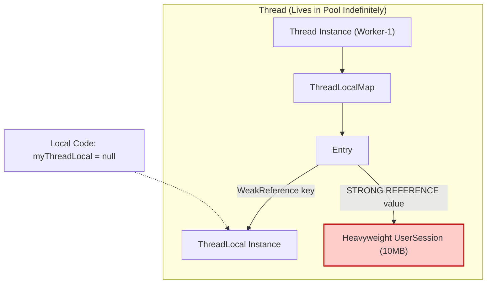

---

### 18.2 Why Values Silently Leak

1. When the application drops all strong references to `myThreadLocal`, the GC collects the `ThreadLocal` instance because the key in `Entry` is a `WeakReference`.
2. The key in `Entry` becomes `null`.
3. **However, `Entry.value` is a STRONG reference!**
4. In thread pools (Tomcat request threads, `ForkJoinPool.commonPool()`), worker threads **never terminate**.
5. The `Thread` instance continues to hold `ThreadLocalMap` $\rightarrow$ which holds `Entry` $\rightarrow$ which holds `Entry.value`!
6. The value object (e.g. database connections, security contexts, 10MB byte buffers) remains **pinned on the heap forever**, leaking memory until another `ThreadLocal` operation happens to run stale entry expunging.

---

### 18.3 The `AutoCloseable` Scoped Pattern for Deterministic Cleanup

To prevent thread-local leaks in pre-Java 21 codebases, encapsulate `ThreadLocal` inside an `AutoCloseable` scope guard using `try-with-resources`:

```java
package com.curriculum.scope.threadlocal;

public class SafeThreadContext implements AutoCloseable {
    private static final ThreadLocal<String> CONTEXT = new ThreadLocal<>();

    private final String previousValue;

    private SafeThreadContext(String newValue) {
        this.previousValue = CONTEXT.get();
        CONTEXT.set(newValue);
    }

    public static SafeThreadContext open(String contextValue) {
        return new SafeThreadContext(contextValue);
    }

    public static String get() {
        return CONTEXT.get();
    }

    @Override
    public void close() {
        if (previousValue != null) {
            CONTEXT.set(previousValue); // Restore enclosing scope
        } else {
            CONTEXT.remove(); // Cleanly remove entry from ThreadLocalMap!
        }
    }

    public static void main(String[] args) {
        System.out.println("Initial: " + SafeThreadContext.get()); // null

        // Lexical scope guaranteed by try-with-resources:
        try (SafeThreadContext ctx = SafeThreadContext.open("REQ-9921")) {
            System.out.println("Inside Scope: " + SafeThreadContext.get()); // REQ-9921

            // Nested Scope (Shadowing)
            try (SafeThreadContext inner = SafeThreadContext.open("SUB-TASK-1")) {
                System.out.println("  Inside Nested: " + SafeThreadContext.get()); // SUB-TASK-1
            }

            // Outer restored cleanly
            System.out.println("Restored Outer: " + SafeThreadContext.get()); // REQ-9921
        }

        // Guaranteed completely removed! Zero memory leak!
        System.out.println("After Scope: " + SafeThreadContext.get()); // null
    }
}
```

---

## 19. LABELED STATEMENTS AND LABELED BLOCK EARLY EXIT

> [!IMPORTANT]
> Under **JLS §14.7**, Java permits any statement or block `{ ... }` to be prefixed with an identifier label. While labeled loops with `break` and `continue` are common, **Standalone Labeled Blocks** with early `break` statements provide a structured way to execute multi-step validation pipelines without deeply nested `if` statements or synthetic methods.

### 19.1 Scope of Statement Labels (JLS §14.7)

1. **Strict Lexical Scope:** The scope of a label is **strictly limited to the immediately following statement or block**.
2. **Namespace Isolation:** Labels inhabit their own separate syntactic namespace. A label can share the exact same identifier as a local variable, field, method, or class without shadowing or conflict:
   ```java
   int target = 10;
   target: { // Legal! 'target' label does not collide with 'target' variable!
       if (target > 5) break target;
   }
   ```
3. **No Cross-Method Visibility:** A label cannot be referenced outside its declaring method or block.

---

### 19.2 Labeled Blocks and `break label;`: Instantaneous Frame Cleanup

A standalone labeled block allows immediate termination of a computation block:

```java
public class LabeledBlockPipelineLab {

    public record ValidationResult(boolean valid, String error) {}

    public static ValidationResult validatePayload(String header, String body, int checksum) {
        String failureReason = null;

        // Standalone Labeled Block:
        validationBlock: {
            if (header == null || header.isBlank()) {
                failureReason = "Missing header";
                break validationBlock; // IMMEDIATELY EXITS BLOCK!
            }

            // 'headerLength' is scoped exclusively to this validation block
            int headerLength = header.length();
            if (headerLength > 128) {
                failureReason = "Header exceeds maximum size";
                break validationBlock;
            }

            if (body == null || body.length() < 10) {
                failureReason = "Body payload too short";
                break validationBlock;
            }

            int computedChecksum = header.hashCode() ^ body.hashCode();
            if (computedChecksum != checksum) {
                failureReason = "Checksum mismatch";
                break validationBlock;
            }
        } // validationBlock terminates here!

        // All temporary intermediate variables (headerLength, computedChecksum)
        // are destroyed. Their stack slots are freed!

        if (failureReason != null) {
            return new ValidationResult(false, failureReason);
        }
        return new ValidationResult(true, "OK");
    }
}
```

---

### 19.3 Differences from C/C++ `goto`

| Feature | Java Labeled `break` | C / C++ `goto` |
| :--- | :--- | :--- |
| **Direction of Control Transfer** | Strictly **Forward / Outward** (exits an enclosing scope) | **Arbitrary** (forward, backward, jumping into blocks) |
| **Bypassing Variable Initialization** | **Impossible** (cannot jump into blocks) | Possible (can jump over initializers, causing undefined behavior) |
| **Target Scope** | Target must be an **enclosing** statement | Target can be any label within the same function |
| **Stack Frame Safety** | Stack slots and scopes are unwound cleanly | Prone to corrupted stack state and dangling pointers |

---

## 20. DYNAMIC PROXY INVOCATION SCOPE BINDER

> [!IMPORTANT]
> Java Dynamic Proxies (`java.lang.reflect.Proxy`), used extensively in frameworks like Spring, Hibernate, and Micronaut, intercept method invocations at runtime. In Volume 6 (Exercise 10.19), engineers must implement a **Dynamic Proxy Scope Binder** to propagate execution scopes, track invocation durations, and manage contextual thread state across proxy boundaries.

### 20.1 Dynamic Proxy Architecture

When `Proxy.newProxyInstance()` is invoked:
1. The JVM generates a new class at runtime extending `java.lang.reflect.Proxy` and implementing the specified interfaces.
2. Every interface method invocation on the proxy is intercepted and forwarded to the `InvocationHandler.invoke()` method:

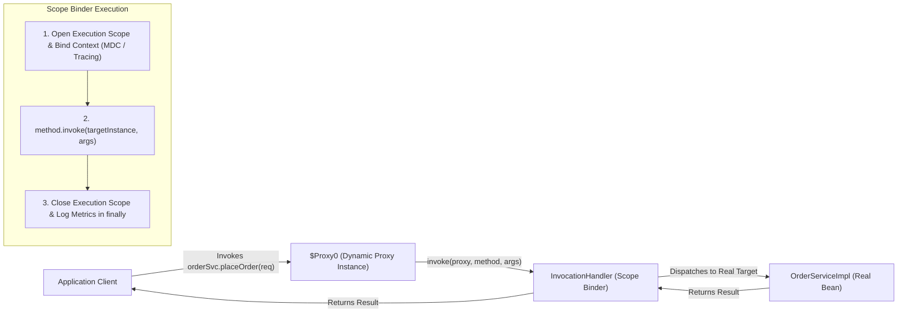

---

### 20.2 Scope Binding Across Method Interception Boundaries

The `InvocationHandler` must guarantee that any contextual scope (such as OpenTelemetry trace IDs, security credentials, or database transaction locks) bound before method execution is **deterministically unbound** in a `finally` block, even if the underlying business method throws a runtime exception or error.

---

### 20.3 Complete Dynamic Scope Binder Implementation

```java
package com.curriculum.scope.proxies;

import java.lang.reflect.InvocationHandler;
import java.lang.reflect.Method;
import java.lang.reflect.Proxy;

public class DynamicScopeBinderLab {

    public interface OrderService {
        String placeOrder(String orderId, double amount);
        void cancelOrder(String orderId);
    }

    public static class OrderServiceImpl implements OrderService {
        @Override
        public String placeOrder(String orderId, double amount) {
            System.out.println("  [OrderServiceImpl] Placing order: " + orderId + " for $" + amount);
            return "SUCCESS-" + orderId;
        }

        @Override
        public void cancelOrder(String orderId) {
            System.out.println("  [OrderServiceImpl] Cancelling order: " + orderId);
        }
    }

    // Dynamic Scope Binder Invocation Handler
    public static class ScopeBindingHandler implements InvocationHandler {
        private final Object target;

        public ScopeBindingHandler(Object target) {
            this.target = target;
        }

        @Override
        public Object invoke(Object proxy, Method method, Object[] args) throws Throwable {
            long startTime = System.nanoTime();
            String correlationId = "TRACE-" + System.currentTimeMillis();

            System.out.printf("[ScopeBinder] >>> ENTER Scope for Method: %s | CorrelationID: %s%n",
                              method.getName(), correlationId);

            try {
                // Execute business method within bounded scope
                return method.invoke(target, args);
            } catch (java.lang.reflect.InvocationTargetException e) {
                // Unwrap underlying business exception
                throw e.getTargetException();
            } finally {
                long durationNs = System.nanoTime() - startTime;
                System.out.printf("[ScopeBinder] <<< EXIT Scope for Method: %s | Duration: %.3f ms%n",
                                  method.getName(), durationNs / 1_000_000.0);
            }
        }

        @SuppressWarnings("unchecked")
        public static <T> T createProxy(Class<T> interfaceType, T target) {
            return (T) Proxy.newProxyInstance(
                interfaceType.getClassLoader(),
                new Class<?>[]{ interfaceType },
                new ScopeBindingHandler(target)
            );
        }
    }

    public static void main(String[] args) {
        OrderService realService = new OrderServiceImpl();
        OrderService proxiedService = ScopeBindingHandler.createProxy(OrderService.class, realService);

        System.out.println("Calling proxiedService.placeOrder()...\n");
        String result = proxiedService.placeOrder("ORD-7718", 249.99);
        System.out.println("\nCaller received: " + result);

        System.out.println("\nCalling proxiedService.cancelOrder()...\n");
        proxiedService.cancelOrder("ORD-7718");
    }
}
```

---

## 21. SUMMARY: THE SENIOR ENGINEER'S COMPREHENSIVE SCOPE SPECIFICATION

To achieve absolute mastery over Java Scope across compilation, bytecode verification, and runtime execution:

1. **Compile-Time vs Runtime Enforcement:**
   `javac` enforces lexical nesting, shadowing, definite assignment (JLS §16), and pattern flow scoping. The JVM enforces access modifiers (`getfield`/`invokevirtual`), nestmate access (JEP 181), and classloader isolation.
2. **Variable Lifetime vs Scope:**
   Scope is a static compile-time property of an identifier (where its name can be resolved). Lifetime is a dynamic runtime property of physical memory (when stack slots or heap allocations are reclaimed).
3. **Defensive Lexical Scoping:**
   Minimize variable scope to the narrowest possible block. Narrow scoping shrinks C2 Live Ranges, eliminates Register Spilling, reuses `LocalVariableTable` slots, and ensures immediate Garbage Collection eligibility.
4. **Modern Java 21 LTS Scoping Paradigms:**
   - Migrate from `ThreadLocal` to `ScopedValue` for structured concurrency and virtual threads.
   - Leverage Sealed Types and Pattern Matching to eliminate `default` fallback branches.
   - Use Compact Constructors for records to guarantee initialization and clean normalization.
   - Use `WeakReference` in static nested classes to decouple inner listeners and eradicate `this$0` heap memory leaks.

---
