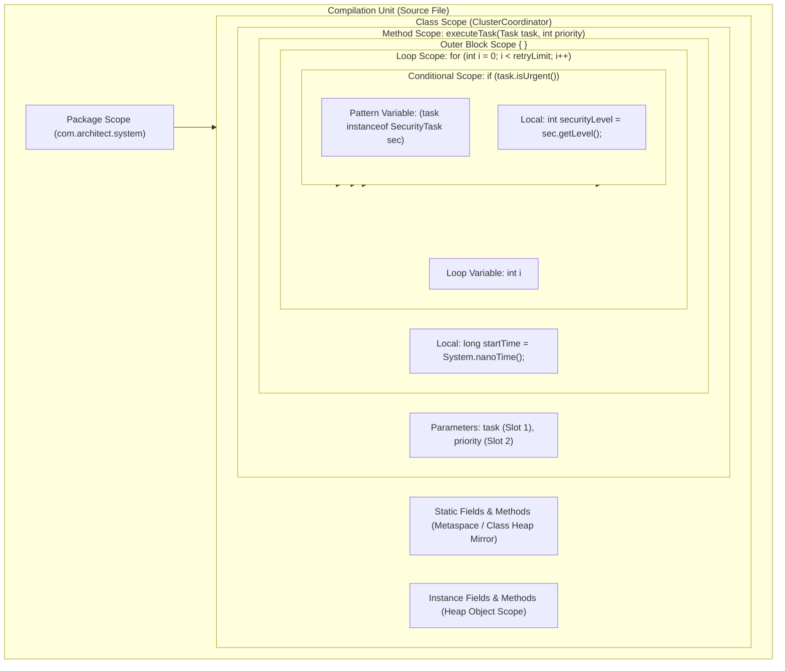
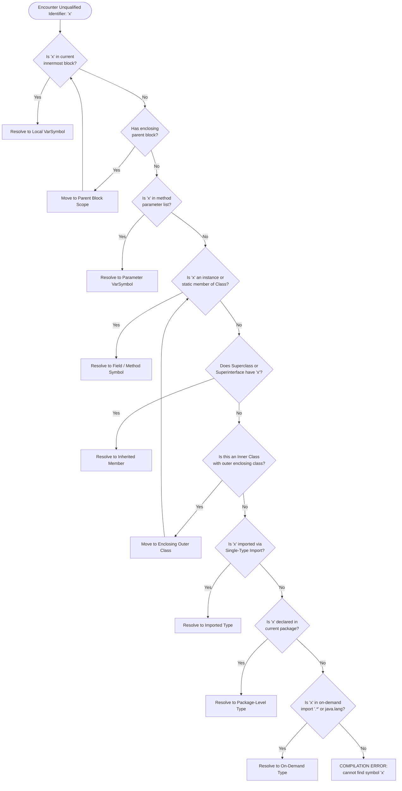
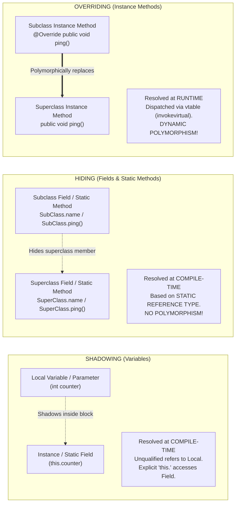
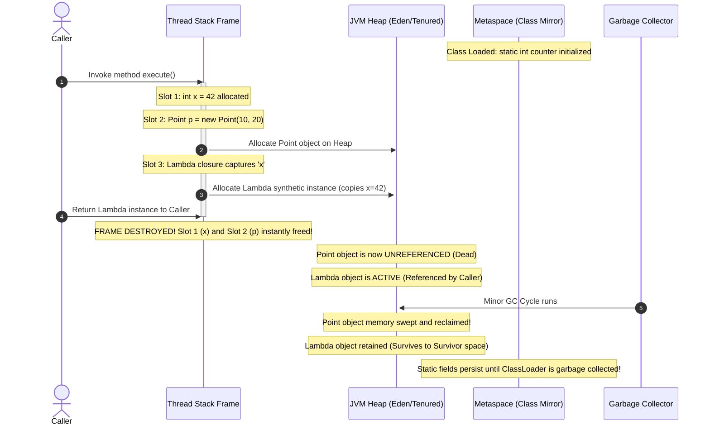

# MODULE 7: SCOPE — Volume 1: Theory & Internals

Welcome to Module 7, Volume 1 of the Java Mastery Curriculum. In this module, we will explore the foundational mechanics of variable, method, and type visibility in the Java programming language. 

As a software engineer operating at an advanced or staff level, understanding scope is not simply a matter of knowing where a variable can be referenced without triggering a compile-time error. It requires a comprehensive mental model of how the OpenJDK compiler (`javac`) constructs and traverses symbol tables during abstract syntax tree (AST) attribution, how the Java Language Specification (JLS) enforces name resolution, how the Java Virtual Machine (JVM) allocates and reuses execution stack frame slots, how Metaspace and Java heap architectures diverge in storing static versus instance state, and how modern language features—such as flow-sensitive pattern matching and invokedynamic lambda capture—fundamentally reshape lexical visibility and runtime lifetimes.

Targeting **Java 21 LTS** and standard tools like IntelliJ IDEA and `javap`, this volume serves as the definitive deep-dive into Java scope, lifetime, shadowing, hiding, compiler internals, and execution memory layouts.

---

## PART 1: DEFINITION

### 1.1 What is Scope?

In computer programming and programming language theory, **scope** is formally defined as the region of program source code within which an entity declared by a declaration is accessible by its simple (unqualified) name (JLS §6.3). 

When you declare a variable, a constant, a method parameter, a class, an interface, a record, an enum, or a type parameter, you bind an identifier (a name) to a semantic programming entity within a specific lexical context. Scope defines the exact textual and structural boundaries within the source code where that binding is active, valid, and resolvable by the compiler frontend.

```java
// Top-level scope (Package / Compilation Unit)
package com.architect.engine;

public class ScopeDemarcation { // Class scope begins
    private int instanceCounter = 0; // In scope throughout the entire class body

    public void execute(int threshold) { // Method scope begins; 'threshold' in scope
        int localAccumulator = 10; // Block/Local scope begins

        if (localAccumulator > threshold) { // Inner block begins
            int tempDelta = localAccumulator - threshold; // 'tempDelta' in scope ONLY in this block
            System.out.println("Delta: " + tempDelta);
        } // 'tempDelta' scope terminates here

        // tempDelta cannot be referenced here! Compile-time error: cannot find symbol.
        System.out.println("Accumulator: " + localAccumulator);
    } // 'localAccumulator' and 'threshold' scope terminates here
} // 'instanceCounter' scope terminates here
```

Java is a **statically scoped** (or **lexically scoped**) language. In a lexically scoped language, the scope of an identifier is determined entirely at compile time by the physical, syntactic structure of the source text—specifically by the nesting of blocks, methods, types, and packages. 

> [!NOTE]
> **Static Scoping vs. Dynamic Scoping**
> Early languages such as early Lisp and certain modern scripting interpreters (like Bash functions or Emacs Lisp dynamic variables) employ *dynamic scoping*. In a dynamically scoped system, an identifier is resolved by walking backwards up the *runtime call stack* (the chain of active invocation records). 
> 
> In Java, runtime invocation paths have zero impact on name resolution. A method `foo()` cannot implicitly access local variables declared in `bar()` simply because `bar()` invoked `foo()`. The binding of names to storage locations is permanently locked during compiler analysis, producing deterministic, secure, and highly optimizable binaries.

```
+-----------------------------------------------------------------------+
| Lexical Scoping (Java): Resolved via Source AST Hierarchy             |
|                                                                       |
|   Source File:                                                        |
|   class Engine {                                                      |
|       void worker() {                                                 |
|           // Compiler inspects enclosing blocks -> Class -> Package  |
|       }                                                               |
|   }                                                                   |
+-----------------------------------------------------------------------+
| Dynamic Scoping (Non-Java): Resolved via Runtime Call Stack            |
|                                                                       |
|   main() ---> calls service() ---> calls execute()                    |
|   execute() searches call frames: execute -> service -> main          |
+-----------------------------------------------------------------------+
```

### 1.2 Why Does Scope Exist?

Scope is not an arbitrary compiler restriction; it is one of the most critical structural invariants in software engineering. Scope exists to fulfill four architectural requirements:

1. **Encapsulation and Information Hiding (Parnas' Principle):**
   By restricting the visibility of identifiers to the smallest viable region of code, scope minimizes unintended external interactions. Code outside a given block or class is physically barred by the compiler from mutating or observing internal intermediate variables. This prevents tight coupling and ensures class invariants cannot be corrupted by external actors.

2. **Name Collision Avoidance (Namespace Partitioning):**
   In large-scale enterprise systems comprising millions of lines of code and thousands of external dependencies, it is impossible to guarantee globally unique variable names. Scope provides isolated namespaces. A loop counter named `i` inside a sorting utility does not collide with a loop counter named `i` in an HTTP parser, nor does it collide with an instance variable named `i`.

3. **Deterministic Memory Management and Resource Allocation:**
   Scope provides the compiler and the runtime execution engine with strict boundaries governing an entity's utility. For local variables, the compiler uses lexical scope to determine when an execution frame slot can be allocated, freed, or recycled for another variable of compatible type. This keeps stack frames lean and maximizes CPU cache locality (L1/L2 cache efficiency).

4. **Cognitive Load Reduction and Readability:**
   Human short-term memory can effectively hold only $7 \pm 2$ discrete chunks of information simultaneously (Miller's Law). When reading a 15-line block of code, an engineer should only have to reason about identifiers that are active within that specific lexical horizon. A variable with infinite scope forces the reader to track potential mutations across the entire codebase.

> [!IMPORTANT]
> The **Principle of Least Privilege** applies directly to variable scope: *Every variable should be declared with the smallest possible scope and the shortest possible lifetime.* Never declare a variable at class scope if it can be a method parameter; never declare a variable at method scope if it can be confined to an inner `if` or `for` block.

### 1.3 Scope vs. Lifetime: The Fundamental Divergence

One of the most persistent points of confusion among junior and mid-level Java engineers is the conflation of **Scope** and **Lifetime**. Although they are intimately related, they exist in completely separate dimensions of computation:

* **Scope** is a **compile-time, spatial, syntactic property**. It answers the question: *“Where in the source code file can this identifier be written and resolved?”* Scope is measured in lines of code, blocks, braces `{ }`, and AST nodes. It ceases to exist once compilation completes (with the exception of optional debug metadata preserved in classfiles).
* **Lifetime** (also referred to as **extent**) is a **runtime, temporal, operational property**. It answers the question: *“Between which points in program execution time does the allocated memory for this entity exist in the JVM?”* Lifetime is measured in clock cycles, method execution spans, garbage collection epochs, and class loader lifecycles.

```
+-------------------------------------------------------------------------------+
|                        SCOPE vs. LIFETIME DIVERGENCE                          |
+-----------------------------------+-------------------------------------------+
| ATTRIBUTE                         | SCOPE                                     | LIFETIME (EXTENT)                         |
+-----------------------------------+-------------------------------------------+
| Dimension                         | Spatial (Source Code / Syntax)            | Temporal (Execution Time / Clock)         |
| Enforced By                       | OpenJDK Compiler (javac frontend)         | JVM (Interpreter, JIT, Garbage Collector) |
| Representation                    | AST Nodes, Symbol Tables (`Scope.java`)   | Stack Slots, Heap Memory, Metaspace       |
| Erasure                           | Erased during bytecode generation*        | Persists until deallocation or GC         |
| Measurement Unit                  | Lexical blocks, lines of code, `{ }`      | Microseconds, CPU cycles, GC cycles       |
+-----------------------------------+-------------------------------------------+
* Note: The LocalVariableTable classfile attribute is optional debug metadata and does not affect JVM semantics.
```

To deeply internalize this distinction, consider the **Four Quadrants of Variable State**:

```
                              LIFETIME (Temporal)
                       ALIVE                        DEAD
            +---------------------------+---------------------------+
            | QUADRANT I:               | QUADRANT III:             |
            | In Scope & Alive          | In Scope & Dead           |
   IN       |                           |                           |
  SCOPE     | Standard active execution | Forward references in     |
            | inside a method block.    | initializers; unassigned  |
S           |                           | local variables.          |
P           +---------------------------+---------------------------+
A           | QUADRANT II:              | QUADRANT IV:              |
T           | Out of Scope & Alive      | Out of Scope & Dead       |
I  OUT OF   |                           |                           |
A   SCOPE   | 1. Heap objects whose     | Local variables after     |
L           |    local reference went   | method return; unreferenced|
            |    out of scope.          | heap objects collected    |
            | 2. Lambda captured vars.  | by GC.                    |
            +---------------------------+---------------------------+
```

#### Quadrant Analysis with Code:

**Quadrant II (Out of Scope & Alive) Example:**
```java
public class RetentionExample {
    public static List<String> leakPayload() {
        List<String> dataList = new ArrayList<>(); // dataList declared in method scope
        dataList.add("Payload 0xFA91");
        return dataList; // dataList reference is returned
    } // dataList local variable identifier goes OUT OF SCOPE here.

    public static void main(String[] args) {
        List<String> externalRef = leakPayload();
        // The identifier 'dataList' is OUT OF SCOPE here (cannot be referenced).
        // However, the ArrayList object on the heap is ALIVE and actively referenced
        // by 'externalRef'. Its lifetime extends indefinitely until externalRef is cleared.
        System.out.println(externalRef.get(0));
    }
}
```

**Quadrant III (In Scope & Dead / Uninitialized) Example:**
```java
public void definiteAssignmentTrap(boolean flag) {
    int uninitializedVal; // IN SCOPE starting from declaration point

    if (flag) {
        uninitializedVal = 42;
    }
    
    // 'uninitializedVal' is IN SCOPE right here.
    // However, it is NOT ALIVE / NOT VALID in terms of definite assignment.
    // System.out.println(uninitializedVal); // COMPILE ERROR: variable might not have been initialized
}
```

### 1.4 Compile-Time Enforcement (javac) vs. Runtime Enforcement (JVM)

Understanding Java scope requires looking at how the toolchain splits responsibilities:

#### The Role of javac
During the compilation phase, `javac` transforms text into an Abstract Syntax Tree (`JCTree`). The compiler toolchain executes multiple discrete phases:
1. **Parse:** Scans tokens and constructs the initial parse tree.
2. **Enter:** Builds symbols for classes, interfaces, and package structures.
3. **Attr (Attribution):** This is where scope resolution occurs. The compiler's `com.sun.tools.javac.comp.Attr` and `com.sun.tools.javac.code.Scope` resolve identifiers against active lexical scopes, check type correctness, verify access modifiers (`public`, `protected`, `private`), and validate definite assignment (JLS §16).
4. **Flow:** Performs dataflow analysis, checking reachability, exception handling, and variable assignment state.
5. **Gen:** Generates bytecode.

Once `Attr` and `Flow` validate that every identifier adheres to the rules of lexical scoping, **all block scopes are flattened**. The JVM itself has no concept of an inner block or a loop block!

#### The Role of the JVM
The JVM executes bytecode instructions inside a stack-based abstract machine. In the compiled classfile:
* There are no `{ }` tokens.
* Local variables are stripped of their names and translated into numerical offsets within the **Local Variable Array (LVA)** of the execution stack frame.
* An `int x` in an outer block might occupy slot index `1`. An `int y` inside an inner block might also occupy slot index `1` if their lexical scopes do not overlap!
* The JVM instruction `iload_1` simply says: "Push the 32-bit integer located in slot 1 of the current frame onto the operand stack." The JVM does not know or care whether slot 1 was named `counter`, `x`, or `temp`.

> [!NOTE]
> The only trace of variable scope preserved in a compiled `.class` file is the optional `LocalVariableTable` attribute, emitted when compiling with the `-g` or `-g:vars` flag. This table is strictly debugging metadata used by IDE debuggers and crash dump formatters to map slot numbers back to human-readable names and bytecode instruction offset ranges.

---

## PART 2: SYNTAX — EVERY DETAIL

### 2.1 Block Scope (Local Scope)

A **block** in Java is a sequence of statements, local variable declarations, and local class declarations enclosed within opening and closing curly braces `{ }` (JLS §14.2).

```java
{
    // A block begins
    int localBlockVar = 100;
    // localBlockVar is visible here
} // localBlockVar scope permanently ends here
```

#### Lexical Nesting and Visibility Rules
Blocks can be arbitrarily nested inside methods, constructors, instance initializers, and static initializers. The fundamental rule of lexical nesting dictates:
1. **Inward Visibility:** An inner nested block has read/write access to all variables declared in its enclosing (outer) blocks prior to the inner block's declaration.
2. **Outward Invisibility:** An outer block has **no visibility** into variables declared within its nested inner blocks.

```java
public void nestedBlockDemonstration() {
    int outerA = 10;
    
    { // Nesting Level 1
        int middleB = 20;
        System.out.println(outerA);  // VALID: Accessing outer scope
        System.out.println(middleB); // VALID: Accessing current scope

        { // Nesting Level 2
            int innerC = 30;
            System.out.println(outerA);  // VALID: Accessing outer-outer scope
            System.out.println(middleB); // VALID: Accessing outer scope
            System.out.println(innerC);  // VALID: Accessing current scope
        } // innerC scope terminates here

        // System.out.println(innerC); // COMPILE ERROR: cannot find symbol 'innerC'
    } // middleB scope terminates here

    // System.out.println(middleB); // COMPILE ERROR: cannot find symbol 'middleB'
    System.out.println(outerA); // VALID: outerA is still in scope
}
```

#### The Anti-Shadowing Rule for Local Variables (JLS §6.4)
One of the most profound design decisions in Java—diverging sharply from C and C++—is that **Java strictly prohibits declaring a local variable with the exact same identifier as another local variable in an enclosing block or method parameter**.

In C/C++, the following code compiles without warnings and silently shadows the outer variable:
```c
/* VALID IN C/C++ - STRICTLY ILLEGAL IN JAVA */
void cFunction() {
    int x = 10;
    if (x > 5) {
        int x = 99; // Re-declares 'x', shadowing outer 'x'
        printf("%d", x); // Prints 99
    }
    printf("%d", x); // Prints 10
}
```

In Java, attempting this exact construct results in a hard compilation failure:

```java
public void javaScopeIntegrity() {
    int x = 10;
    if (x > 5) {
        // COMPILE ERROR: variable x is already defined in method javaScopeIntegrity()
        int x = 99; 
    }
}
```

> [!CAUTION]
> **Why did James Gosling and the Java architects ban local variable shadowing?**
> In C and C++, accidental re-declaration of a variable with the same name inside an inner conditional block is one of the most prolific sources of subtle runtime bugs. A developer intends to update the outer variable, accidentally prepends a type declaration (`int x = 99;`), creates an isolated inner variable, leaves the outer variable unchanged, and causes silent state corruption. Java eliminates this entire class of bugs at the compiler level.

### 2.2 Method Scope

Method scope encompasses the boundary of an entire method body, including its formal parameter list.

#### Parameter Scope vs. Local Variable Scope
* **Formal Parameters:** The scope of a method parameter is the **entire body** of the method, including any nested blocks. A parameter is considered definitely assigned at the very first instruction of the method body, holding the argument value supplied by the caller.
* **Local Variables:** The scope of a local variable does **not** span the entire method. Its scope begins strictly at its **variable declarator** (the point where its declaration and name appear) and extends to the closing curly brace `}` of the immediately enclosing block.

```java
public void scopeBoundary(int paramX) { // paramX is in scope from here...
    // System.out.println(localVar); // COMPILE ERROR: illegal forward reference / cannot find symbol
    
    int localVar = 50; // localVar scope begins HERE.
    
    System.out.println(paramX + localVar); // Both in scope and definitely assigned
    
} // ...both paramX and localVar scope permanently end HERE.
```

#### Definite Assignment Analysis (JLS §16)
Unlike fields (which are automatically initialized to zero, false, or null by the JVM upon allocation), **local variables are NOT initialized by default**. 

The Java compiler enforces a formal mathematical lattice known as **Definite Assignment (DA)**. Every local variable must be definitely assigned prior to any access or read operation. If there exists even a single execution path through which the variable might not have been assigned a value, `javac` emits a compile-time error.

```java
public int calculateBonus(int yearsOfService, boolean highPerformer) {
    int multiplier; // Declared, but uninitialized.

    if (yearsOfService > 5) {
        multiplier = 3;
    } else if (highPerformer) {
        multiplier = 2;
    }
    // DANGER: What if yearsOfService <= 5 AND highPerformer is false?
    // multiplier is NOT definitely assigned along that control flow path!

    // COMPILE ERROR: variable multiplier might not have been initialized
    return 1000 * multiplier; 
}
```

To satisfy the compiler, every branch of control flow must establish definite assignment:

```java
public int calculateBonusFixed(int yearsOfService, boolean highPerformer) {
    final int multiplier; // Can be marked final!

    if (yearsOfService > 5) {
        multiplier = 3;
    } else if (highPerformer) {
        multiplier = 2;
    } else {
        multiplier = 1; // All possible branches now assign multiplier
    }

    return 1000 * multiplier; // Legal: Definitely assigned on every path
}
```

#### Method Stack Frame Architecture
When a thread invokes a method, the JVM allocates a **Stack Frame** on that thread's call stack. The frame contains:
1. The **Operand Stack** (scratchpad for arithmetic and evaluation).
2. The **Local Variable Array (LVA)**.
3. Frame Data (reference to runtime constant pool, normal method completion info, exception dispatch info).

```
+---------------------------------------------------------------+
|                      JVM STACK FRAME                          |
+---------------------------------------------------------------+
|                      OPERAND STACK                            |
|             [ ... push / pop evaluation area ... ]            |
+---------------------------------------------------------------+
|                   LOCAL VARIABLE ARRAY (LVA)                  |
| Slot 0:  this  (for instance methods)                         |
| Slot 1:  Parameter 1                                          |
| Slot 2:  Parameter 2 (or low bits of 64-bit parameter)        |
| Slot 3:  Local Variable 1                                     |
| Slot n:  Local Variable n                                     |
+---------------------------------------------------------------+
|                      FRAME DATA                               |
| Constant Pool Resolution, Return PC, Exception Dispatch Table |
+---------------------------------------------------------------+
```

The LVA assigns slots as follows:
* **Instance Methods:** Slot `0` is implicitly allocated to store the reference to the invoking object: `this`. Method parameters occupy slots `1` through $k$. Local variables occupy subsequent slots.
* **Static Methods:** Because static methods run without an object context, there is no `this` reference. Method parameters occupy slots starting directly at `0`.
* **Category 1 vs. Category 2 Types:**
  * Category 1 types (`int`, `float`, `reference`, `boolean`, `byte`, `short`, `char`) occupy **one single 32-bit slot**.
  * Category 2 types (`long`, `double`) represent 64-bit quantities and consume **two consecutive slots** (slot $n$ and slot $n+1$).

### 2.3 Loop Scope

Loops introduce specialized scoping rules that tightly bind loop control variables to iteration bodies.

#### Traditional `for` Loop Scope
The traditional three-part `for` loop has the following syntax:
```java
for (ForInit; Expression; ForUpdate)
    Statement
```
Any variable declared within the `ForInit` expression has its scope extended over:
1. The `ForInit` expression itself.
2. The terminating condition `Expression`.
3. The increment/update expression `ForUpdate`.
4. The entire loop body statement or block `Statement`.

```java
for (int i = 0; i < 10; i++) {
    System.out.println("Iteration: " + i); // 'i' is visible and accessible
}
// System.out.println(i); // COMPILE ERROR: cannot find symbol 'i'
```

#### Sequential Loop Variable Reuse
Because the scope of a `for` loop variable terminates immediately at the end of the loop body, **disjoint sequential loops can legally reuse the same identifier**:

```java
public void sequentialLoops() {
    // Loop 1
    for (int i = 0; i < 5; i++) {
        System.out.print(i);
    } // Scope of first 'i' terminates here.

    System.out.println();

    // Loop 2: COMPLETELY LEGAL. A new variable 'i' is introduced in a new, disjoint scope.
    for (int i = 10; i < 15; i++) {
        System.out.print(i);
    } // Scope of second 'i' terminates here.
}
```

> [!TIP]
> At the bytecode level, `javac` will typically assign both loop variables `i` to the **exact same stack slot index** in the Local Variable Array, since their live ranges do not overlap. This optimizes memory consumption on the execution stack.

#### `while` vs. `do-while` Scope Pitfall
The distinction between `while` and `do-while` scoping contains a subtle trap:

```java
public void whileVsDoWhile() {
    // WHILE LOOP:
    // Variables declared inside the body block are NOT accessible in the condition.
    while (true) {
        int token = readNextToken();
        if (token == -1) break;
    }
    // token is out of scope here.

    // DO-WHILE LOOP:
    do {
        int payload = fetchStreamData();
        process(payload);
    } while (payload != 0); // COMPILE ERROR: cannot find symbol 'payload'!
}
```

> [!CAUTION]
> **The `do-while` Condition Scope Trap**
> In a `do-while` loop, the closing conditional expression `while (condition);` is syntactically **outside** the curly braces of the loop body! Therefore, any variable declared inside the `do { ... }` block is already out of scope when the condition expression is evaluated. If the condition needs to test a variable modified in the loop, that variable **must be declared prior to the `do` statement**.

```java
// CORRECT DO-WHILE STRUCTURAL SCOPE:
int payload; // Declared in outer method/block scope
do {
    payload = fetchStreamData();
    process(payload);
} while (payload != 0); // Legal: 'payload' is in scope
```

#### Enhanced `for` Loop (For-Each) Scope
The enhanced `for` loop introduced in Java 5 operates on arrays and `java.lang.Iterable` instances:
```java
for (String element : stringList) {
    System.out.println(element);
}
// element is out of scope
```
The scope of `element` is confined exclusively to the body of the loop. Under the hood, `javac` lowers (desugars) this construct into standard bytecode:
* For arrays: An invisible integer index counter `i` and an array cache reference are generated in hidden stack slots.
* For Iterables: A hidden `Iterator<T>` reference is declared and invoked via `.hasNext()` and `.next()`.

### 2.4 if/switch Scope

#### The Single-Statement Scope Hazard
In Java, an `if`, `else`, `while`, or `for` statement does not strictly require curly braces if it controls only a single statement:

```java
// LEGAL BUT DANGEROUS:
if (status == 200)
    String message = "Success"; // COMPILE ERROR: variable declaration not allowed here!
```

> [!IMPORTANT]
> **JLS §14.4 Restriction: Declarations Cannot Be Single Controlled Statements**
> The Java Language Specification states: *“Every local variable declaration statement is immediately contained by a block.”*
> Writing `if (condition) int x = 10;` is illegal because the scope of `x` would consist only of its own declaration statement, rendering it immediately unreachable and useless. If you declare a variable, you must use curly braces `{ }` to create an explicit block.

#### Classic `switch` Statements: The Fall-Through Scope Trap
Prior to Java 14, `switch` blocks had a notorious syntactic quirk: **a single `switch` statement comprises ONE unified lexical scope across all its `case` labels**, unless explicit blocks are added.

```java
public void switchScopeHazard(int mode) {
    switch (mode) {
        case 1:
            int threshold = 100; // Declared in the switch scope
            System.out.println("Mode 1: " + threshold);
            break;

        case 2:
            // threshold is IN SCOPE here! 
            // However, if mode == 2, case 1 was jumped over!
            // threshold has NOT been initialized!
            
            // int threshold = 200; // COMPILE ERROR: variable threshold is already defined in switch!
            
            threshold = 200; // Legal assignment to the variable declared in case 1!
            System.out.println("Mode 2: " + threshold);
            break;

        case 3:
            // If mode == 3, neither case 1 nor case 2 executed.
            // System.out.println(threshold); // COMPILE ERROR: variable threshold might not have been initialized
            break;
            
        default:
            break;
    }
}
```

```
+-----------------------------------------------------------------------+
|                 CLASSIC SWITCH: SINGLE SHARED SCOPE                   |
+-----------------------------------------------------------------------+
| switch (mode) {                                                       |
|   case 1:                                                             |
|       int threshold = 100;  <--+ Scope of 'threshold' spans ALL cases |
|       break;                   | across the entire switch!            |
|   case 2:                      |                                      |
|       threshold = 200;      <--+ Potential use without initialization |
|       break;                   | if jumped directly to case 2!        |
| }                                                                     |
+-----------------------------------------------------------------------+
|                 ISOLATED SWITCH: EXPLICIT CASE BLOCKS                 |
+-----------------------------------------------------------------------+
| switch (mode) {                                                       |
|   case 1: {                 <--+ Block Scope A                        |
|       int threshold = 100;     | 'threshold' confined to Case 1       |
|       break;                   |                                      |
|   }                         <--+                                      |
|   case 2: {                 <--+ Block Scope B                        |
|       int threshold = 200;     | Completely distinct variable!        |
|       break;                   | No collision, fully safe.            |
|   }                         <--+                                      |
| }                                                                     |
+-----------------------------------------------------------------------+
```

To eliminate this scoping hazard, always wrap the statements following a `case` label in explicit curly braces `{ }`:

```java
switch (mode) {
    case 1 -> {
        int threshold = 100; // Confined strictly to Case 1
        yield threshold * 2;
    }
    case 2 -> {
        int threshold = 200; // Distinct variable; no collision with Case 1
        yield threshold * 3;
    }
    default -> 0;
}
```

#### Modern Switch Expressions (Java 14+)
Modern switch expressions utilizing arrow syntax (`case X ->`) completely overhaul this behavior. Each arm of the switch expression constitutes an independent lexical scope. Fall-through is impossible, eliminating both uninitialized variable reads and scope bleeding.

### 2.5 Pattern Variable Scope (Java 16+, Java 21)

Introduced in Java 16 (JEP 394) and extended with Record Patterns in Java 21 (JEP 440) and Pattern Matching for Switch (JEP 441), **pattern variables** break away from traditional block-delimited scoping. Instead, they introduce **Flow-Sensitive Scoping** (also known as *definite assignment-based scoping*).

A pattern variable is in scope **only in regions of program code where the compiler can mathematically prove that the pattern matched**.

```java
if (obj instanceof String s) {
    // 's' is IN SCOPE here because obj is guaranteed to be a String!
    System.out.println("String length: " + s.length());
} else {
    // 's' is OUT OF SCOPE here! obj is NOT a String.
    // System.out.println(s); // COMPILE ERROR: cannot find symbol 's'
}
// 's' is OUT OF SCOPE here as well!
```

#### Logical Operators: `&&` vs. `||`
The flow-sensitive nature of pattern variables becomes starkly apparent when interacting with short-circuit boolean operators:

```java
// 1. CONDITIONAL AND (&&): LEGAL
// The RHS is ONLY evaluated if the LHS evaluated to true.
// Therefore, 's' is guaranteed to be matched and assigned when evaluating the RHS.
if (obj instanceof String s && s.length() > 5) {
    System.out.println("Long string: " + s.toUpperCase());
}

// 2. CONDITIONAL OR (||): ILLEGAL
// If obj is NOT a String, the LHS evaluates to false, and the short-circuit OR
// forces the RHS to evaluate! When evaluating the RHS, 's' is NOT assigned.
/*
if (obj instanceof String s || s.length() > 5) { // COMPILE ERROR!
    System.out.println("Error: " + s);           // COMPILE ERROR!
}
*/
```

#### The Inverted Guard Pattern (Early Exit)
One of the most elegant patterns enabled by flow-sensitive scoping is the inverted guard clause:

```java
public void processPayload(Object payload) {
    // Guard clause: If payload is NOT a String, exit immediately!
    if (!(payload instanceof String s)) {
        // 's' is OUT OF SCOPE inside this if-block
        return;
    }

    // ASTONISHING COMPILER FLOW:
    // If execution reaches this point, it is mathematically IMPOSSIBLE
    // for !(payload instanceof String) to have been true!
    // Therefore, payload MUST be a String, and 's' is IN SCOPE for the
    // remainder of the enclosing method body!
    
    System.out.println("Payload content: " + s.toLowerCase());
    System.out.println("Payload hash: " + s.hashCode());
}
```

```
+-----------------------------------------------------------------------+
|              FLOW-SENSITIVE PATTERN MATCHING SCOPE                    |
+-----------------------------------------------------------------------+
| if (!(obj instanceof String s)) {                                     |
|     return; // Control leaves if condition is false                   |
| }                                                                     |
| // ================================================================== |
| // Flow analysis: The only way execution reaches here is if           |
| // obj WAS an instance of String!                                     |
| // Therefore, 's' is in scope and definitely assigned!                |
|                                                                       |
| System.out.println(s.toUpperCase()); // COMPLETELY VALID              |
+-----------------------------------------------------------------------+
```

### 2.6 Class Scope (Instance & Static)

Class scope governs members (fields, methods, nested classes) declared directly within the body of a class (JLS §6.3).

```java
public class ClusterNode {
    // Class-level member declarations
    private static int totalNodeCount = 0; // Static scope
    private final String nodeId;           // Instance scope
    private NodeStatus status;             // Instance scope

    static {
        // Static initializer block scope
        totalNodeCount = initializeClusterQuorum();
    }

    {
        // Instance initializer block scope
        this.status = NodeStatus.PROVISIONING;
    }
}
```

#### Member Visibility and the "Entire Class" Rule
Unlike local variables (which cannot be read before their line of declaration), **class members are in scope throughout the entire lexical body of the class**, regardless of textual order. 

```java
public class OrderProcessor {
    public void executeOrder() {
        // Completely legal to call calculateTax() and access baseCurrency
        // even though they are declared 20 lines further down in the file!
        double tax = calculateTax(100.0);
        System.out.println("Base currency: " + baseCurrency + ", Tax: " + tax);
    }

    private String baseCurrency = "USD";

    private double calculateTax(double amount) {
        return amount * 0.08;
    }
}
```

#### The Illegal Forward Reference Exception (JLS §8.3.3)
There is one critical exception to the "entire class" rule: **Field Initializers and Initializer Blocks**. 

To prevent circular initialization bugs, `javac` forbids reading a field during its declaration or inside an initializer block if that field textually appears later in the file, unless the read is explicitly qualified with `this.` or the class name.

```java
public class InitializationOrder {
    // COMPILE ERROR: illegal forward reference
    // int badCalc = futureVal + 10; 

    int legalCalc = this.futureVal + 10; // COMPILES! (Evaluates to 0 + 10 = 10 because futureVal is not yet initialized)

    int futureVal = 50;

    static {
        // System.out.println(staticFuture); // COMPILE ERROR: illegal forward reference
        System.out.println(InitializationOrder.staticFuture); // COMPILES! Prints default value (0)
    }
    static int staticFuture = 100;
}
```

#### Instance Scope vs. Static Scope

```
+-----------------------------------+-------------------------------------------+
| CHARACTERISTIC                    | INSTANCE SCOPE                            | STATIC (CLASS) SCOPE                      |
+-----------------------------------+-------------------------------------------+
| Association                       | Tied to an individual heap object instance| Tied to the loaded `java.lang.Class`      |
| Storage Location                  | JVM Garbage-Collected Heap (Object Body)  | Heap (`Class` instance mirror) / Metaspace|
| Lifetime                          | From `new` until Garbage Collected        | From Class Load until Class Unload        |
| Receiver Pointer                  | Explicit/Implicit `this`                  | No receiver (`this` is strictly illegal)  |
| Access from Static Context        | ILLEGAL (Requires object reference)       | LEGAL (Directly accessible anywhere)      |
| Default Initialization            | Applied automatically upon allocation     | Applied automatically upon class prep     |
+-----------------------------------+-------------------------------------------+
```

```java
public class ScopeContextRules {
    private int instanceField = 10;
    private static int staticField = 20;

    public static void staticMethod() {
        System.out.println(staticField); // VALID: Static accessing static
        
        // System.out.println(instanceField); 
        // COMPILE ERROR: non-static variable instanceField cannot be referenced from a static context
        
        // System.out.println(this); 
        // COMPILE ERROR: non-static variable this cannot be referenced from a static context
    }

    public void instanceMethod() {
        System.out.println(staticField);   // VALID: Instance methods can access static state
        System.out.println(instanceField); // VALID: Implicitly resolved to this.instanceField
    }
}
```

### 2.7 Variable Lifetime vs. Scope (Critical Distinction)

To master memory analysis and performance tuning, one must map out how scope boundaries relate to actual JVM storage allocation and teardown:

```
+----------------------------------------------------------------------------------------------------+
|                               VARIABLE LIFETIME vs. SCOPE MATRIX                                   |
+-----------------------+-----------------------+-----------------------------+----------------------+
| VARIABLE TYPE         | LEXICAL SCOPE         | RUNTIME LIFETIME (EXTENT)   | STORAGE ALLOCATION   |
+-----------------------+-----------------------+-----------------------------+----------------------+
| Method Parameter      | Entire method body    | Duration of method frame    | JVM Thread Stack     |
|                       |                       | execution on call stack     | (Local Variable Array|
+-----------------------+-----------------------+-----------------------------+----------------------+
| Local Variable        | From declaration to   | Until slot is overwritten,  | JVM Thread Stack     |
|                       | end of enclosing block| frame pops, or scalar freed | (Local Variable Array|
+-----------------------+-----------------------+-----------------------------+----------------------+
| Instance Field        | Entire class body     | From object instantiation   | JVM Heap             |
|                       |                       | (`new`) until GC sweeps it  | (Inside Object Body) |
+-----------------------+-----------------------+-----------------------------+----------------------+
| Static Field          | Entire class body     | From Class Preparation      | JVM Heap             |
|                       |                       | until ClassLoader is unloaded| (Inside Class Mirror|
+-----------------------+-----------------------+-----------------------------+----------------------+
| Lambda Captured Var   | Declaring method/block| Extends as long as the      | JVM Heap (Copied to  |
|                       |                       | lambda instance is alive!   | synthetic field)     |
+-----------------------+-----------------------+-----------------------------+----------------------+
```

### 2.8 Shadowing

**Shadowing** occurs when an entity declared within an inner scope has the exact same name as an entity in an enclosing scope. Within the inner scope, the declaration of the entity shadows the declaration of the outer entity (JLS §6.4.1).

#### Local Variables Shadowing Fields
The most ubiquitous example in Java is a constructor or setter parameter shadowing an instance field:

```java
public class TransactionRecord {
    private String transactionId; // Instance field
    private double amount;        // Instance field

    public TransactionRecord(String transactionId, double amount) {
        // The parameters 'transactionId' and 'amount' SHADOW the instance fields!
        // Unqualified 'transactionId' resolves to the method parameter in slot 1.
        
        // To access the shadowed instance fields, we MUST qualify with 'this':
        this.transactionId = transactionId;
        this.amount = amount;
    }

    public void printShadowingDetails() {
        int transactionId = 999; // Shadows this.transactionId within this method
        
        System.out.println(transactionId);      // Prints 999 (Local variable)
        System.out.println(this.transactionId); // Prints instance field value
    }
}
```

#### Shadowing Static Fields
When a local variable shadows a static class variable, the shadowed field can be accessed by qualifying it with the class name:

```java
public class ConfigurationRegistry {
    public static int TIMEOUT_MS = 5000;

    public void configure() {
        int TIMEOUT_MS = 1000; // Shadows static field
        
        System.out.println(TIMEOUT_MS); // 1000 (Local)
        System.out.println(ConfigurationRegistry.TIMEOUT_MS); // 5000 (Static Field)
    }
}
```

> [!WARNING]
> While shadowing fields with method parameters is standard idiomatic Java in constructors and setters, **shadowing fields with arbitrary local variables inside deep method logic is an anti-pattern**. It severely impairs readability and invites bugs where a developer accidentally mutates the local variable assuming they are updating object state.

### 2.9 Hiding

While *Shadowing* deals with local variables obscuring enclosing fields, **Hiding** occurs exclusively across class inheritance hierarchies (JLS §8.3 and JLS §8.4.8.2).

#### Field Hiding (Subclass Fields)
If a subclass declares a field with the same name as an inherited field from its superclass, the subclass field **hides** the superclass field. 

> [!CAUTION]
> **FIELDS ARE NOT POLYMORPHIC IN JAVA!**
> There is no virtual method table (vtable) dispatch for fields. Field resolution is executed entirely at compile time based on the **static reference type** of the variable through which the field is accessed, NOT the runtime class of the object!

```java
class SuperNode {
    public String identifier = "SUPER_001";
}

class SubNode extends SuperNode {
    public String identifier = "SUB_999"; // Hides SuperNode.identifier
}

public class FieldHidingDemo {
    public static void main(String[] args) {
        SubNode child = new SubNode();
        SuperNode parentRef = child; // Upcasting reference

        // Access via SubNode reference:
        System.out.println(child.identifier);     // Prints: SUB_999
        
        // Access via SuperNode reference pointing to the EXACT SAME OBJECT:
        System.out.println(parentRef.identifier); // Prints: SUPER_001 !
        
        // Explicit casting access:
        System.out.println(((SuperNode) child).identifier); // Prints: SUPER_001
    }
}
```

```
+-----------------------------------------------------------------------+
|                    MEMORY LAYOUT OF SubNode ON HEAP                   |
+-----------------------------------------------------------------------+
| SubNode Instance on Heap:                                             |
|   +---------------------------------------------------------------+   |
|   | Object Header: Mark Word (64-bit) + Klass Word (32/64-bit)    |   |
|   +---------------------------------------------------------------+   |
|   | SuperNode.identifier  ---> points to String "SUPER_001"       |   |
|   +---------------------------------------------------------------+   |
|   | SubNode.identifier    ---> points to String "SUB_999"         |   |
|   +---------------------------------------------------------------+   |
|                                                                       |
| Both fields exist SIMULTANEOUSLY inside the object memory body!       |
| Which field is read depends on the static type of the reference:      |
|   SuperNode ref = child; -> reads SuperNode.identifier slot          |
|   SubNode ref   = child; -> reads SubNode.identifier slot            |
+-----------------------------------------------------------------------+
```

#### Static Method Hiding
If a subclass declares a static method with the exact same signature as a static method in its superclass, the subclass method **hides** the superclass method. This is **NOT overriding**. Overriding is dynamic and polymorphic (`invokevirtual`); hiding is static and compile-time bound (`invokestatic`).

```java
class NetworkService {
    public static void ping() {
        System.out.println("NetworkService::ping");
    }
}

class FastNetworkService extends NetworkService {
    // HIDES NetworkService.ping() - Does NOT override!
    // Adding @Override annotation here causes a COMPILE ERROR!
    public static void ping() {
        System.out.println("FastNetworkService::ping");
    }
}

public class MethodHidingDemo {
    public static void main(String[] args) {
        NetworkService service = new FastNetworkService();
        service.ping(); // Prints: NetworkService::ping !
        // Compiler emits invokestatic NetworkService.ping()!
    }
}
```

### 2.10 Effectively Final (Java 8+)

Introduced in Java 8 alongside lambdas and stream pipelines, the concept of **effectively final** relaxed the requirement that variables accessed from anonymous inner classes or lambda expressions must be explicitly marked with the `final` modifier (JLS §4.12.4).

A variable or parameter is **effectively final** if its value is never modified after its initialization.

```java
public void lambdaContext() {
    int port = 8080; // Not explicitly declared final!
    
    Runnable serverTask = () -> {
        // Reading port inside lambda: LEGAL because port is effectively final
        System.out.println("Connecting to port: " + port); 
    };

    // If we uncomment the line below, 'port' is no longer effectively final!
    // port = 9000;
    
    // The lambda above would now fail compilation:
    // COMPILE ERROR: local variables referenced from a lambda expression 
    // must be final or effectively final
}
```

#### The Architectural Reason: Stack Frame Evaporation vs. Heap Retention
Why does Java strictly enforce this rule? Why can't a lambda or an inner class capture a mutable local variable, as closures do in JavaScript or Python?

1. **Stack Frame Evaporation:** Local variables reside on the thread execution stack. When the method completes, its stack frame is instantly popped and destroyed.
2. **Asynchronous Execution:** Lambdas are objects allocated on the heap. A lambda can be returned from a method, passed to an `ExecutorService`, and executed 10 minutes later on a completely different worker thread long after the originating method's stack frame has vanished!
3. **Capture by Value (Not by Reference):** Because the stack frame vanishes, Java does not capture the stack variable itself. Instead, **it copies the value of the variable into a synthetic private field inside the generated lambda object**.
4. **Aliasing Divergence Prevention:** If Java allowed the originating method to modify the local variable after lambda creation, the variable on the stack and the copied field on the heap would silently diverge! To prevent this illusion of shared mutable state, Java requires that the variable never change after initialization.

---

## PART 3: INTERNAL WORKING

### 3.1 How javac Handles Scope

To truly understand how scope is managed, we must examine the internal architecture of the OpenJDK compiler (`javac`).

```
+--------------------------------------------------------------------------------+
|                        OPENJDK javac COMPILATION PIPELINE                      |
+--------------------------------------------------------------------------------+
|  .java Source Code                                                             |
|         |                                                                      |
|         v                                                                      |
|  [ Parser.java ] -----------> Constructs Abstract Syntax Tree (JCTree)         |
|         |                                                                      |
|         v                                                                      |
|  [ Enter.java ] ------------> Enters classes/symbols into global Symbol Table  |
|         |                                                                      |
|         v                                                                      |
|  [ Attr.java ] -------------> AST Attribution & Scope Resolution               |
|         |                     - Builds Scope tree (com.sun.tools.javac.code)   |
|         |                     - Resolves unqualified names to Symbols          |
|         |                     - Enforces access modifiers & anti-shadowing     |
|         v                                                                      |
|  [ Flow.java ] -------------> Dataflow Analysis (Definite Assignment §16)      |
|         |                                                                      |
|         v                                                                      |
|  [ Lower.java ] ------------> Desugars inner classes, enhanced loops, switches |
|         |                                                                      |
|         v                                                                      |
|  [ Gen.java ] --------------> Emits bytecode & assigns stack frame slots       |
|         |                                                                      |
|         v                                                                      |
|  .class Bytecode File                                                          |
+--------------------------------------------------------------------------------+
```

#### The Symbol Table: `com.sun.tools.javac.code.Scope`
Within `javac`, scope is represented by the concrete class `com.sun.tools.javac.code.Scope`. A `Scope` instance acts as a specialized, highly optimized symbol dictionary that maps simple identifiers (`Name`) to declarations (`Symbol` objects, such as `VarSymbol`, `MethodSymbol`, `ClassSymbol`).

When `javac` enters a method, a block, or a class:
1. It instantiates a new `Scope` object.
2. It sets the `outer` pointer of the new scope to reference the enclosing `Scope`.
3. This creates a **Lexical Scope Tree** representing the physical nesting of the program.

```
+-----------------------------------------------------------------------+
|                    COMPILER LEXICAL SCOPE TREE                        |
+-----------------------------------------------------------------------+
| TopLevelScope (Package: java.lang, imported packages)                 |
|       ^                                                               |
|       | outer                                                         |
| ClassScope (Class: OrderProcessor, members: fields, methods)          |
|       ^                                                               |
|       | outer                                                         |
| MethodScope (Method: process, parameters: orderId, amount)            |
|       ^                                                               |
|       | outer                                                         |
| BlockScope 1 (if-block: local threshold)                              |
|       ^                                                               |
|       | outer                                                         |
| BlockScope 2 (nested loop: local i)                                   |
+-----------------------------------------------------------------------+
```

#### Name Resolution Algorithm in `Attr.java`
When the compiler encounters an unqualified name (e.g., `x`):
1. **Current Scope Lookup:** It searches the innermost active `Scope` dictionary.
2. **Tree Traversal:** If not found, it follows the `outer` pointer to the parent `Scope` (enclosing block, method, then class).
3. **Inheritance Lookup:** If the class scope does not contain `x`, it searches the superclasses and implemented superinterfaces.
4. **Lexical Enclosing Classes:** If inside an inner class, it traverses outwards to enclosing outer classes.
5. **Compilation Unit & Imports:** If still unresolved, it searches single-type imports (`import com.foo.Bar;`), then the current package, then on-demand imports (`import com.foo.*;`).
6. **Failure:** If the top-level scope is reached without finding a matching symbol, `javac` emits the famous error: `cannot find symbol`.

### 3.2 Bytecode and Local Variable Table

To observe how scope translates to bytecode, let us compile and inspect a class with disjoint block scopes using `javap -c -v -p -l`.

#### Sample Java Code:
```java
package com.architect.demo;

public class ScopeBytecodeDemo {
    public void executeScopeLifecycle() {
        int initialVal = 10;
        
        { // Block A
            int blockAVal = 20;
            System.out.println(initialVal + blockAVal);
        } // blockAVal dies here

        { // Block B
            int blockBVal = 30; // Can javac reuse blockAVal's stack slot?
            System.out.println(initialVal + blockBVal);
        } // blockBVal dies here
    }
}
```

#### Disassembled Bytecode (`javap -c -p -l`):
```text
public void executeScopeLifecycle();
  descriptor: ()V
  flags: (0x0001) ACC_PUBLIC
  Code:
    stack=3, locals=3, args_size=1
       0: bipush        10
       2: istore_1       // initialVal stored in slot 1
       3: bipush        20
       5: istore_2       // blockAVal stored in slot 2
       6: getstatic     #7  // Field java/lang/System.out:Ljava/io/PrintStream;
       9: iload_1
      10: iload_2
      11: iadd
      12: invokevirtual #13 // Method java/io/PrintStream.println:(I)V
      15: bipush        30
      17: istore_2       // blockBVal REUSES slot 2!
      18: getstatic     #7  // Field java/lang/System.out:Ljava/io/PrintStream;
      21: iload_1
      22: iload_2
      23: iadd
      24: invokevirtual #13 // Method java/io/PrintStream.println:(I)V
      27: return

    LocalVariableTable:
      Start  Length  Slot  Name          Signature
          0      28     0  this          Lcom/architect/demo/ScopeBytecodeDemo;
          3      25     1  initialVal    I
          6       9     2  blockAVal     I
         18      10     2  blockBVal     I
```

#### Deep Bytecode Analysis:
1. `locals=3`: The method frame allocates exactly **3 slots** in its Local Variable Array:
   * Slot `0`: `this` (instance reference).
   * Slot `1`: `initialVal` (spans instructions `3` to `28`, covering the entire method).
   * Slot `2`: **Reused!** Notice that both `blockAVal` and `blockBVal` are assigned to Slot `2`.
2. `LocalVariableTable`:
   * `blockAVal` starts at instruction offset `6` and has a length of `9` (valid from offset 6 to 15).
   * `blockBVal` starts at instruction offset `18` and has a length of `10` (valid from offset 18 to 27).
   * Their live ranges are completely disjoint! The compiler reuses slot 2, minimizing the memory footprint of the stack frame.

> [!NOTE]
> **The HotSpot GC Root Retention Hazard**
> Slot reuse is generally a powerful optimization. However, consider a scenario where a method allocates a massive $500\text{ MB}$ byte array in an inner block, stores it in slot 2, and then proceeds to execute a long-running computation (e.g., an infinite polling loop) in a subsequent block *without declaring another local variable to overwrite slot 2*.
> 
> Because slot 2 still contains the reference to the byte array, and the stack frame remains active on the thread call stack, the byte array remains **strongly reachable from a GC root (the stack slot)!** The Garbage Collector cannot reclaim it, leading to a temporary memory leak. In high-performance systems, explicitly setting such temporary references to `null` before entering long-running phases is a recommended mitigation.

### 3.3 Instance vs. Static Field Storage

Where do instance fields and static fields physically reside within HotSpot JVM memory?

```
+-----------------------------------------------------------------------------------+
|                        HOTSPOT MEMORY TOPOLOGY (JAVA 21)                          |
+-----------------------------------------------------------------------------------+
| JVM GARBAGE-COLLECTED HEAP                                                        |
|                                                                                   |
|  [ Regular Object Instances ]                                                     |
|  +-----------------------------------------------------------------------------+  |
|  | Instance of ClusterNode:                                                    |  |
|  |   - Mark Word (64 bits): Identity Hash, GC Age, Lock States                 |  |
|  |   - Klass Word (32 bits w/ Compressed OOPs): Pointer to InstanceKlass       |  |
|  |   - Instance Fields (packed by type size for 8-byte alignment):             |  |
|  |       nodeId (Compressed OOP Reference)                                     |  |
|  |       status (Compressed OOP Reference)                                     |  |
|  |   - Alignment Padding (0-7 bytes)                                           |  |
|  +-----------------------------------------------------------------------------+  |
|                                                                                   |
|  [ Java Class Mirrors ]                                                           |
|  +-----------------------------------------------------------------------------+  |
|  | java.lang.Class Instance for ClusterNode:                                   |  |
|  |   - Standard Object Header                                                  |  |
|  |   - STATIC FIELDS ARE STORED HERE!                                          |  |
|  |       totalNodeCount = 42                                                   |  |
|  |       defaultQuorum = 3                                                     |  |
|  +-----------------------------------------------------------------------------+  |
+-----------------------------------------------------------------------------------+
| METASPACE (Native Off-Heap Memory)                                                |
|                                                                                   |
|  +-----------------------------------------------------------------------------+  |
|  | InstanceKlass for ClusterNode:                                              |  |
|  |   - VTable & ITable (Virtual Method Dispatch Tables)                        |  |
|  |   - Constant Pool Cache                                                     |  |
|  |   - Method Bytecode, Field Offsets, ClassLoader Reference                   |  |
|  +-----------------------------------------------------------------------------+  |
+-----------------------------------------------------------------------------------+
```

#### Instance Fields: Heap Allocation and Field Packing
When an object is created with `new`:
1. Memory is allocated on the Heap.
2. The JVM initializes the object header:
   * **Mark Word (64 bits):** Identity hash code, age bits for generational collectors, biased locking/monitor pointer flags.
   * **Klass Word (32 or 64 bits):** Compressed pointer (`-XX:+UseCompressedClassPointers`) referencing the class metadata in Metaspace.
3. **Field Layout (`-XX:FieldsAllocationStyle`):** HotSpot reorders instance fields to eliminate CPU alignment penalties and minimize padding. Fields are packed in order: `long`/`double` (8-byte alignment), `int`/`float` (4-byte alignment), `short`/`char` (2-byte alignment), `byte`/`boolean` (1-byte alignment), followed by object references.
4. Bytecodes used: `getfield` and `putfield`.

#### Static Fields: The Metaspace Misconception
A very widespread myth among Java developers is that static variables are stored in Metaspace. **This is completely false.**
* Class *metadata* (internal JVM structures, method bytecode, type information, vtables) is stored in **Metaspace** (native memory outside the Java heap).
* **Static fields are stored directly on the Java Heap, embedded inside the `java.lang.Class` mirror object!**

> [!IMPORTANT]
> **Why did Java 8 move static fields to the Java Heap Class mirror?**
> In Java 7 and earlier, static fields lived in PermGen. When PermGen was eradicated in Java 8, class metadata moved to off-heap Metaspace. However, static fields frequently reference regular heap objects. If static references were stored in native Metaspace, the Garbage Collector would have to perform cross-boundary root scanning between native memory and the GC heap, drastically degrading GC pause times. Storing static fields inside the heap-allocated `Class` object ensures standard GC generational scanning and tracing mechanisms treat static roots seamlessly.

Bytecodes used for static fields: `getstatic` and `putstatic`.

### 3.4 JVM Variable Lifetime Mechanics

#### 1. Stack Allocation & Immediate Reclaim
Variables confined to method scope require zero garbage collection overhead. When a thread executes a `return` or `athrow` instruction:
* The thread's frame pointer register (`RBP` / `RSP` in x86-64 assembly) is adjusted back to the caller's frame.
* The entire stack frame, containing all its primitive values and references, is instantly annihilated in a single CPU instruction cycle.

#### 2. Escape Analysis and Scalar Replacement
Modern JVMs with HotSpot C2 (Server Compiler) perform sophisticated **Escape Analysis** (JSR-292 / `-XX:+DoEscapeAnalysis`).

When an object is instantiated inside a method, the C2 compiler tracks whether references to that object escape outside the method:
* **GlobalEscape:** Object escapes method and thread (e.g., stored in a static field, returned from method).
* **ArgEscape:** Object passed as argument to another method, but does not escape thread.
* **NoEscape:** Object remains strictly confined to the declaring method.

If an object is classified as **NoEscape**, HotSpot performs **Scalar Replacement** (`-XX:+EliminateAllocations`):
* The JVM **does not allocate the object on the heap at all!**
* It breaks the object down into its primitive scalar components (e.g., dismantling a `Point` object into two `int` variables: `x` and `y`).
* These scalar values are allocated directly into CPU registers or stack frame slots!
* Result: Heap allocation rate drops to zero, and GC pressure is completely avoided.

```
+-----------------------------------------------------------------------+
|                      HOTSPOT ESCAPE ANALYSIS                          |
+-----------------------------------------------------------------------+
| void calculate() {                                                    |
|     Point p = new Point(10, 20); // NoEscape                          |
|     int dist = p.x + p.y;                                             |
| }                                                                     |
|                                                                       |
| C2 Compiler Optimization (Scalar Replacement):                        |
|   Object allocation completely eliminated!                            |
|   int p_x = 10; -> mapped directly to CPU Register RAX                |
|   int p_y = 20; -> mapped directly to CPU Register RDX                |
|   Zero Heap Allocation! Zero GC Overhead!                             |
+-----------------------------------------------------------------------+
```

#### 3. Lambda Capture Internals: The `invokedynamic` Engine
When a lambda expression captures a variable from its enclosing scope, how does `javac` compile it?

```java
public Supplier<String> createGreeter(String prefix) {
    String punctuation = "!"; // Effectively final
    return () -> prefix + " World" + punctuation;
}
```

1. **Compilation:** `javac` does **not** create an anonymous inner class at compile time. Instead, it generates a private synthetic static or instance method containing the lambda body:
   ```text
   private static java.lang.String lambda$createGreeter$0(java.lang.String, java.lang.String);
   ```
2. **Indy Call Site:** Inside `createGreeter()`, `javac` emits an `invokedynamic` instruction referencing `LambdaMetafactory.metafactory()`.
3. **Runtime Spin-Up:** When `invokedynamic` executes for the first time, `LambdaMetafactory` generates an internal class dynamically using ASM bytecode generation.
4. **Field Capture:** The generated class contains private final instance fields for each captured variable (`prefix` and `punctuation`). The values are passed into its constructor and preserved on the heap.

---

## PART 4: VISUAL DIAGRAMS

### Diagram 1: Mermaid — Complete Java Scope Hierarchy Tree

This diagram illustrates the nested lexical containment hierarchy enforced by the OpenJDK compiler.



---

### Diagram 2: ASCII — JVM Stack Frame Layout with Local Variable Slots

This detailed ASCII diagram illustrates how a thread's call stack frame organizes parameters, instance receivers, Category 1 and Category 2 data types, and slot reuse across non-overlapping scopes.

```
========================================================================================
                      JVM EXECUTION STACK FRAME (Method Invocation)
========================================================================================

+--------------------------------------------------------------------------------------+
|                                   OPERAND STACK                                      |
|  [ Top of Stack: Intermediate Evaluation Storage (Push / Pop Operations) ]           |
+--------------------------------------------------------------------------------------+

+--------------------------------------------------------------------------------------+
|                             LOCAL VARIABLE ARRAY (LVA)                               |
+-------+--------------------+---------------------+-----------------------------------+
| SLOT  | VARIABLE NAME      | TYPE DESCRIPTOR     | SCOPE LIFETIME & ALLOCATION NOTES |
+-------+--------------------+---------------------+-----------------------------------+
| [ 0 ] | this               | Lcom/Node; (ref)    | Receiver Object (Instance method) |
+-------+--------------------+---------------------+-----------------------------------+
| [ 1 ] | timeoutMs          | I (int, 32-bit)     | Method Parameter 1                |
+-------+--------------------+---------------------+-----------------------------------+
| [ 2 ] | payloadLength      | J (long, low 32b)   | Method Parameter 2 (Category 2)   |
+-------+                    |                     +-----------------------------------+
| [ 3 ] | [long high bits]   | J (long, high 32b)  | Consumes two consecutive slots    |
+-------+--------------------+---------------------+-----------------------------------+
| [ 4 ] | baseMultiplier     | D (double, low 32b) | Local Variable (Category 2)       |
+-------+                    |                     +-----------------------------------+
| [ 5 ] | [double high bits] | D (double, high 32b)| Consumes two consecutive slots    |
+-------+--------------------+---------------------+-----------------------------------+
| [ 6 ] | tempA (Block 1)    | I (int, 32-bit)     | Active: Bytecode PC 12 -> 25      |
|  *    | ------------------ | ------------------- | --------------------------------- |
| [ 6 ] | tempB (Block 2)    | Ljava/lang/String;  | Active: Bytecode PC 30 -> 48      |
|       |                    |                     | * REUSED: Scopes do not overlap!  |
+-------+--------------------+---------------------+-----------------------------------+

+--------------------------------------------------------------------------------------+
|                                     FRAME DATA                                       |
|  - Constant Pool Cache Reference                                                     |
|  - Normal Method Return Handler (Caller PC Restore)                                  |
|  - Exception Dispatch Reference (Catch Block Table Lookup)                           |
+--------------------------------------------------------------------------------------+
========================================================================================
```

---

### Diagram 3: Table — Comprehensive Scope Types Comparison Matrix

The definitive reference matrix comparing all forms of scope in Java 21 across visibility, operational lifetime, storage location, default initialization rules, and re-declaration constraints.

| Scope Category | Textual Scope Boundary | Operational Lifetime (Extent) | Physical JVM Storage | Default Value? | Shadowing / Re-declaration Rules |
| :--- | :--- | :--- | :--- | :--- | :--- |
| **Block Scope** | Opening `{` to closing `}` | Method execution (slot may be recycled) | JVM Stack (LVA Slot) | **No** (Definite Assignment) | Cannot re-declare in same or nested block. Can shadow class fields. |
| **Method Parameter** | Entire method body | Entire method frame execution | JVM Stack (LVA Slot) | **No** (Assigned by Caller) | Cannot re-declare as local variable. Shadows class fields with same name. |
| **Traditional For Loop** | `for(...)` statement and body | Duration of loop iterations | JVM Stack (LVA Slot) | **No** (Initialized in loop header) | Can reuse identifier in disjoint sequential loops. |
| **Classic Switch Case** | Case label to end of `switch` (unless `{}`) | Execution of enclosing method | JVM Stack (LVA Slot) | **No** (Hazardous across case jumps) | Shared across all cases without explicit blocks. |
| **Switch Expression Arm**| Single arrow arm `->` | Execution of specific arm | JVM Stack (LVA Slot) | **No** (Must assign before yield) | Completely isolated per arm. Identifiers can be safely reused. |
| **Pattern Variable** | Flow-sensitive (Definite Assignment) | Where compiler proves match true | JVM Stack (LVA Slot) | **No** (Assigned on successful match)| In scope in `&&` branches and after inverted guards. |
| **Instance Field** | Entire class body | From `new` until Garbage Collected | JVM Heap (Object body) | **Yes** (`0`, `false`, `null`) | Can be shadowed by locals. Hidden by subclass fields with same name. |
| **Static Field** | Entire class body | Class loading until Class unloading | JVM Heap (`Class` mirror instance) | **Yes** (`0`, `false`, `null`) | Can be shadowed by locals. Hidden by subclass static fields. |
| **Lambda Captured Var**| Declaring block (lexical) | Extends as long as lambda is referenced | JVM Heap (Copied to synthetic field) | Inherited from captured state | Must be `final` or **effectively final**. Value is copied. |

---

### Diagram 4: Mermaid — OpenJDK `javac` Name Resolution Flowchart

This flowchart demonstrates the exact priority pipeline traversed by `com.sun.tools.javac.comp.Attr` during identifier lookup.



---

### Diagram 5: ASCII — HotSpot Object Memory Layout & Static Mirror Linkage

This visual details how instance fields are arranged within heap memory and how static fields reside in the `Class` mirror pointing to Metaspace.

```
========================================================================================
             HOTSPOT OBJECT MEMORY LAYOUT & CLASS MIRROR ARCHITECTURE
========================================================================================

HEAP: Instance of TargetNode (0x7ffe0010)
+--------------------------------------------------------------------------------------+
| 1. MARK WORD (64 bits / 8 bytes):                                                    |
|    - Identity HashCode: 0x2e8f1a4c                                                   |
|    - GC Age: 2 | Biased Lock: 0 | Lock State: 01 (Unlocked)                         |
+--------------------------------------------------------------------------------------+
| 2. KLASS WORD (32 bits w/ CompressedClassPointers / 4 bytes):                        |
|    - Compressed Pointer: 0x1f04a --------------------+                               |
+------------------------------------------------------+                               |
| 3. INSTANCE FIELDS (Field Packing Reordered):        |                               |
|    - long timestamp        (8 bytes, offset 12)      |                               |
|    - int nodeId            (4 bytes, offset 20)      |                               |
|    - boolean active        (1 byte,  offset 24)      |                               |
+------------------------------------------------------+                               |
| 4. ALIGNMENT PADDING (7 bytes, offset 25 -> 32)      |                               |
|    - Keeps total object size a multiple of 8 bytes   |                               |
+------------------------------------------------------+                               |
                                                       |                               
                                                       v                               
METASPACE: Native Memory (0x00007fff88200000)          |                               
+------------------------------------------------------+                               |
| InstanceKlass Structure for TargetNode:              |                               |
|   - Virtual Method Table (vtable)                    |                               |
|   - Interface Method Table (itable)                  |                               |
|   - Constant Pool Cache                              |                               |
|   - Pointer back to Java Mirror --------------------+|                               
+-----------------------------------------------------++                               
                                                      |                                
                                                      v                                
HEAP: java.lang.Class Mirror for TargetNode (0x7ffe0090)                               
+--------------------------------------------------------------------------------------+
| 1. OBJECT HEADER (Mark Word + Klass Word)                                            |
+--------------------------------------------------------------------------------------+
| 2. CLASS METADATA FIELDS (Class name, ClassLoader reference)                         |
+--------------------------------------------------------------------------------------+
| 3. STATIC FIELDS (Stored directly on the Heap!):                                     |
|    - static int totalClusterNodes = 128                                              |
|    - static String clusterSecret = "0xAFB7..."                                       |
+--------------------------------------------------------------------------------------+
========================================================================================
```

---

### Diagram 6: Mermaid — Shadowing vs. Hiding vs. Overriding

This sequence and state comparison contrasts how compile-time resolution differs between variables and methods.



---

### Diagram 7: ASCII — Complete `javap` LocalVariableTable Visualizer

This diagram maps bytecode instruction offsets directly against the variable lifetime spans recorded in the `LocalVariableTable`.

```
========================================================================================
             BYTECODE PC OFFSETS vs. LOCAL VARIABLE TABLE MAPPING
========================================================================================

BYTECODE OFFSET STREAM:
PC 0:  bipush 100       // Push 100
PC 2:  istore_1          // Store into Slot 1 (total)       <-- total starts (PC 3)
PC 3:  iconst_0          // Push 0
PC 4:  istore_2          // Store into Slot 2 (i)           <-- i starts (PC 5)
PC 5:  iload_2           // Load i
PC 6:  bipush 10        // Push 10
PC 8:  if_icmpge 25     // If i >= 10, jump to 25
PC 11: iload_1           // Load total
PC 12: iload_2           // Load i
PC 13: iadd              // Add
PC 14: istore_1          // Store total
PC 15: iinc 2, 1         // i++
PC 18: goto 5            // Loop
PC 21: ldc #4            // Load "Done"
PC 23: astore_2          // Store into Slot 2 (msg)         <-- msg REUSES Slot 2! (PC 24)
PC 24: return

----------------------------------------------------------------------------------------
LOCAL VARIABLE TABLE (LVT) ATTRIBUTE:
----------------------------------------------------------------------------------------
Slot Index | Name    | Descriptor | Start PC | Length | Effective Range [Start, End]
-----------+---------+------------+----------+--------+-----------------------------
[ Slot 0 ] | this    | LWorker;   | 0        | 25     | PC 0  to PC 25 (Whole method)
[ Slot 1 ] | total   | I (int)    | 3        | 22     | PC 3  to PC 25
[ Slot 2 ] | i       | I (int)    | 5        | 16     | PC 5  to PC 21 (Loop scope)
[ Slot 2 ] | msg     | LString;   | 24       | 1      | PC 24 to PC 25 (Reused slot!)
----------------------------------------------------------------------------------------

LIFETIME TIMELINE:
Slot 1 [total] : [====================================================] (PC 3 to 25)
Slot 2 [i]     :        [==========================]                    (PC 5 to 21)
Slot 2 [msg]   :                                              [=======] (PC 24 to 25)
                                                             ^
                                                             |
                                Slot 2 recycled after loop terminates!
========================================================================================
```

---

### Diagram 8: Table — Shadowing and Hiding Comprehensive Resolution Matrix

| Conflicting Declarations | Legal in Java? | Resolution Mechanism | How to Access Enclosed / Super Entity |
| :--- | :--- | :--- | :--- |
| **Local Variable vs. Local Variable (Nested Block)** | **NO (Compile Error)** | Prohibited by JLS §6.4 | N/A (Rename one of the variables) |
| **Local Variable vs. Method Parameter** | **NO (Compile Error)** | Prohibited by JLS §6.4 | N/A (Rename local variable) |
| **Method Parameter vs. Instance Field** | **YES (Shadowing)** | Parameter takes precedence | `this.fieldName` |
| **Local Variable vs. Instance Field** | **YES (Shadowing)** | Local takes precedence | `this.fieldName` |
| **Local Variable vs. Static Field** | **YES (Shadowing)** | Local takes precedence | `ClassName.fieldName` |
| **Subclass Field vs. Superclass Field** | **YES (Hiding)** | Static Reference Type dispatch | `((SuperClass) this).fieldName` or `super.fieldName` |
| **Subclass Static Method vs. Super Static Method** | **YES (Hiding)** | Static Reference Type dispatch | `SuperClass.methodName()` |
| **Subclass Instance Method vs. Super Instance Method**| **YES (Overriding)**| Dynamic Dispatch (`invokevirtual`)| `super.methodName()` |

---

### Diagram 9: Mermaid — Variable Lifetime and Garbage Collection Timeline

This diagram contrasts how stack allocation, escaping heap objects, static mirrors, and lambdas behave over operational time.



---

### Diagram 10: ASCII — Switch Fall-Through Scope Hazard Visualization

This diagram illustrates the compiler hazard that occurs when variables are declared across fall-through cases without isolated blocks.

```
========================================================================================
            CLASSIC SWITCH FALL-THROUGH SCOPE & INITIALIZATION HAZARD
========================================================================================

Source Code (Hazardous Single Scope):
----------------------------------------------------------------------------------------
switch (selector) {
    case 1:
        int bufferSize = 1024; // Declaration in common switch scope
        process(bufferSize);
        break;

    case 2:
        // Case 2 can be reached if selector == 2!
        // When selector == 2, the initialization 'bufferSize = 1024' was SKIPPED!
        // However, 'bufferSize' is still textually IN SCOPE here!
        
        // System.out.println(bufferSize); 
        // ^ COMPILE ERROR: variable bufferSize might not have been initialized!

        bufferSize = 2048; // Valid assignment, but confusing and error-prone.
        process(bufferSize);
        break;
}

========================================================================================
Solution: Explicit Scope Isolation with Braces { }
========================================================================================

switch (selector) {
    case 1: { // Scope Sandbox A begins
        int bufferSize = 1024;
        process(bufferSize);
        break;
    } // Scope Sandbox A terminates permanently!

    case 2: { // Scope Sandbox B begins
        // Completely legal to declare a fresh 'bufferSize' variable!
        int bufferSize = 2048; 
        process(bufferSize);
        break;
    } // Scope Sandbox B terminates permanently!
}
========================================================================================
```

---

## PART 5: ADVANCED EDGE CASES & INTERNALS CHECKLIST

### 5.1 Variable Obscuring (JLS §6.4.2)
Beyond shadowing and hiding, the Java Language Specification defines **Obscuring**. 
Obscuring occurs when an identifier can refer to either a type, a package, or a variable depending on context, because they share the exact same name within the same scope.

```java
package com.architect;

public class ObscuringDemo {
    public static int System = 42; // Variable named 'System'

    public static void testObscure() {
        // What does 'System.out.println' do here?
        // JLS §6.5.6.1: A variable declaration OBSCORES a type declaration with the same name!
        
        // COMPILE ERROR: int cannot be dereferenced!
        // System.out.println("Hello"); 
        
        // To bypass obscuring, the type must be fully qualified:
        java.lang.System.out.println("Disambiguated: " + System);
    }
}
```

> [!WARNING]
> Following standard Java naming conventions (lowerCamelCase for variables, UpperCamelCase for types, ALL_CAPS for constants) strictly prevents variable obscuring.

### 5.2 Local Class Scope & Type Variable Scope
Local classes (classes declared inside a method or block) have unique scoping rules:
* A local class is in scope only within the block in which it is declared, starting from its point of declaration.
* It can access enclosing method variables only if they are **effectively final**.
* In Java 16+, local records and local interfaces can also be defined within method blocks, scoped strictly to that block!

```java
public void processBatch(List<String> rawData) {
    // Local record introduced in Java 16 - Scoped strictly to this method!
    record CleanRecord(String id, long timestamp) {}

    List<CleanRecord> cleaned = rawData.stream()
        .map(entry -> new CleanRecord(entry, System.currentTimeMillis()))
        .toList();

    System.out.println("Processed records: " + cleaned.size());
}
// CleanRecord cannot be accessed outside processBatch()!
```

---

## Summary & Key Takeaways

1. **Scope is Lexical and Static:** Enforced strictly by `javac` during compile-time AST attribution. The JVM operates on untyped, unnamed stack slots and field references.
2. **Scope $\neq$ Lifetime:** Scope is spatial (source text region); lifetime is temporal (JVM memory duration). Objects can remain alive long after their original reference variables have gone out of scope.
3. **Local Variables Do Not Shadow Local Variables:** Java strictly bans re-declaring local variables with identical names in nested blocks to eliminate silent shadowing bugs.
4. **Definite Assignment:** Local variables do not receive default values. Every execution path must assign a local variable before it can be read.
5. **Pattern Matching is Flow-Sensitive:** Pattern variables exist in scope only where the compiler proves the type check succeeded.
6. **Fields are Not Polymorphic:** Field hiding is resolved at compile time using static reference types. Overriding applies exclusively to instance methods.
7. **Static Fields Live on the Heap:** Class metadata resides in Metaspace, but static fields are stored directly inside the `java.lang.Class` mirror on the garbage-collected heap.
8. **Stack Slot Recycling:** The compiler recycles local variable slots for non-overlapping block scopes, maximizing CPU cache performance and minimizing stack frame footprints.

---
*End of Module 7, Volume 1: Theory & Internals. Proceed to Volume 2 for Practical Examples and Code Blueprints.*
