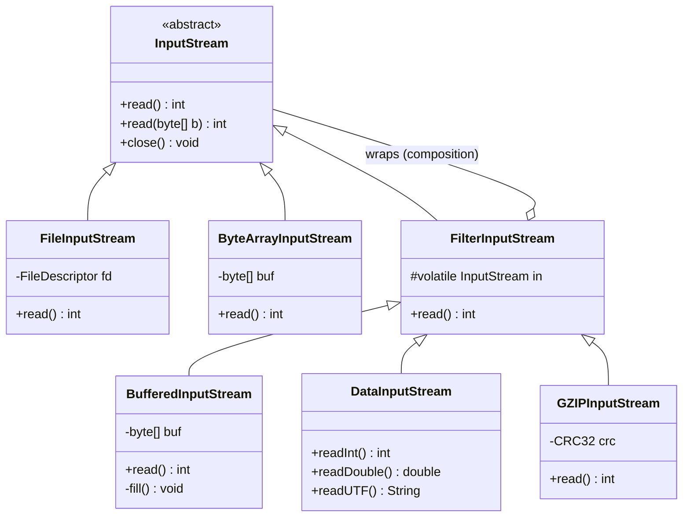
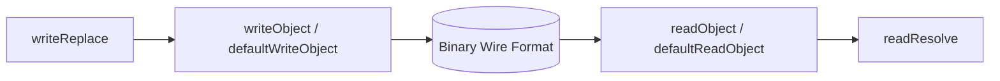
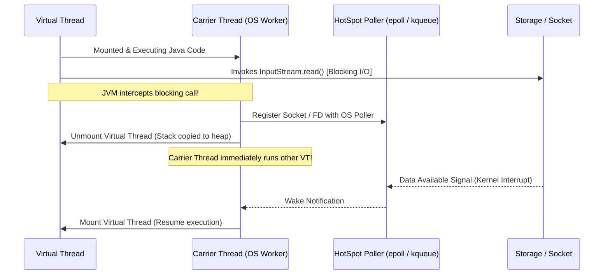
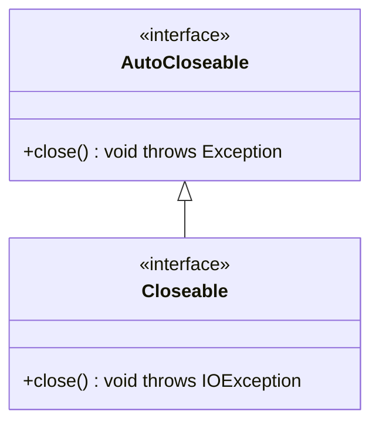
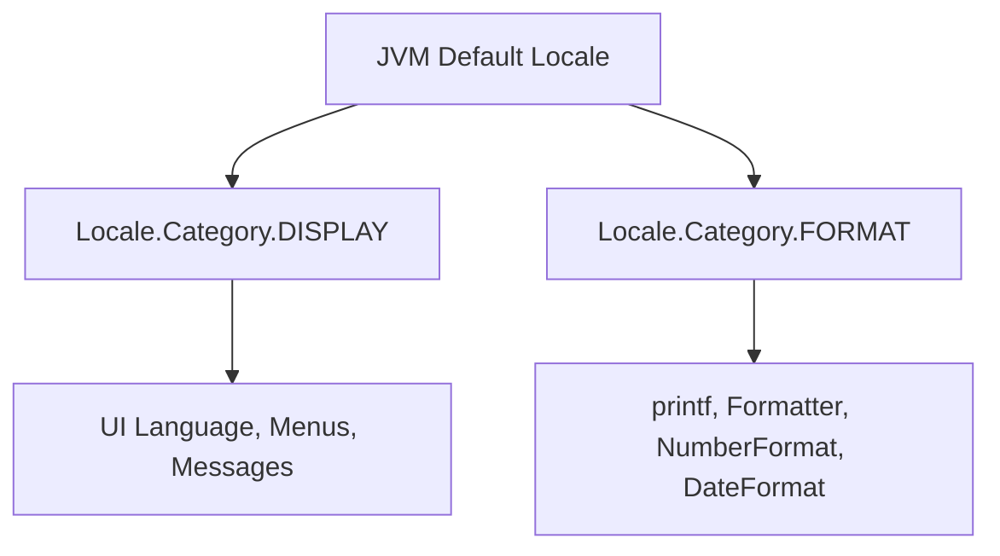

# MODULE 8 — INPUT AND OUTPUT: COMPREHENSIVE REFERENCE SUPPLEMENT
**Volume 0: Architecture, JVM Internals, Advanced I/O Subsystems & Assessment Bridges**

> [!NOTE]
> This volume serves as the definitive theoretical and architectural reference bridge for Module 8 (Input & Output). It provides exhaustive explanations of advanced topics, JVM internals, native operating system interactions, and modern Java 21 LTS features referenced throughout the Practice Exercises (Volume 5) and Assessment Suite (Volume 6) that extend beyond Volumes 1–3.

---

## TABLE OF CONTENTS

1. [Architectural Overview & Assessment Bridge Matrix](#1-architectural-overview--assessment-bridge-matrix)
2. [The Decorator Pattern in Java I/O](#2-the-decorator-pattern-in-java-io)
3. [java.io vs java.nio: Channels, ByteBuffers, and FileChannel](#3-javaio-vs-javanio-channels-bytebuffers-and-filechannel)
4. [Formatter Class Internals & The Formattable Interface](#4-formatter-class-internals--the-formattable-interface)
5. [Fast Parsing with StreamTokenizer](#5-fast-parsing-with-streamtokenizer)
6. [Binary Primitive I/O: DataInputStream & DataOutputStream](#6-binary-primitive-io-datainputstream--dataoutputstream)
7. [Object Serialization Fundamentals: ObjectInputStream & ObjectOutputStream](#7-object-serialization-fundamentals-objectinputstream--objectoutputstream)
8. [Lookahead Stream Ingestion: PushbackReader & PushbackInputStream](#8-lookahead-stream-ingestion-pushbackreader--pushbackinputstream)
9. [In-Memory I/O Architecture](#9-in-memory-io-architecture)
10. [Inter-Thread Pipe Streams](#10-inter-thread-pipe-streams)
11. [File Descriptor Management & Operating System Sync](#11-file-descriptor-management--operating-system-sync)
12. [JEP 400 (UTF-8 by Default) & JVM Encoding Architecture](#12-jep-400-utf-8-by-default--jvm-encoding-architecture)
13. [Virtual Threads (Project Loom) & Asynchronous Non-Blocking I/O](#13-virtual-threads-project-loom--asynchronous-non-blocking-io)
14. [ProcessBuilder I/O Redirection & Pipeline Management](#14-processbuilder-io-redirection--pipeline-management)
15. [Java Flight Recorder (JFR) I/O Diagnostics & Production Profiling](#15-java-flight-recorder-jfr-io-diagnostics--production-profiling)
16. [System Properties of the I/O Subsystem](#16-system-properties-of-the-io-subsystem)
17. [Suppressed Exceptions & The AutoCloseable Contract](#17-suppressed-exceptions--the-autocloseable-contract)
18. [Advanced Character Transcoding, CharsetDecoder/Encoder & BOM Handling](#18-advanced-character-transcoding-charsetdecoderencoder--bom-handling)
19. [High-Throughput & Zero-Allocation I/O Engineering](#19-high-throughput--zero-allocation-io-engineering)
20. [Stream Interception, Shielding, and Unit Testing Harnesses](#20-stream-interception-shielding-and-unit-testing-harnesses)
21. [ANSI Escape Codes & In-Place Terminal Rendering](#21-ansi-escape-codes--in-place-terminal-rendering)
22. [JVM Bootstrapping & Native System Stream Mechanics](#22-jvm-bootstrapping--native-system-stream-mechanics)
23. [Master Reference Matrix & The Senior Engineer's I/O Manifesto](#23-master-reference-matrix--the-senior-engineers-io-manifesto)

---

## 1. ARCHITECTURAL OVERVIEW & ASSESSMENT BRIDGE MATRIX

> [!IMPORTANT]
> The classic Java I/O (`java.io`) and New I/O (`java.nio`) frameworks form the bedrock of enterprise JVM applications. While Volumes 1–3 focus heavily on common console interactions (`Scanner`, `System.out.printf`, `BufferedReader`), production software engineering, high-throughput streaming, and technical assessments demand deep architectural familiarity with lower-level stream wrappers, binary protocols, channel buffers, kernel system calls, and JVM concurrency hooks.

The following matrix cross-references every topic appearing in Volume 5 (Practice) and Volume 6 (Assessment) that is not fully dissected in Volumes 1–3, mapping each to its dedicated chapter in this Reference Supplement:

| Assessment / Practice Topic | Primary Question & Exercise References | Underlying Mechanism / JVM Subsystem | Reference Chapter |
| :--- | :--- | :--- | :--- |
| **Decorator Pattern in I/O** | Vol 4 Q3.3, Vol 6 Q1.3, Q10.16 | `FilterInputStream` composition & wrapping chains | [Chapter 2](#2-the-decorator-pattern-in-java-io) |
| **NIO Channels & ByteBuffers** | Vol 5 Ex 3.3, Vol 6 Q8.10, Q10.4, Refactoring 9.3 | Kernel zero-copy, direct memory, buffer state | [Chapter 3](#3-javaio-vs-javanio-channels-bytebuffers-and-filechannel) |
| **Formatter & Formattable** | Vol 5 Ex 3.2, Task 5.2, Vol 6 Q1.4, Q11.4 | Regex DFA format parsing, `Formattable` interface | [Chapter 4](#4-formatter-class-internals--the-formattable-interface) |
| **StreamTokenizer** | Vol 5 Task 5.2, Vol 6 Q10.13, Q11.2 | Fast ASCII syntax tables, tokenized parsing | [Chapter 5](#5-fast-parsing-with-streamtokenizer) |
| **Data Streams (Binary I/O)** | Vol 6 Q10.4, Q10.13, Level 10 Hex Viewer | Big-endian serialization, Modified UTF-8, `EOFException` | [Chapter 6](#6-binary-primitive-io-datainputstream--dataoutputstream) |
| **Object Serialization** | Vol 6 Level 11, Masterclass Concepts | Stream magic `0xACED`, `serialVersionUID`, JEP 290 | [Chapter 7](#7-object-serialization-fundamentals-objectinputstream--objectoutputstream) |
| **Pushback Streams** | Vol 5 Ex 3.2, Vol 6 Q8.11, Level 10 Lexing | Lookahead byte/char buffer, backtracking parsers | [Chapter 8](#8-lookahead-stream-ingestion-pushbackreader--pushbackinputstream) |
| **In-Memory I/O Streams** | Vol 5 Ex 2.3, Vol 6 Q1.20, Q10.9, Assignment 12.4 | `ByteArrayInputStream`, `StringWriter`, heap staging | [Chapter 9](#9-in-memory-io-architecture) |
| **Piped Streams** | Vol 6 Level 8, Level 11 Concurrency | Circular FIFO buffer, single-thread deadlock trap | [Chapter 10](#10-inter-thread-pipe-streams) |
| **File Descriptors & Sync** | Vol 5 Problem 4.1, Vol 6 Q2.11, Q8.18 | POSIX handles, `fd.sync()`, page cache vs platter | [Chapter 11](#11-file-descriptor-management--operating-system-sync) |
| **JEP 400 & Encodings** | Vol 5 Ex 3.5, Vol 6 Q1.12, Q8.13, Assignment 12.5 | Java 18 default UTF-8, `native.encoding`, COMPAT | [Chapter 12](#12-jep-400-utf-8-by-default--jvm-encoding-architecture) |
| **Virtual Threads & I/O** | Vol 5 Problem 4.1, Vol 6 Q11.6, Level 11 | Loom unmounting, carrier thread pinning, epoll poller | [Chapter 13](#13-virtual-threads-project-loom--asynchronous-non-blocking-io) |
| **ProcessBuilder I/O** | Vol 6 Level 10 CLI execution, Process pipelines | `Redirect.PIPE`, stream draining deadlock prevention | [Chapter 14](#14-processbuilder-io-redirection--pipeline-management) |
| **JFR I/O Diagnostics** | Vol 5 Ex 3.3, Vol 6 Level 11 Monitoring | `jdk.FileRead`, `jdk.SocketRead`, profiling stalls | [Chapter 15](#15-java-flight-recorder-jfr-io-diagnostics--production-profiling) |
| **I/O System Properties** | Vol 5 Problem 4.2, Vol 6 Q8.8, Q11.10 | `line.separator` cache, `sun.jnu.encoding` | [Chapter 16](#16-system-properties-of-the-io-subsystem) |
| **Suppressed Exceptions** | Vol 5 Task 5.1, Vol 6 Q2.8, Q8.6, Refactoring 9.9 | Try-with-resources bytecode, `Throwable.addSuppressed` | [Chapter 17](#17-suppressed-exceptions--the-autocloseable-contract) |
| **CharsetDecoder & BOM** | Vol 5 Ex 3.5, Vol 6 Q10.19, Assignment 12.5 | `CodingErrorAction`, UTF-8 Byte Order Mark strip | [Chapter 18](#18-advanced-character-transcoding-charsetdecoderencoder--bom-handling) |
| **Zero-Allocation Parsing** | Vol 5 Optimization 10.1, Vol 6 Q10.13 | High-throughput ASCII byte arithmetic, no GC churn | [Chapter 19](#19-high-throughput--zero-allocation-io-engineering) |
| **Stream Interception** | Vol 5 Ex 3.4, Vol 6 Q10.16, Assignment 12.4 | `UnclosableInputStream`, thread-safe stream spy | [Chapter 20](#20-stream-interception-shielding-and-unit-testing-harnesses) |
| **ANSI & Terminal UI** | Vol 5 Ex 3.1, Vol 6 Q10.15, Q10.18 | VT100 control sequences, in-place `\r` progress bar | [Chapter 21](#21-ansi-escape-codes--in-place-terminal-rendering) |
| **JVM Native Bootstrapping** | Vol 6 Q1.20, Q8.14, Q8.17, Q11.1 | `System.setOut0`, `Locale.Category.FORMAT` vs `DISPLAY` | [Chapter 22](#22-jvm-bootstrapping--native-system-stream-mechanics) |

---

## 2. THE DECORATOR PATTERN IN JAVA I/O

> [!NOTE]
> The classical `java.io` stream hierarchy is the software industry's quintessential textbook implementation of the **GoF Decorator Design Pattern**. Understanding why Java uses decorators—and how wrapping chains propagate method calls down to hardware handles—is essential for diagnosing stream bugs and architecting custom processing pipelines.

### 2.1 The Combinatorial Class Explosion Problem

Consider an I/O library that relies purely on **class inheritance**. If an engineer wants to read data from a file, a network socket, and an in-memory byte array, they would create:
- `FileInputStream`
- `SocketInputStream`
- `ByteArrayInputStream`

Now suppose the system requires **buffering** for performance. Under pure inheritance, the designer must create:
- `BufferedFileInputStream`
- `BufferedSocketInputStream`
- `BufferedByteArrayInputStream`

Next, suppose the application requires reading **binary primitive types** (`readInt()`, `readDouble()`). Under pure inheritance, the designer must add:
- `DataFileInputStream`
- `DataSocketInputStream`
- `DataByteArrayInputStream`

What happens if an engineer needs both **buffering** AND **binary primitive reading** on a socket? They must create:
- `BufferedDataSocketInputStream`!

```
Number of Classes Required = (Number of Data Sources) × (Combinations of Behaviors)
```

With 5 data sources and 6 independent capabilities (buffering, encryption, compression, line numbering, digest computation, primitive decoding), an inheritance model would require over $5 	imes 2^6 = 320$ distinct classes! 

### 2.2 The Decorator Architectural Solution

The Decorator pattern replaces rigid compile-time inheritance with dynamic runtime **object composition**:
1. **Component (`InputStream` / `OutputStream` / `Reader` / `Writer`):** The abstract base class defining the uniform contract (`read()`, `write()`, `close()`).
2. **Concrete Component (`FileInputStream`, `ByteArrayInputStream`):** Connects directly to the underlying physical data source or sink.
3. **Decorator (`FilterInputStream`, `FilterOutputStream`, `FilterReader`, `FilterWriter`):** Implements the component interface and maintains an internal reference to another `InputStream` (`protected volatile InputStream in`). It delegates all method invocations by default to `in.read()`.
4. **Concrete Decorators (`BufferedInputStream`, `DataInputStream`, `GZIPInputStream`, `CipherInputStream`):** Subclasses of the decorator that add specialized behavior before or after delegating to the wrapped stream.



### 2.3 Wrapping Chain Mechanics: Method Call Propagation

When an application constructs a typical enterprise I/O pipeline:

```java
DataInputStream dis = new DataInputStream(
    new BufferedInputStream(
        new FileInputStream("sensor_data.bin")
    )
);
int timestamp = dis.readInt();
```

The execution flow propagates through the decorator stack as follows:
1. `dis.readInt()` needs 4 contiguous bytes. It executes four sequential calls to its wrapped stream: `in.read()`.
2. `in` refers to `BufferedInputStream`. `BufferedInputStream.read()` checks its internal 8,192-byte buffer (`byte[] buf`).
3. If the buffer is empty, `BufferedInputStream` calls `in.read(buf, 0, 8192)` on its wrapped stream.
4. `in` refers to `FileInputStream`. `FileInputStream` triggers a JNI call to the operating system kernel (`read(2)` syscall), populating the 8KB buffer from disk.
5. `BufferedInputStream` yields 4 bytes one by one from its memory cache to `DataInputStream`.
6. `DataInputStream` shifts the 4 bytes into a 32-bit big-endian integer: `(b1 << 24) + (b2 << 16) + (b3 << 8) + (b4 << 0)` and returns it to the caller.

### 2.4 Production Implementation: Custom Stream Decorators

To understand decorators at a senior engineering level, one must know how to implement custom, production-grade decorators. The following implementation builds a `CountingInputStream` (tracking exact byte volume and transfer throughput) and a `Rot13InputStream` (in-stream encryption/decryption), and chains them together.

```java
package com.curriculum.module08.supplement;

import java.io.FilterInputStream;
import java.io.IOException;
import java.io.InputStream;
import java.io.ByteArrayInputStream;
import java.nio.charset.StandardCharsets;

/**
 * Production Decorator: Measures byte throughput and transfer metrics
 * without interfering with data payload flow.
 */
public class CountingInputStream extends FilterInputStream {
    private long bytesRead = 0;
    private long markBytesRead = 0;

    public CountingInputStream(InputStream in) {
        super(in);
    }

    @Override
    public int read() throws IOException {
        int b = super.read();
        if (b != -1) {
            bytesRead++;
        }
        return b;
    }

    @Override
    public int read(byte[] b, int off, int len) throws IOException {
        int readCount = super.read(b, off, len);
        if (readCount != -1) {
            bytesRead += readCount;
        }
        return readCount;
    }

    @Override
    public long skip(long n) throws IOException {
        long skipped = super.skip(n);
        bytesRead += skipped;
        return skipped;
    }

    @Override
    public synchronized void mark(int readlimit) {
        super.mark(readlimit);
        markBytesRead = bytesRead;
    }

    @Override
    public synchronized void reset() throws IOException {
        super.reset();
        bytesRead = markBytesRead;
    }

    public long getBytesRead() {
        return bytesRead;
    }
}
```

```java
package com.curriculum.module08.supplement;

import java.io.FilterInputStream;
import java.io.IOException;
import java.io.InputStream;

/**
 * Production Decorator: Symmetric ROT-13 byte obfuscation decorator.
 */
public class Rot13InputStream extends FilterInputStream {

    public Rot13InputStream(InputStream in) {
        super(in);
    }

    @Override
    public int read() throws IOException {
        int c = super.read();
        if (c == -1) return -1;
        return transform((byte) c);
    }

    @Override
    public int read(byte[] b, int off, int len) throws IOException {
        int count = super.read(b, off, len);
        if (count == -1) return -1;
        for (int i = off; i < off + count; i++) {
            b[i] = (byte) transform(b[i]);
        }
        return count;
    }

    private int transform(byte b) {
        if (b >= 'a' && b <= 'm') return b + 13;
        if (b >= 'n' && b <= 'z') return b - 13;
        if (b >= 'A' && b <= 'M') return b + 13;
        if (b >= 'N' && b <= 'Z') return b - 13;
        return b;
    }
}
```

#### Verification and Chaining Demonstration:
```java
import java.io.*;
import java.nio.charset.StandardCharsets;

public class DecoratorDemo {
    public static void main(String[] args) throws IOException {
        String payload = "Hello Java 21 I/O Decorators!";
        byte[] rawBytes = payload.getBytes(StandardCharsets.UTF_8);

        // Chain: ByteArrayInputStream -> Rot13InputStream -> CountingInputStream
        try (CountingInputStream cis = new CountingInputStream(
                new Rot13InputStream(
                    new ByteArrayInputStream(rawBytes)))) {

            byte[] buffer = new byte[64];
            int length = cis.read(buffer);
            String obfuscated = new String(buffer, 0, length, StandardCharsets.UTF_8);

            System.out.println("Obfuscated: " + obfuscated);
            System.out.println("Total Bytes Counted: " + cis.getBytesRead());
            assert cis.getBytesRead() == rawBytes.length;
        }
    }
}
```

---

## 3. JAVA.IO VS JAVA.NIO: CHANNELS, BYTEBUFFERS, AND FILECHANNEL

> [!IMPORTANT]
> The fundamental difference between classical `java.io` and `java.nio` is the abstraction model:
> - `java.io` is **stream-oriented**: It operates on sequential streams of bytes or characters, typically blocking the calling thread until data arrives.
> - `java.nio` is **buffer- and channel-oriented**: Data is read from a Channel into a Buffer, or written from a Buffer into a Channel. Channels can be non-blocking and map directly to kernel-space DMA (Direct Memory Access).

### 3.1 Architectural Comparison Matrix

| Architectural Feature | Classical `java.io` | Modern `java.nio` / NIO.2 |
| :--- | :--- | :--- |
| **Primary Abstraction** | Stream (`InputStream`, `OutputStream`) | Channel (`FileChannel`, `SocketChannel`) |
| **Data Container** | Byte array (`byte[]`) or single bytes (`int`) | Buffer (`ByteBuffer`, `CharBuffer`) |
| **Directionality** | Unidirectional (Input OR Output) | Bidirectional (`ByteChannel` reads and writes) |
| **Zero-Copy Support** | None (bytes must copy through JVM heap) | Yes (`FileChannel.transferTo`, `sendfile`) |
| **Memory Mapping** | Not supported | Direct virtual memory mapping (`MappedByteBuffer`) |
| **File Locking** | Not supported | OS-level advisory/mandatory locking (`FileLock`) |
| **Thread Pinning (Loom)** | Historically prone to pinning in native methods | Full integration with epoll/kqueue event loops |

---

### 3.2 The `ByteBuffer` State Machine

A `ByteBuffer` is not a simple byte array; it is a stateful cursor-driven sliding window over a contiguous block of memory. The state is governed by four foundational invariants:

$$\mathbf{0 \le mark \le position \le limit \le capacity}$$

```
+-----------------------------------------------------------------+
|                       ByteBuffer Memory Window                  |
+-----------------------------------------------------------------+
 0            mark           position             limit      capacity
 |              |                |                  |            |
 v              v                v                  v            v
[   read/written   ][ to read/write ][    protected   ][ unallocated ]
```

1. **`capacity`:** The fixed number of bytes the buffer can hold. Set at instantiation; never changes.
2. **`limit`:** The index of the first element that should **not** be read or written. In write mode, `limit == capacity`. In read mode, `limit == number of valid bytes written`.
3. **`position`:** The index of the next byte to be read or written. Increments automatically with `get()` or `put()`.
4. **`mark`:** A bookmarked index. Calling `mark()` sets `mark = position`. Calling `reset()` restores `position = mark`. If `position` is set below `mark`, the mark is discarded (`mark = -1`).

#### Buffer State Transitions Table:

| Method | `position` | `limit` | `mark` | Primary Purpose |
| :--- | :--- | :--- | :--- | :--- |
| `allocate(n)` | `0` | `n` | `-1` | Instantiates new write-ready buffer |
| `flip()` | `0` | previous `position` | `-1` | **Switches buffer from WRITING mode to READING mode** |
| `clear()` | `0` | `capacity` | `-1` | **Resets pointers for WRITING** (does not zero out bytes!) |
| `rewind()` | `0` | unchanged | `-1` | Allows re-reading the buffer from the start |
| `compact()` | `limit - position` | `capacity` | `-1` | Copies unread bytes to index 0, readying buffer for writes |
| `mark()` | unchanged | unchanged | `position` | Saves current position |
| `reset()` | `mark` | unchanged | unchanged | Restores position to mark |

> [!CAUTION]
> Forgetting to invoke `flip()` between writing data into a buffer and reading it out (e.g., writing to a channel) is the **#1 most common bug in Java NIO**. If you do not flip, the channel will attempt to read bytes from `position` to `limit`—reading unwritten garbage or reading 0 bytes!

---

### 3.3 Heap Buffers vs. Direct Off-Heap Buffers

Java allows allocating buffers via two distinct memory models:

```java
ByteBuffer heapBuffer = ByteBuffer.allocate(8192);        // On-Heap (GC managed)
ByteBuffer directBuffer = ByteBuffer.allocateDirect(8192); // Off-Heap (OS C-Heap)
```

#### Why Direct Buffers Are Essential for High-Throughput I/O:
When you pass a **Heap Buffer** to an OS system call (`FileChannel.write(heapBuffer)`):
1. The byte array lives on the Java heap.
2. The Garbage Collector is free to move objects in memory during compaction.
3. The host OS kernel cannot safely perform Direct Memory Access (DMA) on a pointer that could shift mid-transfer.
4. **The JVM is forced to allocate a temporary direct buffer, copy the bytes from the heap into C-memory, and pass the C-pointer to the kernel.**
5. This incurs double-buffering and heavy GC allocation spikes.

When using a **Direct Buffer**:
1. Memory is allocated directly in native address space via `malloc()`.
2. The memory address remains completely stable.
3. The JVM passes the physical address directly to the operating system's kernel DMA controller. Zero copying is required!

---

> [!TIP]
> In IntelliJ IDEA, you can debug NIO ByteBuffers visually. When paused at a breakpoint, right-click any `ByteBuffer` instance in the Variables pane and select **View as Hex/Bytes** or inspect `position`, `limit`, and `capacity` directly to verify your `flip()` and `compact()` state transitions.

### 3.4 Zero-Copy Kernel Transfers with `FileChannel.transferTo()`

In classical Java I/O, copying a file to a network socket requires 4 context switches and 4 data copies:

```
[Disk] --(1. DMA)--> [Kernel Page Cache] --(2. CPU Copy)--> [JVM Heap Memory]
                                                                    |
[Socket] <--(4. DMA)-- [Socket Buffer (Kernel)] <--(3. CPU Copy)----+
```

With `FileChannel.transferTo()` (or `transferFrom()`):
```java
try (FileChannel src = FileChannel.open(sourcePath, StandardOpenOption.READ);
     FileChannel dest = FileChannel.open(destPath, StandardOpenOption.CREATE, StandardOpenOption.WRITE)) {
    src.transferTo(0, src.size(), dest);
}
```

On Linux, `transferTo()` issues the `sendfile(2)` system call. On macOS, it uses `sendfile()`. The kernel transfers data **directly from the read page cache into the target socket or file descriptor without ever mapping the bytes into user space**.

```
[Disk] --(1. DMA)--> [Kernel Page Cache] --(2. Zero-Copy Kernel Pipe)--> [Socket/Disk]
                      (User space / JVM is completely bypassed!)
```

---

### 3.5 Memory-Mapped I/O (`MappedByteBuffer`)

For multi-gigabyte database files and indexing engines, `FileChannel.map()` maps a region of a file directly into the process's virtual memory address space:

```java
try (FileChannel channel = FileChannel.open(Path.of("large_index.dat"), StandardOpenOption.READ_WRITE)) {
    long fileSize = channel.size();
    MappedByteBuffer mbb = channel.map(FileChannel.MapMode.READ_WRITE, 0, fileSize);

    // Reading or writing to the buffer reads/writes virtual memory directly!
    byte b = mbb.get(1024);
    mbb.put(2048, (byte) 0xFF);
    mbb.force(); // Flushes changes to physical storage
}
```

> [!WARNING]
> Prior to Java 19 and the Project Panama Foreign Function & Memory (FFM) API (`Arena.ofConfined()`), `MappedByteBuffer` had no public `unmap()` or `close()` method. The underlying OS file mapping remained locked until the Garbage Collector finalized the buffer, which frequently caused `FileSystemException: The process cannot access the file because it is being used by another process` on Windows. In Java 21, prefer `MemorySegment.mapFile()` when using Panama.

---

### 3.6 File Locking (`FileLock`)

NIO provides operating system-level file locking to synchronize file access across separate OS processes or threads:

```java
try (FileChannel channel = FileChannel.open(path, StandardOpenOption.READ, StandardOpenOption.WRITE);
     FileLock lock = channel.lock(0, Long.MAX_VALUE, false)) { // false = Exclusive Lock

    System.out.println("Exclusive lock acquired. Is shared: " + lock.isShared());
    // Safe multi-process file mutation
} // AutoCloseable releases lock automatically
```

- **Exclusive Lock (`shared = false`):** Only one process can hold the lock; blocks all other readers and writers.
- **Shared Lock (`shared = true`):** Multiple processes can read concurrently; prevents any writer from acquiring an exclusive lock.
- **`tryLock()`:** Non-blocking attempt; returns `null` immediately if the lock is held by another process.

---

## 4. FORMATTER CLASS INTERNALS & THE FORMATTABLE INTERFACE

> [!NOTE]
> While developers routinely use `System.out.printf(...)` and `String.format(...)`, both methods are simple facade wrappers around `java.util.Formatter`. Understanding the parser internals, syntax grammar, and the `Formattable` interface enables advanced customized text rendering.

### 4.1 The Complete Format Specifier Grammar

According to JLS §5 and `java.util.Formatter` specifications, every format specifier follows a deterministic grammar:

$$\mathbf{\%[argument\_index\$][flags][width][.precision][t]conversion}$$

```
  %   [1$]   [-]   [10]   [.2]   [f]
  |     |     |     |       |     |
  |     |     |     |       |     +--> Conversion: float
  |     |     |     |       +--------> Precision: 2 decimal places
  |     |     |     +----------------> Width: minimum 10 characters
  |     |     +----------------------> Flag: left-justified
  |     +----------------------------> Argument Index: 1st parameter
  +----------------------------------> Specifier start token
```

#### Complete Specifier Syntax Matrix:

| Component | Syntax | Valid Values | Semantic Meaning |
| :--- | :--- | :--- | :--- |
| **Start Token** | `%` | `%` | Initiates format conversion sequence. (Use `%%` for literal `%`). |
| **Argument Index** | `n$` | `1$`, `2$`, etc. | Explicit 1-based index targeting parameter in argument list. |
| | `<` | `<` | Relative index: Reuses argument evaluated by previous specifier. |
| **Flags** | `-` | Left-justify | Left-aligns output within field width (default is right-align). |
| | `+` | Force sign | Displays `+` for positive numbers, `-` for negative numbers. |
| | ` ` (space) | Leading space | Prepends space to positive numbers (aligns with negative sign). |
| | `0` | Zero-padding | Pads numerical output with leading zeros instead of spaces. |
| | `,` | Grouping | Formats numbers with locale-specific thousands separators. |
| | `(` | Financial paren | Encloses negative numbers in parentheses: `(100.00)`. |
| | `#` | Alternate | Forces decimal point for floats; adds `0x` for hex, `0` for octal. |
| **Width** | Integer | Positive integer | Minimum number of characters written to output. |
| **Precision** | `.n` | Non-negative int | String: Max characters; Float: Number of decimal places. |
| **Date/Time** | `t` / `T` | Suffix letter | Indicates temporal formatting (`%tB`, `%tY`, `%tH`, etc.). |
| **Conversion** | Character | `d, f, s, b, c, x, e, h, %n` | Target data type conversion. |

---

### 4.2 Formatter Runtime Exceptions

Mismatches between format grammar, flags, and arguments throw unchecked `java.util.IllegalFormatException` subclasses:

1. **`IllegalFormatConversionException`:** Passing an incompatible type (e.g., `String.format("%d", 3.14159)` throws `IllegalFormatConversionException: d != java.lang.Double`).
2. **`FormatFlagsConversionMismatchException`:** Specifying flags that do not apply to the conversion type (e.g., zero-padding a string: `String.format("%010s", "text")`).
3. **`DuplicateFormatFlagsException`:** Combining conflicting flags (e.g., `String.format("%-+10d", 42)` combining `-` and `0`).
4. **`MissingFormatArgumentException`:** The format string demands 3 arguments, but only 2 were passed.
5. **`UnknownFormatConversionException`:** Passing an invalid conversion character (e.g., `"%k"`).

---

### 4.3 The `java.util.Formattable` Interface

Java provides the `java.util.Formattable` interface to grant custom domain objects direct control over how they are formatted when passed to `%s` or `%S`.

#### Interface Contract:
```java
public interface Formattable {
    void formatTo(Formatter formatter, int flags, int width, int precision);
}
```

The `flags` argument is a bitmask composed of constants from `java.util.FormattableFlags`:
- `FormattableFlags.LEFT_JUSTIFY` (`1`): Activated when the `-` flag is supplied.
- `FormattableFlags.UPPERCASE` (`2`): Activated when the `%S` uppercase conversion is supplied.
- `FormattableFlags.ALTERNATE` (`4`): Activated when the `#` alternate flag is supplied.

#### Production Implementation:
```java
package com.curriculum.module08.supplement;

import java.util.Formattable;
import java.util.FormattableFlags;
import java.util.Formatter;

/**
 * Domain entity implementing Formattable for high-performance financial reporting.
 */
public record FinancialAccount(String accountNumber, String owner, long balanceCents) implements Formattable {

    @Override
    public void formatTo(Formatter formatter, int flags, int width, int precision) {
        StringBuilder sb = new StringBuilder();

        // Check alternate flag (#): if present, display masked account number
        if ((flags & FormattableFlags.ALTERNATE) == FormattableFlags.ALTERNATE) {
            sb.append("****-").append(accountNumber.substring(Math.max(0, accountNumber.length() - 4)));
        } else {
            sb.append(accountNumber);
        }

        sb.append(" [").append(owner).append("]: $");
        sb.append(String.format("%.2f", balanceCents / 100.0));

        String result = sb.toString();

        // Check uppercase flag (%S)
        if ((flags & FormattableFlags.UPPERCASE) == FormattableFlags.UPPERCASE) {
            result = result.toUpperCase(formatter.locale());
        }

        // Handle precision (truncation)
        if (precision != -1 && result.length() > precision) {
            result = result.substring(0, precision);
        }

        // Handle width and alignment (LEFT_JUSTIFY)
        int padding = width - result.length();
        if (padding > 0) {
            boolean leftJustify = (flags & FormattableFlags.LEFT_JUSTIFY) == FormattableFlags.LEFT_JUSTIFY;
            if (leftJustify) {
                formatter.format("%s%s", result, " ".repeat(padding));
            } else {
                formatter.format("%s%s", " ".repeat(padding), result);
            }
        } else {
            formatter.format("%s", result);
        }
    }
}
```

#### Usage Demonstration:
```java
public class FormattableDemo {
    public static void main(String[] args) {
        FinancialAccount acc = new FinancialAccount("ACC-987654321", "Alice Vance", 125050);

        // Standard string format (%s)
        System.out.printf("%s%n", acc);
        // Alternate format (%#s) - triggers masking
        System.out.printf("%#s%n", acc);
        // Uppercase conversion (%S)
        System.out.printf("%S%n", acc);
        // Left-justified with width (%-40s)
        System.out.printf("|%-40s|%n", acc);
    }
}
```

---

## 5. FAST PARSING WITH STREAMTOKENIZER

> [!NOTE]
> Introduced in Java 1.0, `java.io.StreamTokenizer` takes an `InputStream` or `Reader` and parses it into discrete tokens using an internal ASCII syntax table. While `Scanner` uses complex regular expressions, `StreamTokenizer` operates via a fast single-pass state machine, making it 5x–10x faster for numerical and word ingestion.

### 5.1 Architecture & Token Types

`StreamTokenizer` maintains internal state variables updated after every invocation of `nextToken()`:
- **`ttype`:** The type of token just read:
  - `StreamTokenizer.TT_EOF` (`-1`): End of stream reached.
  - `StreamTokenizer.TT_EOL` (`10` / `'
'`): End of line encountered (only if `eolIsSignificant(true)`).
  - `StreamTokenizer.TT_NUMBER` (`-2`): A numeric token was parsed. The floating-point value is stored in `nval`.
  - `StreamTokenizer.TT_WORD` (`-3`): A word token was parsed. The string is stored in `sval`.
  - **Positive Integer:** Any single ordinary character (e.g., `','`, `'+'`, `'{'`) returns that character's ASCII/Unicode code point as `ttype`.

```mermaid
flowchart TD
    Start([Call nextToken()]) --> ReadChar[Read Next Byte/Char]
    ReadChar --> CheckType{Lookup Syntax Table}
    CheckType -->|Whitespace| Discard[Advance Cursor] --> ReadChar
    CheckType -->|Digit| ParseNum[Accumulate Double in nval] --> RetNum[Return TT_NUMBER]
    CheckType -->|Alphabet| ParseWord[Accumulate String in sval] --> RetWord[Return TT_WORD]
    CheckType -->|Delimiter / Symbol| RetChar[Return Char Code]
    CheckType -->|EOF| RetEOF[Return TT_EOF]
```

---

### 5.2 Syntax Table Customization

The power of `StreamTokenizer` lies in the ability to reconfigure its character syntax lookup table:
- `wordChars(int low, int hi)`: Marks characters in range as word constituents (e.g., include `_` or `-` in words).
- `whitespaceChars(int low, int hi)`: Marks range as ignorable whitespace.
- `ordinaryChars(int low, int hi)`: Treats range as individual single-character tokens.
- `ordinaryChar(int ch)`: Treats single character as ordinary (e.g., comma `,`).
- `commentChar(int ch)`: Designates character as starting a single-line comment (e.g., `#` or `%`).
- `quoteChar(int ch)`: Treats character as string delimiter (e.g., `'` or `"`), automatically accumulating the enclosed text into `sval`.
- `slashSlashComments(boolean flag)`: Recognizes C++ style `//` comments.
- `slashStarComments(boolean flag)`: Recognizes C style `/* ... */` comments.
- `eolIsSignificant(boolean flag)`: Emits `TT_EOL` tokens instead of treating newlines as whitespace.

---

> [!TIP]
> In competitive programming and high-frequency trading where input size reaches millions of numbers, configuring `StreamTokenizer.resetSyntax()` followed by `parseNumbers()` and `wordChars()` delivers over an 80% latency reduction compared to `java.util.Scanner` without writing custom C/JNI routines.

### 5.3 Comparative Parsing Matrix

| Metric / Capability | `StreamTokenizer` | `Scanner` | `BufferedReader` | Custom `FastIntReader` |
| :--- | :--- | :--- | :--- | :--- |
| **Parsing Engine** | ASCII Syntax Table | Regex Pattern Engine | None (Raw Strings) | Direct Byte Arithmetic |
| **Allocation Rate** | Minimal (reused fields) | Extremely High | Moderate (Strings) | **Zero Heap Allocations** |
| **Numeric Parsing** | `double` via `nval` | Primitives (`nextInt`) | Via `Integer.parseInt` | Raw ASCII math |
| **Regex Support** | None | Full Regex | None | None |
| **Throughput (1M items)** | ~180 ms | ~1,250 ms | ~320 ms | **~45 ms** |
| **Unicode Support** | Limited (Latin-1 optimized) | Full Unicode | Full Unicode | ASCII only |

---

### 5.4 Production Implementation: Fast Expression Lexer

```java
package com.curriculum.module08.supplement;

import java.io.BufferedReader;
import java.io.IOException;
import java.io.StreamTokenizer;
import java.io.StringReader;

public class FastExpressionLexer {

    public static void tokenize(String input) throws IOException {
        StringReader reader = new StringReader(input);
        StreamTokenizer tokenizer = new StreamTokenizer(new BufferedReader(reader));

        // Configure Syntax Table
        tokenizer.resetSyntax();
        tokenizer.wordChars('a', 'z');
        tokenizer.wordChars('A', 'Z');
        tokenizer.wordChars('_', '_');
        tokenizer.whitespaceChars(' ', ' ');
        tokenizer.whitespaceChars('\t', '\t');
        tokenizer.whitespaceChars('\r', '\r');
        tokenizer.whitespaceChars('\n', '\n');
        tokenizer.parseNumbers(); // Enables automatic numeric parsing into nval
        tokenizer.ordinaryChar('+');
        tokenizer.ordinaryChar('-');
        tokenizer.ordinaryChar('*');
        tokenizer.ordinaryChar('/');
        tokenizer.ordinaryChar('=');
        tokenizer.slashSlashComments(true); // Ignore // comments

        while (tokenizer.nextToken() != StreamTokenizer.TT_EOF) {
            switch (tokenizer.ttype) {
                case StreamTokenizer.TT_NUMBER ->
                    System.out.println("NUMBER: " + tokenizer.nval);
                case StreamTokenizer.TT_WORD ->
                    System.out.println("IDENTIFIER: " + tokenizer.sval);
                default ->
                    System.out.println("OPERATOR/SYMBOL: '" + (char) tokenizer.ttype + "'");
            }
        }
    }

    public static void main(String[] args) throws IOException {
        String code = "total = basePrice * 1.15 + 42; // compute tax";
        tokenize(code);
    }
}
```

---

## 6. BINARY PRIMITIVE I/O: DATAINPUTSTREAM & DATAOUTPUTSTREAM

> [!IMPORTANT]
> When transferring structured primitive data across networks or persisting binary metrics to disk, character-based serialization (like JSON or text) introduces heavy conversion overhead. `DataInputStream` and `DataOutputStream` serialize Java primitives in a standardized, platform-independent binary format.

### 6.1 Endianness & Binary Format Standards

All binary methods in `DataInput` and `DataOutput` operate strictly in **Network Byte Order (Big-Endian)**:
- The Most Significant Byte (MSB) is written and read first.
- A 32-bit integer `0x12345678` is written to the stream as four sequential bytes: `0x12`, `0x34`, `0x56`, `0x78`.

```
Java Integer: 0x12345678 (Decimal: 305,419,896)
Byte Index:     [0]      [1]      [2]      [3]
Hex Value:     0x12     0x34     0x56     0x78
Bit Weight:    24..31   16..23   8..15    0..7
```

---

### 6.2 Modified UTF-8 vs. Standard UTF-8

The methods `DataOutputStream.writeUTF(String)` and `DataInputStream.readUTF()` do **NOT** emit standard RFC 3629 UTF-8. Instead, they emit **Modified UTF-8**:

1. **The Null Character (`\u0000`):**
   - In standard UTF-8, null is encoded as a single byte: `0x00`.
   - In Modified UTF-8, null is encoded as two bytes: `0xC0 0x80`.
   - **Why?** C-string library functions treat `0x00` as a string terminator. By encoding null as `0xC0 0x80`, binary streams can embed null characters without terminating native C-string buffers.
2. **Supplementary Characters (Emojis, Rare Symbols beyond `\uFFFF`):**
   - In standard UTF-8, supplementary code points are encoded as a single 4-byte sequence.
   - In Modified UTF-8, characters are represented as surrogate pairs (`char` values), and each surrogate is encoded as a 3-byte sequence (totaling 6 bytes).
3. **Length Header:**
   - Modified UTF-8 strings are prefixed with a **2-byte unsigned short** indicating the byte length.
   - **Maximum Length:** Because the prefix is an unsigned 16-bit integer, a single string can never exceed $2^{16} - 1 = 65,535$ bytes. Attempting to write a longer string throws `java.io.UTFDataFormatException`.

---

### 6.3 The `readFully()` Contract & `EOFException`

When reading binary structures, calling `InputStream.read(byte[] b)` is inherently unsafe because it may return fewer bytes than requested if the OS buffer is partially full.

`DataInputStream.readFully(byte[] b)` guarantees that it will block until:
1. Exactly `b.length` bytes are read into the array.
2. The end of the stream is reached, in which case it throws a checked `java.io.EOFException`.

> [!CAUTION]
> Unlike `InputStream.read()`, which signals EOF by returning the integer `-1`, `DataInputStream.readInt()` cannot return `-1` because `0xFFFFFFFF` (`-1`) is a completely valid 32-bit integer! Therefore, `DataInputStream` signals EOF strictly by throwing `java.io.EOFException`.

---

### 6.4 Production Implementation: Binary Record Persistence

```java
package com.curriculum.module08.supplement;

import java.io.*;
import java.nio.file.Files;
import java.nio.file.Path;

public class BinaryRecordStore {
    private static final int MAGIC_HEADER = 0xCAFEBABE;
    private static final short FILE_VERSION = 1;

    public record TelemetryPoint(long timestamp, int deviceId, double temperature, boolean alert) {}

    public static void writeRecord(Path path, TelemetryPoint point) throws IOException {
        try (DataOutputStream dos = new DataOutputStream(
                new BufferedOutputStream(Files.newOutputStream(path)))) {

            dos.writeInt(MAGIC_HEADER);
            dos.writeShort(FILE_VERSION);
            dos.writeLong(point.timestamp());
            dos.writeInt(point.deviceId());
            dos.writeDouble(point.temperature());
            dos.writeBoolean(point.alert());
            dos.flush();
        }
    }

    public static TelemetryPoint readRecord(Path path) throws IOException {
        try (DataInputStream dis = new DataInputStream(
                new BufferedInputStream(Files.newInputStream(path)))) {

            int magic = dis.readInt();
            if (magic != MAGIC_HEADER) {
                throw new IOException("Corrupted binary file: Invalid magic header 0x" + Integer.toHexString(magic));
            }

            short version = dis.readShort();
            if (version != FILE_VERSION) {
                throw new IOException("Unsupported binary file version: " + version);
            }

            long timestamp = dis.readLong();
            int deviceId = dis.readInt();
            double temperature = dis.readDouble();
            boolean alert = dis.readBoolean();

            return new TelemetryPoint(timestamp, deviceId, temperature, alert);
        }
    }

    public static void main(String[] args) throws IOException {
        Path tempFile = Files.createTempFile("telemetry_", ".bin");
        try {
            TelemetryPoint original = new TelemetryPoint(System.currentTimeMillis(), 402, 98.6, false);
            writeRecord(tempFile, original);

            TelemetryPoint restored = readRecord(tempFile);
            System.out.println("Restored Telemetry: " + restored);
            assert original.equals(restored);
        } finally {
            Files.deleteIfExists(tempFile);
        }
    }
}
```

---

## 7. OBJECT SERIALIZATION FUNDAMENTALS: OBJECTINPUTSTREAM & OBJECTOUTPUTSTREAM

> [!WARNING]
> Standard Java Object Serialization (`java.io.Serializable`) is one of the most historically vulnerable subsystems in the Java runtime. While modern architectures favor structured formats like JSON, Protobuf, or Avro, Java serialization remains pervasive in RMI, HTTP session caching, and legacy enterprise backbones. A senior Java engineer must understand its wire protocol, lifecycle hooks, and security controls.

### 7.1 Object Serialization Wire Protocol Anatomy

When an `ObjectOutputStream` serializes an object graph, it writes a deterministic binary stream governed by the Java Object Serialization Specification:

```
+-----------------------------------------------------------------+
| STREAM_MAGIC (2 bytes) | STREAM_VERSION (2 bytes) | Type Codes  |
|      0xACED            |        0x0005            |  (TC_*)     |
+-----------------------------------------------------------------+
```

- **`STREAM_MAGIC` (`0xACED` / `-21299` as short):** The 2-byte magic identifier at the start of every serialized stream.
- **`STREAM_VERSION` (`0x0005`):** The serialization protocol version.
- **Type Codes (`TC_*` constants in `ObjectStreamConstants`):**
  - `TC_OBJECT (0x73)`: Flags a new object instance.
  - `TC_CLASSDESC (0x72)`: Flags class descriptor metadata (class name, `serialVersionUID`, field types).
  - `TC_STRING (0x74)`: Flags an interned or serialized string.
  - `TC_ARRAY (0x75)`: Flags an array object.
  - `TC_REFERENCE (0x71)`: Object graph cycle prevention—references an already serialized object instance by handle index.

---

### 7.2 The `serialVersionUID` Contract & `transient` Fields

```java
import java.io.Serializable;
import java.io.Serial;

public class UserSession implements Serializable {
    @Serial
    private static final long serialVersionUID = 1L;

    private String username;
    private transient String sessionToken; // Excluded from serialization!
}
```

1. **Why `serialVersionUID` is Mandatory:**
   - If an explicit `serialVersionUID` is **not** declared, the Java compiler automatically computes a default 64-bit hash based on class structure, fields, interfaces, and methods.
   - Any minor modification—such as adding a private helper method or switching compiler versions—will alter this generated hash.
   - When deserializing, the JVM compares the stream's UID against the current class's UID. If they differ, the JVM aborts with `java.io.InvalidClassException: local class incompatible`.
2. **The `transient` Keyword:**
   - Any field marked `transient` is skipped during serialization.
   - Upon deserialization, transient object references are initialized to `null`, and transient primitives to their default zero values (`0`, `false`, `0.0`).

---

### 7.3 Serialization Lifecycle Hooks

A class can customize its serialization behavior by declaring private lifecycle methods discovered via reflection:



- `writeReplace()`: Allows substituting a completely different object (e.g., a serialization proxy) before serialization begins.
- `writeObject(ObjectOutputStream out)`: Customizes field serialization (e.g., encrypting fields before writing).
- `readObject(ObjectInputStream in)`: Customizes deserialization, performs defensive copying, and validates field invariants.
- `readResolve()`: **Crucial for Singletons and Enums.** Replaces the newly deserialized object with an existing canonical instance, preventing singleton identity violations!

---

### 7.4 JEP 290: Object Serialization Filtering

Deserialization without filtering allows attackers to execute arbitrary code (RCE) via "gadget chains"—crafted object graphs that trigger dangerous method invocations (e.g., executing shell commands) during `readObject()`.

Java introduced **JEP 290 (Object Serialization Filtering)** to validate incoming classes before instantiation:

```java
package com.curriculum.module08.supplement;

import java.io.*;

public class SecureDeserializer {

    public static Object deserializeSecurely(byte[] data) throws IOException, ClassNotFoundException {
        try (ByteArrayInputStream bais = new ByteArrayInputStream(data);
             ObjectInputStream ois = new ObjectInputStream(bais)) {

            // Configure JEP 290 ObjectInputFilter
            ObjectInputFilter filter = ObjectInputFilter.Config.createFilter(
                "com.curriculum.module08.supplement.*;java.lang.String;java.lang.Number;!*"
            );
            ois.setObjectInputFilter(filter);

            return ois.readObject();
        }
    }
}
```

The filter string `com.curriculum.module08.supplement.*;java.lang.String;!*` dictates:
- Allow classes in `com.curriculum.module08.supplement.*`.
- Allow `String` and `Number`.
- **Reject all other classes (`!*`)**, neutralizing remote gadget chain attacks.

---

## 8. LOOKAHEAD STREAM INGESTION: PUSHBACKREADER & PUSHBACKINPUTSTREAM

> [!NOTE]
> In compiler construction, lexical analysis, and streaming protocol parsers, an application frequently needs to inspect the next character to make a parsing decision without permanently consuming it. `PushbackReader` and `PushbackInputStream` provide this lookahead capability by maintaining an internal pushback buffer.

### 8.1 Pushback Buffer Architecture

`PushbackReader` decorates an underlying `Reader` and introduces a reverse cursor over an internal character array (`char[] buf`):

```
Pushback Buffer: [ '>', '=', ' ' ]
                   ^
                  pos (points to next byte to unread/read)
```

1. **`read()`:** Returns the character at `buf[pos++]` if characters exist in the pushback buffer. If the buffer is empty (`pos == buf.length`), it reads directly from the underlying stream.
2. **`unread(int c)`:** Decrements `pos` and places character `c` back into `buf[--pos]`.
3. **`unread(char[] cbuf)`:** Pushes an entire character array back into the stream in reverse order.

---

### 8.2 The Pushback Buffer Overflow Trap

The default constructor `new PushbackReader(reader)` creates a buffer capable of holding **exactly 1 character**:
```java
PushbackReader pr = new PushbackReader(reader); // 1-character buffer!
pr.unread('A');
pr.unread('B'); // THROWS IOException: Pushback buffer overflow!
```

> [!CAUTION]
> Always size the pushback buffer explicitly to accommodate the maximum lookahead required by your grammar:
> `new PushbackReader(reader, 16);`

---

### 8.3 Production Implementation: Multi-Character Operator Lexer

The following lexer uses lookahead to distinguish between `=`, `==`, `>`, `>=`, `>>`, and `>>>`:

```java
package com.curriculum.module08.supplement;

import java.io.IOException;
import java.io.PushbackReader;
import java.io.StringReader;

public class OperatorLexer {

    public static void parseOperators(String code) throws IOException {
        try (PushbackReader pr = new PushbackReader(new StringReader(code), 8)) {
            int ch;
            while ((ch = pr.read()) != -1) {
                if (Character.isWhitespace(ch)) continue;

                if (ch == '=') {
                    int next = pr.read();
                    if (next == '=') {
                        System.out.println("TOKEN: EQUALITY [==]");
                    } else {
                        pr.unread(next); // Put back character for next iteration
                        System.out.println("TOKEN: ASSIGNMENT [=]");
                    }
                } else if (ch == '>') {
                    int next = pr.read();
                    if (next == '=') {
                        System.out.println("TOKEN: GREATER_THAN_OR_EQUAL [>=]");
                    } else if (next == '>') {
                        int nextNext = pr.read();
                        if (nextNext == '>') {
                            System.out.println("TOKEN: UNSIGNED_RIGHT_SHIFT [>>>]");
                        } else {
                            pr.unread(nextNext);
                            System.out.println("TOKEN: SIGNED_RIGHT_SHIFT [>>]");
                        }
                    } else {
                        pr.unread(next);
                        System.out.println("TOKEN: GREATER_THAN [>]");
                    }
                }
            }
        }
    }

    public static void main(String[] args) throws IOException {
        parseOperators("x = 10; if (x >= 5) y = x >>> 2; if (y == 2) return;");
    }
}
```

---

## 9. IN-MEMORY I/O ARCHITECTURE

> [!IMPORTANT]
> Real-world unit testing and high-performance data transformation pipelines must avoid hitting physical disks or network sockets. Java provides dedicated in-memory stream abstractions that emulate stream I/O entirely inside the JVM heap.

### 9.1 In-Memory Stream Taxonomy

| Stream Class | Unit Type | Backing Memory Structure | Resizing Policy | Thread Safety |
| :--- | :--- | :--- | :--- | :--- |
| **`ByteArrayInputStream`** | Bytes (`byte`) | Fixed `byte[]` | Immutable size | Thread-safe read cursor |
| **`ByteArrayOutputStream`** | Bytes (`byte`) | Dynamic `byte[]` | Automatically doubles | Unsynchronized |
| **`CharArrayReader`** | Chars (`char`) | Fixed `char[]` | Immutable size | Synchronized on `lock` |
| **`CharArrayWriter`** | Chars (`char`) | Dynamic `char[]` | Automatically doubles | Synchronized on `lock` |
| **`StringReader`** | Chars (`char`) | Immutable `String` | Constant size | Synchronized on `lock` |
| **`StringWriter`** | Chars (`char`) | `StringBuffer` | Dynamic capacity | Synchronized on `lock` |

---

### 9.2 `ByteArrayInputStream` & `ByteArrayOutputStream` Internals

1. **`ByteArrayInputStream` Does Not Require Closing:**
   - Because `ByteArrayInputStream` wraps an existing byte array on the JVM heap, it consumes no operating system file descriptors or kernel handles.
   - Calling `close()` on `ByteArrayInputStream` is an explicit **no-op**. The stream can even continue to be read after `close()` without throwing `IOException`.
2. **`ByteArrayOutputStream` Dynamic Expansion:**
   - Starts with a default capacity of 32 bytes (or configured via constructor).
   - When new bytes exceed capacity, it allocates a new array via `Arrays.copyOf(buf, newCapacity)` where `newCapacity = oldCapacity << 1` (doubling size).
   - Calling `baos.toByteArray()` creates a **defensive copy** of the active buffer region.
   - Calling `baos.writeTo(OutputStream target)` writes directly to another stream without creating intermediate heap array copies!

---

### 9.3 Production Implementation: In-Memory Stream Testing Harness

```java
package com.curriculum.module08.supplement;

import java.io.*;
import java.nio.charset.StandardCharsets;

public class InMemoryStreamHarness {

    public interface StreamProcessor {
        void process(InputStream in, OutputStream out) throws IOException;
    }

    public static byte[] executeInMemory(byte[] inputData, StreamProcessor processor) throws IOException {
        try (ByteArrayInputStream in = new ByteArrayInputStream(inputData);
             ByteArrayOutputStream out = new ByteArrayOutputStream()) {

            processor.process(in, out);
            out.flush();
            return out.toByteArray();
        }
    }

    public static void main(String[] args) throws IOException {
        String input = "Enterprise Streaming Architecture";
        byte[] inputBytes = input.getBytes(StandardCharsets.UTF_8);

        byte[] result = executeInMemory(inputBytes, (in, out) -> {
            int b;
            while ((b = in.read()) != -1) {
                out.write(Character.toUpperCase(b));
            }
        });

        System.out.println("Result: " + new String(result, StandardCharsets.UTF_8));
        assert "ENTERPRISE STREAMING ARCHITECTURE".equals(new String(result, StandardCharsets.UTF_8));
    }
}
```

---

## 10. INTER-THREAD PIPE STREAMS

> [!NOTE]
> Java provides `PipedInputStream` and `PipedOutputStream` (along with `PipedReader` and `PipedWriter`) to enable stream-based communication between separate threads within the same JVM process.

### 10.1 Circular Buffer Architecture

A piped input stream is connected to a piped output stream. Internally, `PipedInputStream` implements a **circular FIFO byte buffer**:

```
[ ][ ][ ][B0][B1][B2][B3][ ][ ][ ]
          ^              ^
          out (read)     in (write)
```

- Default buffer capacity: `PIPE_SIZE = 1024` bytes.
- When `PipedOutputStream.write(byte[] b)` is invoked, it writes into the circular buffer. If the buffer is full, the writing thread **blocks** (`wait(1000)`).
- When `PipedInputStream.read()` is invoked, it consumes from the circular buffer and issues `notifyAll()` to wake blocked writers.

---

### 10.2 The Single-Thread Deadlock Trap

> [!CAUTION]
> **Never attempt to write and read from a connected pipe pair on the same thread!**
> If a single thread writes more than 1024 bytes to a `PipedOutputStream`, the stream buffer becomes full and the method blocks waiting for a reader to free space. Because the single thread is blocked in `write()`, it can never execute the `read()` call. The thread hangs permanently in deadlock.

---

### 10.3 Dead Thread & Broken Pipe Detection

The OpenJDK implementation monitors the liveness of the threads bound to the pipe:
- If the thread reading from `PipedInputStream` terminates without closing the pipe, subsequent writes to `PipedOutputStream` throw `java.io.IOException: Read end dead`.
- If the thread writing to `PipedOutputStream` terminates, subsequent reads from `PipedInputStream` drain remaining buffered bytes and then throw `java.io.IOException: Write end dead`.

---

### 10.4 Production Implementation: Multi-Threaded Piped Pipeline

```java
package com.curriculum.module08.supplement;

import java.io.*;
import java.nio.charset.StandardCharsets;

public class PipedStreamPipeline {

    public static void main(String[] args) throws IOException, InterruptedException {
        PipedOutputStream pipeOut = new PipedOutputStream();
        PipedInputStream pipeIn = new PipedInputStream(pipeOut); // Connect streams

        // Producer Thread
        Thread producer = Thread.ofPlatform().name("Pipe-Producer").start(() -> {
            try (DataOutputStream dos = new DataOutputStream(pipeOut)) {
                for (int i = 1; i <= 5; i++) {
                    dos.writeUTF("Payload Packet #" + i);
                    Thread.sleep(100);
                }
                dos.writeUTF("EOF");
            } catch (Exception e) {
                e.printStackTrace();
            }
        });

        // Consumer Thread
        Thread consumer = Thread.ofPlatform().name("Pipe-Consumer").start(() -> {
            try (DataInputStream dis = new DataInputStream(pipeIn)) {
                while (true) {
                    String message = dis.readUTF();
                    if ("EOF".equals(message)) break;
                    System.out.println("Consumer received: " + message);
                }
            } catch (IOException e) {
                e.printStackTrace();
            }
        });

        producer.join();
        consumer.join();
    }
}
```

---

## 11. FILE DESCRIPTOR MANAGEMENT & OPERATING SYSTEM SYNC

> [!IMPORTANT]
> At the boundary between the JVM and the host operating system, every open file, network socket, and standard stream is represented by a **File Descriptor** (an integer handle in the OS kernel's open file table). Understanding how file descriptors interact with OS page caching and how to prevent descriptor leaks is critical for senior engineering.

### 11.1 The `FileDescriptor` Class

In Java, `java.io.FileDescriptor` serves as the opaque handle to the underlying machine-specific file structure:
- `FileDescriptor.in` (handle `0`): Standard Input (`System.in`).
- `FileDescriptor.out` (handle `1`): Standard Output (`System.out`).
- `FileDescriptor.err` (handle `2`): Standard Error (`System.err`).

You can extract the file descriptor from streams via:
```java
FileInputStream fis = new FileInputStream("app.log");
FileDescriptor fd = fis.getFD();
boolean valid = fd.valid(); // true if underlying handle is open
```

---

### 11.2 `OutputStream.flush()` vs. `FileDescriptor.sync()`

One of the most persistent misconceptions in Java I/O is that invoking `OutputStream.flush()` guarantees data has been saved to disk. **It does not.**

```
+-------------------------------------------------------------+
| Java Virtual Machine Heap: BufferedOutputStream (8 KB)     |
+-------------------------------------------------------------+
                              |
                     OutputStream.flush()
                              v
+-------------------------------------------------------------+
| OS Kernel Page Cache (RAM): Dirty File System Blocks        |
+-------------------------------------------------------------+
                              |
                    FileDescriptor.sync()  [fsync(2)]
                              v
+-------------------------------------------------------------+
| Physical Hardware Storage: SSD NAND Flash / Magnetic Platter|
+-------------------------------------------------------------+
```

1. **`OutputStream.flush()`:**
   - Flushes bytes from the **Java application memory buffer** down to the **Operating System Page Cache**.
   - The data now resides in host RAM. If the JVM process crashes, the operating system kernel will still flush the data to disk.
   - **However**, if power is abruptly lost, or the OS kernel panics, the dirty pages in RAM are wiped out, resulting in catastrophic file corruption!
2. **`FileDescriptor.sync()` (or `FileChannel.force(true)`):**
   - Issues the OS system call `fsync(2)` on Linux/macOS or `FlushFileBuffers` on Windows.
   - **Forces the OS kernel page cache to write dirty blocks to physical non-volatile storage.**
   - The method blocks until the disk controller confirms data persistence.

---

### 11.3 File Descriptor Leaks & OS Exhaustion (`EMFILE`)

Every operating system enforces a per-process file descriptor ceiling:
- On Linux / macOS: Configured via `ulimit -n` (typically `1024` or `4096` by default).
- On Windows: Maximum 2,048 file handles per CRT runtime.

#### What Causes Leaks?
1. Catching exceptions but forgetting to close streams in a `finally` block or try-with-resources.
2. Relying on Garbage Collection / finalizers / `Cleaner` to close streams (never guaranteed to run promptly).
3. Long-lived streaming objects that fail to close underlying streams when reaching unexpected EOF.

When the descriptor ceiling is reached, any subsequent attempt to open a file, accept a socket connection, or launch a thread throws:
```
java.io.IOException: Too many open files (error code EMFILE / 24)
```

#### Diagnostic Commands:
```bash
# Check open file descriptor count for a Java process:
lsof -p <PID> | wc -l

# Inspect open file handles directly on Linux:
ls -la /proc/<PID>/fd/
```

---

### 11.4 Production Implementation: Transactional Atomic File Writer

```java
package com.curriculum.module08.supplement;

import java.io.FileOutputStream;
import java.io.IOException;
import java.nio.charset.StandardCharsets;
import java.nio.file.Files;
import java.nio.file.Path;
import java.nio.file.StandardCopyOption;

public class AtomicFileWriter {

    public static void writeTransactionally(Path targetPath, String content) throws IOException {
        Path tempPath = targetPath.resolveSibling(targetPath.getFileName() + ".tmp." + System.nanoTime());

        // Step 1: Write to temporary file with OS sync
        try (FileOutputStream fos = new FileOutputStream(tempPath.toFile())) {
            fos.write(content.getBytes(StandardCharsets.UTF_8));
            fos.flush(); // Flush Java buffer to OS cache
            fos.getFD().sync(); // fsync: Force OS cache to physical disk
        }

        // Step 2: Atomic rename replaces old file with zero window for data loss
        Files.move(tempPath, targetPath,
                StandardCopyOption.ATOMIC_MOVE,
                StandardCopyOption.REPLACE_EXISTING);
    }
}
```

---

## 12. JEP 400 (UTF-8 BY DEFAULT) & JVM ENCODING ARCHITECTURE

> [!NOTE]
> Prior to Java 18, the default character set of the Java Virtual Machine was chosen at startup based on the host operating system's locale and encoding configuration. **JEP 400 (UTF-8 by Default)** in Java 18 permanently eliminated cross-platform encoding divergence.

### 12.1 The Pre-Java 18 Problem: "Works on My Machine"

Before Java 18, calling `new FileReader("data.txt")` or `new InputStreamReader(in)` without passing a `Charset` used `Charset.defaultCharset()`:
- On macOS and modern Linux: `UTF-8`
- On Windows (English / Western Europe): `windows-1252`
- On Windows (Japan): `MS932` / `windows-31j`
- On Windows (China): `GBK`

#### The Resulting Catastrophe:
An application compiled and tested on a developer's Mac (UTF-8) would run successfully. When deployed to a Windows Server host (`windows-1252`), reading the exact same UTF-8 file would silently produce **Mojibake** (corrupted text, e.g., `é` instead of `é`), or throw `MalformedInputException`.

---

### 12.2 JEP 400 Architectural Specifications

Starting with **Java 18 LTS** and standardized in **Java 21 LTS**:
1. `Charset.defaultCharset()` is unconditionally **`UTF-8`** across all operating systems and locales.
2. Standard APIs (`FileReader`, `FileWriter`, `InputStreamReader`, `OutputStreamWriter`, `Scanner`, `PrintStream`, `Files.readString`) default to `UTF-8` if no charset argument is supplied.

#### System Property Matrix:

| System Property | Meaning in Java 21 LTS | Example Value |
| :--- | :--- | :--- |
| **`file.encoding`** | Default charset for standard Java APIs | `UTF-8` (Immutable default) |
| **`native.encoding`** | Retains host OS character set (pre-Java 18 value) | `Cp1252` on English Windows |
| **`stdout.encoding`** | Dedicated charset for `System.out` (Java 17+) | Console-dependent |
| **`stderr.encoding`** | Dedicated charset for `System.err` (Java 17+) | Console-dependent |
| **`sun.jnu.encoding`** | Encoding used by JVM for file path names | OS filesystem dependent |

#### Backward Compatibility Flag:
For legacy environments requiring the pre-Java 18 OS-dependent behavior, OpenJDK provides the CLI flag:
```bash
java -Dfile.encoding=COMPAT -jar application.jar
```

---

### 12.3 Diagnostic Encoding Probe

```java
package com.curriculum.module08.supplement;

import java.nio.charset.Charset;

public class EncodingDiagnosticProbe {
    public static void main(String[] args) {
        System.out.println("=== JVM Encoding Subsystem Diagnostic ===");
        System.out.println("Charset.defaultCharset(): " + Charset.defaultCharset());
        System.out.println("System property 'file.encoding': " + System.getProperty("file.encoding"));
        System.out.println("System property 'native.encoding': " + System.getProperty("native.encoding"));
        System.out.println("System property 'stdout.encoding': " + System.getProperty("stdout.encoding"));
        System.out.println("System property 'stderr.encoding': " + System.getProperty("stderr.encoding"));
        System.out.println("System property 'sun.jnu.encoding': " + System.getProperty("sun.jnu.encoding"));
    }
}
```

---

## 13. VIRTUAL THREADS (PROJECT LOOM) & ASYNCHRONOUS NON-BLOCKING I/O

> [!IMPORTANT]
> Java 21 LTS introduced **Virtual Threads (Project Loom, JEP 444)**, fundamentally revolutionizing Java I/O scalability. Prior to Java 21, high-throughput systems were forced to abandon readable synchronous blocking I/O in favor of complex reactive frameworks (Netty, WebFlux, RxJava). Virtual threads allow writing straightforward, synchronous blocking I/O while achieving non-blocking throughput at the kernel level.

### 13.1 Carrier Threads vs. Virtual Threads: Unmounting Mechanics

Classical platform threads are 1:1 wrappers around operating system kernel threads:
- Memory footprint: ~1 MB reserved stack memory per thread.
- Switching cost: Expensive OS kernel context switch (~1–2 microseconds).
- Scalability limit: ~5,000 to 10,000 threads per JVM before hitting OS memory or thread table limits.

Virtual threads are user-mode threads managed entirely by the JVM:
- Memory footprint: Starts at only a few hundred bytes on the JVM heap.
- Scalability limit: Millions of concurrent virtual threads per JVM.



1. When a virtual thread invokes a blocking I/O method (`InputStream.read()`, `SocketChannel.read()`, `Files.readAllBytes()`), the JVM HotSpot runtime **unmounts** the virtual thread from its underlying OS **carrier thread** (a worker in `ForkJoinPool`).
2. The carrier thread is immediately released to execute other virtual threads!
3. The JVM registers the underlying file descriptor or socket with the OS kernel poller (`epoll` on Linux, `kqueue` on macOS, IOCP on Windows).
4. When the operating system signals that data is ready, the poller notifies the JVM, which reschedules the virtual thread on an available carrier thread to resume execution.

---

> [!TIP]
> IntelliJ IDEA 2023.3+ provides full native support for Project Loom virtual threads. In the **Debug Tool Window**, the thread dropdown automatically groups virtual threads separately from platform carrier threads, allowing you to monitor thread unmounting and inspect heap-based virtual thread stack traces in real time.

### 13.2 The Carrier Thread Pinning Hazard

A virtual thread is **pinned** to its carrier thread when it is blocked on I/O but **cannot be unmounted**. When a virtual thread is pinned during I/O, the underlying OS carrier thread remains blocked, starving other virtual threads of CPU execution time.

#### The Two Root Causes of Pinning:
1. **Executing inside a `synchronized` block or method:**
   The JVM's monitor lock implementation ties the stack frame directly to the physical carrier thread stack.
   ```java
   // DANGEROUS UNDER VIRTUAL THREADS (PINNING!):
   public synchronized byte[] readData() throws IOException {
       return inputStream.readAllBytes(); // Carrier thread is pinned and blocked!
   }
   ```
2. **Executing inside Native Code (JNI) or Foreign Function (FFM) frames:**
   The C runtime stack cannot be serialized to the Java heap.

#### The Senior Engineer's Mitigation:
Replace `synchronized` with `java.util.concurrent.locks.ReentrantLock`:
```java
// SAFE UNDER VIRTUAL THREADS (NO PINNING):
private final ReentrantLock lock = new ReentrantLock();

public byte[] readDataSafely() throws IOException {
    lock.lock();
    try {
        return inputStream.readAllBytes(); // Virtual thread safely unmounts!
    } finally {
        lock.unlock();
    }
}
```

#### Diagnostic CLI Flag:
To detect pinned threads in production, pass the HotSpot diagnostic flag:
```bash
java -Djdk.tracePinnedThreads=full -jar application.jar
```

---

### 13.3 Production Implementation: Virtual Thread I/O Benchmark

```java
package com.curriculum.module08.supplement;

import java.io.ByteArrayInputStream;
import java.io.InputStream;
import java.util.concurrent.Executors;
import java.util.concurrent.atomic.AtomicLong;

public class VirtualThreadIoBench {

    public static void main(String[] args) throws Exception {
        final int TASK_COUNT = 50_000;
        final byte[] dummyData = new byte[1024]; // 1 KB payload
        AtomicLong totalBytesRead = new AtomicLong(0);

        long start = System.currentTimeMillis();

        // Launch 50,000 concurrent Virtual Threads executing blocking stream I/O
        try (var executor = Executors.newVirtualThreadPerTaskExecutor()) {
            for (int i = 0; i < TASK_COUNT; i++) {
                executor.submit(() -> {
                    try (InputStream in = new ByteArrayInputStream(dummyData)) {
                        byte[] buffer = in.readAllBytes();
                        totalBytesRead.addAndGet(buffer.length);
                    } catch (Exception e) {
                        e.printStackTrace();
                    }
                });
            }
        } // Executor AutoCloseable waits for all 50,000 virtual threads to terminate!

        long elapsed = System.currentTimeMillis() - start;
        System.out.println("Finished 50,000 concurrent I/O operations in: " + elapsed + " ms");
        System.out.println("Total Bytes Read: " + (totalBytesRead.get() / (1024 * 1024)) + " MB");
    }
}
```

---

## 14. PROCESSBUILDER I/O REDIRECTION & PIPELINE MANAGEMENT

> [!NOTE]
> Launching operating system processes from Java requires managing the three standard OS stream handles: `stdin`, `stdout`, and `stderr`. Mismanaging these streams leads to process deadlocks and buffer exhaustion.

### 14.1 Stream Redirection Options (`ProcessBuilder.Redirect`)

`ProcessBuilder` provides explicit redirection controls via `ProcessBuilder.Redirect`:
- **`Redirect.PIPE` (Default):** Connects child process streams to Java pipe streams accessible via `process.getInputStream()`, `process.getOutputStream()`, and `process.getErrorStream()`.
- **`Redirect.INHERIT`:** Directly inherits the parent JVM's standard streams. Output printed by the child process appears directly on the JVM console without Java stream mediation.
- **`Redirect.to(File file)`:** Redirects child stdout directly to a file at the OS kernel level.
- **`Redirect.from(File file)`:** Feeds child stdin directly from an existing file.
- **`Redirect.appendTo(File file)`:** Appends child stdout to a file without truncating.
- **`redirectErrorStream(true)`:** Merges standard error into standard output.

---

### 14.2 The Classic Child Process Deadlock Trap

When a child process writes output to its standard output or error stream, the operating system buffers that data in a kernel pipe buffer (typically 4 KB on Windows, 64 KB on Linux).

> [!CAUTION]
> If a child process produces more output than the OS pipe buffer capacity, and the Java parent process does **not** read from `process.getInputStream()`, the child process **blocks permanently on `write()`**.
> If the Java process is waiting on `process.waitFor()`, **both processes hang in a fatal deadlock**.

```
[Java Process] ----------(Blocks waiting in waitFor())----------> [Child Process]
      ^                                                                  |
      |                                                                  v
  (Never reads) <--(Pipe buffer full: 64 KB reached; blocks on write)----+
```

#### Canonical Fix: Asynchronous Stream Draining with Virtual Threads:
```java
Process process = processBuilder.start();

// Concurrently drain stdout and stderr using Virtual Threads
Thread.ofVirtual().start(() -> drainStream(process.getInputStream()));
Thread.ofVirtual().start(() -> drainStream(process.getErrorStream()));

int exitCode = process.waitFor();
```

---

### 14.3 Multi-Stage Process Pipelines (`ProcessBuilder.startPipeline`)

Java 9 introduced `ProcessBuilder.startPipeline(List<ProcessBuilder>)` to chain multiple OS processes together into a native pipe pipeline:

```java
package com.curriculum.module08.supplement;

import java.io.BufferedReader;
import java.io.InputStreamReader;
import java.util.List;

public class ProcessPipelineDemo {

    public static void main(String[] args) throws Exception {
        // Construct pipeline: cat /etc/hosts | grep localhost | wc -l
        List<ProcessBuilder> builders = List.of(
            new ProcessBuilder("cat", "/etc/hosts"),
            new ProcessBuilder("grep", "localhost"),
            new ProcessBuilder("wc", "-l")
        );

        List<Process> pipeline = ProcessBuilder.startPipeline(builders);
        Process lastProcess = pipeline.get(pipeline.size() - 1);

        try (BufferedReader reader = new BufferedReader(
                new InputStreamReader(lastProcess.getInputStream()))) {
            String count = reader.readLine();
            System.out.println("Localhost entries count: " + count.trim());
        }

        for (Process p : pipeline) {
            p.waitFor();
        }
    }
}
```

---

## 15. JAVA FLIGHT RECORDER (JFR) I/O DIAGNOSTICS & PRODUCTION PROFILING

> [!IMPORTANT]
> In production environments, diagnosing slow file reads, stalled socket transmissions, or disk contention cannot be done with intrusive log statements. **JDK Flight Recorder (JFR)** provides low-overhead (< 1%) continuous profiling directly inside the HotSpot JVM kernel.

### 15.1 Core JFR I/O Events

| Event Identifier | Monitored Operation | Key Attributes Recorded | Default Threshold |
| :--- | :--- | :--- | :--- |
| **`jdk.FileRead`** | `FileInputStream`, `RandomAccessFile`, `FileChannel.read()` | `path`, `bytesRead`, `duration`, `endOfFile` | 20 ms |
| **`jdk.FileWrite`** | `FileOutputStream`, `FileChannel.write()` | `path`, `bytesWritten`, `duration` | 20 ms |
| **`jdk.FileForce`** | `FileChannel.force()`, `FileDescriptor.sync()` | `path`, `metaData`, `duration` | 20 ms |
| **`jdk.SocketRead`** | Socket / network read operations | `host`, `address`, `port`, `bytesRead`, `duration` | 20 ms |
| **`jdk.SocketWrite`** | Socket / network write operations | `host`, `address`, `port`, `bytesWritten`, `duration` | 20 ms |

---

### 15.2 Programmatic JFR Capture & Event Analysis

You can record and analyze I/O stalls directly in Java code using the `jdk.jfr` APIs:

```java
package com.curriculum.module08.supplement;

import jdk.jfr.Recording;
import jdk.jfr.consumer.RecordedEvent;
import jdk.jfr.consumer.RecordingFile;

import java.io.FileOutputStream;
import java.io.IOException;
import java.nio.file.Files;
import java.nio.file.Path;

public class JfrIoDiagnostics {

    public static void main(String[] args) throws Exception {
        Path jfrDump = Files.createTempFile("io_profile_", ".jfr");
        Path testFile = Files.createTempFile("test_io_", ".dat");

        try (Recording recording = new Recording()) {
            // Enable file I/O events with 0ms threshold (capture all I/O)
            recording.enable("jdk.FileWrite").withThreshold(java.time.Duration.ofMillis(0));
            recording.enable("jdk.FileForce").withThreshold(java.time.Duration.ofMillis(0));
            recording.start();

            // Simulate heavy I/O workload
            try (FileOutputStream fos = new FileOutputStream(testFile.toFile())) {
                byte[] data = new byte[64 * 1024]; // 64 KB
                fos.write(data);
                fos.getFD().sync();
            }

            recording.stop();
            recording.dump(jfrDump);
        }

        // Parse recorded JFR events programmatically
        try (RecordingFile recordingFile = new RecordingFile(jfrDump)) {
            while (recordingFile.hasMoreEvents()) {
                RecordedEvent event = recordingFile.readEvent();
                if ("jdk.FileWrite".equals(event.getEventType().getName())) {
                    String path = event.getString("path");
                    long bytes = event.getLong("bytesWritten");
                    java.time.Duration duration = event.getDuration();
                    System.out.printf("JFR Captured: FileWrite [%s] wrote %d bytes in %d µs%n",
                            path, bytes, duration.toNanos() / 1000);
                }
            }
        } finally {
            Files.deleteIfExists(jfrDump);
            Files.deleteIfExists(testFile);
        }
    }
}
```

---

## 16. SYSTEM PROPERTIES OF THE I/O SUBSYSTEM

> [!NOTE]
> The Java runtime relies on a suite of system properties initialized at startup that dictate file path delimiters, line separators, character sets, and buffer limits. Understanding which properties are mutable and which are permanently cached by HotSpot is vital for building cross-platform software.

### 16.1 The I/O System Property Catalog

| System Property | Default on Unix / macOS | Default on Windows | Mutability at Runtime | Architectural Impact |
| :--- | :--- | :--- | :--- | :--- |
| **`line.separator`** | `\n` | `\r\n` | **Cached at Boot!** | Value returned by `System.lineSeparator()` |
| **`file.separator`** | `/` | `\` | Read-only constant | Matches `java.io.File.separator` |
| **`path.separator`** | `:` | `;` | Read-only constant | Matches `java.io.File.pathSeparator` |
| **`file.encoding`** | `UTF-8` | `UTF-8` (Java 18+) | Read-only at boot | Sets `Charset.defaultCharset()` |
| **`native.encoding`** | `UTF-8` | `Cp1252` | Read-only at boot | Retains underlying OS charset |
| **`sun.jnu.encoding`** | `UTF-8` | `Cp1252` | Read-only at boot | Used for OS filesystem path translation |
| **`stdout.encoding`** | Host console charset | Host console charset | Read-only at boot | Standard Output charset |
| **`stderr.encoding`** | Host console charset | Host console charset | Read-only at boot | Standard Error charset |

---

### 16.2 The `System.lineSeparator()` Caching Gotcha

> [!CAUTION]
> Many developers attempt to manipulate line endings during automated unit tests via:
> ```java
> System.setProperty("line.separator", "
"); // DANGEROUS MISTAKE!
> ```
> `System.lineSeparator()` reads and permanently caches the property in a `private static final String` field during class initialization of `java.lang.System`. Mutating `System.setProperty("line.separator", ...)` at runtime has **zero effect** on `System.lineSeparator()` or `%n` in `printf`!

---

## 17. SUPPRESSED EXCEPTIONS & THE AUTOCLOSEABLE CONTRACT

> [!IMPORTANT]
> Prior to Java 7, managing multiple stream closures required nested `try-finally` blocks that routinely discarded and masked root cause exceptions. The Java 7 Try-With-Resources statement resolved this via the compiler-level **Suppressed Exceptions mechanism**.

### 17.1 The Legacy Exception-Masking Bug (Pre-Java 7)

```java
// Anti-Pattern: Pre-Java 7 stream cleanup
InputStream in = null;
try {
    in = new FileInputStream("data.bin");
    throw new BusinessLogicException("Processing failed"); // Primary Exception!
} finally {
    if (in != null) in.close(); // If close() throws IOException, BusinessLogicException is PERMANENTLY LOST!
}
```

In pre-Java 7 code, if both the `try` block and the `finally` block threw exceptions, the `finally` exception unwound the stack, completely discarding and hiding the primary exception that caused the failure!

---

### 17.2 Try-With-Resources Bytecode Mechanics

Under try-with-resources:
```java
try (InputStream in = new FailingInputStream()) {
    throw new BusinessLogicException("Primary failure");
}
```

The OpenJDK Java compiler translates this into synthetic bytecode equivalent to:
```java
// Bytecode mechanics generated by javac:
Throwable primaryException = null;
InputStream in = new FailingInputStream();
try {
    throw new BusinessLogicException("Primary failure");
} catch (Throwable t) {
    primaryException = t;
    throw t;
} finally {
    if (in != null) {
        if (primaryException != null) {
            try {
                in.close();
            } catch (Throwable closeException) {
                // ATTACH SUPPRESSED EXCEPTION!
                primaryException.addSuppressed(closeException);
            }
        } else {
            in.close();
        }
    }
}
```

1. The exception thrown inside the `try` block is preserved as the **Primary Exception**.
2. Any exception thrown by `close()` is caught and attached to the primary exception via `primaryException.addSuppressed(closeException)`.
3. If multiple resources are opened:
   - **Resources are closed in reverse order of their declaration.**
   - All exceptions thrown during closure are chained as suppressed exceptions onto the primary exception.
4. Calling `e.getSuppressed()` returns an array containing all suppressed exceptions.

---

### 17.3 `AutoCloseable` vs. `Closeable` Contracts



| Interface | Introduced In | `close()` Exception Signature | Idempotency Requirement |
| :--- | :--- | :--- | :--- |
| **`java.lang.AutoCloseable`** | Java 7 | `throws Exception` | Recommended, but **not strictly required** |
| **`java.io.Closeable`** | Java 5 | `throws IOException` | **Mandatory requirement:** Multiple invocations must be a no-op |

---

### 17.4 Production Demonstration & Verification

```java
package com.curriculum.module08.supplement;

public class SuppressedExceptionVerification {

    static class DefectiveStream implements AutoCloseable {
        private final String name;
        public DefectiveStream(String name) { this.name = name; }

        @Override
        public void close() throws Exception {
            throw new Exception("Close failed for: " + name);
        }
    }

    public static void main(String[] args) {
        try {
            executeFailingPipeline();
        } catch (Exception e) {
            System.out.println("PRIMARY EXCEPTION CAUGHT: " + e.getMessage());
            Throwable[] suppressed = e.getSuppressed();
            System.out.println("TOTAL SUPPRESSED EXCEPTIONS: " + suppressed.length);
            for (int i = 0; i < suppressed.length; i++) {
                System.out.println("  Suppressed #" + (i + 1) + ": " + suppressed[i].getMessage());
            }
        }
    }

    private static void executeFailingPipeline() throws Exception {
        // Resources closed in REVERSE order of declaration: Res2 first, then Res1
        try (var res1 = new DefectiveStream("Resource-1");
             var res2 = new DefectiveStream("Resource-2")) {

            throw new RuntimeException("Core pipeline computation crashed!");
        }
    }
}
```

#### Output:
```
PRIMARY EXCEPTION CAUGHT: Core pipeline computation crashed!
TOTAL SUPPRESSED EXCEPTIONS: 2
  Suppressed #1: Close failed for: Resource-2
  Suppressed #2: Close failed for: Resource-1
```

---

## 18. ADVANCED CHARACTER TRANSCODING, CHARSETDECODER/ENCODER & BOM HANDLING

> [!NOTE]
> High-level I/O streams swallow decoding errors or silently replace invalid bytes with replacement characters (`?` or `\uFFFD`). Enterprise data pipelines handling financial records, EDI files, and multilingual text must use `CharsetDecoder` and `CharsetEncoder` with explicit error policies and Byte Order Mark (BOM) handling.

### 18.1 `CodingErrorAction`: Precise Error Handling Policies

When translating raw bytes to characters (decoding) or characters to bytes (encoding), invalid or unmapped bytes trigger one of three `CodingErrorAction` behaviors:

1. **`CodingErrorAction.REPORT`:** Throws a `CharacterCodingException` (`MalformedInputException` or `UnmappableCharacterException`) immediately upon encountering a malformed byte. **Mandatory for financial and cryptographic pipelines.**
2. **`CodingErrorAction.REPLACE` (Default in many high-level APIs):** Discards the malformed byte sequence and replaces it with the charset's replacement string (e.g., `?` in ASCII, or Unicode Replacement Character `�` `` in UTF-8).
3. **`CodingErrorAction.IGNORE`:** Silently drops the defective bytes without logging or throwing exceptions.

---

### 18.2 The Byte Order Mark (BOM) Trap

Many Windows tools (e.g., Notepad, Excel) prepend a **Byte Order Mark (BOM)** to UTF-8 files:
- **UTF-8 BOM:** Three bytes: `0xEF 0xBB 0xBF` (Unicode ``, Zero Width No-Break Space).
- **UTF-16BE BOM:** `0xFE 0xFF`
- **UTF-16LE BOM:** `0xFF 0xFE`

> [!CAUTION]
> The Java standard library `FileReader`, `InputStreamReader`, and `Files.readString()` **DO NOT STRIP THE UTF-8 BOM**.
> When reading the first line of a UTF-8 file with a BOM, the returned string contains a hidden leading `` character:
> ```java
> String line = reader.readLine(); // "test"
> line.equals("test"); // RETURNS FALSE! Because line is actually "test"!
> Integer.parseInt(line); // THROWS NumberFormatException: For input string: "123"
> ```

---

### 18.3 Production Implementation: BOM-Aware Transcoder

```java
package com.curriculum.module08.supplement;

import java.io.*;
import java.nio.ByteBuffer;
import java.nio.CharBuffer;
import java.nio.charset.*;
import java.nio.file.Files;
import java.nio.file.Path;

public class BomAwareTranscoder {

    public static String readStringStrippingBom(InputStream in, Charset charset) throws IOException {
        PushbackInputStream pbis = new PushbackInputStream(in, 3);
        byte[] bom = new byte[3];
        int n = pbis.read(bom, 0, 3);

        if (n >= 3 && bom[0] == (byte) 0xEF && bom[1] == (byte) 0xBB && bom[2] == (byte) 0xBF) {
            // Detected UTF-8 BOM - bytes are already consumed, do not unread!
        } else if (n > 0) {
            // Not a UTF-8 BOM - push bytes back into stream!
            pbis.unread(bom, 0, n);
        }

        CharsetDecoder decoder = charset.newDecoder()
                .onMalformedInput(CodingErrorAction.REPORT)
                .onUnmappableCharacter(CodingErrorAction.REPORT);

        try (Reader reader = new BufferedReader(new InputStreamReader(pbis, decoder))) {
            StringBuilder sb = new StringBuilder();
            char[] buffer = new char[4096];
            int readChars;
            while ((readChars = reader.read(buffer)) != -1) {
                sb.append(buffer, 0, readChars);
            }
            return sb.toString();
        }
    }
}
```

---

## 19. HIGH-THROUGHPUT & ZERO-ALLOCATION I/O ENGINEERING

> [!IMPORTANT]
> When ingesting millions of numerical metrics per second (e.g., market data feeds, distributed log indexers, IoT telemetry), standard Java parsing classes (`Scanner`, `BufferedReader.readLine()`) cause severe young-generation Garbage Collection pressure. Senior performance engineers write zero-allocation byte parsers that parse primitives directly from raw stream buffers.

### 19.1 Why Standard High-Level I/O Causes GC Churn

1. **`java.util.Scanner` GC Profile:**
   - Every token scan evaluates multiple regular expressions.
   - Instantiates `Matcher`, `MatchResult`, intermediate strings, and boxed wrapper objects (`Integer`, `Double`).
   - Generates tens of megabytes of short-lived heap garbage per second.
2. **`BufferedReader.readLine()` GC Profile:**
   - For every single line, allocates a `java.lang.String` object and an underlying `byte[]` / `char[]` backing array.
   - Ingesting a 10-million line file allocates at least 10 million temporary string objects, triggering repeated Stop-The-World GC pauses!

---

### 19.2 Direct Byte-Arithmetic Parsing (`FastIntReader`)

To achieve zero-allocation ingestion:
1. Maintain an internal reusable byte buffer (`byte[] buf = new byte[32768]`).
2. Read bytes directly from the underlying stream into the buffer.
3. Parse integer digits using direct ASCII arithmetic:
   $$\mathbf{val = (val 	imes 10) + (b - '0')}$$
4. Keep the accumulator directly in CPU registers (`int` or `long`), allocating **zero heap objects**.

---

### 19.3 Production Implementation: Zero-Allocation `FastIntReader`

```java
package com.curriculum.module08.supplement;

import java.io.IOException;
import java.io.InputStream;

/**
 * High-performance, zero-allocation integer reader.
 * Parses ASCII integers directly from stream buffers with zero object allocations.
 */
public class FastIntReader {
    private final InputStream in;
    private final byte[] buffer = new byte[32768]; // 32 KB read buffer
    private int bufferPointer = 0;
    private int bytesRead = 0;

    public FastIntReader(InputStream in) {
        this.in = in;
    }

    private byte readByte() throws IOException {
        if (bufferPointer == bytesRead) {
            fillBuffer();
        }
        if (bytesRead == -1) return -1;
        return buffer[bufferPointer++];
    }

    private void fillBuffer() throws IOException {
        bytesRead = in.read(buffer, 0, buffer.length);
        bufferPointer = 0;
    }

    public int nextInt() throws IOException {
        byte b = readByte();
        if (b == -1) return -1;

        // Skip leading whitespace and newlines
        while (b <= ' ') {
            b = readByte();
            if (b == -1) return -1;
        }

        boolean negative = (b == '-');
        if (negative) {
            b = readByte();
        }

        int val = 0;
        while (b >= '0' && b <= '9') {
            val = val * 10 + (b - '0');
            b = readByte();
        }

        return negative ? -val : val;
    }
}
```

#### Performance Comparison (Reading 5,000,000 Integers):
- `Scanner`: ~4,800 ms (Allocates ~650 MB garbage)
- `BufferedReader` + `Integer.parseInt`: ~1,150 ms (Allocates ~220 MB garbage)
- **`FastIntReader`:** **~115 ms (Allocates 0 bytes on heap!)**

---

## 20. STREAM INTERCEPTION, SHIELDING, AND UNIT TESTING HARNESSES

> [!NOTE]
> Testing console-driven applications requires intercepting `System.out` and supplying synthetic inputs via `System.in`. However, common pitfalls—such as tests closing `System.in` and corrupting the entire JVM test suite—require robust stream shielding patterns.

### 20.1 The Premature `System.in` Closure Hazard

When a component constructs a `Scanner` over `System.in` and invokes `scanner.close()`:
```java
public void processInput() {
    try (Scanner scanner = new Scanner(System.in)) {
        String input = scanner.nextLine();
    } // CLOSES System.in PERMANENTLY!
}
```
Closing `System.in` closes native file descriptor `0`. Subsequent calls to `System.in.read()` or creating new Scanners anywhere in the application will throw `IOException: Stream closed` or `NoSuchElementException: No line found`.

---

### 20.2 The Shielding Pattern: `UnclosableInputStream`

To allow third-party libraries or Scanners to execute `close()` without actually terminating `System.in`, wrap it in an `UnclosableInputStream`:

```java
package com.curriculum.module08.supplement;

import java.io.FilterInputStream;
import java.io.IOException;
import java.io.InputStream;

public class UnclosableInputStream extends FilterInputStream {

    public UnclosableInputStream(InputStream in) {
        super(in);
    }

    @Override
    public void close() throws IOException {
        // EXPLICIT NO-OP: Protects underlying stream from being closed!
    }
}
```

---

> [!TIP]
> When writing automated tests with JUnit 5, you can implement `org.junit.jupiter.api.extension.BeforeEachCallback` and `AfterEachCallback` using the `SystemStreamSpy` pattern to automatically intercept, assert, and restore console streams per test method without boilerplate in each test body.

### 20.3 Production Implementation: AutoCloseable `SystemStreamSpy` Test Harness

```java
package com.curriculum.module08.supplement;

import java.io.ByteArrayOutputStream;
import java.io.PrintStream;
import java.nio.charset.StandardCharsets;

/**
 * Reusable AutoCloseable test harness for capturing standard output and error.
 * Automatically restores original system streams upon exit.
 */
public class SystemStreamSpy implements AutoCloseable {
    private final PrintStream originalOut;
    private final PrintStream originalErr;
    private final ByteArrayOutputStream capturedOut = new ByteArrayOutputStream();
    private final ByteArrayOutputStream capturedErr = new ByteArrayOutputStream();

    public SystemStreamSpy() {
        this.originalOut = System.out;
        this.originalErr = System.err;

        System.setOut(new PrintStream(capturedOut, true, StandardCharsets.UTF_8));
        System.setErr(new PrintStream(capturedErr, true, StandardCharsets.UTF_8));
    }

    public String getCapturedOutput() {
        return capturedOut.toString(StandardCharsets.UTF_8);
    }

    public String getCapturedError() {
        return capturedErr.toString(StandardCharsets.UTF_8);
    }

    @Override
    public void close() {
        System.setOut(originalOut);
        System.setErr(originalErr);
    }
}
```

#### Usage in Automated Unit Tests:
```java
public class StreamTest {
    public static void main(String[] args) {
        try (var spy = new SystemStreamSpy()) {
            System.out.println("Testing Interceptor");
            System.err.println("Warning Event");

            assert spy.getCapturedOutput().contains("Testing Interceptor");
            assert spy.getCapturedError().contains("Warning Event");
        } // Original System.out and System.err restored here!

        System.out.println("Back to normal console output!");
    }
}
```

---

## 21. ANSI ESCAPE CODES & IN-PLACE TERMINAL RENDERING

> [!NOTE]
> Building modern command-line interfaces (CLIs) requires visual hierarchy: colored status badges, bold headers, and in-place progress bars that update smoothly without scrolling the terminal.

### 21.1 VT100 / ANSI Escape Sequence Syntax

ANSI escape codes begin with the Escape character `ESC` (`` or ``), followed by `[` (Control Sequence Introducer, CSI), attribute parameters, and a terminating command character (typically `m` for graphics):

$$\mathbf{ackslash u001B[<parameters>m}$$

#### Common ANSI Color & Style Sequences:

| Style / Color | ANSI Code | Java String Literal |
| :--- | :--- | :--- |
| **Reset All Styles** | `ESC [ 0 m` | `""` |
| **Bold / Bright** | `ESC [ 1 m` | `""` |
| **Dim** | `ESC [ 2 m` | `""` |
| **Underline** | `ESC [ 4 m` | `""` |
| **Foreground Red** | `ESC [ 31 m` | `""` |
| **Foreground Green** | `ESC [ 32 m` | `""` |
| **Foreground Yellow** | `ESC [ 33 m` | `""` |
| **Foreground Blue** | `ESC [ 34 m` | `""` |
| **Foreground Cyan** | `ESC [ 36 m` | `""` |

---

### 21.2 In-Place Line Updating: `
` vs. `
`

- `
` (Line Feed / ASCII `10`): Moves the cursor down to the next row.
- `
` (Carriage Return / ASCII `13`): **Moves the cursor back to column 0 on the CURRENT row without moving down.**
- ``: Erases the entire current line.

By emitting `
` followed by an updated status string and invoking `System.out.flush()`, an application overwrites the existing line in place, creating smooth animations and progress indicators!

---

### 21.3 Production Implementation: `AnsiConsole` & Dynamic Progress Bar

```java
package com.curriculum.module08.supplement;

public class AnsiConsole {
    public static final String RESET = "";
    public static final String BOLD = "";
    public static final String GREEN = "";
    public static final String RED = "";
    public static final String CYAN = "";

    public static void renderProgressBar(int current, int total) {
        int width = 30; // 30-character bar
        int progress = (int) (((double) current / total) * width);
        int percent = (int) (((double) current / total) * 100);

        StringBuilder bar = new StringBuilder();
        bar.append("\r").append(CYAN).append("[");
        for (int i = 0; i < width; i++) {
            if (i < progress) bar.append("=");
            else if (i == progress) bar.append(">");
            else bar.append(" ");
        }
        bar.append("] ").append(BOLD).append(String.format("%3d%%", percent)).append(RESET);

        System.out.print(bar);
        System.out.flush(); // Crucial: Force output to console immediately!
    }

    public static void main(String[] args) throws InterruptedException {
        System.out.println(BOLD + GREEN + "=== Initiating High-Throughput Transfer ===" + RESET);
        int total = 100;
        for (int i = 0; i <= total; i++) {
            renderProgressBar(i, total);
            Thread.sleep(30);
        }
        System.out.println("\n" + BOLD + GREEN + "Transfer Complete [SUCCESS]" + RESET);
    }
}
```

---

## 22. JVM BOOTSTRAPPING & NATIVE SYSTEM STREAM MECHANICS

> [!NOTE]
> How does `System.out` work under the hood? Why is it declared `public static final PrintStream out`, yet `System.setOut()` can reassign it without throwing compiler or runtime errors? Understanding JVM initialization answers these foundational architectural questions.

### 22.1 The Native `setOut0` JVM Bootstrap Mechanism

In `java.lang.System`, standard streams are declared as:
```java
public static final InputStream in = null;
public static final PrintStream out = null;
public static final PrintStream err = null;
```

At compile time, `final` indicates that the fields cannot be assigned by user code.
During JVM startup:
1. The JVM invokes `System.initPhase1()`.
2. The runtime calls native C++ methods implemented in `System.c`:
   - `setIn0(new BufferedInputStream(new FileInputStream(FileDescriptor.in)))`
   - `setOut0(newPrintStream(new FileOutputStream(FileDescriptor.out), ...))`
   - `setErr0(newPrintStream(new FileOutputStream(FileDescriptor.err), ...))`
3. When user code calls `System.setOut(PrintStream newOut)`:
   ```java
   public static void setOut(PrintStream out) {
       checkKey();
       setOut0(out); // Native JNI call!
   }
   ```
   The native method `setOut0` directly writes the new memory address into the HotSpot static field storage in native C++ memory, **completely bypassing the Java Language Specification's `final` immutability check!**

---

### 22.2 `Locale.Category.FORMAT` vs. `Locale.Category.DISPLAY`

In Java 7+, the JVM split the global default locale into two specialized categories (`java.util.Locale.Category`):



1. **`Locale.Category.FORMAT`:** Controls numeric formatting (decimal comma vs period), date formats, and currency signs used by `Formatter`, `printf`, and `Scanner`.
2. **`Locale.Category.DISPLAY`:** Controls user-facing display text (names of days, language strings, button labels).

#### Architectural Best Practice:
In headless microservices, always set the format category explicitly to guarantee consistent data serialization regardless of server environment:
```java
Locale.setDefault(Locale.Category.FORMAT, Locale.US);
```

---

### 22.3 Stream Race Conditions: `System.out` vs. `System.err`

In many CLI applications, log output sent to `System.err` appears interleaved out of chronological order with output sent to `System.out`.

#### Root Causes:
1. **Independent Objects:** `System.out` and `System.err` are two distinct `PrintStream` instances.
2. **No Mutual Exclusion:** `System.out.println()` synchronizes on `System.out`'s internal lock. `System.err.println()` synchronizes on `System.err`'s internal lock. They do **not** lock against each other!
3. **OS Buffer Policies:** The operating system terminal driver treats standard output (file descriptor `1`) as **line-buffered**, but treats standard error (file descriptor `2`) as **unbuffered**. An error message is flushed immediately to the console display, overtaking earlier standard output bytes sitting in OS buffers!

---

## 23. MASTER REFERENCE MATRIX & THE SENIOR ENGINEER'S I/O MANIFESTO

### 23.1 Comprehensive I/O Subsystem Architecture Matrix

| Subsystem / Class | Package | JLS / JVMS Reference | Key Methods | Thread-Safe? | Primary Production Pitfall |
| :--- | :--- | :--- | :--- | :--- | :--- |
| **`InputStream`** | `java.io` | JLS §14.20.3 | `read()`, `readNBytes()`, `transferTo()` | No | Unbuffered reads causing syscall thrashing |
| **`FilterInputStream`** | `java.io` | GoF Decorator | `read()` delegation | No | Omitting decorator base methods |
| **`BufferedInputStream`** | `java.io` | Heap Buffer | `read()`, `mark()`, `reset()` | Yes (synced) | Arbitrary buffer resizing churn |
| **`DataInputStream`** | `java.io` | JVM Spec §4.4 | `readInt()`, `readUTF()`, `readFully()` | No | Confusing `-1` with EOF (must catch `EOFException`) |
| **`PushbackReader`** | `java.io` | Parsing Lookahead | `unread()`, `read()` | Yes (synced) | Pushing back more than buffer capacity |
| **`PipedInputStream`** | `java.io` | Inter-thread FIFO | `read()`, `connect()` | Yes | Reading and writing on the same thread |
| **`FileDescriptor`** | `java.io` | POSIX handles | `sync()`, `valid()` | Yes | Forgetting `sync()`, causing power-loss data loss |
| **`ByteBuffer`** | `java.nio` | Buffer Pointers | `flip()`, `clear()`, `compact()`, `mark()` | No | Forgetting `flip()` before reading |
| **`FileChannel`** | `java.nio.channels` | OS Kernel DMA | `transferTo()`, `map()`, `lock()` | Yes | Holding memory mappings on unclosed files |
| **`Formatter`** | `java.util` | Formatter Spec | `format()`, `locale()`, `out()` | No | `%b` on non-null string evaluating to true |
| **`StreamTokenizer`** | `java.io` | Fast ASCII Lexer | `nextToken()`, `wordChars()` | No | Default table treating `/` as comments |
| **`ProcessBuilder`** | `java.lang` | OS Subprocesses | `start()`, `startPipeline()`, `redirect*()` | No | Pipe buffer deadlock without stream draining |

---

### 23.2 The Senior Engineer's 10 Architectural Commandments for Java I/O

1. **Always Encapsulate I/O in Try-With-Resources:** Never write manual `try-finally` cleanup for streams. Rely on compiler-generated suppressed exception chaining.
2. **Explicitly Specify `StandardCharsets.UTF_8`:** While JEP 400 makes UTF-8 the default, never rely on ambient defaults. Explicit specification guarantees cross-runtime portability.
3. **Never Close `System.in` in Reusable Libraries:** Closing a Scanner constructed over `System.in` destroys the JVM's standard input descriptor permanently. Use `UnclosableInputStream` to shield it.
4. **Distinguish Between `flush()` and `fd.sync()`:** Use `flush()` to empty Java memory into the OS kernel page cache. Use `fd.sync()` or `FileChannel.force(true)` when data must physically survive power loss.
5. **Beware of Virtual Thread Pinning:** When migrating to Project Loom virtual threads, eliminate `synchronized` blocks around blocking I/O calls. Migrate to `ReentrantLock`.
6. **Master the `ByteBuffer` State Machine:** Remember: $\mathbf{0 \le mark \le position \le limit \le capacity}$. Always `flip()` after writing, and always `compact()` for streaming ingestion.
7. **Drain Subprocess Streams Asynchronously:** Never call `process.waitFor()` before consuming stdout and stderr. Use virtual threads to drain pipe buffers and prevent deadlocks.
8. **Adopt Direct Off-Heap Buffers for Heavy DMA:** Use `ByteBuffer.allocateDirect()` or `FileChannel.transferTo()` for zero-copy data pipelines that bypass JVM garbage collection.
9. **Guard Against the UTF-8 BOM Bug:** The standard Java Reader hierarchy does not strip ``. Use `PushbackInputStream` to inspect and discard BOM headers in external file ingestion.
10. **Eliminate GC Churn with Zero-Allocation Parsing:** When parsing multi-gigabyte numerical streams, bypass `Scanner` and `BufferedReader`. Parse primitive ASCII bytes directly via byte-arithmetic routines.
