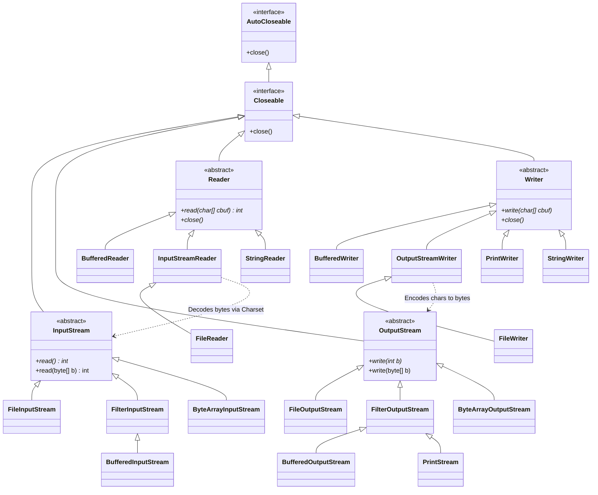
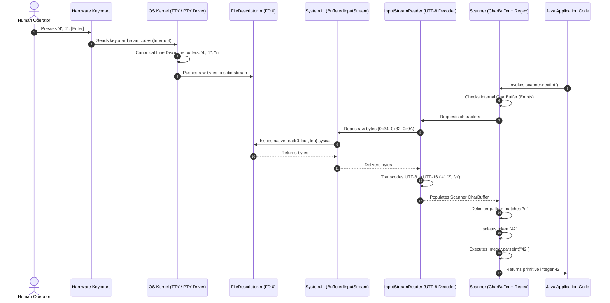
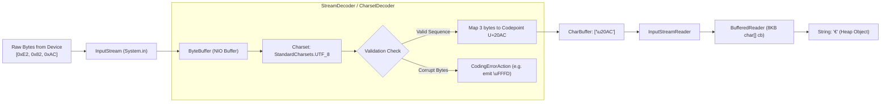
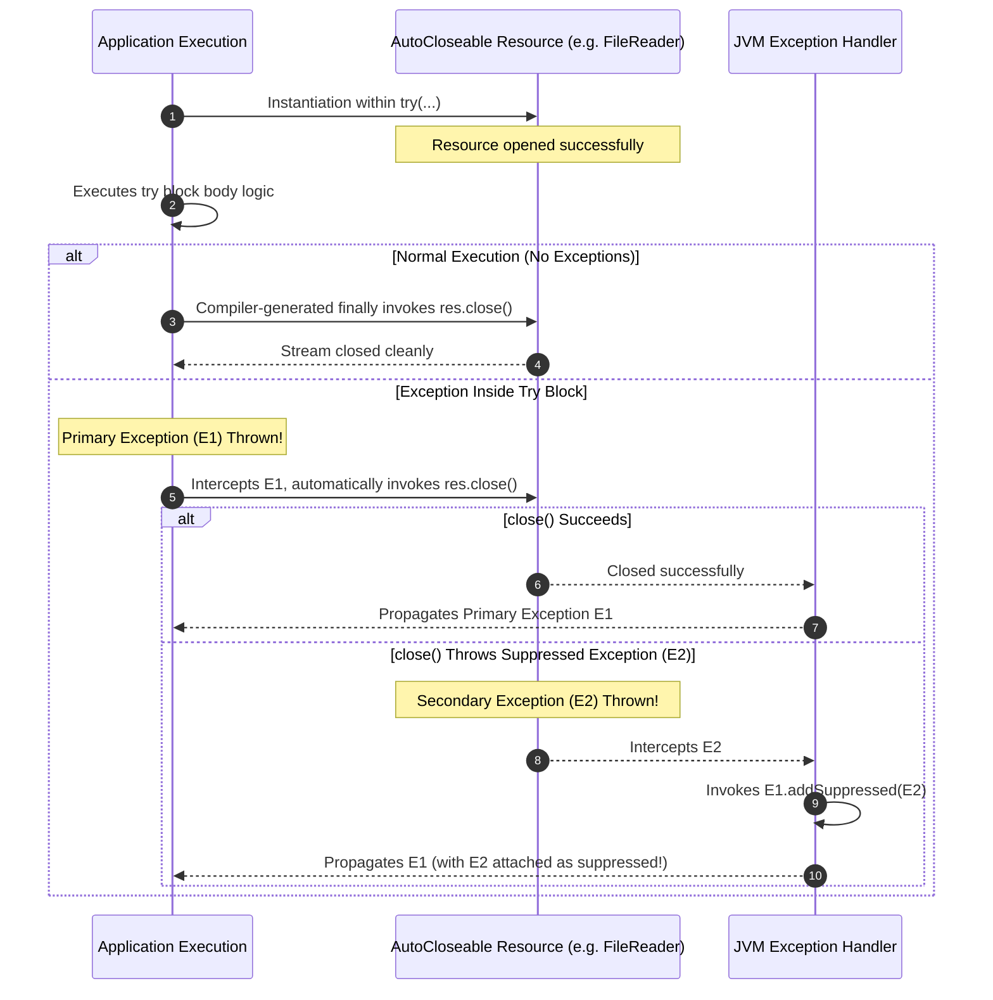

# MODULE 8: INPUT AND OUTPUT — Volume 1: Theory & Internals

Welcome to Module 8, Volume 1 of the Java Mastery Curriculum. In this module, we will explore the foundational architecture, low-level mechanics, and runtime execution models of Java's Input/Output (I/O) subsystem.

As a senior Java engineer, JVM architect, or compiler engineer, understanding I/O in Java requires moving far beyond surface-level invocations of `System.out.println()` or `new Scanner(System.in)`. You must master how the JVM abstracts hardware peripheral interfaces, how the OpenJDK runtime bridges character encodings and operating system file descriptors, how character decoders process multi-byte UTF-8 sequences, how buffers eliminate context-switching overhead across the user-space/kernel-space boundary, and how modern Java (spanning Java 9 through Java 21 LTS) revolutionizes data transfer and virtual thread scheduling during blocking I/O calls.

---

## PART 1: DEFINITION

### 1.1 What is I/O in Java?

In computational theory and computer architecture, **Input/Output (I/O)** is the subsystem responsible for transferring data between the primary memory subsystem of the host computer (the Random Access Memory housing the Java Virtual Machine heap, off-heap buffers, and call stacks) and external entities. These external entities encompass physical peripheral hardware (NVMe SSDs, mechanical hard drives, network interface cards, keyboards, mice, serial ports), software-managed abstractions (virtual terminals, operating system pipes, Unix domain sockets), and logical data sinks or sources (in-memory byte arrays, process standard streams).

From the perspective of the Java Virtual Machine (JVM), an **Input operation** is the ingestion of an external sequence of binary octets or encoded characters into JVM-managed memory. Conversely, an **Output operation** is the extraction and serialization of JVM-managed state, transmitting it outward across the process boundary to an external consumer or persistent storage mechanism.

```
+-----------------------------------------------------------------------------------+
|                                 OPERATING SYSTEM HOST                             |
|                                                                                   |
|  +-----------------------------------------------------------------------------+  |
|  |                        JAVA VIRTUAL MACHINE PROCESS                         |  |
|  |                                                                             |  |
|  |   +-----------------------+                    +------------------------+   |  |
|  |   |   JVM HEAP / NATIVE   |                    |   JVM HEAP / NATIVE    |   |  |
|  |   |   MEMORY SUBSYSTEM    |                    |   MEMORY SUBSYSTEM     |   |  |
|  |   +-----------^-----------+                    +-----------+------------+   |  |
|  |               | (Ingestion)                                | (Egress)       |  |
|  |     +---------+----------+                       +---------v----------+     |  |
|  |     |   java.io / NIO    |                       |   java.io / NIO    |     |  |
|  |     |   Input Streams    |                       |   Output Streams   |     |  |
|  |     +---------^----------+                       +---------+----------+     |  |
|  +---------------|--------------------------------------------|----------------+  |
|                  |                                            |                   |
|                  | Syscall: read(2)                           | Syscall: write(2) |
|  +---------------|--------------------------------------------|----------------+  |
|  |               v                                            v                |  |
|  |      OS KERNEL SPACE (VFS, Page Cache, Socket Buffers, TTY Line Discipline) |  |
|  +---------------+--------------------------------------------+----------------+  |
|                  |                                            |                   |
|                  | Hardware Interrupts / DMA                  | DMA / Controller  |
|  +---------------v--------------------------------------------v----------------+  |
|  |      PHYSICAL HARDWARE (Keyboard, NVMe SSD, NIC, PTY/Terminal, Pipe)        |  |
|  +-----------------------------------------------------------------------------+  |
+-----------------------------------------------------------------------------------+
```

In Java, all classical I/O is centered around the concept of a **Stream**. A stream is an abstract, sequentially ordered, unidirectional sequence of data elements with an undetermined or dynamically determined length. Streams enforce three fundamental architectural invariants:
1. **Unidirectional Data Flow:** An input stream can only be read from; an output stream can only be written to. Bidirectional communication requires two distinct streams or a bidirectional NIO channel.
2. **Sequential Consumption:** Data elements are read or written sequentially. Unless backed by a seekable device (such as a random-access file or seekable byte channel), consumed elements cannot be rewound without explicit buffering or mark/reset capabilities.
3. **Blocking Synchronous Semantics (Classical I/O):** By default, an invocation to read data blocks the executing thread if data is not yet available at the hardware or kernel layer. In Java 21, Virtual Threads fundamentally alter the thread-scheduling cost of this blocking behavior.

### 1.2 Why Does Java Have Multiple I/O Classes?

Developers encountering Java's I/O framework for the first time often express bewilderment at its sheer breadth. To read text from the standard input or a file, Java offers `Scanner`, `BufferedReader`, `Console`, `DataInputStream`, `FileInputStream`, `FileReader`, `StringReader`, `Files.readString()`, and `Channels.newReader()`. 

This design is neither accidental nor redundant. It is the direct consequence of four orthogonal architectural dimensions:

```
                                  JAVA I/O TAXONOMY
                                          |
         +--------------------------------+-------------------------------+
         |                                                                |
   DATA GRANULARITY                                              PROCESSING RESPONSIBILITY
         |                                                                |
    +----+----+                                                      +----+----+
    |         |                                                      |         |
  BYTES   CHARACTERS                                            LOW-LEVEL   HIGH-LEVEL
 (8-bit)   (16-bit)                                              STREAM      DECORATION
    |         |                                                  PIPING     (Buffering,
InputStream Reader                                                  |        Formatting,
OutputStream Writer                                            FileInputStream Parsing)
                                                               SocketInputStream    |
                                                                              BufferedReader
                                                                              PrintWriter
                                                                              Scanner
```

#### 1. Data Granularity (Bytes vs. Characters)
Computing hardware and network protocols operate strictly on raw binary octets (8-bit bytes). Human beings, however, communicate via natural language symbols (graphemes, characters, codepoints). A single character may span anywhere from 1 to 4 bytes in modern encodings like UTF-8. Java strictly separates classes handling raw binary data (`InputStream`, `OutputStream`) from classes handling character and text manipulation (`Reader`, `Writer`).

#### 2. The Decorator Pattern (Composition Over Inheritance)
Rather than constructing monolithic classes containing every imaginable capability (e.g., a hypothetical `BufferedEncodingTranslatingFormattedFileStream`), Java’s designers adopted the **Decorator Design Pattern** (GoF). Basic streams provide pure transport mechanisms (e.g., `FileInputStream`, `SocketInputStream`), while wrapper streams decorate the underlying transport with orthogonal capabilities:
* `BufferedInputStream` / `BufferedReader`: Adds in-memory chunk caching to minimize kernel context switching.
* `DataInputStream`: Adds binary parsing for primitive types (`readInt()`, `readDouble()`).
* `InputStreamReader`: Adds character transcoding based on a `Charset`.
* `LineNumberReader`: Adds automated tracking of line boundaries.

#### 3. Convenience vs. Throughput (High-Level vs. Low-Level)
* **Convenience Abstractions (`Scanner`, `PrintWriter`):** Designed for human developer ergonomics, rapid prototyping, token parsing, and formatted output. They trade raw throughput for automated type conversions, regular expression parsing, and localized parsing rules.
* **High-Throughput Abstractions (`BufferedReader`, `BufferedOutputStream`, NIO `FileChannel`):** Designed for batch processing, enterprise pipelines, and high-frequency data ingestion. They eliminate intermediate allocations, avoid regex overhead, and optimize for CPU cache lines and direct system-call boundaries.

#### 4. Execution Context & Security Abstractions (`Console`)
Reading data from an interactive UNIX terminal or Windows console requires specialized capabilities that generic byte streams cannot provide, such as disabling terminal echo for password entry, handling terminal line-discipline settings, and querying TTY allocation.

---

### 1.3 The Stream-Based Model: Byte Streams vs. Character Streams

The divide between byte streams and character streams is the single most critical structural boundary in `java.io`.

```
+-----------------------------------------------------------------------------------+
|                        JAVA I/O CORE ABSTRACT ROOT HIERARCHY                     |
+-----------------------------------------+-----------------------------------------+
| BYTE-ORIENTED (8-BIT OCTETS)            | CHARACTER-ORIENTED (16-BIT UTF-16)      |
| Base Types: byte, byte[]                | Base Types: char, char[], String        |
+-----------------------------------------+-----------------------------------------+
|                                         |                                         |
|           java.io.InputStream           |            java.io.Reader               |
|                    ▲                    |                   ▲                     |
|                    │                    |                   │                     |
|      +-------------+-------------+      |      +------------+------------+        |
|      │                           │      |      │                         │        |
| FileInputStream          FilterInputStream FileReader            BufferedReader   |
|                                  ▲                                                |
|                                  │                                                |
|                         BufferedInputStream                                       |
|                                                                                   |
+-----------------------------------------+-----------------------------------------+
|                                         |                                         |
|           java.io.OutputStream          |            java.io.Writer               |
|                    ▲                    |                   ▲                     |
|                    │                    |                   │                     |
|      +-------------+-------------+      |      +------------+------------+        |
|      │                           │      |      │                         │        |
| FileOutputStream         FilterOutputStream FileWriter           BufferedWriter   |
|                                  ▲                                       ▲        |
|                                  │                                       │        |
|                         PrintStream (Bridge)                     PrintWriter      |
|                                                                                   |
+-----------------------------------------+-----------------------------------------+
```

#### Byte Streams (`InputStream` / `OutputStream`)
* **Underlying Unit:** Unsigned 8-bit octet (`0x00` through `0xFF`), represented in Java method signatures as an `int` ranging from `0` to `255`, or within a signed `byte` array (`-128` to `127`).
* **EOF Sentinel:** The integer `-1` signals the End-Of-File (EOF).
* **Domain:** Executable binaries, image formats (PNG, JPEG), audio streams, compressed archives (ZIP, GZIP), protocol buffer payloads, serialized JVM class files, and raw network sockets.
* **Core Contract:**
  ```java
  // Reads a single byte; returns 0-255 or -1 on EOF
  public abstract int read() throws IOException;
  
  // Reads a block of bytes into an array
  public int read(byte[] b, int off, int len) throws IOException;
  
  // Writes a single byte (lower 8 bits of b)
  public abstract void write(int b) throws IOException;
  ```

#### Character Streams (`Reader` / `Writer`)
* **Underlying Unit:** 16-bit UTF-16 code unit (`\u0000` through `\uFFFF`), represented as a primitive `char` or an `int` ranging from `0` to `65535`.
* **EOF Sentinel:** The integer `-1` signals EOF.
* **Domain:** Source code, XML documents, JSON payloads, CSV files, plain text, human-interactive terminal inputs.
* **Core Contract:**
  ```java
  // Reads a single character; returns 0-65535 or -1 on EOF
  public int read() throws IOException;
  
  // Reads characters into an array
  public abstract int read(char[] cbuf, int off, int len) throws IOException;
  
  // Writes a string or char slice
  public void write(String str, int off, int len) throws IOException;
  ```

> [!CAUTION]
> **The Byte-to-Character Pitfall**
> Never attempt to process text using raw `InputStream.read()` by naively casting bytes to characters: `(char) inputStream.read()`. This assumes that one byte equals one character—an assumption that fails catastrophically for any non-ASCII UTF-8 sequence. For example, the Euro symbol `€` is encoded in UTF-8 as three bytes: `0xE2 0x82 0xAC`. Casting each byte to `char` produces the garbage string `€`. Always use a `Reader` configured with an explicit `Charset` to parse text.

---

### 1.4 Java's I/O Evolution: Three Generations

Java’s I/O facilities have evolved across three major technological epochs, reflecting the transformation of internet-scale computing and operating system kernel architectures over the past three decades:

```
+-----------------------------------------------------------------------------------+
|                        THE THREE GENERATIONS OF JAVA I/O                          |
+-----------------------------------------------------------------------------------+
| GENERATION 1: Classical Stream I/O (java.io) — Java 1.0 / 1.1                     |
| * Synchronous, blocking stream abstractions.                                      |
| * Unidirectional pipes, heavy thread-per-connection concurrency model.            |
| * Pure JNI bindings to C runtime stdio and OS file descriptors.                   |
+-----------------------------------------------------------------------------------+
| GENERATION 2: New I/O (java.nio) — Java 1.4                                       |
| * Buffer-oriented rather than stream-oriented (ByteBuffer, CharBuffer).           |
| * Channel-based abstractions (FileChannel, SocketChannel).                        |
| * Non-blocking, event-driven I/O multiplexing (Selector, epoll/kqueue).           |
| * Direct memory buffers (off-heap memory) and kernel zero-copy (transferTo).      |
+-----------------------------------------------------------------------------------+
| GENERATION 3: NIO.2 & Modern Ergonomics (java.nio.file) — Java 7 through Java 21  |
| * Path, Paths, and Files APIs replacing java.io.File.                             |
| * Rich filesystem attribute querying, directory streams, asynchronous channels.   |
| * One-line high-performance methods: Files.readString(), Files.writeString().      |
| * Virtual Threads (Java 21 LTS): Synchronous syntax running on non-blocking JVM   |
|   schedulers via Loom carrier-thread unmounting.                                  |
+-----------------------------------------------------------------------------------+
```

#### Generation 1: Classical Stream I/O (`java.io`, Java 1.0 & 1.1)
Introduced in Java 1.0 (`InputStream`, `OutputStream`) and expanded in Java 1.1 (`Reader`, `Writer`), this generation introduced the stream and decorator abstractions. Its fundamental limitation was its **blocking, thread-bound architecture**: when a thread called `read()` on a socket or console, the underlying operating system thread was placed into an uninterruptible wait state. Scalability was bottlenecked by OS thread memory footprints and kernel context-switching limits.

#### Generation 2: New I/O (`java.nio`, Java 1.4)
To address massive network concurrency (the C10K problem), Java 1.4 introduced NIO. Instead of streams, NIO centers around:
1. **Channels:** Bidirectional conduits capable of reading and writing asynchronously or synchronously.
2. **Buffers:** Explicit memory regions (`ByteBuffer`, `CharBuffer`) managing `position`, `limit`, and `capacity`.
3. **Selectors:** Multiplexers that allow a single thread to monitor thousands of network channels using OS-native polling primitives (`epoll` on Linux, `kqueue` on macOS, I/O Completion Ports on Windows).

#### Generation 3: NIO.2 Filesystem API (`java.nio.file`, Java 7)
Java 7 addressed severe design flaws in `java.io.File` (such as silent boolean failure on delete, inability to access file metadata, and lack of symbolic link support) by introducing `java.nio.file.Path` and `java.nio.file.Files`.

#### Generation 3.5: Modern Stream Pipelines & Project Loom (Java 9 to Java 21 LTS)
Modern Java bridges ergonomic simplicity and high performance:
* Java 9 introduced `InputStream.transferTo(OutputStream)` and `InputStream.readAllBytes()`.
* Java 11 introduced `Files.readString(Path)` and `Files.writeString(Path, CharSequence)`.
* **Java 21 LTS Virtual Threads (Project Loom):** Virtual threads revolutionize classical `java.io`. When a virtual thread executes a blocking `read()` or `readLine()` on an underlying network socket or stream, the JVM intercepts the call, unmounts the virtual thread from its carrier OS thread, and parks it until the OS signals data availability. This restores the clean, readable programming model of classical synchronous I/O while matching the throughput of reactive asynchronous frameworks.

> [!NOTE]
> **Virtual Threads vs. File I/O Pinning**
> While Virtual Threads unmount cleanly during blocking *network* socket I/O operations (via OS epoll/kqueue polling in `Poller.java`), standard blocking *file* I/O (`FileInputStream`, `FileOutputStream`, `RandomAccessFile`) still pins the carrier thread on many operating systems due to kernel-level limitations in asynchronous file APIs. The JDK compensates for this by dynamically expanding the `ForkJoinPool` carrier thread pool to preserve concurrency, but high-throughput systems should utilize `FileChannel` or NIO.2 asynchronous channels when non-blocking file processing is required.

---

### 1.5 Console I/O vs. File I/O vs. Network I/O

Underneath the JVM's unifying abstractions, the operating system kernel handles console, file, and network streams with fundamentally divergent semantics:

```
+-----------------------------------------------------------------------------------------------+
|                       COMPARATIVE MATRIX: CONSOLE vs. FILE vs. NETWORK I/O                   |
+----------------------+--------------------------+---------------------+-----------------------+
| PROPERTY             | CONSOLE I/O              | FILE I/O            | NETWORK I/O           |
+----------------------+--------------------------+---------------------+-----------------------+
| Underlying Device    | TTY / PTY (Pseudo-term)  | Block Storage (SSD) | NIC (Ethernet / WiFi) |
| Seekable (Rewind)    | No (Stream only)         | Yes (seek / cursor) | No (Stream only)      |
| Buffering Layer      | Terminal Line Discipline | OS Page Cache (RAM) | Socket Send/Recv Buf  |
| Operating Mode       | Canonical (Cooked) / Raw | Direct / Cached     | Stream (TCP) / Pkt(UDP)|
| Latency Range        | Human scale (10-500 ms)  | Microseconds (µs)   | Milliseconds (ms)     |
| EOF Condition        | Explicit Ctrl+D / Ctrl+Z | File size reached   | FIN / RST Packet      |
| Java Abstraction     | Console / Scanner / in   | FileInputStream/NIO | Socket.getInputStream |
+----------------------+--------------------------+---------------------+-----------------------+
```

#### Console I/O
The console communicates with a terminal emulator via a **Pseudo-Terminal (PTY)** pair. By default, the terminal operates in **canonical mode** (cooked mode): the operating system buffers user keyboard strokes in a kernel line buffer, allowing backspacing, character editing, and cursor movement. The kernel does not release a single byte to the JVM's `System.in` until the user presses the `Enter` key (`\n` or `\r\n`). In addition, the terminal line discipline handles echo (printing the typed characters back to the screen) and translates control characters (e.g., `Ctrl+C` into `SIGINT`).

#### File I/O
File systems manage blocks of data on non-volatile media. Reading from a file leverages the operating system's **Page Cache**. When Java issues a read request, the kernel reads ahead contiguous disk blocks into kernel memory. File I/O supports arbitrary random access: a thread can jump directly to byte offset $10,000,000$ without reading the preceding bytes.

#### Network I/O
Network sockets transfer data packets across network switches and routers using TCP/IP. Sockets are non-seekable, suffer from variable latency, packet loss, and jitter, and must handle partial reads (e.g., asking for 1024 bytes but receiving only 87 bytes due to TCP window fragmentation).

---

### 1.6 Standard Streams: System.in, System.out, System.err

Following the Unix architectural philosophy that established standard streams in 1970, the JVM initializes three static stream references inside `java.lang.System` during bootstrap:

```
               +------------------------------------------------+
               |              OPERATING SYSTEM KERNEL           |
               |                                                |
               |  File Descriptor 0: stdin  (Keyboard / Input)  |
               |  File Descriptor 1: stdout (Terminal Display)  |
               |  File Descriptor 2: stderr (Terminal Display)  |
               +-----------------------+------------------------+
                                       |
                     JVM Bootstrap Initialization Phase
                                       |
               +-----------------------v------------------------+
               |                java.lang.System                |
               |                                                |
               |  public static final InputStream in;           |
               |  public static final PrintStream out;          |
               |  public static final PrintStream err;          |
               +------------------------------------------------+
```

#### 1. `System.in` (`java.io.InputStream`)
* **Underlying File Descriptor:** FD 0 (`stdin`).
* **Runtime Concrete Type:** Wrapped internally as a `java.io.BufferedInputStream` wrapping a native `FileInputStream` initialized with `FileDescriptor.in`.
* **Nature:** Pure byte stream. It has no built-in awareness of character sets, encodings, or line structures. Reading a single character requires explicit decoding.

#### 2. `System.out` (`java.io.PrintStream`)
* **Underlying File Descriptor:** FD 1 (`stdout`).
* **Runtime Concrete Type:** A `java.io.PrintStream` wrapping a `BufferedOutputStream` wrapping a `FileOutputStream` initialized with `FileDescriptor.out`.
* **Buffering Behavior:** Auto-flushing is enabled by default. Writing a newline character (`\n`) or invoking `println()` flushes the internal buffer to the operating system.

#### 3. `System.err` (`java.io.PrintStream`)
* **Underlying File Descriptor:** FD 2 (`stderr`).
* **Runtime Concrete Type:** A `java.io.PrintStream` wrapping a `FileOutputStream` bound to `FileDescriptor.err`.
* **Buffering Behavior:** Auto-flushing is enabled. It is structurally dedicated to error reporting and diagnostic logging. Because standard output and standard error are distinct operating system handles, shell scripts can redirect program output to a persistent file while allowing diagnostic error traces to remain visible in the terminal:
  ```bash
  java -jar Application.jar > output.log 2> error.log
  ```

---

## PART 2: SYNTAX — EVERY DETAIL

### 2.1 Scanner (`java.util.Scanner`)

Introduced in Java 5, `java.util.Scanner` is a high-level, regular-expression-based text tokenizer. It breaks input into tokens using a delimiter pattern (which defaults to whitespace) and converts tokens into Java primitive values using typed scanning methods.

```java
package java.util;

public final class Scanner implements Iterator<String>, AutoCloseable {
    // Internally tokenizes character buffers using java.util.regex.Pattern
}
```

#### Constructors
```java
// Read from Standard Input (System.in)
Scanner scConsole = new Scanner(System.in);

// Read with an explicit Character Encoding (CRITICAL BEST PRACTICE)
Scanner scUtf8 = new Scanner(System.in, StandardCharsets.UTF_8);

// Read from an In-Memory String
Scanner scString = new Scanner("100 200 400.50 true Alpha");

// Read from a File (java.io.File or java.nio.file.Path)
Scanner scFile = new Scanner(Path.of("data.csv"), StandardCharsets.UTF_8);

// Read from any arbitrary Readable source (such as CharBuffer or custom reader)
Scanner scReadable = new Scanner(new BufferedReader(new FileReader("data.txt")));
```

#### Reading Methods
* `next()`: Scans and returns the next complete token matching the delimiter pattern.
* `nextLine()`: Advances the scanner past the current line boundary and returns the skipped string (excluding line terminators).
* `nextInt()`, `nextLong()`, `nextShort()`, `nextByte()`: Parses the next token as a signed integer type. Supports radix parsing via overloaded variants: `nextInt(16)` parses hex strings like `"7F"`.
* `nextDouble()`, `nextFloat()`: Parses the next token as a floating-point number using the active `Locale`.
* `nextBoolean()`: Parses case-insensitive `"true"` or `"false"`.
* `nextBigInteger()`, `nextBigDecimal()`: Scans arbitrary-precision arithmetic values.

#### Checking Methods (Precondition Probes)
To avoid `InputMismatchException` and `NoSuchElementException`, `Scanner` provides non-advancing lookahead inspection methods:
* `hasNext()`: Returns `true` if the scanner has another token in its input.
* `hasNextLine()`: Returns `true` if there is another line in the input.
* `hasNextInt()`, `hasNextDouble()`, `hasNextBoolean()`: Checks if the next token can be interpreted as the specified type without consuming it.
* `hasNext(Pattern pattern)`: Matches the upcoming token against a custom compiled regex.

> [!WARNING]
> **Console Blocking on `hasNextXxx()`**
> When attached to an interactive console (`System.in`), methods like `hasNextInt()` are **blocking**. If the user has not pressed `Enter`, `hasNextInt()` halts thread execution until an input line is submitted. It does not return `false` on an empty buffer; it waits for input!

---

#### The Scanner Trap: The Leftover Newline Bug

The single most common bug encountered by engineers utilizing `Scanner` is the "Leftover Newline Bug" that occurs when interleaving primitive reads (`nextInt()`, `nextDouble()`) with line reads (`nextLine()`).

##### The Defective Code:
```java
Scanner scanner = new Scanner(System.in);

System.out.print("Enter your age: ");
int age = scanner.nextInt(); // User types: 2 5 [Enter]

System.out.print("Enter your full name: ");
String name = scanner.nextLine(); // BUG: Instantly skipped! Produces ""

System.out.println("Result: Age=" + age + ", Name='" + name + "'");
```

##### Why This Happens (Buffer-Level Breakdown):
When the user types `25` followed by `Enter`, the operating system terminal transmits three bytes across `System.in`: `'2'`, `'5'`, and the newline character `'\n'` (or `'\r\n'` on Windows).

1. `scanner.nextInt()` executes:
   - Scans the buffer and identifies the token characters `'2'` and `'5'`.
   - Parses the numeric value `25`.
   - **Crucial:** `nextInt()` consumes *only* the numeric digits. It leaves the trailing delimiter `'\n'` sitting in the scanner’s internal buffer!
2. `scanner.nextLine()` executes:
   - The contract of `nextLine()` is to scan until it encounters a line separator, return all content prior to that separator, and discard the separator.
   - It inspects the buffer and *immediately* finds the leftover `'\n'`.
   - It returns everything before the `'\n'`—which is an empty string `""`!
   - The user is never prompted to input their name.

```
USER TYPES: '2', '5', '\n'

Initial Buffer State:
+---+---+----+
| 2 | 5 | \n |
+---+---+----+
  ▲
  |-- Read Pointer

1. After scanner.nextInt():
+---+---+----+
| 2 | 5 | \n |
+---+---+----+
          ▲
          |-- Read Pointer (Stops BEFORE \n)
Returns: 25

2. scanner.nextLine() executes immediately:
Inspects current pointer: Finds '\n'!
Consumes '\n', advances pointer, returns preceding characters: "" (EMPTY STRING)
```

##### The Fixes:

* **Fix 1: Consume the Trailing Newline (Intermediate Flush)**
  ```java
  int age = scanner.nextInt();
  scanner.nextLine(); // Explicitly consume the lingering '\n'
  String name = scanner.nextLine(); // Now correctly blocks for user input
  ```

* **Fix 2: Read Exclusively via `nextLine()` and Parse (Senior Engineer Standard)**
  Avoid token-based primitive parsing entirely. Read every line as a pure string, then parse explicitly. This completely eliminates buffer synchronization bugs and cleanly isolates parsing exceptions:
  ```java
  System.out.print("Enter your age: ");
  int age = Integer.parseInt(scanner.nextLine().trim());
  
  System.out.print("Enter your full name: ");
  String name = scanner.nextLine().trim();
  ```

---

#### Delimiters and Pattern Customization
By default, `Scanner` splits tokens using the Unicode whitespace pattern: `\p{javaWhitespace}+`. You can reconfigure this using `useDelimiter()`:

```java
// Parse CSV (Comma-Separated Values)
String csvData = "Alpha,100,True,Beta,200,False";
try (Scanner sc = new Scanner(csvData)) {
    sc.useDelimiter(",");
    while (sc.hasNext()) {
        System.out.println("Token: " + sc.next());
    }
}

// Complex Delimiter: Commas, Semicolons, or Whitespace
sc.useDelimiter(Pattern.compile("[,;\\s]+"));
```

> [!TIP]
> **Production CSV Processing: Do Not Use `Scanner` for RFC 4180 Compliance**
> While `scanner.useDelimiter(",")` is handy for trivial programming contests or homework problems, it is strictly non-compliant with RFC 4180. A simple delimiter regex fails when a CSV field contains escaped commas within quotes (e.g., `"Garg, Naman",100`), escaped quote characters (`""`), or embedded newlines. In production enterprise pipelines, use dedicated, zero-copy parsers such as Jackson CSV, OpenCSV, or Apache Commons CSV.

#### Locale & Number Formatting
`Scanner` is locale-sensitive. In the United States (`Locale.US`), the decimal separator is a dot (`3.14`). In France (`Locale.FRANCE`) and Germany (`Locale.GERMANY`), the decimal separator is a comma (`3,14`).

```java
String frenchNumber = "3,14";
Scanner sc = new Scanner(frenchNumber);
sc.useLocale(Locale.FRANCE);
double val = sc.nextDouble(); // Successfully parses 3.14

// If sc used Locale.US, nextDouble() would throw InputMismatchException!
```

> [!IMPORTANT]
> **Closing `Scanner(System.in)` Kills Standard Input Permanently**
> `Scanner` implements `AutoCloseable`. Placing `new Scanner(System.in)` inside a `try-with-resources` block will invoke `close()` on the scanner upon block exit. Because `Scanner.close()` closes its underlying source, **it closes `System.in`!**
> Once the standard input stream is closed at the operating system file descriptor level, it **cannot** be reopened within that JVM process. Any subsequent read attempts across the entire application will throw `IOException: Stream closed`. Only close a `Scanner` if it wraps an actual file or network connection, never when wrapping `System.in`.

---

### 2.2 Console (`java.io.Console`)

Introduced in Java 6, `java.io.Console` provides direct access to the character-based console device associated with the current virtual machine.

```java
package java.io;

public final class Console implements Flushable {
    // Singleton access via System.console()
}
```

#### Accessing the Console
The `Console` instance is accessed via `System.console()`. It cannot be instantiated directly via a constructor.

```java
Console console = System.console();
if (console == null) {
    // We are running in an environment without an attached TTY!
}
```

#### The "IDE Null Trap"
If you run `System.console()` inside IntelliJ IDEA, Eclipse, VS Code, or a CI/CD build runner (like Jenkins or GitHub Actions), **it will return `null`**.

```
+-------------------------------------------------------------------------------+
|                        WHY System.console() IS NULL IN IDEs                   |
+-------------------------------------------------------------------------------+
| PHYSICAL OS TERMINAL:                                                         |
| Terminal App / Bash ---> Spawns JVM directly attached to /dev/tty             |
| isatty(fileno(stdin)) == 1 ---> System.console() returns Console object       |
+-------------------------------------------------------------------------------+
| IDE RUN WINDOW (IntelliJ IDEA):                                               |
| IDE Process ---> Spawns JVM via OS Pipe / Redirection (ProcessBuilder)        |
| stdin/stdout are redirected pipes, NOT an interactive TTY!                    |
| isatty(fileno(stdin)) == 0 ---> System.console() returns NULL                 |
+-------------------------------------------------------------------------------+
```

The underlying native method in the JDK (`Java_java_io_Console_initIDs`) executes a POSIX system call:
```c
if (!isatty(0) || !isatty(1)) {
    return NULL; // Standard input or standard output is not a terminal device
}
```
Because IDE run consoles launch Java applications as child processes with redirected pipes to capture output in their custom GUI tool windows, standard input is not a true TTY device.

##### The Universal Senior Engineer Idiom:
```java
public class SecureInput {
    public static char[] promptPassword(String prompt) throws IOException {
        Console console = System.console();
        if (console != null) {
            return console.readPassword("%s", prompt);
        } else {
            // Graceful Fallback for IDE Development and Redirection
            System.out.print(prompt + " (IDE fallback - plain text): ");
            BufferedReader reader = new BufferedReader(new InputStreamReader(System.in));
            String line = reader.readLine();
            return (line != null) ? line.toCharArray() : new char[0];
        }
    }
}
```

#### Key Methods
* `readLine()`: Reads a single line of text from the console.
* `readLine(String fmt, Object... args)`: Prints a formatted prompt, then reads a line.
* `readPassword()`: Reads a password with **terminal echo disabled**.
* `readPassword(String fmt, Object... args)`: Displays a formatted prompt and reads a password securely without echoing characters.
* `printf(String fmt, Object... args)`: Formatted write to the console.
* `writer()` / `reader()`: Returns the underlying `PrintWriter` and `Reader`.

#### Security Mechanics: Why `readPassword()` Returns `char[]` Instead of `String`
`Console.readPassword()` intentionally returns a mutable character array (`char[]`) rather than a `java.lang.String`. This is a fundamental security architecture decision:

```
+-------------------------------------------------------------------------------+
|                   SECURITY HAZARD: String vs. char[] FOR PASSWORDS            |
+-------------------------------------------------------------------------------+
| java.lang.String:                                                             |
| 1. IMMUTABLE: Internal byte[]/char[] cannot be wiped or zeroed out.           |
| 2. STRING POOL / HEAP: Persists in memory across multiple GC generational     |
|    cycles (Eden -> Survivor -> Tenured/Old Gen).                              |
| 3. ATTACK SURFACE: Exposed to heap memory dump analyzers, core dump files,   |
|    process memory scanning, and unauthorized JNI inspection.                  |
+-------------------------------------------------------------------------------+
| char[] ARRAY:                                                                 |
| 1. MUTABLE: The memory can be explicitly sanitized immediately after use.     |
| 2. ZEROING OUT: Arrays.fill(password, '\0') destroys the plaintext in RAM.    |
| 3. MINIMAL ATTACK WINDOW: Exists only for microseconds during authentication. |
+-------------------------------------------------------------------------------+
```

##### Secure Destruction Idiom:
```java
char[] secretPassword = console.readPassword("Enter Master Key: ");
try {
    authenticateUser(secretPassword);
} finally {
    // Overwrite the password buffer in memory immediately after authentication!
    Arrays.fill(secretPassword, '0');
}
```

---

### 2.3 BufferedReader (`java.io.BufferedReader`)

`java.io.BufferedReader` is the enterprise standard for reading character-based text streams efficiently. It intercepts calls to an underlying `Reader`, pre-fetching large blocks of characters into an internal memory buffer.

```java
package java.io;

public class BufferedReader extends Reader {
    private static int defaultCharBufferSize = 8192; // 8K character internal buffer
    private Reader in;
    private char[] cb;
    private int nChars, nextChar;
}
```

#### Construction
```java
// Standard Wrapping of System.in
BufferedReader reader = new BufferedReader(new InputStreamReader(System.in, StandardCharsets.UTF_8));

// Custom Buffer Sizing (e.g., 32KB buffer for multi-gigabyte log file processing)
BufferedReader largeFileReader = new BufferedReader(new FileReader("server.log"), 32768);
```

#### Key Methods
* `readLine()`: Reads a line of text. A line is terminated by `\n`, `\r`, or `\r\n`.
  * **Returns:** The line contents *without* the termination characters.
  * **EOF Behavior:** Returns `null` when the end of stream is reached (unlike `Scanner`, which throws `NoSuchElementException`).
* `read()`: Reads a single 16-bit character. Returns an `int` between `0` and `65535`, or `-1` on EOF.
* `read(char[] cbuf, int off, int len)`: Reads characters directly into an array slice.
* `ready()`: Returns `true` if the internal buffer is non-empty or if the underlying stream will not block upon the next read.
* `lines()`: Returns a lazy, functional `Stream<String>`.

##### Idiomatic Line-Reading Loop:
```java
try (BufferedReader br = new BufferedReader(new FileReader("access.log", StandardCharsets.UTF_8))) {
    String line;
    while ((line = br.readLine()) != null) {
        processLogEntry(line);
    }
}
```

##### Modern Functional Pipeline (`lines()`):
```java
try (BufferedReader br = Files.newBufferedReader(Path.of("metrics.csv"))) {
    long errorCount = br.lines()
                        .filter(l -> l.startsWith("ERROR"))
                        .count();
}
```

---

### 2.4 InputStreamReader — The Byte-to-Character Bridge

`java.io.InputStreamReader` is the bridge connecting raw 8-bit byte streams (`InputStream`) to 16-bit character streams (`Reader`).

```java
package java.io;

public class InputStreamReader extends Reader {
    private final StreamDecoder sd; // Wraps java.nio.charset.CharsetDecoder
}
```

Every operating system, file format, and network socket transmits raw binary bytes. To convert those bytes into text characters, a mapping rule—a **Character Set Encoding (`Charset`)**—is required. `InputStreamReader` consumes bytes from its underlying `InputStream`, loads them into a `java.nio.ByteBuffer`, and delegates to a `sun.nio.cs.StreamDecoder` backed by a `CharsetDecoder` to emit characters into a `CharBuffer`.

```
                    INPUTSTREAMREADER DECODING PIPELINE
                    
  Raw Bytes          ByteBuffer              CharsetDecoder           CharBuffer          Java Chars
+-----------+     +---------------+        +----------------+       +--------------+     +------------+
| System.in | --> | 0xE2 0x82 0xAC| -----> | UTF-8 Decoder  | ----> |   \u20AC     | --> |    '€'     |
+-----------+     +---------------+        +----------------+       +--------------+     +------------+
 (Hardware)         (Kernel/JNI)            (Transcoding)            (JVM Memory)         (char/String)
```

#### Charset Specification
Prior to Java 18, invoking `new InputStreamReader(System.in)` without an explicit charset argument was a major source of bugs. The JVM fell back to the host operating system's default encoding:
* Windows: Typically `windows-1252` or `Shift_JIS`.
* Linux/macOS: Typically `UTF-8`.
This meant code that compiled and ran cleanly on a Mac crashed or corrupted text when deployed to a Windows production server!

#### Java 18 JEP 400: UTF-8 by Default
Starting in **Java 18 (and continuing in Java 21 LTS)**, JEP 400 set the default charset of the Java APIs to **UTF-8** uniformly across all operating systems, platforms, and locales.

However, senior engineers enforce **explicit charset declarations** in production code:
```java
// ALWAYS specify StandardCharsets.UTF_8 explicitly
InputStreamReader reader = new InputStreamReader(System.in, StandardCharsets.UTF_8);
```

---

### 2.5 PrintWriter (`java.io.PrintWriter`)

`java.io.PrintWriter` provides formatted, human-readable character output capabilities. It prints representations of any Java object or primitive type to a text stream.

```java
package java.io;

public class PrintWriter extends Writer {
    private final boolean autoFlush;
    private boolean trouble = false; // Internal error state flag
}
```

#### Key Characteristics

1. **Suppression of `IOException`:** Unlike standard `Writer` classes, `PrintWriter` methods (`print()`, `println()`, `printf()`) **never throw `IOException`**. If an underlying write fails (e.g., an OS pipe breaks, a disk runs out of space, or a socket disconnects), the exception is caught internally, and an internal boolean flag `trouble` is set to `true`.
   ```java
   PrintWriter out = new PrintWriter(new FileWriter("output.txt"));
   out.println("Processing transaction...");
   if (out.checkError()) {
       // An IOException occurred during output operations!
       handleFatalDiskError();
   }
   ```
2. **Auto-Flushing:** When auto-flush is enabled via its constructor, `PrintWriter` automatically flushes its buffer whenever `println()`, `printf()`, or `format()` is invoked:
   ```java
   PrintWriter writer = new PrintWriter(System.out, true); // true = auto-flush enabled
   ```

---

### 2.6 PrintStream (`java.io.PrintStream`)

`java.io.PrintStream` is an output stream that wraps another `OutputStream` and adds the exact same high-level formatting methods (`print`, `println`, `printf`) found in `PrintWriter`.

#### The Crucial Distinction: `PrintStream` vs. `PrintWriter`
* `PrintStream` operates on **bytes** (`OutputStream`). Whenever you pass a character or string to a `PrintStream`, it must implicitly convert those characters into bytes using a charset encoder before writing to the sink.
* `PrintWriter` operates on **characters** (`Writer`). It writes raw Unicode characters without forcing an immediate conversion to bytes, allowing downstream writers to handle batch encoding.
* `System.out` and `System.err` are instances of `PrintStream`.

```java
// System.out writes bytes internally
System.out.println("Hello, World!"); 

// In high-performance text servers, PrintWriter wrapping a BufferedWriter is preferred:
PrintWriter out = new PrintWriter(new BufferedWriter(new OutputStreamWriter(System.out, StandardCharsets.UTF_8)));
```

---

### 2.7 Formatting (`printf` / `String.format` / `formatted`)

Java provides a C-style string formatting subsystem powered by `java.util.Formatter`.

#### The Format Specifier Grammar
Every format specifier conforms to the formal specification:
```
%[argument_index$][flags][width][.precision]conversion
```

```
                        ANATOMY OF A FORMAT SPECIFIER
                        
                 %    1$    -    15    .    4    f
                 │    │     │    │     │    │    │
                 │    │     │    │     │    │    └── Conversion Type: Floating-point
                 │    │     │    │     │    └─────── Precision: 4 decimal places
                 │    │     │    │     └──────────── Precision Separator
                 │    │     │    └────────────────── Width: Minimum 15 characters wide
                 │    │     └─────────────────────── Flag: Left-justify ('-' flag)
                 │    └───────────────────────────── Argument Index: Use 1st parameter
                 └────────────────────────────────── Format Specifier Introducer
```

#### 1. Conversion Characters
* `%d`: Decimal integer (applicable to `byte`, `short`, `int`, `long`, `BigInteger`).
* `%f`: Floating-point decimal number (`float`, `double`, `BigDecimal`).
* `%e`, `%E`: Scientific notation (e.g., `1.234567e+02`).
* `%s`, `%S`: String conversion. If an object is supplied, its `toString()` method is invoked. `%S` forces uppercase.
* `%c`, `%C`: Unicode character (`char`, `Character`).
* `%b`, `%B`: Boolean conversion. Note: Evaluates to `true` for **any non-null object** (even an empty string or integer 0!), and `false` only if the reference is `null` or `Boolean.FALSE`.
* `%x`, `%X`: Hexadecimal integer.
* `%o`: Octal integer.
* `%n`: **Platform-independent line separator.** (Outputs `\r\n` on Windows, `\n` on Linux/macOS). **Always use `%n` instead of `\n` in format strings!**
* `%%`: Escapes and prints a literal percent sign `%`.

#### 2. Flags
* `-`: Left-justified alignment within the minimum field width (default is right-justified).
* `+`: Always display a sign (`+` or `-`) for numeric values.
* `0`: Zero-pad numeric outputs to satisfy the minimum field width.
* `,`: Include locale-specific grouping separators (e.g., thousands separators: `1,000,000`).
* ` `: (Space): Prefix a leading space for positive numbers, aligning positive and negative numbers.
* `(`: Enclose negative numbers in parentheses: `(125.50)`.

#### 3. Width and Precision
```java
System.out.printf("|%10d|%n", 42);       // |        42| (Right-aligned, 10 spaces)
System.out.printf("|%-10d|%n", 42);      // |42        | (Left-aligned, 10 spaces)
System.out.printf("|%010d|%n", 42);      // |0000000042| (Zero-padded to 10 chars)
System.out.printf("|%.2f|%n", 3.14159);  // |3.14|       (2 decimal places)
System.out.printf("|%10.2f|%n", 3.14159);// |      3.14| (10 width, 2 decimal places)
System.out.printf("|%,12d|%n", 1000000); // |   1,000,000| (Grouping separator)
```

#### 4. Argument Indexing & Argument Reuse
You can explicitly dictate which parameter maps to a specifier using `index$`:
```java
// Reusing the first argument multiple times:
String message = String.format("%1$s is %1$s, because %1$s was written in Java.", "Java");
// Produces: "Java is Java, because Java was written in Java."

// Relative indexing (< flag) reuses the argument from the immediate previous specifier:
System.out.printf("%d in hex is %<X, and in octal is %<o%n", 255);
// Produces: "255 in hex is FF, and in octal is 377"
```

#### 5. Format APIs Comparison
```java
// 1. Direct output stream printing
System.out.printf("Total: $%.2f%n", total);

// 2. Formatting into a new String instance
String report = String.format(Locale.US, "Balance: $%,.2f", balance);

// 3. String.formatted() (Introduced in Java 15 - Senior Preferred Fluent Syntax)
String userRecord = "User[id=%d, name='%s']".formatted(userId, userName);
```

> [!TIP]
> **Always Use `%n` Instead of `\n` in Format Strings**
> While `\n` hardcodes the ASCII line feed character (`0x0A`, standard on Linux and macOS), Windows platforms expect a carriage return followed by a line feed (`\r\n`, `0x0D 0x0A`). Hardcoding `\n` in format strings causes formatted files and reports to render incorrectly in legacy Windows viewers like Notepad or print spoolers. Specifying `%n` instructs `java.util.Formatter` to dynamically query `System.lineSeparator()` and emit the exact byte sequence expected by the host operating system.

---

### 2.8 Standard Stream Redirection (`System.setIn`, `System.setOut`, `System.setErr`)

The standard streams are defined as `public static final` fields in `java.lang.System`. However, Java provides specialized native methods to redirect them at runtime:
* `System.setIn(InputStream in)`
* `System.setOut(PrintStream out)`
* `System.setErr(PrintStream err)`

Internally, these methods execute native code (`setIn0`, `setOut0`, `setErr0`) that bypasses standard Java language `final` field immutability constraints.

#### Unit Testing Pattern: Capturing Standard Output
In automated unit testing (JUnit 5), capturing `System.out` is essential to verify CLI outputs without changing production code:

```java
public class SystemRedirectionTest {
    private final PrintStream originalOut = System.out;
    private ByteArrayOutputStream testOutputStream;

    @BeforeEach
    void setUpStreams() {
        testOutputStream = new ByteArrayOutputStream();
        // Redirect System.out to our memory buffer
        System.setOut(new PrintStream(testOutputStream, true, StandardCharsets.UTF_8));
    }

    @AfterEach
    void restoreStreams() {
        // ALWAYS restore the original stream to prevent test pollutions!
        System.setOut(originalOut);
    }

    @Test
    void testCliOutput() {
        // Execute code under test
        System.out.print("Transaction Committed");
        
        String output = testOutputStream.toString(StandardCharsets.UTF_8);
        assertEquals("Transaction Committed", output);
    }
}
```

---

### 2.9 Modern Approaches (Java 9 through Java 21 LTS)

Modern Java simplifies everyday I/O by replacing complex multi-line buffer loops with expressive, zero-copy-capable utility methods.

#### 1. `Files.readString(Path)` and `Files.writeString(Path, CharSequence)` (Java 11)
Reads an entire file directly into a `java.lang.String` or writes a text string to disk in a single call.
```java
Path configPath = Path.of("/etc/app/config.json");

// Read entire file (defaults to UTF-8)
String json = Files.readString(configPath, StandardCharsets.UTF_8);

// Write string atomically
Files.writeString(configPath, "{ \"status\": \"ACTIVE\" }", StandardCharsets.UTF_8, 
                  StandardOpenOption.CREATE, StandardOpenOption.TRUNCATE_EXISTING);
```

#### 2. `InputStream.readAllBytes()` (Java 9)
Reads all remaining bytes from an input stream into a single `byte[]`.
```java
try (InputStream is = new FileInputStream("payload.bin")) {
    byte[] data = is.readAllBytes();
}
```
> [!CAUTION]
> **Out-Of-Memory (OOM) Hazard with `readAllBytes()`**
> Never invoke `readAllBytes()` on untrusted external inputs or unbounded network streams. If an attacker streams a 4GB file into an endpoint, `readAllBytes()` will attempt to allocate a contiguous 4GB array on the JVM heap, triggering an immediate `java.lang.OutOfMemoryError: Java heap space`.

#### 3. `InputStream.transferTo(OutputStream)` (Java 9) & `Reader.transferTo(Writer)` (Java 10)
Directly pipes all bytes or characters from an input stream to an output stream using an optimized internal buffer:
```java
try (InputStream input = new FileInputStream("source.zip");
     OutputStream output = new FileOutputStream("backup.zip")) {
    // Zero manual buffer management!
    long bytesTransferred = input.transferTo(output);
}
```

#### 4. `InputStream.readNBytes(byte[] b, int off, int len)` (Java 9 & 11)
Classical `InputStream.read(byte[], int, int)` is **not guaranteed** to read all requested bytes; it may return fewer bytes if only a partial packet is available. `readNBytes()` blocks repeatedly until the exact requested byte count is satisfied or EOF is reached:
```java
byte[] header = new byte[16];
int actualRead = inputStream.readNBytes(header, 0, 16);
if (actualRead < 16) {
    throw new EOFException("Premature end of header block");
}
```

---

## PART 3: INTERNAL WORKING

### 3.1 How `System.out` Works: The Complete Execution Call Chain

When you write `System.out.println("Hello");`, what actually happens under the hood? Tracing this call down through the JDK source, through the Java Native Interface (JNI), into the C library, and across the OS kernel boundary reveals the underlying complexity:

```
               USER CODE: System.out.println("Hello");
                               │
                               ▼
        ┌──────────────────────────────────────────────┐
        │ 1. java.io.PrintStream.println(String)       │
        │    - Synchronizes on 'this' (thread safety)  │
        │    - Calls print("Hello")                    │
        │    - Calls newLine()                         │
        └──────────────────────┬───────────────────────┘
                               │
                               ▼
        ┌──────────────────────────────────────────────┐
        │ 2. java.io.BufferedWriter / StreamEncoder    │
        │    - Encodes String characters (UTF-16) into │
        │      bytes using the active Charset (UTF-8)  │
        └──────────────────────┬───────────────────────┘
                               │
                               ▼
        ┌──────────────────────────────────────────────┐
        │ 3. java.io.BufferedOutputStream.write(...)   │
        │    - Checks internal byte[] buffer (8192 B)  │
        │    - If newline present & autoFlush enabled: │
        │      Calls flushBuffer()                     │
        └──────────────────────┬───────────────────────┘
                               │
                               ▼
        ┌──────────────────────────────────────────────┐
        │ 4. java.io.FileOutputStream.writeBytes(...)  │
        │    - Checks FileDescriptor status            │
        │    - Invokes native JNI method:              │
        │      Java_java_io_FileOutputStream_writeBytes│
        └──────────────────────┬───────────────────────┘
                               │
               JNI / C RUNTIME BOUNDARY (User Space)
                               │
                               ▼
        ┌──────────────────────────────────────────────┐
        │ 5. OpenJDK Native C (io_util.c)              │
        │    - Dispatches to POSIX write() system call │
        │      write(1, buffer, length); (FD 1 = stdout│
        └──────────────────────┬───────────────────────┘
                               │
            CPU PRIVILEGE TRANSITION (Ring 3 -> Ring 0)
                               │
                               ▼
        ┌──────────────────────────────────────────────┐
        │ 6. OPERATING SYSTEM KERNEL                   │
        │    - Traps syscall via sysenter / syscall    │
        │    - Routes FD 1 to TTY / PTY Driver         │
        │    - Line Discipline processes text          │
        │    - Transmits buffer to Terminal Emulator   │
        │      (e.g., Apple Terminal, iTerm2, xterm)   │
        └──────────────────────────────────────────────┘
```

#### Step-by-Step Execution Mechanics:
1. **Synchronization:** `PrintStream.println()` contains an internal synchronization block:
   ```java
   public void println(String x) {
       synchronized (this) {
           print(x);
           newLine();
       }
   }
   ```
   Every call to `System.out.println()` acquires the monitor lock on the shared `System.out` singleton! In high-concurrency microservices, thousands of threads calling `System.out.println` simultaneously will experience severe thread contention and lock wait states.
2. **Character-to-Byte Transcoding:** The `String` "Hello" is held in JVM memory as a byte array with a UTF-16 or Latin-1 coder flag. `PrintStream`’s internal `OutputStreamWriter` converts the UTF-16 characters into raw UTF-8 bytes using a native charset encoder.
3. **Buffer Management & Auto-Flush:** The bytes enter `BufferedOutputStream`. Because `System.out` is constructed with auto-flush enabled, the invocation of `newLine()` triggers `flushBuffer()`, pushing the bytes to `FileOutputStream`.
4. **JNI Transition:** `FileOutputStream` invokes the native method:
   ```c
   JNIEXPORT void JNICALL
   Java_java_io_FileOutputStream_writeBytes(JNIEnv *env, jobject this,
                                           jbyteArray bytes, jint off, jint len,
                                           jboolean append) {
       writeBytes(env, this, bytes, off, len, append, fos_fd);
   }
   ```
5. **POSIX System Call:** The C library issues the raw operating system kernel call:
   ```c
   write(1, buffer_ptr, byte_count);
   ```
   Here, `1` represents File Descriptor 1 (`stdout`).
6. **Kernel Transition:** The CPU switches execution privilege from **User Mode (Ring 3)** to **Kernel Mode (Ring 0)**. The kernel’s Virtual File System (VFS) routes the write request to the driver attached to standard output—typically a Pseudo-Terminal (PTY) master process managed by the operating system’s terminal emulator.

---

### 3.2 How Scanner Reads Input: Regex & Buffer State Engine

`Scanner` is not a simple wrapper around an input stream. It is a full deterministic finite automaton (DFA) state machine backed by regular expression compilation.

```
+-------------------------------------------------------------------------------+
|                       SCANNER INTERNAL ARCHITECTURE                           |
|                                                                               |
|  +-------------------------------------------------------------------------+  |
|  | Readable source (System.in wrapped via InputStreamReader)               |  |
|  +------------------------------------+------------------------------------+  |
|                                       | (Fills in 1024-char chunks)           |
|                                       v                                       |
|  +-------------------------------------------------------------------------+  |
|  | CharBuffer buf (Default capacity = 1024 chars, dynamic expansion)       |  |
|  |                                                                         |  |
|  | [ 'H' | 'e' | 'l' | 'l' | 'o' | ' ' | '4' | '2' | '\n' | ... | ... ]   |  |
|  |         ▲                             ▲                                 |  |
|  |         │                             │                                 |  |
|  |      position                       limit                               |  |
|  +------------------------------------+------------------------------------+  |
|                                       |                                       |
|                                       v                                       |
|  +-------------------------------------------------------------------------+  |
|  | Matcher matcher (Bound to Pattern delimPattern = \p{javaWhitespace}+)   |  |
|  +-------------------------------------------------------------------------+  |
+-------------------------------------------------------------------------------+
```

#### The Internal State Pipeline:
1. **Internal Buffer Allocation:** `Scanner` maintains an internal `java.nio.CharBuffer` with a default size of 1024 characters.
2. **Buffer Refill via `needInput()`:** When `nextInt()` or `next()` is called, `Scanner` inspects its buffer. If the buffer does not contain a complete token, it calls `read()` on the underlying `Readable` source to pull the next 1024 characters from `System.in`.
3. **Delimiter Search:** The `matcher` scans across the `CharBuffer` searching for matches against the delimiter pattern (`\p{javaWhitespace}+`).
4. **Token Isolation:** Once a delimiter boundary is located, the substring between the current `position` and the matched delimiter is isolated as a token candidate.
5. **Type Parsing:** For `nextInt()`, the isolated token string is matched against an internal integer regular expression cache. If the regex matches, the token is passed to `Integer.parseInt(token, radix)`. If the regex fails, the scanner throws `InputMismatchException` without advancing the buffer read pointer!

---

### 3.3 Bytecode Dissection for I/O Operations

To understand how the compiler handles I/O, let us inspect the bytecode generated by `javac`.

#### Source Code:
```java
public class IoBytecodeSample {
    public static void main(String[] args) {
        System.out.println("Hello, JVM");
    }
}
```

#### Compiled Bytecode Dissection (`javap -v -c IoBytecodeSample`):
```text
Classfile /Users/namangarg/Desktop/javaTest/IoBytecodeSample.class
  Last modified Oct 28, 2026; size 548 bytes
  Constant pool:
     #1 = Methodref          #2.#3          // java/lang/Object."<init>":()V
     #7 = Fieldref           #8.#9          // java/lang/System.out:Ljava/io/PrintStream;
    #13 = String             #14            // Hello, JVM
    #15 = Methodref          #16.#17        // java/io/PrintStream.println:(Ljava/lang/String;)V
{
  public static void main(java.lang.String[]);
    descriptor: ([Ljava/lang/String;)V
    flags: (0x0009) ACC_PUBLIC, ACC_STATIC
    Code:
      stack=2, locals=1, args_size=1
         0: getstatic     #7       // Field java/lang/System.out:Ljava/io/PrintStream;
         3: ldc           #13      // String Hello, JVM
         5: invokevirtual #15      // Method java/io/PrintStream.println:(Ljava/lang/String;)V
         8: return
}
```

#### JVM Instruction Analysis:
* `0: getstatic #7`: Inspects Constant Pool index `#7`. It retrieves the static field `java.lang.System.out` of type `Ljava/io/PrintStream;` and pushes the object reference onto the operand stack. (Stack depth = 1).
* `3: ldc #13`: Loads the constant string `"Hello, JVM"` from the Constant Pool (index `#13`) and pushes the reference onto the operand stack. (Stack depth = 2).
* `5: invokevirtual #15`: Dynamically dispatches the virtual method `println` on the `PrintStream` instance currently on the stack, passing the string parameter. The JVM pops both references from the stack, executes the method, and pushes nothing back (void return `V`).
* `8: return`: Returns from the static `main` method.

---

### 3.4 Character Encoding: Byte-to-Char & Char-to-Byte Transformations

#### The Internal UTF-16 JVM Representation
Inside the JVM runtime, text characters are represented as UTF-16 code units:
* Primitive `char`: An unsigned 16-bit numeric type (`0x0000` to `0xFFFF`).
* **Basic Multilingual Plane (BMP):** Covers characters from `U+0000` to `U+FFFF`. Each BMP character fits into a single `char`.
* **Supplementary Planes (Emojis, Historic Scripts):** Characters from `U+10000` to `U+10FFFF` cannot fit into 16 bits. They are encoded as **Surrogate Pairs**: two consecutive 16-bit `char` values (a High Surrogate `0xD800–0xDBFF` and a Low Surrogate `0xDC00–0xDFFF`).
  ```java
  // The 'Grinning Face' emoji 😀 is Codepoint U+1F600
  String emoji = "😀";
  System.out.println(emoji.length()); // Prints: 2 (Spans TWO 16-bit chars!)
  ```

#### Encoding vs. Decoding
```
ENCODING (Characters to Bytes):
  char[] / String ("Hello €")
           │
           ▼  OutputStreamWriter / CharsetEncoder (UTF-8)
  byte[] [0x48, 0x65, 0x6C, 0x6C, 0x6F, 0x20, 0xE2, 0x82, 0xAC]
                                                └──────────────┘
                                                 3-byte sequence for '€'

DECODING (Bytes to Characters):
  byte[] [0xE2, 0x82, 0xAC]
           │
           ▼  InputStreamReader / CharsetDecoder (UTF-8)
  char[] ['\u20AC'] ('€')
```

#### Malformed Input & Error Actions
When an `InputStreamReader` encounters an invalid byte sequence (e.g., an illegal byte in a UTF-8 stream), the underlying `CharsetDecoder` can be configured with three distinct actions:
1. `CodingErrorAction.REPLACE` (Default): Replaces the corrupted byte sequence with the Unicode Replacement Character `\uFFFD` (``).
2. `CodingErrorAction.REPORT`: Throws a `java.nio.charset.MalformedInputException`.
3. `CodingErrorAction.IGNORE`: Silently drops the offending bytes.

---

### 3.5 I/O Performance Mechanics: Syscalls, Caching, and Benchmarks

Why is an unbuffered stream so catastrophically slow compared to a buffered stream? The answer lies in the physics of **Operating System System Calls (`syscalls`)**.

```
+-------------------------------------------------------------------------------+
|                    UNBUFFERED vs. BUFFERED I/O COMPARISON                     |
+-------------------------------------------------------------------------------+
| UNBUFFERED READ (FileInputStream.read()):                                     |
|                                                                               |
| JVM (User Space)    === Syscall: read(1 byte) ===>    OS Kernel (Ring 0)      |
| [1 Byte Returned]   <=== Context Switch Back <====    [Reads byte from disk]  |
|                                                                               |
| Repeat 1,000,000 times = 1,000,000 User-to-Kernel Mode Transitions!          |
| Result: Massive CPU pipeline stall, TLB invalidation, severe latency.         |
+-------------------------------------------------------------------------------+
| BUFFERED READ (BufferedReader / BufferedInputStream):                         |
|                                                                               |
| JVM (User Space)    === Syscall: read(8192 bytes) =>  OS Kernel (Ring 0)      |
| [8192 B in Buffer]  <=== Context Switch Back <====    [Reads 8KB from cache]  |
|                                                                               |
| Next 8,191 read() calls are served DIRECTLY from JVM L1/L2 Cache in RAM!     |
| Repeat only 122 times for 1,000,000 bytes = 99.98% Reduction in Syscalls!    |
+-------------------------------------------------------------------------------+
```

#### System Call Costs:
A transition from User Mode (Ring 3) to Kernel Mode (Ring 0) requires the CPU to:
1. Save all general-purpose registers to the kernel stack.
2. Flush instruction pipelines.
3. Switch page table pointers and change processor privilege levels.
4. Execute kernel dispatch tables.
5. Restore registers upon returning to user space.

This overhead costs between $100$ and $1500$ CPU nanoseconds per call. Executing a syscall for every individual byte processed completely destroys CPU cache locality.

#### Empirical Benchmark: Reading 1,000,000 Lines of Text
Here is a benchmark comparing the three primary input mechanisms parsing 1,000,000 records:

```
+-------------------------------------------------------------------------------+
|              BENCHMARK: INGESTION OF 1,000,000 LINES (LOWER IS BETTER)        |
+-----------------------------+---------------------+---------------------------+
| IMPLEMENTATION              | EXECUTION TIME (ms) | HEAP ALLOCATION (MB)      |
+-----------------------------+---------------------+---------------------------+
| Scanner(System.in)          | 1,842 ms            | 480 MB (Regex/Matcher)    |
| BufferedReader.readLine()   | 185 ms              | 64 MB (String objects)    |
| Custom Direct Byte Parser*  | 38 ms               | 0.05 MB (Zero allocation) |
+-----------------------------+---------------------+---------------------------+
* Note: A Custom Direct Byte Parser reads 64KB chunks directly into a byte[] and parses
  ASCII digits mathematically (val = val * 10 + (b - '0')) without allocating Strings.
```

`Scanner` is roughly **10 times slower** than `BufferedReader` because it re-evaluates regular expressions, updates regex matching states, allocates matcher groups, and continuously scans its dynamic buffer on every single token.

---

## PART 4: VISUAL DIAGRAMS

The following 10 diagrams and comprehensive reference tables synthesize the entire architecture of Java's Input/Output subsystem.

---

### Diagram 1: Mermaid — Complete Java I/O Class Hierarchy Tree

This diagram illustrates the inheritance and decorator relationships between the primary byte and character streams, highlighting the bridges that connect them.



---

### Diagram 2: Mermaid — Data Flow from Keyboard to Scanner to Program

This sequence diagram traces how a keypress travels from hardware to the operating system, through the JVM's standard streams, and finally into an application variable.



---

### Diagram 3: ASCII — Buffer Internals for `BufferedReader`

This architectural schematic reveals the internal pointer mechanics, read cursors, and mark/reset boundaries within `BufferedReader`'s internal 8192-character array.

```
+---------------------------------------------------------------------------------------+
|                    java.io.BufferedReader INTERNAL BUFFER SCHEMATIC                   |
|                                                                                       |
|  Internal Array: private char[] cb = new char[8192];                                  |
|                                                                                       |
|  [ 'H' | 'e' | 'l' | 'l' | 'o' | ',' | ' ' | 'W' | 'o' | 'r' | 'l' | 'd' | ... | ... ] |
|     |                             |                                       |           |
|     |                             |                                       |           |
|     v                             v                                       v           |
|  markedChar                    nextChar                                nChars         |
|  (Position 0)               (Current Read Cursor)               (End of Valid Data)   |
|                                                                                       |
|  FIELD INVARIANTS:                                                                    |
|  * nextChar: Index of the next character to be read from the buffer (0 <= nextChar)   |
|  * nChars:   Index of the last valid character + 1 in the buffer (nextChar <= nChars) |
|  * markedChar: Saved position when mark() was called; -1 if no active mark exists    |
|                                                                                       |
|  OPERATION PHASES:                                                                    |
|  1. read() / readLine(): Returns cb[nextChar++].                                      |
|  2. Buffer Exhaustion: When (nextChar >= nChars), fill() is invoked to refill from   |
|     the underlying Reader via a single bulk OS read call.                             |
|  3. mark(limit): Sets markedChar = nextChar.                                          |
|  4. reset(): Restores nextChar = markedChar (allowing lookahead rewinding).           |
+---------------------------------------------------------------------------------------+
```

---

### Diagram 4: Table — All Format Specifiers with Examples and Output

The following exhaustive reference table details every conversion specifier, flag combination, input type, and resulting string output in the Java formatting engine.

| Specifier | Name | Expected Input Types | Example Invocations | Formatted Output | Semantic Explanation |
| :--- | :--- | :--- | :--- | :--- | :--- |
| `%d` | Decimal Integer | `byte`, `short`, `int`, `long`, `BigInteger` | `String.format("%d", 42)` | `"42"` | Standard base-10 signed integer formatting. |
| `%10d` | Width-Padded | Any integer | `String.format("%10d", 42)` | `"        42"` | Right-aligned, padded with spaces to 10 characters. |
| `%-10d` | Left-Justified | Any integer | `String.format("%-10d", 42)` | `"42        "` | Left-aligned, space-padded on the right. |
| `%010d` | Zero-Padded | Any integer | `String.format("%010d", 42)` | `"0000000042"` | Zero-padded to fill 10 character columns. |
| `%,d` | Grouping | Any integer | `String.format("%,d", 1000000)` | `"1,000,000"` | Inserts locale-specific thousands separators. |
| `%+d` | Forced Sign | Any integer | `String.format("%+d", 42)` | `"+42"` | Always prints `+` for positive and `-` for negative. |
| `%(d` | Financial Parens | Any integer | `String.format("%(d", -42)` | `"(42)"` | Encloses negative numbers in parentheses. |
| `%f` | Decimal Float | `float`, `double`, `BigDecimal` | `String.format("%f", 3.14159)` | `"3.141590"` | Default decimal format (defaults to 6 decimals). |
| `%.2f` | Precision Float | `float`, `double` | `String.format("%.2f", 3.14159)` | `"3.14"` | Formats to exactly 2 decimal places (rounds half-up). |
| `%e` | Scientific Notation | `float`, `double` | `String.format("%e", 1234.5)` | `"1.234500e+03"` | Lowercase exponent computerized scientific notation. |
| `%E` | Scientific Upper | `float`, `double` | `String.format("%E", 1234.5)` | `"1.234500E+03"` | Uppercase exponent scientific notation. |
| `%s` | String Conversion | Any `Object` | `String.format("%s", "Java")` | `"Java"` | Calls `String.valueOf(arg)`. |
| `%.3s` | String Truncate | `String`, `Object` | `String.format("%.3s", "Antigravity")` | `"Ant"` | Precision on a string acts as a maximum character limit. |
| `%S` | Uppercase String | Any `Object` | `String.format("%S", "hello")` | `"HELLO"` | Converts string to uppercase according to locale rules. |
| `%c` | Character | `char`, `Character`, `byte` | `String.format("%c", 'Z')` | `"Z"` | Formats a single Unicode character. |
| `%b` | Boolean | Any `Object` | `String.format("%b", "false")` | `"true"` | Returns `"true"` for ANY non-null object! |
| `%b` (null) | Null Boolean | `null` | `String.format("%b", null)` | `"false"` | Evaluates strictly to `"false"` when null. |
| `%x` | Hexadecimal | Any integer | `String.format("%x", 255)` | `"ff"` | Lowercase hexadecimal representation. |
| `%X` | Hexadecimal Upper | Any integer | `String.format("%X", 255)` | `"FF"` | Uppercase hexadecimal representation. |
| `%o` | Octal Integer | Any integer | `String.format("%o", 8)` | `"10"` | Base-8 octal representation. |
| `%h` | Hash Code | Any `Object` | `String.format("%h", "test")` | `"364492"` | Lowercase hex string of `arg.hashCode()`. |
| `%n` | Platform Newline | None | `String.format("A%nB")` | `"A\nB"` (Unix) | Platform-specific newline (`\r\n` on Win, `\n` on Unix). |
| `%%` | Escaped Percent | None | `String.format("100%%")` | `"100%"` | Literal percent sign. |

---

### Diagram 5: Mermaid — `System.out.println()` Call Chain

This flowchart maps the detailed execution path of an output invocation through the JDK classes, down through JNI, into the C standard library, and across the OS kernel barrier.

```mermaid
flowchart TD
    A["Application: System.out.println('Hello')"] --> B["PrintStream.println(String)"]
    
    subgraph JDK_User_Space [JDK User-Space Runtime]
        B --> C["Acquire Monitor Lock: synchronized(this)"]
        C --> D["PrintStream.print('Hello')"]
        D --> E["PrintStream.newLine()"]
        E --> F["StreamEncoder.write(String)"]
        F --> G["CharsetEncoder: UTF-16 to UTF-8 Conversion"]
        G --> H["BufferedOutputStream.write(byte[])"]
        H --> I{"autoFlush == true?"}
        I -- Yes --> J["BufferedOutputStream.flushBuffer()"]
        I -- No --> K["Wait until 8KB buffer fills"]
        J --> L["FileOutputStream.writeBytes(byte[], int, int)"]
    end

    subgraph Native_JNI [Native C Runtime Boundary]
        L --> M["JNI Call: Java_java_io_FileOutputStream_writeBytes"]
        M --> N["C Runtime: write(1, buf, len)"]
    end

    subgraph Kernel_Space [Operating System Kernel (Ring 0)]
        N --> O["Syscall: sys_write (Trap to Ring 0)"]
        O --> P["VFS & File Descriptor Table (FD 1 = stdout)"]
        P --> Q["PTY / TTY Line Discipline Driver"]
        Q --> R["Terminal Window / Display Output"]
    end
```

---

### Diagram 6: Table — `Scanner` vs. `BufferedReader` Comparison

This matrix compares the two primary approaches for reading input across performance, safety, memory, and architectural paradigms.

| Feature / Dimension | `java.util.Scanner` | `java.io.BufferedReader` | Architectural Guidance |
| :--- | :--- | :--- | :--- |
| **Primary Paradigm** | Token-based parsing & regex scanning. | Sequential character block reading. | Use `Scanner` for rapid prototyping; `BufferedReader` for production. |
| **Throughput Speed** | Slow (~1.8s per 1M lines). | Very Fast (~0.18s per 1M lines). | `BufferedReader` is ~10x faster due to lack of regex overhead. |
| **Memory Allocation** | High (allocates `Pattern`, `Matcher`, `String`). | Low (reuses internal `char[]` buffer). | `Scanner` generates heavy GC pressure on high-volume inputs. |
| **Parsing Capability** | Built-in: `nextInt()`, `nextDouble()`. | None: Reads raw text only. | `BufferedReader` requires manual parsing (`Integer.parseInt()`). |
| **Handling of EOF** | Throws `NoSuchElementException`. | Returns `null` on `readLine()`, `-1` on `read()`. | `BufferedReader` conforms to classical C/Unix EOF sentinel styles. |
| **Buffer Sizing** | Dynamic (starts at 1024 chars, doubles). | Fixed (default 8192 chars, configurable). | `BufferedReader` provides deterministic memory footprints. |
| **Leftover Delimiter Trap** | **Severe Hazard** (`nextInt()` then `nextLine()`).| **Immune** (`readLine()` consumes terminators). | `Scanner` requires manual newline clearing. |
| **Exception Handling** | Suppresses `IOException`; throws unchecked. | Throws checked `java.io.IOException`. | `BufferedReader` forces strict compile-time error handling. |
| **Thread Safety** | Not Thread-Safe. | Thread-Safe (synchronizes on internal lock). | Neither should be shared concurrently without external synchronization. |
| **Stream Auto-Close** | Closing `Scanner(System.in)` kills `System.in`.| Closing `BufferedReader` closes wrapped stream.| Never close wrappers around `System.in` until JVM shutdown! |

---

### Diagram 7: ASCII — The Scanner Newline Trap Visualization

This diagram traces the exact state of `Scanner`'s internal buffer, pointer positions, and token boundaries before and after calling `nextInt()` followed by `nextLine()`.

```
STEP 1: User types "42" and presses [Enter].
Terminal transmits bytes: '4', '2', '\n' into Scanner CharBuffer.

  Buffer Index:   [ 0 ]   [ 1 ]   [ 2 ]
  Character:      | '4' | | '2' | | '\n'|
                    ▲
                    │
               Read Pointer (position = 0)

-----------------------------------------------------------------------------------------
STEP 2: int age = scanner.nextInt(); executes.
Scanner regex engine scans for integer characters. It consumes '4' and '2'.
It matches a delimiter boundary at '\n'.
It parses 42, BUT LEAVES '\n' IN THE BUFFER!

  Buffer Index:   [ 0 ]   [ 1 ]   [ 2 ]
  Character:      | '4' | | '2' | | '\n'|
                                    ▲
                                    │
                               Read Pointer (position = 2)
  Returned Value: 42

-----------------------------------------------------------------------------------------
STEP 3: String name = scanner.nextLine(); executes immediately.
Scanner seeks the next line terminator starting from current position (index 2).
It IMMEDIATELY encounters '\n'!
It consumes the '\n', advances the pointer to index 3, and returns all characters
between index 2 and index 2 (WHICH IS EMPTY!).

  Buffer Index:   [ 0 ]   [ 1 ]   [ 2 ]   [ 3 ]
  Character:      | '4' | | '2' | | '\n'| | EOF |
                                            ▲
                                            │
                                       Read Pointer (position = 3)
  Returned Value: "" (Empty String - Prompt was skipped without user interaction!)

-----------------------------------------------------------------------------------------
THE SOLUTION: Consume the residual delimiter before reading the next line.
  int age = scanner.nextInt();
  scanner.nextLine(); // Explicitly advances Read Pointer past index 2 ('\n')
  String name = scanner.nextLine(); // Now blocks and waits for fresh user input!
```

---

### Diagram 8: Mermaid — Character Encoding Pipeline

This diagram illustrates how raw binary octets are decoded into 16-bit Java characters and ultimately combined into an immutable `java.lang.String`.



---

### Diagram 9: Table — Modern I/O Methods (Java 9–21) Quick Reference

This table serves as an architectural cheat sheet for modern I/O methods introduced between Java 9 and Java 21 LTS.

| Method Signature | Introduced | Class | Return Type | Architectural Purpose |
| :--- | :--- | :--- | :--- | :--- |
| `Files.readString(Path)` | Java 11 | `java.nio.file.Files` | `String` | Reads entire file into a `String` using UTF-8 in a single line. |
| `Files.readString(Path, Charset)` | Java 11 | `java.nio.file.Files` | `String` | Reads entire file using an explicitly specified character set. |
| `Files.writeString(Path, CharSequence, OpenOption...)` | Java 11 | `java.nio.file.Files` | `Path` | Writes string contents to a file with atomic/append options. |
| `InputStream.readAllBytes()` | Java 9 | `java.io.InputStream` | `byte[]` | Reads all remaining bytes from the stream directly into memory. |
| `InputStream.readNBytes(int len)` | Java 11 | `java.io.InputStream` | `byte[]` | Reads exactly `len` bytes, blocking until satisfied or EOF. |
| `InputStream.readNBytes(byte[] b, int off, int len)` | Java 9 | `java.io.InputStream` | `int` | Reads up to `len` bytes into an array slice, guaranteeing full read. |
| `InputStream.transferTo(OutputStream)` | Java 9 | `java.io.InputStream` | `long` | Pipes all stream bytes to an output stream without manual loops. |
| `Reader.transferTo(Writer)` | Java 10 | `java.io.Reader` | `long` | Pipes all characters from a reader to a writer efficiently. |
| `String.formatted(Object... args)` | Java 15 | `java.lang.String` | `String` | Fluent instance method alternative to `String.format()`. |
| `Reader.nullReader()` | Java 11 | `java.io.Reader` | `Reader` | Returns a no-op reader that discards all inputs (similar to `/dev/null`). |
| `Writer.nullWriter()` | Java 11 | `java.io.Writer` | `Writer` | Returns a no-op writer that swallows all written characters. |
| `OutputStream.nullOutputStream()` | Java 9 | `java.io.OutputStream` | `OutputStream` | Discards all bytes written to it. |

---

### Diagram 10: Mermaid — Try-with-Resources Resource Lifecycle for I/O

This diagram outlines how the Java compiler transforms a `try-with-resources` block into bytecode that guarantees resource closure, even when exceptions are thrown, using suppressed exception chaining.



---

## PART 5: ADVANCED EDGE CASES & INTERNALS CHECKLIST

### 5.1 The Dangers of Closing Standard Streams

A recurring trap in modular Java applications is passing `System.in` or `System.out` to utility classes that close the stream upon completion:

```java
public void readUserPreferences() {
    // ANTI-PATTERN: Wrapping System.in in try-with-resources!
    try (Scanner scanner = new Scanner(System.in)) {
        int preference = scanner.nextInt();
    } // scanner.close() is invoked here!
}

public void readNextOperation() {
    // CATASTROPHIC FAILURE:
    // System.in was closed by readUserPreferences()!
    // The following call throws: java.util.NoSuchElementException / IllegalStateException
    Scanner scanner = new Scanner(System.in);
    String operation = scanner.nextLine(); 
}
```

#### Why You Cannot "Reopen" `System.in`:
When an `InputStream` wrapping `FileDescriptor.in` is closed, it invokes the native `close(0)` system call. The operating system kernel deallocates File Descriptor 0 from the process's file descriptor table. The JVM has no legal mechanism to re-acquire the original standard input handle from the parent shell. 

#### Senior Engineer Best Practice:
Never close wrappers around standard streams. If a component must implement `AutoCloseable`, use a **Non-Closing Stream Wrapper**:

```java
public class NonClosingInputStream extends FilterInputStream {
    public NonClosingInputStream(InputStream in) {
        super(in);
    }

    @Override
    public void close() throws IOException {
        // Deliberate No-Op: Do not close the underlying stream!
    }
}

// Safe usage with try-with-resources:
try (Scanner sc = new Scanner(new NonClosingInputStream(System.in))) {
    // Scanner.close() calls NonClosingInputStream.close(), protecting System.in
}
```

---

### 5.2 Thread Contention and Interleaving on `System.out` vs. `System.err`

Because `System.out` and `System.err` are two distinct, uncoordinated streams, their output in a terminal can interleave unpredictably:

```java
System.out.println("Step 1: Ingesting Records");
System.err.println("WARN: Record 5 contains null fields");
System.out.println("Step 2: Processing Completed");
```

In the terminal output, you may see:
```text
WARN: Record 5 contains null fields
Step 1: Ingesting Records
Step 2: Processing Completed
```

#### Root Cause:
`System.out` is buffered and flushes conditionally, while `System.err` is unbuffered and writes immediately to File Descriptor 2. Furthermore, terminal emulators process FD 1 and FD 2 across asynchronous pipe readers. Never rely on the visual ordering of mixed `System.out` and `System.err` prints. Use a coordinated logging framework (Logback, SLF4J, Log4j2) that synchronizes output across an internal queue.

---

### 5.3 Scanner Regex Delimiter Buffer Exhaustion

`Scanner` matches delimiters using regular expressions. If you supply a delimiter regex containing greedy quantifiers or lookbehind expressions without care, `Scanner` may fail to match a delimiter within its current 1024-character buffer:

```java
// Hazardous: Complex multiline regex on an unbounded network stream
scanner.useDelimiter("(?<=\\r\\n\\r\\n)");
```

If the matching pattern does not appear within the buffer, `Scanner` triggers `needInput()`, dynamically resizing and doubling its internal `CharBuffer`. If the delimiter is missing or malformed in an incoming data stream, `Scanner` will continuously read and expand its buffer until it consumes the entire JVM heap, triggering `java.lang.OutOfMemoryError: Java heap space`.

---

### 5.4 Floating-Point Parsing Hazards (`Double.parseDouble` vs. `Scanner.nextDouble`)

When parsing floating-point numbers from external sources (such as JSON, CSV, or configuration files):
1. **`Scanner.nextDouble()` is Locale-Sensitive:** It uses the default JVM locale unless explicitly overridden. If a machine in France parses a configuration containing `"3.14"`, it crashes with `InputMismatchException` because French numeric formatting expects `"3,14"`.
2. **`Double.parseDouble(String)` is Locale-Invariant:** It **always** parses using the US-style decimal point (`.`), regardless of the underlying operating system locale.

```java
// Configuration files, REST payloads, and protocols must ALWAYS use Locale-Invariant parsing:
double threshold = Double.parseDouble(stringToken); // Safe across all global environments!
```

---

### 5.5 Operating System File Descriptor Exhaustion (`EMFILE`)

Every open file, network socket, console handle, and pipe consumes an operating system **File Descriptor (FD)**. Operating systems impose hard and soft limits on the maximum number of file descriptors a process may hold simultaneously (inspectable via `ulimit -n` on Linux/macOS, typically defaulting to 1024 or 4096).

```java
// CRITICAL BUG: Leaking File Descriptors
for (int i = 0; i < 5000; i++) {
    // If an exception occurs, or if close() is neglected, FDs remain OPEN in the kernel!
    FileInputStream fis = new FileInputStream("data_" + i + ".txt");
    fis.read();
    // Missing fis.close()!
}
```

Once the threshold is breached, the kernel rejects further allocation requests. Any subsequent call to open a file, accept a network socket connection, or spawn a thread will throw:
```text
java.io.IOException: Too many open files
```

#### Mitigation Invariant:
Every resource implementing `AutoCloseable` **must** be managed within a `try-with-resources` block.

---

## Summary & Key Takeaways

1. **The Core Split:** Classical Java I/O strictly separates byte manipulation (`InputStream`, `OutputStream`) from character manipulation (`Reader`, `Writer`). Never mix them without an explicit `Charset` bridge (`InputStreamReader`, `OutputStreamWriter`).
2. **Buffering is Mandatory for Performance:** Unbuffered I/O issues a system call for every single byte, destroying throughput. `BufferedReader` and `BufferedOutputStream` bundle read and write operations into in-memory chunks (typically 8KB), reducing kernel context switching by over 99%.
3. **The Scanner Trap:** `Scanner.nextInt()` consumes only numeric digits, leaving the trailing newline `\n` in the buffer. Subsequent calls to `Scanner.nextLine()` immediately read this leftover newline and return an empty string. Fix this by reading lines via `nextLine()` and parsing explicitly with `Integer.parseInt()`.
4. **Console Security:** `System.console()` provides direct TTY interaction and disables terminal echo for passwords via `readPassword()`. It returns a mutable `char[]` rather than an immutable `String` so the password can be securely zeroed out from memory immediately after use (`Arrays.fill(pwd, '0')`).
5. **The IDE Console Null Trap:** `System.console()` returns `null` inside IntelliJ IDEA and other IDEs because IDE run windows spawn processes via redirected pipes rather than interactive TTYs. Always provide a fallback to `BufferedReader(new InputStreamReader(System.in))`.
6. **Error Handling Philosophy:** Unlike standard writers, `PrintWriter` and `PrintStream` suppress `IOException` on their `print()` methods. You must explicitly query `checkError()` to detect failed write operations.
7. **Modern Ergonomics:** For modern Java (Java 11 through Java 21 LTS), leverage `Files.readString()`, `Files.writeString()`, `InputStream.readAllBytes()`, and `InputStream.transferTo()` to eliminate boilerplate buffer-copying loops while maintaining optimal performance.
8. **Virtual Threads (Java 21 LTS):** In modern Java, blocking I/O calls executed on Virtual Threads automatically unmount from their underlying OS carrier threads, bringing the throughput benefits of asynchronous reactive programming to clean, synchronous I/O code.
